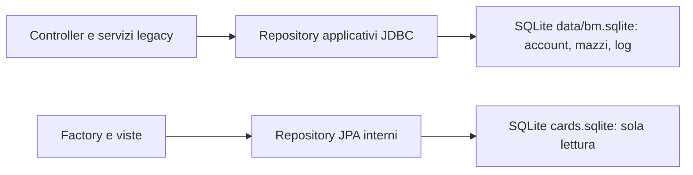
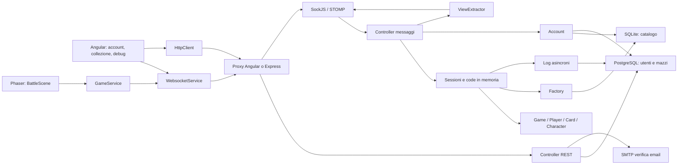

## Struttura corrente I22 — 26 ottobre 2026

`E:/bm` è un monorepo: server Spring Boot, client Angular debug, CLI Node,
strumenti e documentazione condividono un unico Git. Le due cronologie originarie
sono archiviate localmente in `.repository-history`, senza gitlink/submodule.
La conversione non cambia topologia applicativa, protocollo, regole o toolchain.
SQLite applicativo V001–V003 e journal durevole restano separati dal catalogo
read-only. Avvio di un solo processo su loopback; nessun hosting o deploy.
[Struttura e comandi](../README.md), [candidato e limiti I22](reports/i22-report.md).
Le sezioni datate sotto sono evidenze storiche.

> Aggiornamento I19b, 26 ottobre 2026: journal comune alle quattro modalità e ai cicli di vita; copia locale immutabile dei batch prima dell’append SQLite. V003 aggiunge registro attivi e finalizzazione atomica/idempotente con OUTCOME. Il recupero usa gli stessi byte senza eseguire il motore; i prefissi senza esito restano attivi, restart→draw è I24. Nessuna modifica al regolamento 1.5. [Contratto](match-archive.md), [report I19b](reports/i19b-report.md). Le sezioni datate sotto rimangono storiche.

> Aggiornamento I19a, 24 ottobre 2026: journal quick append-only in LOG003, migrazione V002, snapshot copiati ai confini del round e batch SQLite dopo il commit del motore. Export privato dei match conclusi e diagnostica dei fallimenti; nessun restore. [Contratto e limiti](match-archive.md), [report](reports/i19a-report.md). Le architetture e i risultati datati sotto rimangono storici.

> Pianificazione aggiornata il 24 ottobre 2026: [roadmap della versione base approvata](roadmap.md). I01–I11 acquisiti; prossimo I26, CLI testuale leggero per gli scenari automatici applicativi senza UX (unit e integrazioni mirate restano diretti). Elo/I25/F38 rinviato, fuori dalla base. Chiusura I22 con prove tecniche e UX e approvazione esplicita del proprietario. Nessuna nuova implementazione con questa revisione; regolamento vigente 1.3. I censimenti e i risultati datati sotto restano storici nei rispettivi ambiti.

## Architettura pianificata per la base (non implementata)

I26 aggiungerà un adattatore CLI testuale sottile sul protocollo REST/STOMP/SockJS reale e sul server autorevole, riusando runtime e librerie compatibili già disponibili. Non caricherà Angular/Phaser/browser e non duplicherà motore o regole. Input scriptabile, eventi strutturati, processi multiaccount e chiusura risorse renderanno ripetibili gli scenari non UX. Il debug resta la superficie UX. Nessun nuovo componente è presente per effetto di questo documento.

## Aggiornamento I11 - transazione del servizio partite

GameSessionServiceImpl salva uno snapshot prima del comando, ripristina il grafo su errore di risoluzione e pubblica eventi solo dopo commit. GameController legge snapshot sotto il monitor del servizio; getGame resta interno e restituisce il grafo vivo. Registro match di istanza, stati carta per applicazione. Nessuna garanzia di pubblicazione persistente o recovery di crash. [Regolamento 1.1 e limiti I11](reports/i11-report.md).

## Aggiornamento I06 - confine WebSocket autenticato

ActiveSessions gestisce claim/rilascio sincronizzati; AuthChannelInterceptorAdapter autentica CONNECT e lega SEND/SUBSCRIBE alla sessione; DestinationPolicy applica allowlist, identita e membership prima dei controller. Risposte private standard Spring `/user/queue/...` su broker `/queue`; client aggiornato. Log amministrativi riservati ad ADMIN. [Dettagli I06](reports/i06-report.md). Nessun recupero match o timeout di rientro ancora implementato.

> Aggiornamento normativo 23 ottobre 2026: il [Regolamento ufficiale 1.0](game-rules.md) prevale su questo documento per le regole di gioco. Le indicazioni precedenti «codice come riferimento provvisorio», le questioni sulle regole già risolte da R01–R07 e i risultati di test qui riportati sono storici; le richieste non implementate restano roadmap. Verifiche attuali: [conformità](rules-conformance.md).

## Architettura corrente dopo I03

PostgreSQL è stato sostituito da un SQLite applicativo su file. Il catalogo resta SQLite/JPA read-only; account, mazzi e log passano tramite gli stessi servizi a repository JDBC con statement parametrizzati e transaction manager dedicato. Dati JSON in TEXT, PK composta reale per i mazzi, schema V001 con versione/checksum. Driver PostgreSQL e hibernate-types rimossi.

Il profilo local è predefinito, loopback; email disabilitata e nessun account amministrativo creato implicitamente. Il contesto Spring è ora verificato e il JAR si avvia su HTTP; protocollo client/browser e partita restano da collaudare. [Report I03](E:/bm/docs/reports/i03-report.md). Le descrizioni dei due entity manager e PostgreSQL sotto conservano lo stato storico precedente.

# Architettura ricostruita

**Decisioni successive del proprietario:** stack/versioni liberi, PostgreSQL non obbligatorio, debug come client corrente. Il diagramma sotto descrive il legacy, non una scelta architetturale futura. Reconnect sul processo vivo richiesto, restart→draw senza restore; hosting e admin rinviati. Fonte: [decisioni del proprietario](E:/bm/docs/open-questions.md); [roadmap aggiornata](E:/bm/docs/roadmap.md).

Stato delle evidenze: **V** = codice/configurazione verificati staticamente; **D** = deduzione; **M** = non verificato. Nessun flusso è stato provato end-to-end.

## Client e distribuzione

**V:** [main.ts](E:/bm/bm-web-client/src/main.ts) avvia `AppModule` e registra il custom element IonPhaser. [AppModule](E:/bm/bm-web-client/src/app/app.module.ts:124) concentra componenti e dipendenze in un modulo unico. Route: home, `rules`, `hub`, `sign-up`, `phaser`, fallback home. Non sono configurati route guard. L'hub seleziona la schermata in base a `WebsocketService.isConnected()`; non è una barriera di autorizzazione server.

**V:** [SessionService](E:/bm/bm-web-client/src/app/service/session.service.ts:8) conserva account, utenti online, coda e indicatori di caricamento; [GameService](E:/bm/bm-web-client/src/app/service/game.service.ts:13) conserva partita, giocatore e vista e calcola bersagli/carte giocabili. Sono oggetti in memoria del browser: non risultano salvataggi localStorage/sessionStorage nei sorgenti esaminati.

**V:** [UserHubComponent.bounceJoinGameEvent](E:/bm/bm-web-client/src/app/user-hub/user-hub.component.ts:24) passa al client debug oppure alla route Phaser. [PhaserClientComponent.joinGame](E:/bm/bm-web-client/src/app/client-phaser/phaser-client.component.ts:34) espone servizi su `window`; [BattleScene](E:/bm/bm-web-client/src/app/client-phaser/scnenes/battle/battle-scene.ts:10) li recupera, carica asset, crea oggetti e converte drag/drop in mosse. Le animazioni leggono report testuali del server. È accoppiamento concreto a variabili globali, non un'interfaccia separata del motore.

**V:** sviluppo tramite Angular CLI e [proxy.config.json](E:/bm/bm-web-client/proxy.config.json); distribuzione tramite [server.js](E:/bm/bm-web-client/server.js), che serve `dist/bm-web-client` e inoltra `/rest` e `/ws` a host Heroku fissi. Non contiene fallback esplicito a `index.html` per route profonde. **D:** ricaricare direttamente `/hub` nella distribuzione Express può produrre 404. Supporto upgrade WebSocket e fallback SockJS da verificare: il proxy non dichiara `ws: true`.

## Server

| Componente | Responsabilità verificata | Fonte |
|---|---|---|
| REST users | Disponibilità credenziali, email di verifica, registrazione e validazione login | [UserSignUpController](E:/bm/bm-server/src/main/java/com/gsc/bm/api/rest/users/UserSignUpController.java:15), [UserLogInController](E:/bm/bm-server/src/main/java/com/gsc/bm/api/rest/users/UserLogInController.java:14) |
| REST panel | Conteggio, esportazione, cancellazione log e ingestione log client | [GameLogsController](E:/bm/bm-server/src/main/java/com/gsc/bm/api/rest/panel/GameLogsController.java:21), [WebClientLogsController](E:/bm/bm-server/src/main/java/com/gsc/bm/api/rest/panel/WebClientLogsController.java:20) |
| Controller STOMP | Comandi partita, code e account | [GameController](E:/bm/bm-server/src/main/java/com/gsc/bm/api/ws/GameController.java:15), [UserController](E:/bm/bm-server/src/main/java/com/gsc/bm/api/ws/UserController.java:14), [QuickGameQueuesController](E:/bm/bm-server/src/main/java/com/gsc/bm/api/ws/QuickGameQueuesController.java:17) |
| Connessioni/code | Presenza, attività degli utenti, raggruppamento giocatori | [ConnectionsServiceImpl](E:/bm/bm-server/src/main/java/com/gsc/bm/service/session/ConnectionsServiceImpl.java:18), [QueueServiceImpl](E:/bm/bm-server/src/main/java/com/gsc/bm/service/session/QueueServiceImpl.java:14) |
| Sessioni | Mappa partite, inoltro mosse al motore, callback aggiornamenti, rimozione dopo leave | [GameSessionServiceImpl](E:/bm/bm-server/src/main/java/com/gsc/bm/service/session/GameSessionServiceImpl.java:17) |
| Motore | Stato e risoluzione sincrona delle regole | [Game](E:/bm/bm-server/src/main/java/com/gsc/bm/model/game/Game.java:25), [Move](E:/bm/bm-server/src/main/java/com/gsc/bm/model/game/Move.java:20), [Character](E:/bm/bm-server/src/main/java/com/gsc/bm/model/Character.java:17) |
| Factory | Istanziazione riflessiva delle classi e caricamento descrizioni; costruzione giocatori/mazzi | [CardFactoryServiceImpl.craftCard](E:/bm/bm-server/src/main/java/com/gsc/bm/service/factories/CardFactoryServiceImpl.java:26), [PlayerFactoryServiceImpl](E:/bm/bm-server/src/main/java/com/gsc/bm/service/factories/PlayerFactoryServiceImpl.java:16) |
| Viste | Mano completa solo per il player richiesto, conteggi per altri; viste globali per log | [ViewExtractorServiceImpl.extractViewFor/extractGlobalSlimView](E:/bm/bm-server/src/main/java/com/gsc/bm/service/view/ViewExtractorServiceImpl.java:89) |
| Persistenza | Due datasource/entity manager/transaction manager e repository distinti | [InternalDbConfig](E:/bm/bm-server/src/main/java/com/gsc/bm/conf/db/InternalDbConfig.java:27), [ExternalDbConfig](E:/bm/bm-server/src/main/java/com/gsc/bm/conf/db/ExternalDbConfig.java:26) |

**V:** non è un'architettura a microservizi: un processo Spring Boot gestisce HTTP, broker semplice, motore e accesso a entrambi i database. Il processo Node serve e inoltra traffico, non esegue regole di gioco. Fonti: entry point, configurazione broker e `server.js` citati sopra.

## Stato, concorrenza e recupero

**V:** `_GAMES` è una `ConcurrentHashMap<Game, Set<String>>`; `getGame` cerca l'ID scorrendo le chiavi. I metodi del servizio sessioni sono `synchronized`, serializzando anche mosse di partite diverse. `Game` contiene liste e mappe mutabili; le viste effettuano più copie mediante serializzazione Java. [GameSessionServiceImpl](E:/bm/bm-server/src/main/java/com/gsc/bm/service/session/GameSessionServiceImpl.java:17), [ViewExtractorServiceImpl](E:/bm/bm-server/src/main/java/com/gsc/bm/service/view/ViewExtractorServiceImpl.java:27).

**V:** code, presenza, codici email e log in accumulo sono in memoria del processo. `GameLoggingServiceImpl` usa un executor singolo per salvare l'intera lista di azioni e non fornisce una funzione di ripristino. **D:** restart o più repliche non condividono partite e code; i log non costituiscono un sistema di recovery. [AuthServiceImpl](E:/bm/bm-server/src/main/java/com/gsc/bm/service/session/AuthServiceImpl.java:18), [GameLoggingServiceImpl](E:/bm/bm-server/src/main/java/com/gsc/bm/service/session/GameLoggingServiceImpl.java:22).

**V:** `leaveGame` rimuove l'utente dall'insieme degli iscritti, ma non lo elimina dai giocatori del motore né gli assegna una resa. `PresenceEventListener` gestisce disconnessione e code senza chiamare `leaveGame`. **D:** una partita può restare in attesa della mossa di un utente assente e permanere in memoria. Non risultano timeout di turno, watchdog o ricollegamento applicativo. [PresenceEventListener](E:/bm/bm-server/src/main/java/com/gsc/bm/api/ws/PresenceEventListener.java:14).

## Sicurezza ed errori

**V:** due meccanismi distinti: HTTP Basic amministrativo da configurazione e autenticazione STOMP tramite credenziali account BCrypt. La validazione REST restituisce un booleano, non un token. `getAuthTokenOrFail` assegna sempre l'autorità `USER`, mentre il ruolo mostrato nel profilo proviene dal DB. [HttpSecurityConfig](E:/bm/bm-server/src/main/java/com/gsc/bm/conf/http/HttpSecurityConfig.java:19), [AuthServiceImpl](E:/bm/bm-server/src/main/java/com/gsc/bm/service/session/AuthServiceImpl.java:18).

**V:** la configurazione STOMP autorizza `anyMessage().permitAll()`. I controller non confrontano username/playerId con il principal. Il filtro delle mani dipende quindi dall'identificativo richiesto, non dall'identità verificata. **D:** accesso a viste o modifica mazzi altrui è un rischio supportato dal percorso di codice, non una prova di intrusione eseguita. [WebSocketAuthorizationSecurityConfig](E:/bm/bm-server/src/main/java/com/gsc/bm/conf/ws/WebSocketAuthorizationSecurityConfig.java:8).

**V:** gli errori di registrazione `AuthenticationException` diventano HTTP 409; credenziali errate danno `false`; `IllegalMoveException` viene inviata a `/illegalMove`. Le altre eccezioni non hanno un gestore applicativo uniforme. Le factory stampano stack trace e ritornano null; il client STOMP non registra callback di errore/riconnessione. [CardFactoryServiceImpl](E:/bm/bm-server/src/main/java/com/gsc/bm/service/factories/CardFactoryServiceImpl.java:14), [WebsocketService.connect](E:/bm/bm-web-client/src/app/service/websocket.service.ts:32).

## Decisione tecnica I01 attuata

Mantenuti framework, motore, protocolli e librerie applicative per ottenere una baseline compilabile prima delle migrazioni. Fissata toolchain locale compatibile, invariati POM e lockfile delle dipendenze; aggiunti strumenti comuni di bootstrap/build e versioni Node/npm dichiarate nel client. Confronto con upgrade immediato e sostituzione in [i01-report.md](E:/bm/docs/reports/i01-report.md). Nessuna decisione su storage futuro o hosting, nessuna prova applicativa derivata dalla compilazione.
