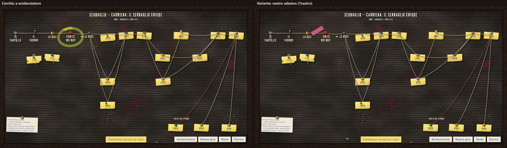
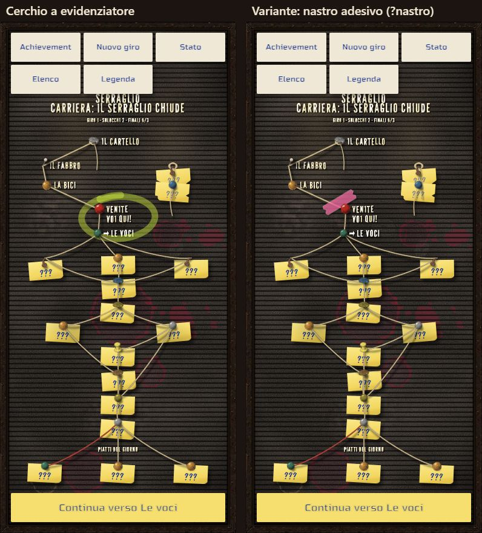

# Carriere — la bacheca a lettere

> Concetto visivo della mappa delle carriere e dell'aspetto generale del prototipo, scelto dal proprietario l'11 novembre 2026 dopo la
> [prova della Fase B](prototipo-fase-b.md#prova-del-proprietario). Senza valore normativo. Lo stato sta nella riga di CA-0a dei
> [lavori anticipati](../../product-roadmap.md#lavori-anticipati).

## L'idea del proprietario

Con le sue parole: «la lavagna del bar, però non scritta col gesso, ma una **bacheca in feltro con le fessure orizzontali, vecchia e
malandata, vintage, con le scritte di plastica bianca ingiallite dal tempo**. Ci si possono aggiungere **post-it fissati con una puntina per
quello che non torna**. Vediamo di farla funzionare graficamente e artisticamente: è più difficile della lavagna, ma è bellissima».

È la bacheca dei prezzi e del menù dei bar di una volta, appesa dietro al bancone: la mappa della carriera diventa il listino del Serraglio,
composto lettera per lettera da qualcuno che non ha mai avuto voglia di farlo bene.

## Com'è fatta davvero

Dalle ricerche dell'11 novembre 2026 (fonti in fondo):

- **Il pannello** è di feltro scuro (nero, marrone, verde scuro, a volte rosso) con **scanalature orizzontali parallele** a passo fisso;
  le lettere hanno sul retro una **linguetta** che si infila in una scanalatura. Una lettera alta occupa più scanalature, quindi **le righe di
  testo stanno solo dove ci sono le scanalature**: non si può scrivere in obliquo né fra due fessure.
- **Le lettere** sono di plastica, quasi sempre bianche sul feltro scuro, in un bastoncino condensato (Helvetica, Gothic) o più di rado in
  un romano; ci sono numeri e simboli (frecce, trattini, punti, cuori, stelle). Si staccano a fatica dalle stecche e si perdono.
- **Il vecchio e il malandato**, che è il carattere da ottenere: plastica ingiallita in modo disuguale, lettere un po' storte o infilate
  a metà, una lettera che manca e viene sostituita da un'altra («ö» al posto di «o», un «8» al posto di una «B»), spaziature sbagliate, feltro
  impolverato e spelacchiato, cornice di legno o d'alluminio graffiata, qualche lettera caduta sul fondo della cornice.
- **Dal 2018 circa sono tornate di moda** come oggetto d'arredo: per questo la versione vecchia e trascurata del bar si distingue subito da
  quella pulita e d'arredamento, che è il contrario di ciò che vogliamo.

## Come funziona come mappa

La bacheca non può disegnare linee oblique, quindi la struttura a rombi va **composta come un listino**:

- **Ogni nodo è una riga di lettere** con il suo titolo («IL BANCONE VUOTO»), allineata alle scanalature. Le colonne di profondità diventano
  sezioni del listino, una accanto all'altra o una sotto l'altra, secondo l'orientamento.
- **I collegamenti fra i nodi sono spilli e cordicelle** (proprietario, 11 novembre 2026: «si possono fare inserendo degli spilli e
  legando fra loro delle cordicelle»): uno spillo piantato nel feltro accanto a ogni riga, una cordicella tesa da spillo a spillo. Le
  cordicelle vanno anche in obliquo, quindi il rombo si vede davvero, mentre le lettere restano nelle scanalature. Lo stato del
  collegamento sta nella cordicella: tesa per un percorso fatto, allentata o arrotolata intorno allo spillo per uno ancora da fare,
  assente se porta a un segreto non trovato. Frecce e trattini di plastica restano possibili dentro le righe.
- **Gli stati dei nodi** diventano stati delle lettere:
  - **corrente:** una puntina colorata o una freccia di plastica accanto alla riga;
  - **disponibile:** lettere dritte e bianche, con la freccia che indica dove andare;
  - **fatto in questo giro:** lettere ingiallite normali;
  - **esplorato in un giro passato:** lettere più ingiallite o un po' storte;
  - **escluso in questo giro:** lettere storte, una caduta in fondo alla cornice;
  - **mai visto («???»):** un **post-it** fissato con una puntina sopra lo spazio della riga, con «???» scritto a penna; è il «quello che non
    torna» del proprietario. Dalla Fase K solo sui nodi più lontani: un nodo affrontabile subito mostra il nome anche se non lo si è mai
    visto, e il suo post-it si stacca quando diventa affrontabile;
  - **segreto mai trovato:** niente, nemmeno il post-it;
  - **finali:** in fondo al listino, come i «piatti del giorno».
- **Le scritte che non sono nodi** (titolo della carriera, giro, sblocchi) stanno in alto come l'intestazione del listino: «SERRAGLIO —
  CARRIERA: DOV'È GRAPPINO? — GIRO 2».

## L'aspetto generale

Lo stesso linguaggio vale per il resto del prototipo, perché il proprietario ha trovato scarno anche il «feel generale»: pulsanti come
strisce di lettere di plastica o post-it, pannelli come cartoncini appesi con la puntina, l'elenco delle carriere come le prime righe della
bacheca. La scena di dialogo resta com'è, con il suo nuovo carattere tipografico.

## Come si realizza

Tre pezzi, da provare prima con un **bozzetto statico** (una schermata della mappa a metà giro, nei due orientamenti) e solo dopo il giudizio
del proprietario su tutta la mappa:

1. **Il pannello di feltro con le scanalature, disegnato dal codice:** il passo delle scanalature deve essere esatto, perché le lettere ci
   si appoggiano sopra, e un'immagine generata non lo garantisce. Il feltro si fa con una texture di rumore (filtro SVG `feTurbulence` o una
   piccola texture generata, ripetuta) e le scanalature con un gradiente ripetuto, con ombre e luci sottili. Polvere, aloni e zone spelacchiate
   come strato sopra.
2. **Le lettere di plastica, disegnate dal codice** con un font: ogni lettera un elemento a sé, con piccole variazioni casuali ma stabili
   (rotazione di pochi decimi di grado, mezzo pixel su o giù, ingiallimento diverso), un'ombra netta in basso a destra per lo spessore e
   una luce sul bordo alto. Font candidato: **League Gothic**, revival libero (SIL OFL) dell'Alternate Gothic del 1903, il bastoncino
   condensato delle bacheche; in alternativa **Oswald** (OFL). I font «da bacheca» veri (Letterboard, Feltboard JNL, Daily Special) hanno
   licenze commerciali e restano esclusi.
3. **Le parti illustrate, generate o disegnate:** la cornice vecchia e graffiata, il post-it, la puntina, qualche lettera caduta. Se servono
   immagini, un piccolo giro di prompt con lo stesso processo degli altri asset (D11 del piano C4), nello stile del gioco.

**Dopo il primo bozzetto** (proprietario, 11 novembre 2026): lettere con «un certo senso di rotondità plasticosa»; puntine da bacheca di
sughero, «anche diverse fra loro: è un bar marcio, usano quello che trovano»; bacheca «un po' sporca, con vecchie macchie di vino in alcuni
punti o altro».

**Regole per non perdere il carattere:** imperfezioni decise dai dati e ripetibili (lo stesso nodo ha sempre la stessa «e» storta), mai
casuali a ogni apertura; leggibilità prima di tutto, soprattutto sul telefono; niente marchi o loghi; niente scritte generate dentro le
immagini.

## Fonti

- [Make way, chalkboards, for old-school felt letter boards](https://www.pressreader.com/usa/chattanooga-times-free-press/20181021/282716227974966),
  Chattanooga Times Free Press, 2018: il ritorno di moda, le scanalature, le lettere a innesto.
- [Davson Quartet letter board letters](https://www.alphabetsigns.com/signs/davson-quartet-letter-board-letters.html), Alphabet Signs: i
  produttori storici e gli stili delle lettere (Helvetica, Roman, Gothic).
- [Loose-letter sign, US1452074A](https://patents.google.com/patent/US1452074), Google Patents: le insegne a lettere sciolte nelle scanalature.
- [Ghent 1/2" Gothic letters, white plastic](https://www.mybinding.com/ghent-gothic-font-letters-numbers-symbols-white-plastic.html?sku=LG12):
  lettere, numeri e simboli in commercio.
- [League Gothic](https://www.fontsquirrel.com/fonts/league-gothic), Font Squirrel: licenza SIL OFL 1.1, revival dell'Alternate Gothic.
- [Letterboard (Sunday Creative Co.)](https://myfonts.com/collections/letterboard-font-sunday-creative-co),
  [Feltboard JNL](https://www.myfonts.com/fonts/jnlevine/feltboard), [Daily Special (DJR)](https://djr.com/daily-special): font da
  bacheca con licenza commerciale, esclusi.
- [Tile-style letters with CSS](https://tympanus.net/codrops/2012/09/12/creative-web-typography-styles/comment-page-2/), Codrops, e
  [embossed text with text-shadow](https://www.sitepoint.com/using-css-text-shadow-to-create-embossed-text): una lettera per elemento,
  ombre multiple per lo spessore.

## Il movimento

Scelto dal proprietario il 12 novembre 2026 (Fase G del [prototipo](prototipo.md#fase-g-la-bacheca-si-muove)): fili che oscillano piano,
una lettera allentata che tremola, cade e si rimette a posto trascinandola, la puntina «sei qui» che viaggia da un nodo all'altro, il post-it
che si stacca quando si scopre un nodo. Poco e mai mentre si legge o si sceglie: «non troppo, se no disturba».

**Fase I** del [prototipo](prototipo.md#fase-i-piera-lenta-teste-più-ferme-nodi-strappati): il nodo che si chiude in un giro si strappa o
si accartoccia, e torna intero al giro nuovo.

**Fase J:** il nodo chiuso è sempre strappato, in più punti, con la scritta grigia; l'accartocciato si toglie.

**Fase K:** i nodi affrontabili mostrano il nome già prima di esserci stati; il post-it «???» resta solo sui nodi più lontani e si stacca
quando il nodo diventa affrontabile. Quando una puntina si toglie, il filo che vi era legato non resta sospeso.

**Dove sei, a colpo d'occhio.** Il proprietario, 14 novembre 2026, provando il mockup della
[campagna principale](mockup-principale.md): «non si capisce bene dove siamo nella mappa a colpo d'occhio. Si potrebbe anche cerchiare il
nodo dove siamo, tipo cerchio fatto come se fosse un evidenziatore, o trovare qualche altro modo carino per metterlo in risalto». Prima lo
diceva solo la puntina rossa «sei qui», che su una bacheca di venti nodi si perde. Nel prototipo sono state provate due versioni, per
tutte le carriere (tutorial, prova, principale). **Scelto il cerchio** dal proprietario, 14 novembre 2026: «teniamo il cerchio». Il
nastro, variante di confronto, si toglie.

- **Il cerchio a evidenziatore** (normale): un tratto largo, giallo-verde fluo e un po' trasparente, che gira attorno al nodo della
  puntina (titolo e puntina insieme) un po' più di un giro, allargandosi: si chiude male, e dove ripassa sull'inizio il colore si carica,
  come un evidenziatore vero. È storto in modo diverso per ogni nodo, deciso dai dati. Si traccia in 0,4 s come un gesto di mano quando la
  puntina «sei qui» arriva (finito il suo viaggio, o subito se non viaggia); con il movimento ridotto è già disegnato, fermo. Sta sotto le
  cordicelle e le puntine, e non passa sulle lettere.
- **Il nastro adesivo** (variante, `?nastro`): un pezzo di nastro rosa, semitrasparente, con i lati corti strappati, attaccato di sbieco
  sull'angolo in alto a sinistra del nodo, che si attacca con un piccolo colpo. L'ho preferito al nodo che si alza con la bacheca in
  penombra perché è un oggetto della bacheca come le puntine e i post-it, e perché una penombra su tutta la bacheca andrebbe ridipinta a
  ogni oscillazione delle cordicelle. Si nota meno del cerchio: tiene il nodo, non lo indica.

Registrazione: [`r-puntina-e-cerchio.webm`](../../../prototipi/carriere/catture/r-puntina-e-cerchio.webm) (4 s, 960×540), la puntina
che arriva e il cerchio che si traccia. Le catture le rifà `strumenti/catture-risalto.mjs`, che fa anche da prova di bordo: il risalto
sta sul nodo della puntina, nei due modi e con il movimento ridotto, già tutto disegnato.

**Banco della fluidità** sulle bacheche della prova e della principale, prima e dopo, nei due orientamenti e con la CPU 4× più lenta:
zero difetti visibili prima e dopo, e il risalto non fa tornare i fotogrammi lunghi (il cerchio si anima una volta sola, 0,4 s, poi è
fermo).

| Giro | Fotogrammi lunghi prima → dopo | p95 (ms) prima → dopo |
|---|---|---|
| bacheca-o-1x | 14 → 12 | 34 → 33 |
| bacheca-o-4x | 32 → 15 | 50 → 33 |
| bacheca-v-1x | 7 → 6 | 33 → 17 |
| bacheca-v-4x | 18 → 13 | 17 → 17 |
| bacheca-principale-o-1x | 30 → 10 | 50 → 34 |
| bacheca-principale-o-4x | 24 → 16 | 50 → 34 |
| bacheca-principale-v-1x | 9 → 4 | 33 → 17 |
| bacheca-principale-v-4x | 12 → 13 | 33 → 17 |

Le differenze sono nel rumore della macchina (il «dopo» è venuto più calmo del «prima»).

**Prove:** il cerchio gira attorno al riquadro del nodo senza tagliarlo, fa più di un giro e ripassa più largo, è diverso da nodo a nodo e
sempre uguale per lo stesso; il risalto comincia all'arrivo della puntina; il nastro sta sull'angolo, di sbieco. Sette mutazioni, tutte
prese (una all'inizio sfuggiva, il cerchio che ripassa senza allargarsi: rafforzata la prova).
