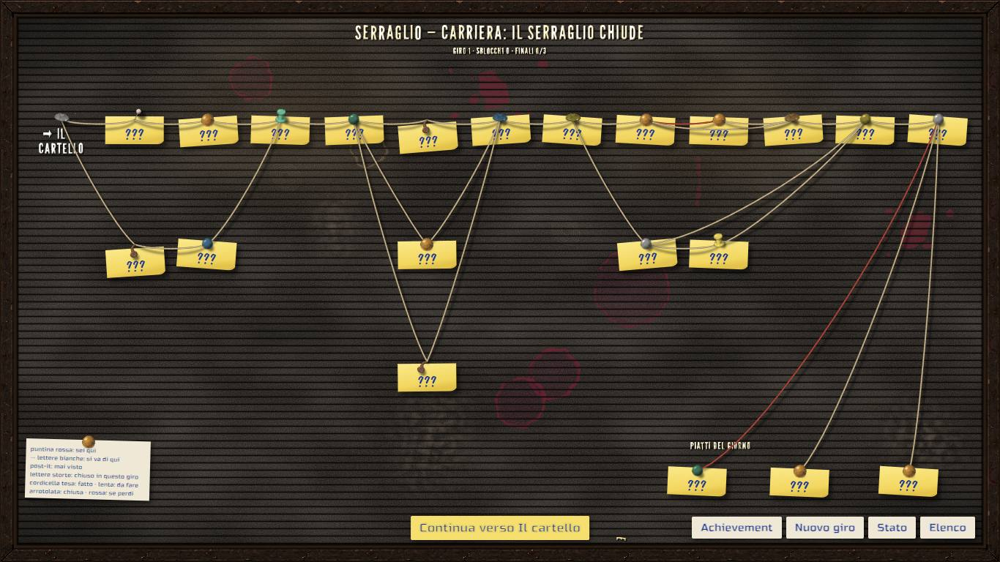
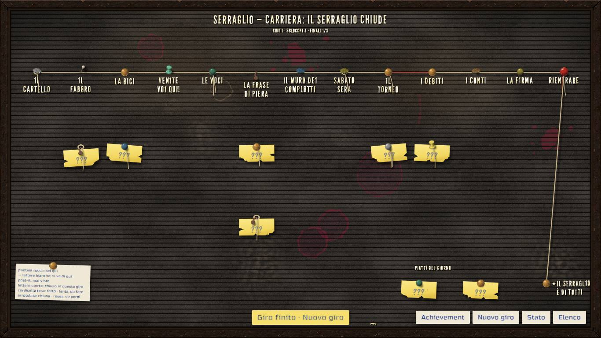
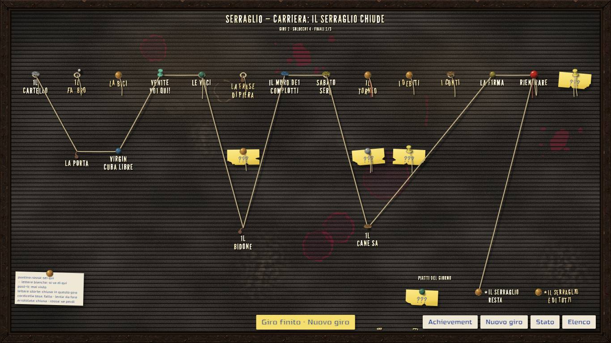
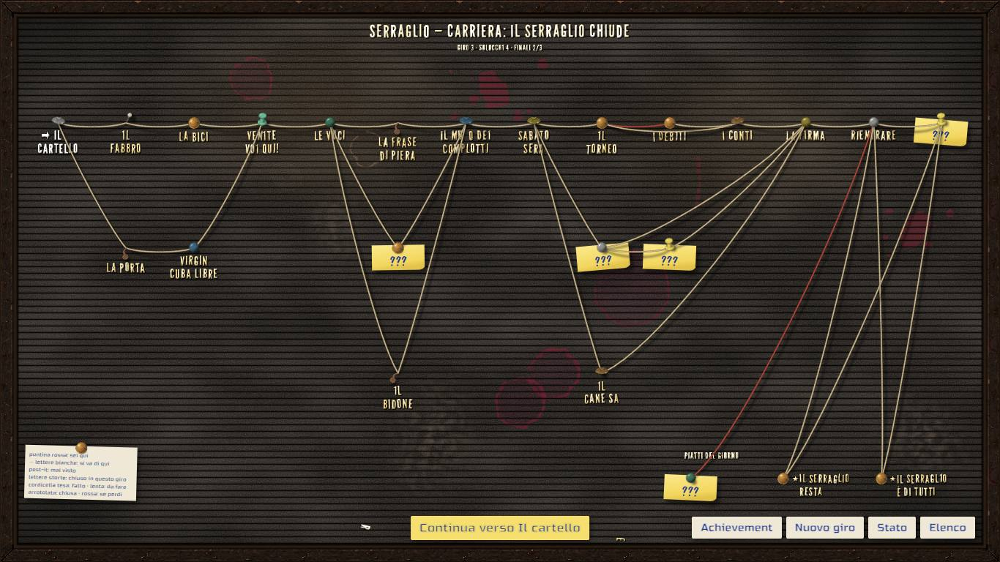
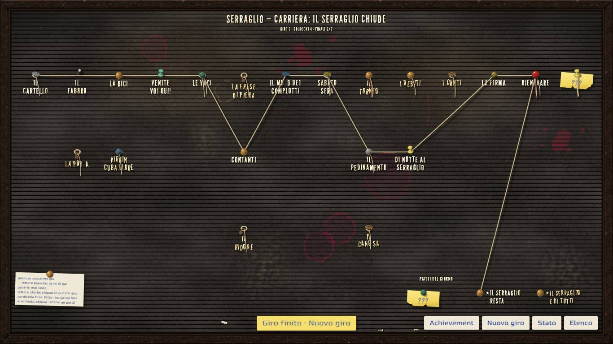
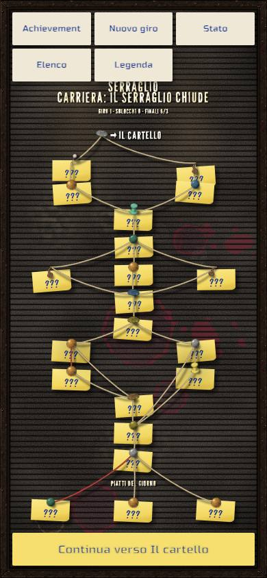
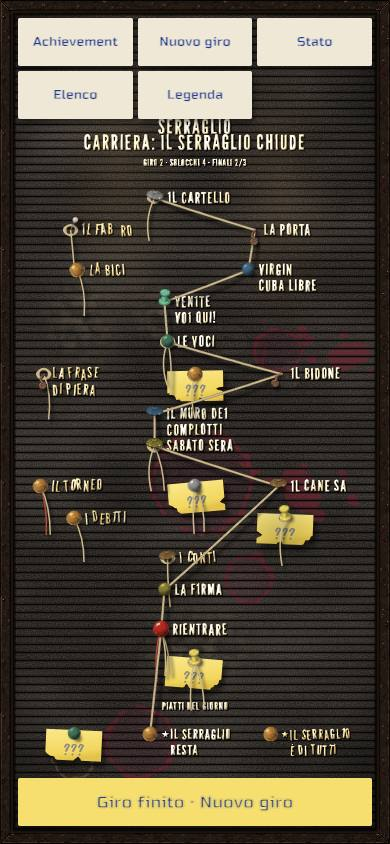

# Carriere — mockup del grafo della campagna principale

> Rapporto dell'esecutore, scritto il 14 novembre 2026, sul mockup del grafo della [carriera principale](principale.md), versione 0.2,
> nel [prototipo](prototipo.md#chiusura) che resta nel repository per provare le storie nuove. **Contiene solo proposte:** la scaletta non è
> stata toccata, e le scelte di storia restano della regia e del proprietario. Lo stato sta nella riga «Storia della campagna principale»
> dei [lavori anticipati](../../product-roadmap.md#lavori-anticipati). Senza valore normativo.

## In breve

- **La scaletta 0.2 si gioca da cima a fondo** nel prototipo, sulla bacheca, con le partite simulate:
  [`storie/principale.md`](../../../prototipi/carriere/storie/principale.md), registrata accanto al tutorial e alla prova. Tutti i 21 nodi,
  le partite con chi gioca e contro chi, le sette scelte con i loro segni, i fili, i tre finali, i due segreti e gli otto achievement.
  Le battute sono segnaposto, una o due per scena, dalla colonna «Scena».
- **Il controllo del grafo è verde:** 21 nodi su 21 raggiunti; gli starter di Celestina, Piera e Beppe e lo sblocco del PvP su ogni percorso;
  i tre finali raggiungibili; S1 da III1, S2 da III5; tutti gli achievement possibili.
- **I numeri per giro tornano con la scaletta:** da 11 a 13 nodi con partita, 14 con la rivincita S2. **Il PvP arriva sempre con la quarta
  partita**, cioè al più tardi al 36% del giro: prima di metà su ogni percorso.
- **Dove si aggroviglia:** sulla firma (III4), dove arrivano quattro strade; sul ramo del torneo, che allunga tutta la mappa di due colonne;
  e dopo III5, dove partono tre finali e la rivincita.
- **Il formato ha retto con tre estensioni minime,** tutte provate: segni e sblocchi con una condizione, i segni con il trattino nelle
  condizioni, un segreto che compare quando la sua condizione vale. In più due correzioni: un nodo che chiude il file con una scelta, e il
  controllo del grafo che con 21 partite superava il tetto degli stati.
- **Per arrivare a 15–20 incontri per giro** servono da 4 a 7 nodi in più su ogni strada; la proposta è sotto, insieme a quello che la
  bacheca regge ancora.

## Come si vede

`./prototipi/carriere/run.ps1 -Task Dev`, poi «Il Serraglio chiude» nell'elenco. Le catture si rifanno con
`node strumenti/catture-principale.mjs` (dopo `Build`; `BM_REGISTRA=si` registra anche la bacheca lungo un giro), i numeri con
`node --experimental-strip-types strumenti/percorsi.ts --elenco`, il controllo con `run.ps1 -Task Check`.

## Come si legge la mappa

La bacheca mette **ogni nodo nella colonna della sua strada più lunga dall'inizio**, e i rami uno sotto l'altro. Per la principale vuol
dire quattordici colonne, contro le quattro o sei del tutorial e della prova:

| Colonne | Atto | Nodi |
|---|---|---|
| 1–4 | I | I1; I2a o I2b; I3a o I3b; I4 |
| 5–7 | II | II1; II2a, II2b o II2c; II3 |
| 8–13 | III | III1; III2a, III2b o S1; III3c o III3b; III3a; III4; III5 |
| 14 | dopo | S2 |

Si legge da sinistra a destra come la scaletta: la **fila in alto** è la strada principale (Mara, Piera, il torneo vinto), le **file
sotto** sono le alternative (Spazienzio nell'atto I, Beppe e Celestina nell'atto II, il pedinamento e il segreto nell'atto III). Le tre
riunioni (I4, II3, III4) sono i punti in cui le cordicelle tornano tutte sulla fila in alto: i rombi si vedono bene negli atti I e II.

**Dove si aggroviglia:**

1. **La firma (III4).** Ci arrivano quattro strade: i conti (III3a), la notte al Serraglio (III3b), il pedinamento senza chiave (III2b) e
   il segreto (S1). Le loro cordicelle partono da tre file diverse e si stringono sulla stessa puntina: è il punto più fitto della bacheca.
2. **Il ramo del torneo.** III2a → III3c → III3a sono tre colonne in fila, mentre il pedinamento e il segreto ne usano una o due: la firma
   finisce nella colonna 12, e le strade corte dell'atto III hanno cordicelle lunghe e oblique che attraversano mezza bacheca. In più la
   cordicella diretta del torneo vinto (III2a → III3a) passa dietro la puntina dei debiti, sulla stessa fila: a colpo d'occhio sembra che
   si passi sempre dai debiti.
3. **Dopo III5.** Tre cordicelle scendono ai «piatti del giorno» e una va a destra verso S2: il finale F3 (dimmi-di-si-2, a sinistra) è
   lontano da III5, e la sua cordicella rossa (si arriva perdendo) attraversa la bacheca in diagonale.
4. **I fili non si vedono sulla bacheca,** ed è giusto: chiave, frase, Celestina, bilancio e Duccio sono segni e varianti di battuta. La
   bacheca mostra solo i due archi condizionati (la notte con la chiave, Grappino con il bilancio). Il groviglio narrativo resta nelle
   scene, non sulla mappa.

Nei giri dopo il primo la bacheca racconta bene la strada fatta: tesa e con i nomi la strada di questo giro, strappati i nodi chiusi, con
i nomi i nodi già visti negli altri giri.

| Giro | Che cosa mostra |
|---|---|
| (a) Mara → Piera → il torneo perso | la fila in alto quasi tutta tesa, il ramo dei debiti, F2 |
| (b) Spazienzio → Celestina → dietro a Grappino | le file sotto negli atti I e II, il segreto S1 che compare in III1, F1 |
| (c) con la chiave, la notte al Serraglio | all'inizio la rivincita S2 già sulla bacheca (dopo F1); poi il pedinamento e la notte |

**Sul telefono** (390×844) la mappa intera ci sta, ma è al limite: quattordici file, il passo delle scanalature a 8 px (contro 11–16 per
le carriere del prototipo), i post-it dei rami che si toccano. Si legge la forma, meno i nomi.

Registrazione: [`p-giro-bacheca.webm`](../../../prototipi/carriere/catture/p-giro-bacheca.webm) (26 s, 960×540), la bacheca a ogni
ritorno lungo il giro b: la «sei qui» che viaggia, i post-it dei nodi affrontabili che si staccano, i nodi che si chiudono e si strappano,
il segreto che compare.

## I numeri per giro

Contati da `strumenti/percorsi.ts`, che gioca con il motore ogni percorso di un giro (le scelte tutte, le partite vinte, e perse dove una
sconfitta apre un ramo). Un percorso è una sequenza di nodi con il suo finale.

| Strada nell'atto III | Nodi con partita nel giro | Finali |
|---|---|---|
| Torneo vinto (III2a → III3a) | 12 | F2, F3 |
| Torneo perso (III2a → III3c → III3a) | 13 | F2, F3 |
| Pedinamento con la chiave (III2b → III3b) | 12 | F1, F3 |
| Pedinamento senza chiave (III2b → III4) | 11 | F1, F3 |
| Dietro a Grappino (S1) | 11 | F1, F3 |
| Una qualsiasi, dopo F1, con la rivincita S2 | +1 (fino a 14) | F1 o F2 |

- **Primo giro:** 40 percorsi, da 11 a 13 nodi con partita. Gli atti I e II sono sempre 4 + 3 nodi; tutta la varietà di lunghezza sta
  nell'atto III (da 4 a 6).
- **Dopo F1:** 60 percorsi, fino a 14 con la rivincita.
- **PvP:** sempre con la quarta partita (I4), quindi fra il 31% (giro da 13) e il 36% (giro da 11) delle partite del giro.
- **Starter:** su ogni percorso Celestina in I4; Piera e Beppe in II2a o II2b, poi l'altro in II3, oppure (pista di Celestina) Piera in
  II3 e Beppe in III1. Le prove giocano le tre piste e controllano chi gioca II3 e III1.
- **Controllo del grafo:** 1041 stati esplorati, 516 fini distinte; nessun errore, nessun avviso.
- **La chiave:** la notte al Serraglio (III3b) si apre solo a chi è passato da I2a o dalla pista di Beppe: quattro delle sei combinazioni
  di via e pista danno la chiave (la via di Mara sempre, quella di Spazienzio solo con la pista di Beppe). Chi va con Spazienzio e poi con
  Piera o con Celestina non vede mai la notte al Serraglio, e nemmeno l'achievement «Lo diceva Celestina» in quel giro.

## Dove la scaletta e il formato non combaciano

| Nella scaletta | Nel formato | Che cosa ha fatto il mockup | Proposta |
|---|---|---|---|
| «Gioca: a scelta» (II1, III1 se non manca nessuno, III3a) | La partita ha un giocatore fisso o scritto in un segno | Una scelta muta senza destinazione prima della partita, che scrive il segno | Nel client «a scelta» è il selettore del personaggio prima della partita, non una scelta di storia: va detto nel formato (`→ Partita: a scelta fra …`) |
| «L'alleato con cui hai più segni» (III4, III5) | Non si contano i segni per personaggio | Il segno `alleato`, dalla via dell'atto III: Beppe per il torneo, Mara per il pedinamento, Celestina per Grappino | Scegliere una regola scrivibile: «chi ti ha accompagnato nell'atto III» (come nel mockup) o un conteggio nel formato |
| Starter garantiti in II3 e III1 | Uno sblocco era sempre incondizionato | **Estensione:** `[Se …] [Sblocca: …]` e `[Se …] [Segno: …]` | Tenerla in CA-0: è la stessa logica delle battute con condizione |
| I segni `via-atto-1`, `via-atto-3` | Le condizioni leggevano solo segni senza trattino | **Estensione:** il trattino nei nomi dei segni | — |
| Il finale dipende dalla strada (F1 dopo pedinamento o segreto, F2 dopo il torneo) | Un nodo ha una sola uscita | III5 vinto finisce con una scelta muta con una sola opzione visibile per strada (più la rivincita dopo F1): il giocatore vede un pulsante | Uscite condizionate nel formato (`→ Fine se …`), così il finale arriva senza un pulsante inutile |
| S2 «compare dopo F1, in un giro nuovo, sulla bacheca» | Un segreto si vedeva solo quando ci si arriva | **Estensione:** un segreto con una condizione (`[Nodo: segreto; se finale …]`) si vede sulla bacheca quando la condizione vale | — |
| Un nodo che chiude il file con una scelta (S2) | Errore «il nodo non ha uscita» | **Correzione** del convertitore | — |
| 21 partite in un giro | Il controllo del grafo superava il tetto di 200 000 stati | **Correzione:** nella chiave dello stato solo i segni e i nodi che qualche condizione legge (1041 stati invece di oltre 200 000; il tutorial passa da 72 a 12 stati e la prova da 28 a 15, con gli stessi esiti) | — |
| «Celestina lo dice solo a chi le ha dato retta» | Nessun punto della scaletta dice chi le dà retta | La variante in III3b con il segno `pista = celestina` | Un momento in I1 in cui le si dà retta (una scelta o una battuta di ritento), oppure accettare la pista di Celestina come «darle retta» |
| «Ve l'avevo detto»: «Mara accusa tutti, nessuno escluso» | Non c'è un nodo dove succede | Achievement quando si sono esplorati II2a, II2b, II2c e S1 (Piera, Beppe, Celestina e il cane) | Decidere dove Mara accusa chi: una variante di battuta per accusa, e l'achievement sull'ultima |
| «Difendi la frase di Piera in II2a» | La partita si vince sempre prima di andare avanti | Il segno `frase` arriva vincendo II2a: chi fa la pista di Piera la difende sempre | Se «difendere» deve poter fallire, serve una sfida (vincere entro N round) o una sconfitta che apre un ramo |
| S1: «si gioca contro Piera», chi gioca non è detto | — | Gioca l'alleato (Celestina, dalla pista del bidone) | Dirlo nella scaletta |
| «Dietro a Grappino» | Una scelta muta è «con <personaggio>» | Grappino aggiunto al cast con un cartoncino segnaposto; l'opzione è «con Grappino, dietro a lui in cantina» | — |
| Il PvP | Il formato non sa che cos'è | Uno sblocco `pvp` in I4, obbligatorio su ogni percorso | Tenerlo come sblocco nel formato di CA-0: così il controllo verifica anche dove arriva |
| Il cast: Celestina, Beppe, Sergio, Duccio senza ritratti di scena; il padrone senza nome | — | Cartoncini segnaposto con il primo piano degli identikit approvati (`segnaposto/`, fatti dal codice: non sono immagini generate), una sola espressione «neutra»; il padrone è una figura in ombra | Le espressioni per personaggio vanno decise con i dialoghi |
| Il Dimmi Di Sì dentro, la cantina, il bar di notte | Sfondi che non ci sono | S3 (l'esterno del Dimmi Di Sì) anche dentro; S2 in disordine per la cantina e il bar di notte; S1 con l'insegna spenta per la strada di notte | Sono già nei prossimi passi della scaletta |

## Dove allungare per arrivare a 15–20 incontri per giro

Oggi ogni giro ha da 11 a 13 nodi con partita; per stare fra 15 e 20 servono da 4 a 7 nodi in più su ogni strada. Gli atti I e II hanno
sempre la stessa lunghezza, l'atto III da 4 a 6: conviene allungare dove la storia ha più da dire e dove le strade sono più corte.

| Dove | Oggi | Proposta | Nodi in più per giro |
|---|---|---|---|
| Le piste dell'atto II | un nodo ciascuna (II2a, II2b, II2c) | due nodi per pista: la pista e il suo indizio, dove nascono i fili (la frase, la chiave, il bilancio) e dove Mara accusa qualcuno | +1 |
| Le vie dell'atto I | due nodi per via (I2, I3) | un terzo nodo per via prima della riunione: Mara e Beppe in giro per la «Apri e Chiudi s.r.l.»; Spazienzio e Duccio alla seconda porta | +1 |
| Fra II3 e III1 | niente | una scena in cui Sergio è accusato a torto davanti a tutti (il depistaggio dell'atto II, oggi tutto in II3) | +1 |
| Il pedinamento senza chiave e il segreto | 4 nodi nell'atto III, i più corti | un nodo in più ciascuno: sotto casa di Sergio; in cantina, chi è «S. Sommerso» | +1 su queste strade (pareggia il torneo) |
| Prima della firma | niente | «Domenica mattina»: il bar che si prepara alla firma, una FFA con tutti | +1 |

Con tutte queste un giro va da 15 a 17 nodi con partita, più i ritenti. **La bacheca, però, è già al limite:** ogni nodo in più lungo la
strada è una colonna in più, e oltre le 14 di oggi i titoli non ci stanno più in orizzontale e sul telefono le file si sovrappongono.
Per la carriera vera servirà una bacheca per atto (tre bacheche, o una che scorre), da decidere in CA-0 prima di allungare.

## Verifiche

| Comando | Esito |
|---|---|
| Prima di cominciare: `run.ps1 -Task Test`, `-Task Check`, `-Task Build` | verdi |
| `run.ps1 -Task Test` | verdi: 111. Nuove (`tests/principale.test.ts`): la conversione senza errori né avvisi, il controllo del grafo, i numeri per giro e il PvP, i fili (chiave, bilancio, debiti, finali per strada), gli starter garantiti sulle tre piste, S1 e S2 sulla bacheca, le estensioni, la correzione del convertitore, la chiave ridotta del controllo, i segnaposto |
| `run.ps1 -Task Check` | verde: tutorial e prova invariati negli esiti; principale 21/21 nodi, 0 errori, 0 avvisi |
| `run.ps1 -Task Build` | verde |
| `strumenti/percorsi.ts` | i numeri sopra |
| Catture (`strumenti/catture-principale.mjs`) | verdi, giocando dall'interfaccia, con i controlli di bordo (S1 e S2 nascosti all'inizio, il torneo perso, il segreto, S2 dopo F1, la notte con la chiave, nessun errore nella pagina) |
| Catture del prototipo (`strumenti/catture.mjs`) | verdi; la bacheca del tutorial e della prova non cambia con la disposizione nuova (le differenze sono le animazioni e il «Continua verso» della Fase K), quindi le loro catture non sono rifatte |
| Banco della fluidità | sotto: zero difetti visibili prima e dopo; la bacheca della principale, misurata solo dopo, anche |
| Mutazioni | 17 sulle estensioni, sulla chiave ridotta del controllo, sul conteggio dei percorsi e su tre fili della storia (la chiave in II2b, lo starter di Beppe in III1, il bilancio per Grappino): tutte prese; una all'inizio sfuggiva (la chiave del controllo senza «perso»): rafforzata la prova |
| `python scripts/check-links.py`, `python scripts/check-rules.py`, `git diff --check` | verdi, pulito |

**Banco della fluidità**, nei due orientamenti e con la CPU normale e quattro volte più lenta. Prima: sul codice di partenza; per la
bacheca della prova il banco si è fermato due volte su un tempo scaduto al secondo giro (con la CPU 4×), quindi per quei tre giri il prima
è il dopo della [Fase K](prototipo-fase-k.md#prima-e-dopo), che ha lo stesso codice del prototipo.

| Giro | Fotogrammi lunghi prima → dopo | p95 (ms) prima → dopo | Vuoti, lampeggi, salti, veli, bocche |
|---|---|---|---|
| scena-prova-o-1x | 11 → 9 | 17 → 17 | 0 → 0 |
| scena-prova-o-4x | 26 → 14 | 34 → 17 | 0 → 0 |
| scena-prova-v-1x | 9 → 7 | 17 → 17 | 0 → 0 |
| scena-prova-v-4x | 32 → 14 | 34 → 17 | 0 → 0 |
| bacheca-o-1x | 26 → 16 | 50 → 34 | 0 → 0 |
| bacheca-o-4x | 20 (Fase K) → 14 | 34 → 33 | 0 → 0 |
| bacheca-v-1x | 10 (Fase K) → 10 | 17 → 17 | 0 → 0 |
| bacheca-v-4x | 16 (Fase K) → 18 | 17 → 33 | 0 → 0 |
| bacheca-principale-o-1x | — → 32 | — → 50 | — → 0 |
| bacheca-principale-o-4x | — → 53 | — → 50 | — → 0 |
| bacheca-principale-v-1x | — → 6 | — → 33 | — → 0 |
| bacheca-principale-v-4x | — → 14 | — → 17 | — → 0 |

Zero difetti visibili ovunque. La bacheca della principale in orizzontale ha il doppio dei fotogrammi lunghi di quella della prova (32 e
53 contro 16 e 14): già al primo giro 22 puntine e 27 cordicelle (la prova ne ha meno della metà), ridisegnate a ogni apertura e oscillanti. Non si vede come scatto, ma è il
segnale che una bacheca di quaranta nodi andrà alleggerita (cordicelle ferme fuori dallo schermo, o una bacheca per atto, sopra).

## Non verificato e limiti

- **Telefono vero:** come per tutto il prototipo, Edge sul portatile.
- **Le scene:** le battute sono segnaposto, una o due per nodo; non dicono niente del ritmo delle scene vere.
- **I ritratti segnaposto** sono cartoncini fermi, con il movimento procedurale e senza bocca: non dicono niente di come staranno i
  personaggi in scena.
- **La rivincita S2** è aperta su ogni strada dopo F1 (anche dopo il torneo, finendo poi con F2): la scaletta dice «dopo III5», senza
  dire su quali strade.

## Domande per la regia e il proprietario

1. Le tre estensioni del formato (segni e sblocchi con condizione, segreti con condizione, trattino nei segni) e le uscite condizionate
   proposte sopra: passano a CA-0?
2. «L'alleato con cui hai più segni»: la regola del mockup (chi ti accompagna nell'atto III) va bene, o serve un conteggio?
3. Dove allungare: le proposte sopra, e una bacheca per atto per reggere più colonne.
