# Carriere — mockup del grafo della campagna principale

> Rapporto dell'esecutore, scritto il 14 novembre 2026, sul mockup del grafo della [carriera principale](principale.md), versione 0.2,
> nel [prototipo](prototipo.md#chiusura) che resta nel repository per provare le storie nuove. **Contiene solo proposte:** la scaletta non è
> stata toccata, e le scelte di storia restano della regia e del proprietario. Lo stato sta nella riga «Storia della campagna principale»
> dei [lavori anticipati](../../product-roadmap.md#lavori-anticipati). Senza valore normativo.

## In breve

- **La scaletta 0.2 si gioca da cima a fondo** nel prototipo, sulla bacheca, con le partite simulate:
  [`storie/principale.md`](../../../prototipi/carriere/storie/principale.md), registrata accanto al tutorial e alla prova. Tutti i 21 nodi,
  le partite con chi gioca e contro chi, le sette scelte con i loro segni, i fili, i tre finali, i due segreti e gli otto achievement.
  Le battute sono segnaposto, una o due per scena, dalla colonna «Scena».
- **Il controllo del grafo è verde:** 21 nodi su 21 raggiunti; gli starter di Celestina, Piera e Beppe e lo sblocco del PvP su ogni percorso;
  i tre finali raggiungibili; S1 da III1, S2 da III5; tutti gli achievement possibili.
- **I numeri per giro tornano con la scaletta:** da 11 a 13 nodi con partita, 14 con la rivincita S2. **Il PvP arriva sempre con la quarta
  partita**, cioè al più tardi al 36% del giro: prima di metà su ogni percorso.
- **Dove si aggroviglia:** sulla firma (III4), dove arrivano quattro strade; sul ramo del torneo, che allunga tutta la mappa di due colonne;
  e dopo III5, dove partono tre finali e la rivincita.
- **Il formato ha retto con tre estensioni minime,** tutte provate: segni e sblocchi con una condizione, i segni con il trattino nelle
  condizioni, un segreto che compare quando la sua condizione vale. In più due correzioni: un nodo che chiude il file con una scelta, e il
  controllo del grafo che con 21 partite superava il tetto degli stati.
- **Per arrivare a 15–20 incontri per giro** servono da 4 a 7 nodi in più su ogni strada; la proposta è sotto, insieme a quello che la
  bacheca regge ancora.

## Come si vede

`./prototipi/carriere/run.ps1 -Task Dev`, poi «Il Serraglio chiude» nell'elenco. Le catture si rifanno con
`node strumenti/catture-principale.mjs` (dopo `Build`; `BM_REGISTRA=si` registra anche la bacheca lungo un giro), i numeri con
`node --experimental-strip-types strumenti/percorsi.ts --elenco`, il controllo con `run.ps1 -Task Check`.

## Come si legge la mappa

La bacheca mette **ogni nodo nella colonna della sua strada più lunga dall'inizio**, e i rami uno sotto l'altro. Per la principale vuol
dire quattordici colonne, contro le quattro o sei del tutorial e della prova:

| Colonne | Atto | Nodi |
|---|---|---|
| 1–4 | I | I1; I2a o I2b; I3a o I3b; I4 |
| 5–7 | II | II1; II2a, II2b o II2c; II3 |
| 8–13 | III | III1; III2a, III2b o S1; III3c o III3b; III3a; III4; III5 |
| 14 | dopo | S2 |

Si legge da sinistra a destra come la scaletta: la **fila in alto** è la strada principale (Mara, Piera, il torneo vinto), le **file
sotto** sono le alternative (Spazienzio nell'atto I, Beppe e Celestina nell'atto II, il pedinamento e il segreto nell'atto III). Le tre
riunioni (I4, II3, III4) sono i punti in cui le cordicelle tornano tutte sulla fila in alto: i rombi si vedono bene negli atti I e II.

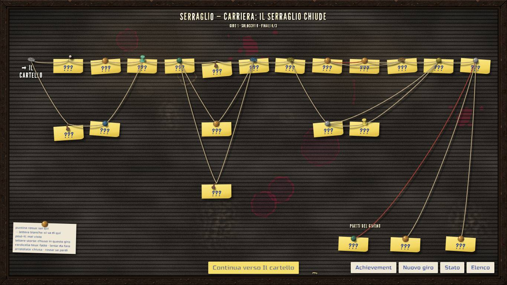

**Dove si aggroviglia:**

1. **La firma (III4).** Ci arrivano quattro strade: i conti (III3a), la notte al Serraglio (III3b), il pedinamento senza chiave (III2b) e
   il segreto (S1). Le loro cordicelle partono da tre file diverse e si stringono sulla stessa puntina: è il punto più fitto della bacheca.
2. **Il ramo del torneo.** III2a → III3c → III3a sono tre colonne in fila, mentre il pedinamento e il segreto ne usano una o due: la firma
   finisce nella colonna 12, e le strade corte dell'atto III hanno cordicelle lunghe e oblique che attraversano mezza bacheca. In più la
   cordicella diretta del torneo vinto (III2a → III3a) passa dietro la puntina dei debiti, sulla stessa fila: a colpo d'occhio sembra che
   si passi sempre dai debiti.
3. **Dopo III5.** Tre cordicelle scendono ai «piatti del giorno» e una va a destra verso S2: il finale F3 (dimmi-di-si-2, a sinistra) è
   lontano da III5, e la sua cordicella rossa (si arriva perdendo) attraversa la bacheca in diagonale.
4. **I fili non si vedono sulla bacheca,** ed è giusto: chiave, frase, Celestina, bilancio e Duccio sono segni e varianti di battuta. La
   bacheca mostra solo i due archi condizionati (la notte con la chiave, Grappino con il bilancio). Il groviglio narrativo resta nelle
   scene, non sulla mappa.

Nei giri dopo il primo la bacheca racconta bene la strada fatta: tesa e con i nomi la strada di questo giro, strappati i nodi chiusi, con
i nomi i nodi già visti negli altri giri.

| Giro | Che cosa mostra |
|---|---|
| (a) Mara → Piera → il torneo perso | la fila in alto quasi tutta tesa, il ramo dei debiti, F2 |
| (b) Spazienzio → Celestina → dietro a Grappino | le file sotto negli atti I e II, il segreto S1 che compare in III1, F1 |
| (c) con la chiave, la notte al Serraglio | all'inizio la rivincita S2 già sulla bacheca (dopo F1); poi il pedinamento e la notte |

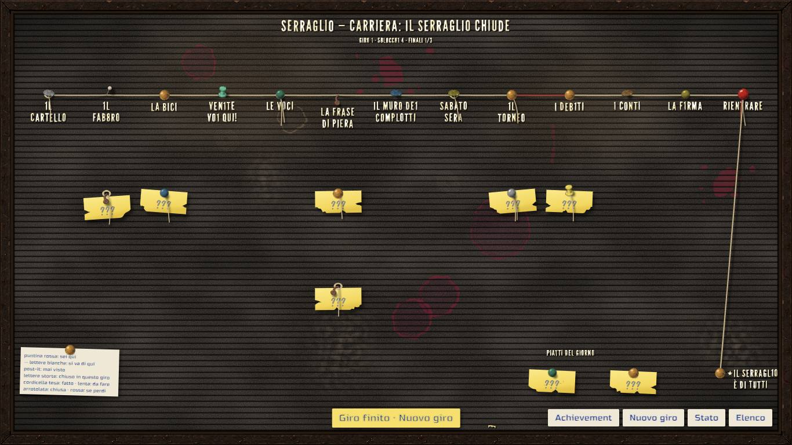
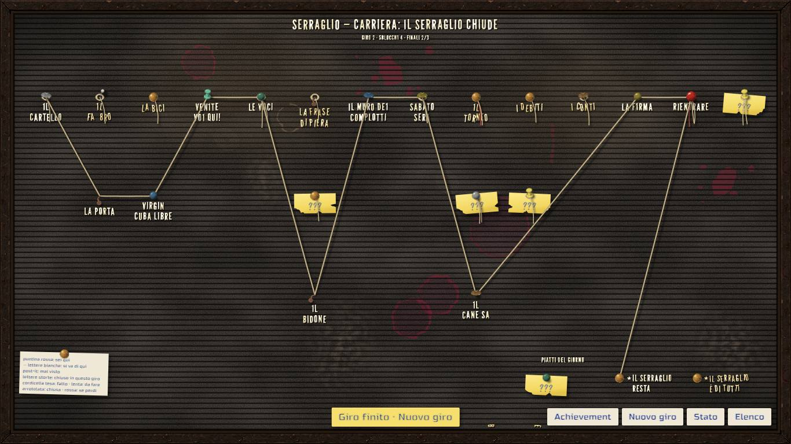
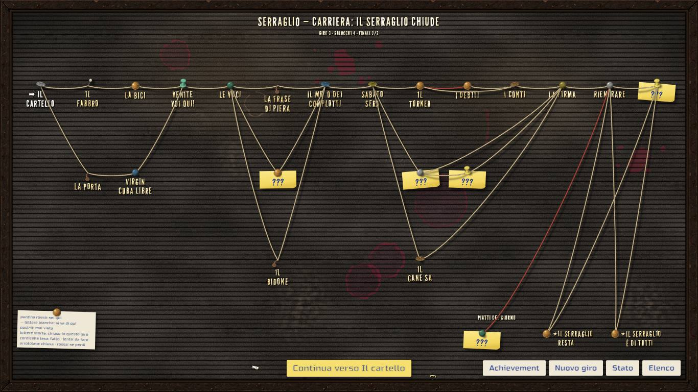
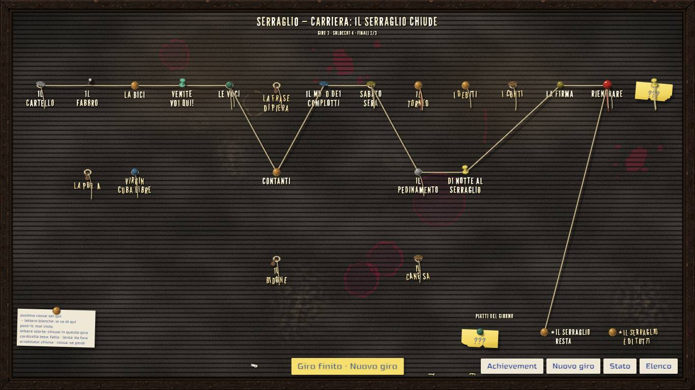

**Sul telefono** (390×844) la mappa intera ci sta, ma è al limite: quattordici file, il passo delle scanalature a 8 px (contro 11–16 per
le carriere del prototipo), i post-it dei rami che si toccano. Si legge la forma, meno i nomi.

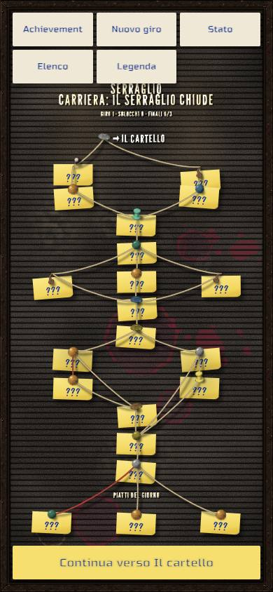
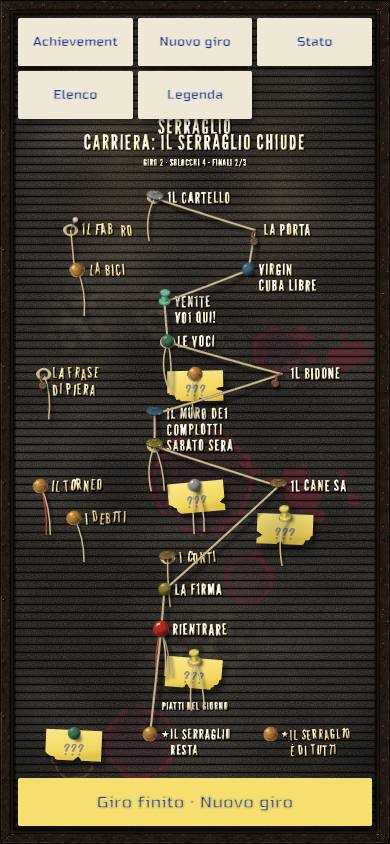

Registrazione: [`p-giro-bacheca.webm`](../../../prototipi/carriere/catture/p-giro-bacheca.webm) (26 s, 960×540), la bacheca a ogni
ritorno lungo il giro b: la «sei qui» che viaggia, i post-it dei nodi affrontabili che si staccano, i nodi che si chiudono e si strappano,
il segreto che compare.

## I numeri per giro

Contati da `strumenti/percorsi.ts`, che gioca con il motore ogni percorso di un giro (le scelte tutte, le partite vinte, e perse dove una
sconfitta apre un ramo). Un percorso è una sequenza di nodi con il suo finale.

| Strada nell'atto III | Nodi con partita nel giro | Finali |
|---|---|---|
| Torneo vinto (III2a → III3a) | 12 | F2, F3 |
| Torneo perso (III2a → III3c → III3a) | 13 | F2, F3 |
| Pedinamento con la chiave (III2b → III3b) | 12 | F1, F3 |
| Pedinamento senza chiave (III2b → III4) | 11 | F1, F3 |
| Dietro a Grappino (S1) | 11 | F1, F3 |
| Una qualsiasi, dopo F1, con la rivincita S2 | +1 (fino a 14) | F1 o F2 |

- **Primo giro:** 40 percorsi, da 11 a 13 nodi con partita. Gli atti I e II sono sempre 4 + 3 nodi; tutta la varietà di lunghezza sta
  nell'atto III (da 4 a 6).
- **Dopo F1:** 60 percorsi, fino a 14 con la rivincita.
- **PvP:** sempre con la quarta partita (I4), quindi fra il 31% (giro da 13) e il 36% (giro da 11) delle partite del giro.
- **Starter:** su ogni percorso Celestina in I4; Piera e Beppe in II2a o II2b, poi l'altro in II3, oppure (pista di Celestina) Piera in
  II3 e Beppe in III1. Le prove giocano le tre piste e controllano chi gioca II3 e III1.
- **Controllo del grafo:** 1041 stati esplorati, 516 fini distinte; nessun errore, nessun avviso.
- **La chiave:** la notte al Serraglio (III3b) si apre solo a chi è passato da I2a o dalla pista di Beppe: quattro delle sei combinazioni
  di via e pista danno la chiave (la via di Mara sempre, quella di Spazienzio solo con la pista di Beppe). Chi va con Spazienzio e poi con
  Piera o con Celestina non vede mai la notte al Serraglio, e nemmeno l'achievement «Lo diceva Celestina» in quel giro.

## Dove la scaletta e il formato non combaciano

| Nella scaletta | Nel formato | Che cosa ha fatto il mockup | Proposta |
|---|---|---|---|
| «Gioca: a scelta» (II1, III1 se non manca nessuno, III3a) | La partita ha un giocatore fisso o scritto in un segno | Una scelta muta senza destinazione prima della partita, che scrive il segno | Nel client «a scelta» è il selettore del personaggio prima della partita, non una scelta di storia: va detto nel formato (`→ Partita: a scelta fra …`) |
| «L'alleato con cui hai più segni» (III4, III5) | Non si contano i segni per personaggio | Il segno `alleato`, dalla via dell'atto III: Beppe per il torneo, Mara per il pedinamento, Celestina per Grappino | Scegliere una regola scrivibile: «chi ti ha accompagnato nell'atto III» (come nel mockup) o un conteggio nel formato |
| Starter garantiti in II3 e III1 | Uno sblocco era sempre incondizionato | **Estensione:** `[Se …] [Sblocca: …]` e `[Se …] [Segno: …]` | Tenerla in CA-0: è la stessa logica delle battute con condizione |
| I segni `via-atto-1`, `via-atto-3` | Le condizioni leggevano solo segni senza trattino | **Estensione:** il trattino nei nomi dei segni | — |
| Il finale dipende dalla strada (F1 dopo pedinamento o segreto, F2 dopo il torneo) | Un nodo ha una sola uscita | III5 vinto finisce con una scelta muta con una sola opzione visibile per strada (più la rivincita dopo F1): il giocatore vede un pulsante | Uscite condizionate nel formato (`→ Fine se …`), così il finale arriva senza un pulsante inutile |
| S2 «compare dopo F1, in un giro nuovo, sulla bacheca» | Un segreto si vedeva solo quando ci si arriva | **Estensione:** un segreto con una condizione (`[Nodo: segreto; se finale …]`) si vede sulla bacheca quando la condizione vale | — |
| Un nodo che chiude il file con una scelta (S2) | Errore «il nodo non ha uscita» | **Correzione** del convertitore | — |
| 21 partite in un giro | Il controllo del grafo superava il tetto di 200 000 stati | **Correzione:** nella chiave dello stato solo i segni e i nodi che qualche condizione legge (1041 stati invece di oltre 200 000; il tutorial passa da 72 a 12 stati e la prova da 28 a 15, con gli stessi esiti) | — |
| «Celestina lo dice solo a chi le ha dato retta» | Nessun punto della scaletta dice chi le dà retta | La variante in III3b con il segno `pista = celestina` | Un momento in I1 in cui le si dà retta (una scelta o una battuta di ritento), oppure accettare la pista di Celestina come «darle retta» |
| «Ve l'avevo detto»: «Mara accusa tutti, nessuno escluso» | Non c'è un nodo dove succede | Achievement quando si sono esplorati II2a, II2b, II2c e S1 (Piera, Beppe, Celestina e il cane) | Decidere dove Mara accusa chi: una variante di battuta per accusa, e l'achievement sull'ultima |
| «Difendi la frase di Piera in II2a» | La partita si vince sempre prima di andare avanti | Il segno `frase` arriva vincendo II2a: chi fa la pista di Piera la difende sempre | Se «difendere» deve poter fallire, serve una sfida (vincere entro N round) o una sconfitta che apre un ramo |
| S1: «si gioca contro Piera», chi gioca non è detto | — | Gioca l'alleato (Celestina, dalla pista del bidone) | Dirlo nella scaletta |
| «Dietro a Grappino» | Una scelta muta è «con <personaggio>» | Grappino aggiunto al cast con un cartoncino segnaposto; l'opzione è «con Grappino, dietro a lui in cantina» | — |
| Il PvP | Il formato non sa che cos'è | Uno sblocco `pvp` in I4, obbligatorio su ogni percorso | Tenerlo come sblocco nel formato di CA-0: così il controllo verifica anche dove arriva |
| Il cast: Celestina, Beppe, Sergio, Duccio senza ritratti di scena; il padrone senza nome | — | Cartoncini segnaposto con il primo piano degli identikit approvati (`segnaposto/`, fatti dal codice: non sono immagini generate), una sola espressione «neutra»; il padrone è una figura in ombra | Le espressioni per personaggio vanno decise con i dialoghi |
| Il Dimmi Di Sì dentro, la cantina, il bar di notte | Sfondi che non ci sono | S3 (l'esterno del Dimmi Di Sì) anche dentro; S2 in disordine per la cantina e il bar di notte; S1 con l'insegna spenta per la strada di notte | Sono già nei prossimi passi della scaletta |

## Dove allungare per arrivare a 15–20 incontri per giro

Oggi ogni giro ha da 11 a 13 nodi con partita; per stare fra 15 e 20 servono da 4 a 7 nodi in più su ogni strada. Gli atti I e II hanno
sempre la stessa lunghezza, l'atto III da 4 a 6: conviene allungare dove la storia ha più da dire e dove le strade sono più corte.

| Dove | Oggi | Proposta | Nodi in più per giro |
|---|---|---|---|
| Le piste dell'atto II | un nodo ciascuna (II2a, II2b, II2c) | due nodi per pista: la pista e il suo indizio, dove nascono i fili (la frase, la chiave, il bilancio) e dove Mara accusa qualcuno | +1 |
| Le vie dell'atto I | due nodi per via (I2, I3) | un terzo nodo per via prima della riunione: Mara e Beppe in giro per la «Apri e Chiudi s.r.l.»; Spazienzio e Duccio alla seconda porta | +1 |
| Fra II3 e III1 | niente | una scena in cui Sergio è accusato a torto davanti a tutti (il depistaggio dell'atto II, oggi tutto in II3) | +1 |
| Il pedinamento senza chiave e il segreto | 4 nodi nell'atto III, i più corti | un nodo in più ciascuno: sotto casa di Sergio; in cantina, chi è «S. Sommerso» | +1 su queste strade (pareggia il torneo) |
| Prima della firma | niente | «Domenica mattina»: il bar che si prepara alla firma, una FFA con tutti | +1 |

Con tutte queste un giro va da 15 a 17 nodi con partita, più i ritenti. **La bacheca, però, è già al limite:** ogni nodo in più lungo la
strada è una colonna in più, e oltre le 14 di oggi i titoli non ci stanno più in orizzontale e sul telefono le file si sovrappongono.
Per la carriera vera servirà una bacheca per atto (tre bacheche, o una che scorre), da decidere in CA-0 prima di allungare.

## Verifiche

| Comando | Esito |
|---|---|
| Prima di cominciare: `run.ps1 -Task Test`, `-Task Check`, `-Task Build` | verdi |
| `run.ps1 -Task Test` | verdi: 111. Nuove (`tests/principale.test.ts`): la conversione senza errori né avvisi, il controllo del grafo, i numeri per giro e il PvP, i fili (chiave, bilancio, debiti, finali per strada), gli starter garantiti sulle tre piste, S1 e S2 sulla bacheca, le estensioni, la correzione del convertitore, la chiave ridotta del controllo, i segnaposto |
| `run.ps1 -Task Check` | verde: tutorial e prova invariati negli esiti; principale 21/21 nodi, 0 errori, 0 avvisi |
| `run.ps1 -Task Build` | verde |
| `strumenti/percorsi.ts` | i numeri sopra |
| Catture (`strumenti/catture-principale.mjs`) | verdi, giocando dall'interfaccia, con i controlli di bordo (S1 e S2 nascosti all'inizio, il torneo perso, il segreto, S2 dopo F1, la notte con la chiave, nessun errore nella pagina) |
| Catture del prototipo (`strumenti/catture.mjs`) | verdi; la bacheca del tutorial e della prova non cambia con la disposizione nuova (le differenze sono le animazioni e il «Continua verso» della Fase K), quindi le loro catture non sono rifatte |
| Banco della fluidità | sotto: zero difetti visibili prima e dopo; la bacheca della principale, misurata solo dopo, anche |
| Mutazioni | 17 sulle estensioni, sulla chiave ridotta del controllo, sul conteggio dei percorsi e su tre fili della storia (la chiave in II2b, lo starter di Beppe in III1, il bilancio per Grappino): tutte prese; una all'inizio sfuggiva (la chiave del controllo senza «perso»): rafforzata la prova |
| `python scripts/check-links.py`, `python scripts/check-rules.py`, `git diff --check` | verdi, pulito |

**Banco della fluidità**, nei due orientamenti e con la CPU normale e quattro volte più lenta. Prima: sul codice di partenza; per la
bacheca della prova il banco si è fermato due volte su un tempo scaduto al secondo giro (con la CPU 4×), quindi per quei tre giri il prima
è il dopo della [Fase K](prototipo-fase-k.md#prima-e-dopo), che ha lo stesso codice del prototipo.

| Giro | Fotogrammi lunghi prima → dopo | p95 (ms) prima → dopo | Vuoti, lampeggi, salti, veli, bocche |
|---|---|---|---|
| scena-prova-o-1x | 11 → 9 | 17 → 17 | 0 → 0 |
| scena-prova-o-4x | 26 → 14 | 34 → 17 | 0 → 0 |
| scena-prova-v-1x | 9 → 7 | 17 → 17 | 0 → 0 |
| scena-prova-v-4x | 32 → 14 | 34 → 17 | 0 → 0 |
| bacheca-o-1x | 26 → 16 | 50 → 34 | 0 → 0 |
| bacheca-o-4x | 20 (Fase K) → 14 | 34 → 33 | 0 → 0 |
| bacheca-v-1x | 10 (Fase K) → 10 | 17 → 17 | 0 → 0 |
| bacheca-v-4x | 16 (Fase K) → 18 | 17 → 33 | 0 → 0 |
| bacheca-principale-o-1x | — → 32 | — → 50 | — → 0 |
| bacheca-principale-o-4x | — → 53 | — → 50 | — → 0 |
| bacheca-principale-v-1x | — → 6 | — → 33 | — → 0 |
| bacheca-principale-v-4x | — → 14 | — → 17 | — → 0 |

Zero difetti visibili ovunque. La bacheca della principale in orizzontale ha il doppio dei fotogrammi lunghi di quella della prova (32 e
53 contro 16 e 14): già al primo giro 22 puntine e 27 cordicelle (la prova ne ha meno della metà), ridisegnate a ogni apertura e oscillanti. Non si vede come scatto, ma è il
segnale che una bacheca di quaranta nodi andrà alleggerita (cordicelle ferme fuori dallo schermo, o una bacheca per atto, sopra).

## Non verificato e limiti

- **Telefono vero:** come per tutto il prototipo, Edge sul portatile.
- **Le scene:** le battute sono segnaposto, una o due per nodo; non dicono niente del ritmo delle scene vere.
- **I ritratti segnaposto** sono cartoncini fermi, con il movimento procedurale e senza bocca: non dicono niente di come staranno i
  personaggi in scena.
- **La rivincita S2** è aperta su ogni strada dopo F1 (anche dopo il torneo, finendo poi con F2): la scaletta dice «dopo III5», senza
  dire su quali strade.

## Domande per la regia e il proprietario

1. Le tre estensioni del formato (segni e sblocchi con condizione, segreti con condizione, trattino nei segni) e le uscite condizionate
   proposte sopra: passano a CA-0?
2. «L'alleato con cui hai più segni»: la regola del mockup (chi ti accompagna nell'atto III) va bene, o serve un conteggio?
3. Dove allungare: le proposte sopra, e una bacheca per atto per reggere più colonne.

## Giudizio del proprietario e della regia

14 novembre 2026. Il proprietario lo ha provato: «io non direi che dobbiamo allungare, quanto piuttosto sistemare la narrazione come già
ti sei accorto te. A me sembra ok come lunghezza e complessità, anche senza allungarla per forza. I dialoghi ovviamente sono ancora da
scrivere, ma già ha una sua struttura». E: «non ci sono nodi raggiungibili con sconfitte? Neanche uno?». Sul piano della regia che ne è
seguito: «mi sembra un ottimo piano». Ne nasce la [scaletta 0.3](principale.md#le-sconfitte-che-aprono-un-ramo).

Risposte alle domande del rapporto:

1. **Le estensioni del formato** (segni e sblocchi con condizione, segreti con condizione, trattino nei segni) **passano a CA-0**, decisione
   della regia; le **uscite condizionate** (`→ Fine se …`) e la **partita «a scelta»** come selettore del personaggio si fanno con
   l'aggiornamento del mockup alla 0.3.
2. **«L'alleato con cui hai più segni»** diventa la regola del mockup, «chi ti ha accompagnato nell'atto III», scritta nella scaletta.
3. **Non si allunga** (proprietario). Resta valida l'osservazione sulla bacheca: oltre quattordici colonne servirebbe una bacheca per atto,
   da decidere in CA-0 se una carriera più lunga lo chiederà.

I buchi della narrazione trovati dal mockup sono chiusi nella 0.3: darle retta, a Celestina (I1s, sconfitta in I1); difendere la frase di
Piera può fallire (II2s); la notte al Serraglio anche senza la chiave (III1s); dove Mara accusa chi; chi gioca S1.

## Aggiornamento alla 0.3

14 novembre 2026, dopo il giudizio qui sopra. Il mockup segue ora la [scaletta 0.3](principale.md): la storia
[`storie/principale.md`](../../../prototipi/carriere/storie/principale.md) è aggiornata, `principale.md` non è stato toccato. Le sezioni
qui sopra restano come erano, sulla 0.2.

### Che cosa è cambiato

- **Tre scene che si aprono perdendo,** senza partita: **I1s Il pavimento** (si perde I1; segno `celestina`; poi di nuovo la scelta di
  I1), **II2s Piera non parla più** (si perde II2a; niente segno `frase`; poi II3), **III1s Sgomberati** (si perde III1; poi la notte al
  Serraglio, anche senza la chiave; achievement «Porta sul retro»). Con i debiti e F3, le sconfitte che aprono un ramo sono cinque.
- **III3b:** si arriva con la chiave dopo il pedinamento (uscita condizionata da III2b) o dallo sgombero; gioca chi ti ha accompagnato
  (Mara o Celestina); la battuta di Celestina è intera con il segno `celestina`.
- **III4:** senza il segno `frase` Piera ricomincia «un signore...» e Sergio si rivela da solo («Sono io. Finiamola»).
- **Chi gioca:** III3b, III4, III5 e S2 il segno `alleato` («chi ti ha accompagnato nell'atto III»: Beppe, Mara, o Celestina dopo lo
  sgombero o dietro a Grappino); S1 Celestina.
- **Mara accusa** Sergio in II1, Piera in II2a, Beppe in II2b, Celestina in II2c, Grappino in S1 (battute segnaposto).
- **Achievement:** «Ve l'avevo detto» con le cinque accuse (esplorati II1, II2a, II2b, II2c e S1, anche in giri diversi); «Lasciatela
  finire» vincendo II2a e arrivando a III4 nello stesso giro; «Lo diceva Celestina» con I1s e III3b nello stesso giro; nuovo «Porta sul
  retro», da III1s. Sono nove.
- **Due estensioni del formato,** accettate dalla regia, con le loro prove:
  - **Uscite condizionate:** `→ Fine: completata, Il Serraglio è di tutti [Se segno via-atto-3 = torneo]`, una per riga; vale la prima la
    cui condizione vale; dopo un'uscita senza condizione non ce ne possono essere altre. III5 vinto finisce nel finale della strada fatta,
    senza pulsanti; anche III2b (la notte con la chiave, altrimenti la firma) ora esce così. Il controllo del grafo segue le condizioni e
    segnala un nodo dove nessuna uscita vale.
  - **La partita «a scelta»:** `→ Partita II1: a scelta fra Celestina, Mara e Spazienzio (giocatore) contro Sergio`; prima della partita
    il tavolo mostra i personaggi fra cui scegliere, e «Vinci» e «Perdi» aspettano la scelta. Con un segno davanti, `{iii1} o a scelta fra
    …`, la scelta c'è solo se il segno non è assegnato: in III1 gioca Beppe quando non ti ha ancora dato le sue carte, altrimenti si sceglie.
    Vale per II1, III1 e III3a; le tre scelte mute che facevano questo lavoro nella prima stesura non ci sono più.
- **Una terza estensione, piccola, per la rivincita:** `→ Scelta muta, se c'è: …` è una scelta che si salta quando nessuna opzione è
  visibile, e le cui opzioni senza destinazione proseguono fino alle uscite. Serve a offrire S2 solo dopo F1 («con Sergio, che vuole la
  rivincita» → S2, oppure «con Beppe, a chiudere il bar per stasera» → il finale della strada) senza rimettere il pulsante inutile negli
  altri giri. Con le sole uscite condizionate la rivincita sarebbe stata obbligatoria dopo F1, cioè un superboss da battere per finire il
  giro.

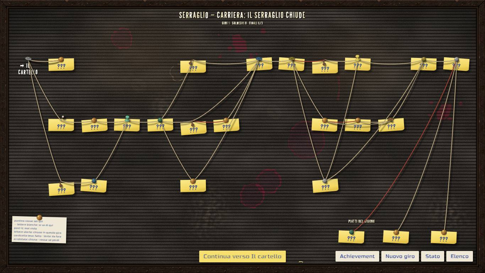
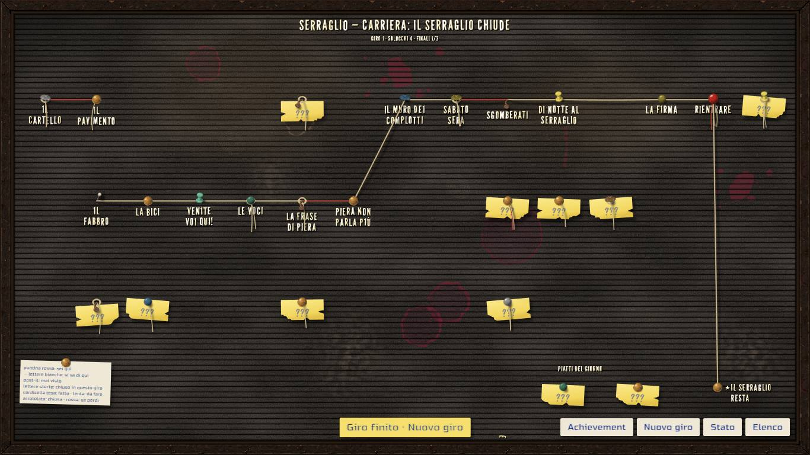

Sul telefono: [la mappa intera](../../../prototipi/carriere/catture/p3-v-01-mappa-intera.jpg) e
[il giro delle tre sconfitte](../../../prototipi/carriere/catture/p3-v-02-giro-tre-sconfitte.jpg). Registrazione:
[`p3-giro-sconfitte.webm`](../../../prototipi/carriere/catture/p3-giro-sconfitte.webm) (28 s, 960×540), la bacheca a ogni ritorno lungo
il giro delle tre sconfitte: le cordicelle rosse che si tendono, il ritorno alla scelta di I1 dopo il pavimento, la notte dalla porta sul
retro.

**Sulla bacheca** le sconfitte si vedono bene: ogni scena che si apre perdendo sta subito a destra del suo nodo, legata da una cordicella
rossa, e a fine giro la strada fatta passa di lì. Il pavimento (I1s) va sulla fila in alto accanto a I1 e sposta di una fila la via di
Mara. La bacheca passa da quattordici a quindici colonne: II2s sposta di una colonna tutto quello che viene dopo (III1s invece sta nella
colonna dei nodi che salta). Si legge ancora in orizzontale; sul telefono è fitta come prima.

### I numeri per giro

| | 0.2 | 0.3 |
|---|---|---|
| Nodi in tutto | 21 con partita, 3 finali, 2 segreti | 24 (21 con partita, 3 scene delle sconfitte), 3 finali, 2 segreti |
| Percorsi del primo giro | 40 | 136 |
| Percorsi dopo F1 | 60 | 204 |
| Nodi con partita per giro | da 11 a 13 (14 con S2) | uguale: da 11 a 13 (14 con S2) |
| Nodi attraversati per giro, scene comprese | come i nodi con partita | da 11 a 16 al primo giro (I1 conta due volte dopo il pavimento) |
| PvP | sempre con la quarta partita (31–36% del giro) | uguale |
| Controllo del grafo | 1041 stati, 0 errori | 333 stati, 0 errori, 0 avvisi; starter e PvP su ogni percorso, tre finali, S1 da III1 e S2 da III5, nove achievement possibili |

Le sconfitte non allungano il giro in partite: le scene I1s e II2s non hanno partita, e lo sgombero salta la partita dell'atto III (si va
diretti alla notte), quindi un giro con tutte e tre le sconfitte ha 11 partite e 15 nodi. Gli stati del controllo scendono (333 contro 1041)
perché le scelte «a scelta» non sono più segni.

### Dove scaletta e formato ancora non combaciano

| Nella 0.3 | Nel mockup | Proposta |
|---|---|---|
| III1 si può perdere, e Beppe vi dà il suo starter quando manca | Lo sblocco viene prima della partita: Beppe «prende le tue parti» sedendosi al tavolo, e lo starter resta anche se perdi | Dirlo nella scaletta, o spostare la garanzia di Beppe in un nodo che non si perde |
| Perso II2a, Piera «parla solo con Grappino» | In II3 Piera gioca lo stesso per te, perché non ti ha ancora dato le sue carte | Una battuta di II3 che la riporta al tavolo («per Grappino, non per voi»), o Beppe in II3 e Piera in III1 |
| «Nessuna è una punizione» | Perdendo I1, II2a o III1 quel nodo non si vince in quel giro: niente carta della prima vittoria di quel nodo | Decidere con EC-0 se le scene delle sconfitte danno qualcosa |
| Lo sgombero porta alla firma senza il torneo né il pedinamento | Dopo lo sgombero il finale è F1 (come per il pedinamento) | La tabella dei finali dice F1 «dopo il pedinamento o il segreto»: aggiungere lo sgombero |
| Mara accusa Piera dopo aver vinto II2a | «Ve l'avevo detto» conta II2a esplorato, anche se la frase si è persa (e l'accusa non c'è) | Spostare l'accusa prima della partita, o una condizione «vinto in un giro qualsiasi», che il formato non ha |
| II1 «a scelta» fra gli starter posseduti | Il selettore ha una lista fissa (Celestina, Mara, Spazienzio) | In CA-0 la lista viene dagli starter dell'account |
| La rivincita S2 «dopo III5, in un giro nuovo dopo F1» | Offerta su ogni strada dopo F1, rifiutabile; il rifiuto ha un'etichetta inventata («con Beppe, a chiudere il bar per stasera») | Dire se S2 è facoltativa e da quali strade |
| I1s «poi la scelta di I1» | La bacheca mostra il ritorno con una cordicella che torna indietro, e I1 due volte nel percorso | — |

### Verifiche dell'aggiornamento

| Comando | Esito |
|---|---|
| `run.ps1 -Task Test`, `-Task Check`, `-Task Build` | verdi: 115 prove. Nuove o rifatte: i nodi della 0.3 e le scene senza partita, le cinque sconfitte che aprono un ramo, le tre partite «a scelta», gli starter garantiti anche perdendo II2a o III1, il giro delle tre sconfitte (segni, chi ti accompagna, finale, achievement), «Lo diceva Celestina» solo con il pavimento, III5 che finisce senza pulsanti e la rivincita rifiutabile dopo F1, le tre estensioni con i loro errori, il tetto delle cordicelle che oscillano |
| `strumenti/percorsi.ts` | i numeri sopra |
| Banco della fluidità, solo sulla bacheca della principale | zero difetti visibili; sotto |
| Catture (`strumenti/catture-principale.mjs`) | verdi, giocando dall'interfaccia: la mappa intera e il giro delle tre sconfitte (I1s, II2s, III1s e la notte fatti, F1), con il selettore del personaggio |
| Mutazioni | 16 sulle estensioni (uscite condizionate, scelta «se c'è», partita «a scelta»), su quattro punti della storia e sul tetto delle cordicelle: tutte prese; quattro all'inizio sfuggivano (la scelta saltata nel controllo, il segno davanti alla partita «a scelta», la scelta da rifare dopo una sconfitta, «Lo diceva Celestina» senza il pavimento): rafforzate le prove |
| `python scripts/check-links.py`, `python scripts/check-rules.py`, `git diff --check` | verdi, pulito |

**Il banco ha trovato un problema, ora corretto.** Con la 0.3 la bacheca della principale, ferma, andava a 83 ms per fotogramma
(in orizzontale, CPU normale: 161 fotogrammi lunghi, p95 101 ms, contro 32 e 50 della 0.2). La causa: trentatré cordicelle che oscillano
tutte, molte lunghe quanto la bacheca, ognuna con l'ombra sfocata da ridipingere a ogni passo. Ora **oscillano al più le sedici più
corte** (`soloLePiuCorte` in `movimentiBacheca.ts`, con la sua prova); le altre penzolano ferme. Il tutorial e la prova ne hanno meno e
non cambiano. La bacheca ferma torna a 16,7 ms; con il movimento ridotto lo era già.

| Giro | Prima della correzione: lunghi, p95 (ms) | Dopo: lunghi, p95 (ms) | Vuoti, lampeggi, salti, veli, bocche |
|---|---|---|---|
| bacheca-principale-o-1x | 161, 101 | 16, 34 | 0 |
| bacheca-principale-o-4x | 165, 133 | 52, 50 | 0 |
| bacheca-principale-v-1x | 89, 67 | 14, 50 | 0 |
| bacheca-principale-v-4x | 107, 83 | 55, 67 | 0 |

Il carico della macchina, durante queste misure, era più alto di quello della prima stesura (la bacheca della prova, misurata di
controllo, è passata da 16 a 44 fotogrammi lunghi): i numeri si confrontano fra loro, non con quelli della 0.2.

## Sconfitte segrete

14 novembre 2026, dopo la prova del proprietario sulla 0.3 e la [scaletta 0.3.2](principale.md#le-sconfitte-che-aprono-un-ramo)
(«Le sconfitte sono un segreto»). `principale.md` non è stato toccato.

### Che cosa aveva visto il proprietario

- Sulla bacheca di una carriera nuova le sconfitte erano già disegnate, con le loro cordicelle rosse: I1 → I1s sulla fila in alto, II2a →
  II2s, III1 → III1s, III2a → III3c. Lui: «perdere non dovrebbe essere una meccanica normale per proseguire sulla mappa, ma una segreta da
  usare sporadicamente».
- **Un difetto:** nella cattura del giro con le tre sconfitte mancava la cordicella I1 → I2a, e il Fabbro stava sulla seconda fila slegato
  dalla strada. La causa: la strada del giro si disegnava con i nodi visti uno dopo l'altro (I1, I1s, I2a), e l'arco I1s → I2a non
  esiste. Lo stesso succedeva a II2a → II3 dopo Piera offesa.

### Che cosa cambia

- **I1s, II2s, III1s e III3c sono segreti** (`[Nodo: segreto]`, il meccanismo che c'era già): niente post-it e niente cordicella finché
  non ci si arriva; quando la sconfitta li apre compaiono, e dopo restano sulla bacheca nei giri seguenti, con il nome, come gli altri
  nodi già visti. Una carriera nuova mostra una sola cordicella rossa, quella del finale F3, che resta fra i «piatti del giorno».
- **I1s e II2s sono tasche** (`[Nodo: segreto; tasca]`, estensione minima del formato):
  - sulla bacheca pendono dal nodo perso, nella sua stessa colonna e sotto di lui, con la sola cordicella rossa d'arrivo: nessuna
    cordicella esce da una tasca, nemmeno quella del ritorno alla scelta di I1;
  - non contano per le colonne: II2s non sposta più tutto di una colonna, e la bacheca torna a quattordici colonne di nodi;
  - la strada del giro salta le tasche e riprende dal nodo perso: nel giro delle sconfitte sono tese I1 → I2a (il difetto è corretto) e
    II2a → II3, oltre alle cordicelle rosse I1 → I1s e II2a → II2s;
  - la puntina «sei qui», dopo il pavimento, torna su I1 e non resta sulla tasca.
- **III1s e III3c sono rami veri:** compaiono con le cordicelle d'arrivo (rossa) e d'uscita (verso la notte al Serraglio, verso i conti)
  solo quando ci si arriva.
- **Il controllo del grafo vede le sconfitte** come prima (sono fra i segreti, con il nodo da cui ci si arriva) e ha **tre avvisi nuovi,**
  per le storie future: un nodo a cui si arriva solo perdendo e non è segreto; una tasca a cui si arriva anche senza perdere; una tasca a
  cui non si arriva perdendo. Per contare le strade il controllo non considera il ritorno alla scelta (I1s → I1), che non è una strada
  nuova verso I1.
- **Due ritocchi della 0.3.1** nella storia, che il mockup non aveva ancora: Mara accusa Piera prima della partita di II2a (così «Ve
  l'avevo detto» conta un'accusa che c'è sempre), e dopo II2s Piera torna al tavolo in II3 «per Grappino, non per voi».

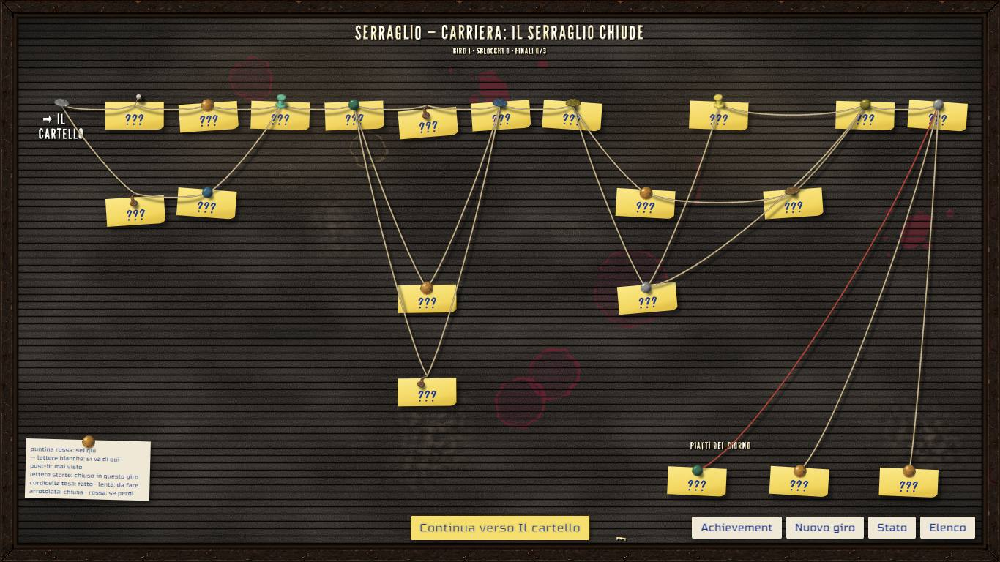
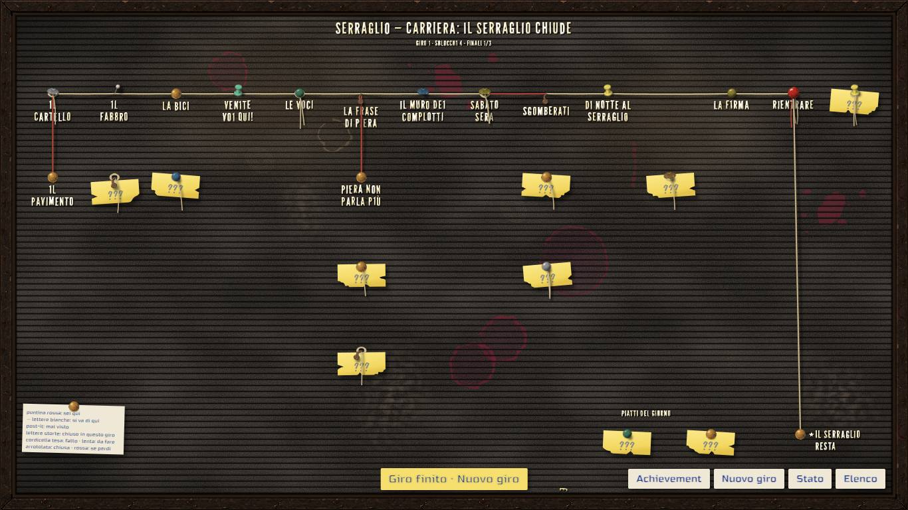
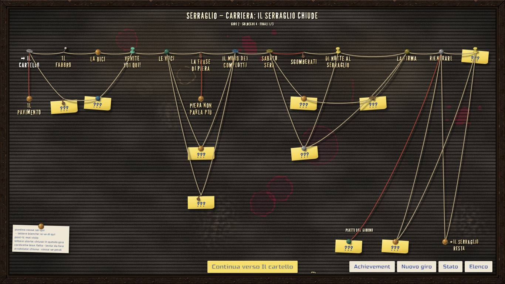

Sul telefono: [la bacheca nuova](../../../prototipi/carriere/catture/p32-v-01-mappa-intera.jpg),
[il giro delle tre sconfitte](../../../prototipi/carriere/catture/p32-v-02-giro-tre-sconfitte.jpg),
[il giro dopo](../../../prototipi/carriere/catture/p32-v-03-giro-dopo.jpg). Registrazione:
[`p32-giro-sconfitte.webm`](../../../prototipi/carriere/catture/p32-giro-sconfitte.webm) (27 s, 960×540), la bacheca a ogni ritorno lungo
il giro delle tre sconfitte: le sconfitte che compaiono una alla volta quando ci si arriva.

- **La bacheca ferma, di nuovo più lenta, corretta:** con le sconfitte nascoste le sedici cordicelle più corte arrivavano a 270 px, e la
  bacheca ferma della principale era tornata a 33 ms di mediana per fotogramma. Ora, sulla bacheca grande, stanno ferme anche le
  cordicelle più lunghe del 18% della larghezza del feltro (`soloLePiuCorte`, con la sua prova); il tutorial e la prova non cambiano. La
  bacheca ferma torna a 16,7 ms di mediana.

### Numeri

Le strade non cambiano: 136 percorsi al primo giro e 204 dopo F1, da 11 a 13 nodi con partita (14 con la rivincita), PvP sempre alla
quarta partita. Il controllo del grafo: 24 nodi su 24, 333 stati, 0 errori e 0 avvisi; sei segreti (I1s da I1, II2s da II2a, III1s da
III1, III3c da III2a, S1 da III1, S2 da III5).

### Che cosa resta da decidere

- **La prova** (`storie/prova.md`, la mini-carriera della regia) ha il retrobottega, a cui si arriva solo perdendo in C (risposta P3 della
  Fase B), e non è segreto: il controllo ora lo dice con un avviso. Non l'ho cambiato, perché la prova non è una storia del gioco e farlo
  segreto cambierebbe le sue catture e le sue prove; se seguire la regola anche lì lo decide la regia.
- **Il posto vuoto delle tasche nascoste:** la disposizione della bacheca è fissa, quindi la riga di II2s, sotto II2a, resta libera anche
  quando II2s non si vede, e II2b e II2c stanno una riga più in basso. Si nota poco; lo stesso fa da sempre S1.
- **Starter prima della partita (0.3.1):** la scaletta dice che lo starter arriva quando il personaggio si siede al tavolo, ma anche che
  dopo II2s Piera gioca in II3 «se tocca a lei». Se lo starter di Piera arrivasse prima della partita di II2a, dopo II2s non toccherebbe più
  a lei. Il mockup tiene lo starter di Piera e di Beppe dopo la vittoria in II2a e II2b (così Piera torna in II3), e prima della partita
  solo in III1: va chiarito quale delle due regole vale.

### Verifiche

| Comando | Esito |
|---|---|
| `run.ps1 -Task Test`, `-Task Check`, `-Task Build` | verdi: 120 prove. Nuove: la bacheca nuova senza sconfitte (una sola cordicella rossa, verso F3), il giro delle tre sconfitte (tasche senza strade proprie, I1 → I2a e II2a → II3 tese, lo sgombero con le sue cordicelle, i debiti ancora nascosti, la puntina che torna su I1), le sconfitte viste nel giro dopo, le tasche nella colonna del nodo perso, gli avvisi nuovi del controllo, il tetto sulla lunghezza delle cordicelle. Il Check segnala l'avviso della prova (sotto «Che cosa resta da decidere») |
| `strumenti/percorsi.ts` | i numeri sopra |
| Banco della fluidità, solo sulla bacheca della principale | zero difetti visibili; sotto |
| Catture (`strumenti/catture-principale.mjs`) | verdi, giocando dall'interfaccia, con i controlli di bordo: le quattro sconfitte e i due segreti nascosti all'inizio, le sconfitte fatte a fine giro, i debiti mai visti nascosti, le sconfitte viste ancora sulla bacheca nel giro dopo |
| Mutazioni | 14 sulle parti nuove (la strada del giro che salta le tasche, la cordicella d'arrivo, niente strade in uscita, la puntina, le colonne, gli avvisi, il ritorno alla scelta, la tasca nel convertitore, due segreti nella storia, il tetto sulla lunghezza): tutte prese; una all'inizio sfuggiva (il ritorno alla scelta contato come strada): rafforzata la prova |
| `python scripts/check-links.py`, `python scripts/check-rules.py`, `git diff --check` | verdi sui file di questo lavoro; `check-links` trova un'ancora mancante in `docs/design/set-base/sb-16g-proposta.md`, una modifica non committata di un'altra sessione, che non ho toccato |

**Banco della fluidità** sulla bacheca della principale (il giro del banco apre la bacheca dopo I1 e dopo I2a, con la «sei qui» che
viaggia e i post-it che si staccano):

| Giro | Con il solo tetto sul numero: lunghi, p95 (ms) | Con il tetto anche sulla lunghezza: lunghi, p95 (ms) | Vuoti, lampeggi, salti, veli, bocche |
|---|---|---|---|
| bacheca-principale-o-1x | 121, 100 | 55, 51 | 0 |
| bacheca-principale-o-4x | 129, 133 | 48, 50 | 0 |
| bacheca-principale-v-1x | 33, 50 | 7, 17 | 0 |
| bacheca-principale-v-4x | 42, 67 | 12, 17 | 0 |

In orizzontale i fotogrammi lunghi restano più di quelli della 0.3 dopo la sua correzione (16 e 52): la bacheca, ferma, è a 16,7 ms di
mediana, ma le aperture con il viaggio della «sei qui» e i post-it pesano di più su una bacheca di 24 nodi. Non si vedono come scatti; è
un altro segnale che una carriera di queste dimensioni chiederà, nel client, una bacheca più leggera o divisa per atti.

### Decisioni della regia sulle sconfitte segrete

14 novembre 2026, dopo il controllo del lavoro: catture, 120 prove, controllo del grafo con le sconfitte fra i segreti.

- **Lo starter:** vale la regola del mockup, ora scritta nella [scaletta 0.3.3](principale.md#atto-ii--di-chi-è-il-serraglio): nella
  propria pista arriva vincendo, nei nodi di garanzia sedendosi al tavolo.
- **La prova segue la regola anche lei:** il retrobottega diventa segreto, perché la regola del proprietario vale per ogni carriera e
  l'avviso del controllo non deve restare acceso. Si fa dopo il risalto del nodo «sei qui», con le catture della prova rifatte solo dove
  cambiano.
- **Il posto vuoto delle tasche nascoste** va bene così, come per S1.

## Aggiornamento alla 0.3.7

20 novembre 2026, dopo la [scaletta 0.3.7](principale.md) e le decisioni del proprietario sul finale: III5 è una **partita a catena**. Il mockup
segue ora la 0.3.7: la storia [`storie/principale.md`](../../../prototipi/carriere/storie/principale.md) è aggiornata (righe segnaposto, una o
due per scena) e il formato, il convertitore, il motore, la bacheca e il controllo del grafo conoscono la catena. `principale.md`,
`product-roadmap.md` e `docs/README.md` non sono stati toccati. Le sezioni qui sopra restano come erano.

### Che cosa è cambiato

- **III5 a catena.** Ogni personaggio sbloccato in quel giro sfida Sergio a turno, **nell'ordine che sceglie il giocatore**. Prima di ogni
  duello Sergio dice la sua battuta per chi gioca. Si vince se vincono tutti; **senza ritento**, la prima sconfitta chiude la catena e porta
  a F3 «Disco pub» (achievement «Sedici euro»). Chi è in catena: Mara e Spazienzio (dal tutorial, senza sblocco) più chi ha il suo
  `starter-<id>` preso in quel giro, cioè cinque su ogni percorso.
- **Il resto dell'atto III:** III1s dà la scena «Sgomberati» con il rientro dalla porta (se si ha la chiave) o dalla finestra del bagno,
  e l'achievement «Rientro abusivo» (prima era «Porta sul retro»); III3a è un duello contro Sergio, a scelta fra i cinque; III3b segue
  il rientro (porta, finestra, nessuno dei due); III1 si intitola «Domenica sera».
- **F2 e F1 sono scene,** non più uscite dirette: vinta la catena, la bacheca offre F2 (se si è fatto il torneo; dà «Monetine») e poi F1,
  che chiude con il finale della strada («è di tutti» dopo il torneo, altrimenti «resta»). Le uscite condizionate sono quelle della 0.3.
- **S2** si offre dopo III5 vinto, solo a chi ha già visto «Il Serraglio resta»: «con chi sei d'accordo?», con Sergio (si va a S2) o con
  Spazienzio (si prosegue). S2 si gioca **a scelta** fra i cinque e dà «Superboss» (prima «Rivincita»). Sergio parla in I3b senza il suo
  alias («Un signore» resta nei dialoghi, non nel mockup).
- **Achievement:** escono «Porta sul retro» e «Rivincita»; entrano «Rientro abusivo», «Monetine» e «Superboss». Sono ancora nove.
- **Come si scrive la catena nel formato** (invariato rispetto a `principale-dialoghi.md`, che non ha dovuto cambiare):

  ```
  → Partita III5, a catena: ogni personaggio sbloccato (giocatore), uno alla volta nell'ordine che sceglie il giocatore, contro Sergio, boss finale
  [Catena: si vince se tutti battono Sergio; alla prima sconfitta la catena finisce]
  [Sconfitta: → F3]
  [Catena, prima di Mara] **Sergio** (neutra): …
  ```

  La freccia dà l'avversario (dopo «contro»); `[Catena: …]` è documentario; `[Sconfitta: …]` è obbligatoria e dice dove va la prima
  sconfitta; `[Catena, prima di X]` è la battuta dell'avversario prima del duello di X, e i personaggi della catena sono quelli che hanno
  una battuta. Lo sblocco di ognuno si ricava da `starter-<id>`: se la carriera lo sblocca, il personaggio è in catena solo dopo averlo preso.
- **Convertitore:** un passo nuovo `catena` (nel formato: avversario, giocatori con sblocco e battuta, modificatori, sconfitta). Errori chiari
  per catena senza `[Sconfitta: …]`, con meno di due personaggi, con battuta di un altro, con battuta doppia, con ritento, senza avversario,
  e per `[Catena: …]` o `[Catena, prima di …]` senza una catena prima. `valida` controlla lo stesso sui dati.
- **Motore e tavolo:** il tavolo mostra la fila (chi ha vinto, chi gioca, chi aspetta) e, nella scelta, i pulsanti; poi la battuta di Sergio;
  poi «Vinci» e «Perdi». Chi ha vinto non si sceglie più; vinti tutti il nodo prosegue, alla prima sconfitta si va a `[Sconfitta]` senza ritento.
- **Controllo del grafo:** su ogni percorso devono esserci tutti i personaggi dichiarati (altrimenti errore con il nome e lo starter che
  manca), la sconfitta della catena deve portare da qualche parte (F3 deve poter essere raggiunto) e la vittoria prosegue.
- **Percorsi:** la catena è **un nodo con partita**; i suoi duelli si contano a parte (da 1, se si perde subito, a 5).

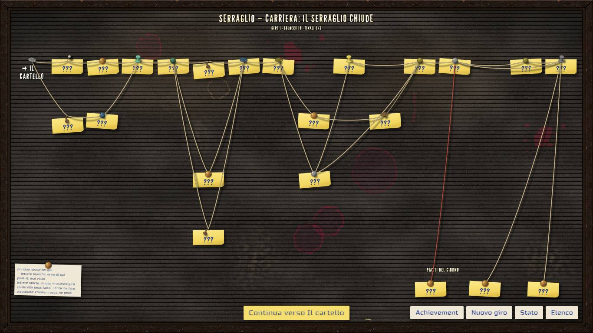
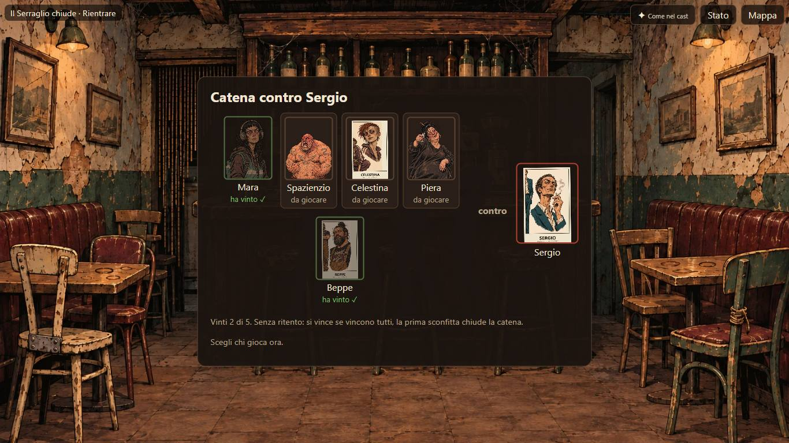
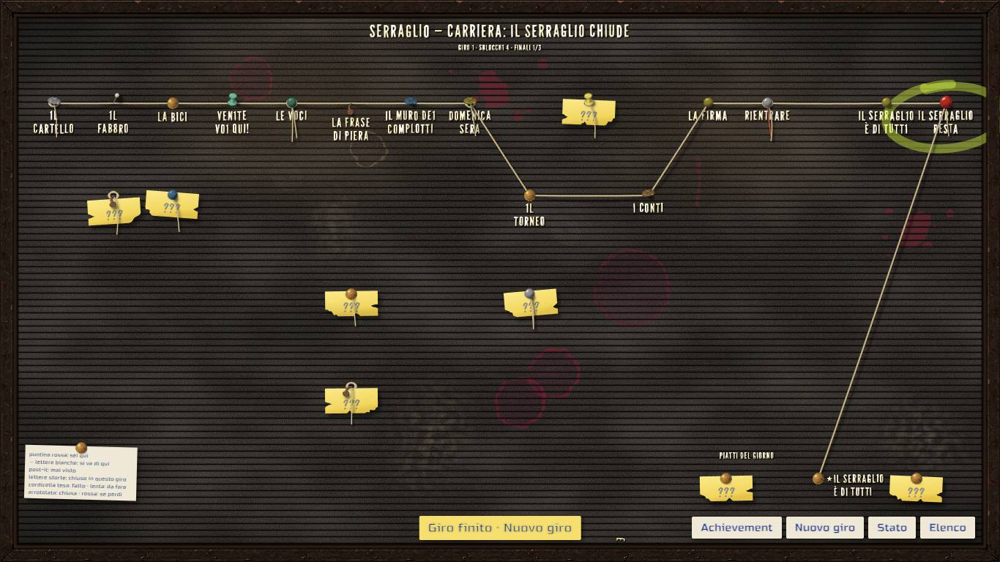

Sul telefono: [la bacheca nuova](../../../prototipi/carriere/catture/p37-v-01-mappa-intera.jpg),
[la catena a metà](../../../prototipi/carriere/catture/p37-v-02-catena-a-meta.jpg),
[la bacheca a giro finito](../../../prototipi/carriere/catture/p37-v-03-fine-giro.jpg). Sono giocate dall'interfaccia; un secondo giro perde il
primo duello e deve finire in «Disco pub» (prova di bordo, senza cattura).

### Numeri

| | 0.3.2 | 0.3.7 |
|---|---|---|
| Nodi | 24 | 26 (F2 e F1 sono scene) |
| Finali | 3 (il finale della sconfitta era «Dimmi Di Sì 2») | 3 («Disco pub» al posto di quello) |
| Percorsi, primo giro / dopo tutti i finali | 136 / 204 | 136 / 204 |
| Nodi con partita per giro | da 11 a 13 (14 con S2) | uguale: la catena è un nodo, F2 e F1 non hanno partita |
| **Duelli della catena** | — | da 1 (si perde il primo) a 5 |
| **Partite, contando i duelli** | da 11 a 13 (14) | da 11 a 17 (18 con S2) |
| PvP | al più tardi al 36% delle partite | uguale |
| Controllo del grafo | 333 stati, 0 errori, 0 avvisi | **469 stati,** 0 errori, 0 avvisi; fini completate 104; finali Disco pub (52), Il Serraglio resta (36), è di tutti (16); `catene: iii5 (5 su 5 su ogni percorso)` |
| Colonne della bacheca | 15 (14 di nodi e i finali) | 17 (16 di nodi e i finali) |
| Prove | 122 | 130 |

Una vittoria di tutta la catena vale cinque partite in un nodo solo: se si contano i duelli, il giro più lungo è di 17 partite, non di 13.
Questo è il numero che conta per il ritmo del giro, e la scaletta (che dice «da 11 a 13») conta la catena una volta sola.

### Dove scaletta e formato non combaciano

| Nella 0.3.7 | Nel mockup | Proposta |
|---|---|---|
| F3 è una scena in `principale-dialoghi.md` (il neon, gli habitué, «Sedici euro»), raggiunta da `[Sconfitta: → F3]` | F3 è un **finale** senza scena, come lo era «Dimmi Di Sì 2» nella 0.3.2: `[Sconfitta: → Fine: completata, Disco pub]`. Come scena, il controllo avviserebbe (nodo raggiunto solo perdendo, non segreto) | Decidere se F3 è una scena vera: sarebbe un nodo `[Nodo: segreto]` visibile come finale, o una regola che esenta i finali |
| La bacheca è di «circa quattordici colonne» | 16 di nodi più i finali: F2 e F1 sono ora scene, quindi due colonne in più | Se è troppo fitta, F2 e F1 possono dividere una colonna, o stare su due righe |
| S2 dopo «con chi sei d'accordo?», «con Sergio» | Offerta solo a chi ha già visto «Il Serraglio resta»; il rifiuto prosegue senza S2; si gioca a scelta fra i cinque | Dire se la rivincita è per chiunque o solo dopo F1 |
| III5: «tutti i personaggi sbloccati» | Sono sempre cinque (Mara e Spazienzio dal tutorial, tre starter nell'atto): il controllo lo prova su ogni percorso | Se un giro potesse arrivare a III5 con meno starter, la catena si accorcia da sola, ma il controllo lo segnala come errore |
| «Patetici, avete dimostrato quanto valete» apre F3 (scelta della regia); «sapete come divertirvi» e la risposta di Spazienzio, dopo la catena vinta, valgono per tutti | «Patetici» non c'è, perché F3 non ha scena; le altre due battute stanno in III5, dopo l'ultimo duello | Si risolve con la decisione su F3 |
| «Un signore» e le espressioni non ancora nel cast | Il mockup usa quelle del cast: Sergio in I3b senza alias, `neutra` dove i dialoghi hanno `strafottente`, `annoiato`, `malvagio` | Aggiungere le espressioni al cast, poi riportarle |

### Verifiche

| Comando | Esito |
|---|---|
| `run.ps1 -Task Test` | verdi: 130 prove (prima: 122). **Ambiente:** `node_modules` non c'era, e il primo avvio era rosso per un modulo mancante (`react`): non una regressione. Si è installato con `run.ps1 -Task Install -Offline` (non entra nel repository) |
| `run.ps1 -Task Check`, `-Task Build` | verdi: il Check come nei numeri; il Build (`tsc` e `vite`) senza errori |
| `strumenti/percorsi.ts` | i numeri sopra |
| Catture (`strumenti/catture-principale.mjs`) | verdi, giocando dall'interfaccia, a 1366×768 e 390×844; i controlli di bordo: le sconfitte e i segreti nascosti all'inizio, la catena a metà (due vinti, tre da scegliere, Sergio sul tavolo), vinta la catena non è F3, F1 sulla bacheca, il secondo giro perso al primo duello porta a «Disco pub» |
| `git diff --check`, `python scripts/check-links.py`, `python scripts/check-rules.py` | vedi il rapporto in chat |
| Il convertitore su `principale-dialoghi.md` | nessun errore sulla catena né su F3; restano gli errori noti (espressioni non ancora nel cast, «Un signore» in I3b) e tre avvisi di scelte in II1 |

**Prove nuove o rifatte:** la catena nel convertitore (la forma intera e tutti gli errori), nei dati (`valida`) e nel controllo del grafo
(starter mancante su un percorso, starter dato dopo la catena, F3 irraggiungibile); il tavolo (cinque in catena, l'ordine scelto, Sergio che
parla a ciascuno, vincono tutti o perde il primo, senza ritento, perso dopo 0, 1 o 4 vittorie); la fila che dipende dagli starter del giro;
F2 → F1 e le uscite condizionate; l'offerta di S2; il rientro dalla porta e dalla finestra; la catena di `principale-dialoghi.md`.

**Mutazioni** (solo sulla logica nuova; ognuna rompe almeno una prova, e le sorgenti sono tornate come erano):

| Mutazione | Prove che la prendono |
|---|---|
| La sconfitta non chiude la catena (si può riprovare) | 3: il tavolo, i fili, i numeri |
| La catena finisce alla prima vittoria | 4: il tavolo, la fila, le uscite, i numeri |
| La catena finisce un duello prima | 4: le stesse |
| L'ordine non lo sceglie il giocatore (sempre il primo) | 1: il tavolo |
| Sergio non parla prima del duello | 1: il tavolo |
| La fila ignora gli starter del giro | 1: la fila per starter |
| Il controllo non segue la sconfitta della catena (F3 irraggiungibile) | 3: il controllo dei tre finali, il controllo della catena, la catena nel convertitore |
| Il controllo non verifica che ci siano tutti in catena | 1: il controllo della catena |

Otto su otto prese. Nessuna è sfuggita, quindi non ho dovuto rafforzare le prove.

## Aggiornamento alla 0.3.7 con i dialoghi veri

20 novembre 2026. Rapporto dell'esecutore. Il prototipo non legge più la storia segnaposto: la carriera «Il Serraglio chiude» si
converte direttamente da [`principale-dialoghi.md`](principale-dialoghi.md), come il tutorial da `tutorial-dialoghi.md`. I testi del
proprietario (`principale-dialoghi.md`, `principale.md`, `tutorial-dialoghi.md`) non sono stati toccati. Le sezioni qui sopra restano
come erano.

### In breve

- **Convert e Check verdi sul testo vero:** 27 nodi su 27 raggiunti; i tre finali (nel controllo: Disco pub 52, Il Serraglio resta 36, è
  di tutti 16 fini); S1 da III1 e S2 da III5; le quattro sconfitte segrete (I1s, II2s, III1s, III3c); gli starter di Celestina, Piera e
  Beppe e il PvP su ogni percorso; la catena di III5 con cinque personaggi su ogni percorso. Controllo: 0 errori, 0 avvisi.
- **La campagna si gioca da cima a fondo sulla bacheca** con le partite simulate, catena di III5 compresa: un giro che vince la catena e
  passa da F2 e F1, un giro che perde il primo duello e finisce nella scena F3 «Disco pub», a 1366×768 e a 390×844.
- **I numeri non cambiano** rispetto al mockup segnaposto 0.3.7: 136 percorsi al primo giro, da 11 a 13 nodi con partita (14 con S2),
  da 11 a 17 partite contando i duelli (18 con S2), PvP sempre con la quarta partita.
- **Lo scarto fra testo e formato è piccolo:** nessun errore di sintassi. Le differenze sono le espressioni e gli sfondi senza immagine
  (ora ripiegano su quelli del cast, con un avviso), «Un signore» (ora alias di Sergio), F3 come scena raggiunta solo perdendo e il PvP
  che arriva dopo qualche battuta. Tre domande per il proprietario, in fondo.
- **Le due prove del tutorial** sono allineate all'epilogo del fallimento approvato (commit `1040bdc`, ribasato su origin/main come
  `f78340d`): cambio di contenuto deliberato. 133 prove verdi.

### Che cosa cambia

- **La fonte:** in [`strumenti/carriere.ts`](../../../prototipi/carriere/strumenti/carriere.ts) la voce «principale» punta a
  `docs/design/carriere/principale-dialoghi.md`. La storia segnaposto
  [`storie/principale.md`](../../../prototipi/carriere/storie/principale.md) resta come storia, con una nota in testa, e non è più
  registrata.
- **Il cast** ([`dati/cast.json`](../../../prototipi/carriere/dati/cast.json)): i ripieghi delle espressioni e degli sfondi (sotto) e
  l'alias «Un signore» di Sergio.
- **Le prove della principale** ([`tests/principale.test.ts`](../../../prototipi/carriere/tests/principale.test.ts)) leggono i dialoghi:
  F1, F2 e F3 sono scene (nell'ordine del file); la sconfitta della catena va al nodo F3, che dà «Sedici euro» e chiude con il finale;
  la cordicella rossa visibile su una bacheca nuova è III5 → F3; le piste di II1 si scelgono con le etichette del testo; il rientro dopo
  lo sgombero si legge dai segni `chiave` e `via-atto-3` (il segnaposto aveva un segno `rientro` che il testo non usa).
- **Il tutorial:** [`tests/converti.test.ts`](../../../prototipi/carriere/tests/converti.test.ts) conta 49 battute (erano 44: le cinque
  della combriccola nell'epilogo); [`tests/motore.test.ts`](../../../prototipi/carriere/tests/motore.test.ts) legge le battute
  dell'epilogo prima dell'achievement. Attesi cambiati per il commit `1040bdc`.
- **Le catture:** [`strumenti/catture-principale.mjs`](../../../prototipi/carriere/strumenti/catture-principale.mjs) usa le etichette del
  testo («con Beppe, a raccogliere…»), controlla F3 sulla bacheca nuova e giocata come scena, e scrive `p37d-*`.

### Estensioni del prototipo

Tutte dal lato del prototipo; il formato delle storie non cambia.

1. **Ripieghi delle espressioni** (`ripieghi` di un personaggio nel cast): un'espressione scritta nei dialoghi ma senza ritratto si mostra
   come quella dichiarata, con un **avviso** («espressione senza ritratto per Celestina: «furba», si mostra «neutra»»); `*` vale per ogni
   espressione che manca (i cartoncini segnaposto). Vale anche negli `[Stacchi: …]`. Senza ripiego resta un errore, e le espressioni
   previste (P8, `espressioniFuture`) restano errori.
2. **Ripieghi degli sfondi** (`ripieghi` di uno sfondo nel cast): un'ambientazione senza immagine («al buio», «di notte», «di giorno»,
   «dentro») si mostra come la variante dichiarata, o come l'immagine di base, con un avviso. Il riconoscimento delle varianti ora vuole
   parole intere.
3. **Una scena finale raggiunta perdendo non deve essere segreta** (controllo del grafo): un nodo che ha uscite, e sono tutte fini, come
   F3, sta fra i finali, sempre visibili. L'avviso «si raggiunge solo perdendo ma non è segreto» resta per i nodi che proseguono.
4. **Il PvP dopo qualche battuta** (`src/percorsi.ts`): in I4 `[Sblocca: pvp]` viene dopo due battute della combriccola, e il conteggio
   non lo attribuiva a nessuna partita. Ora conta la partita appena giocata.

### Dove testo e formato non combaciano

| Nel testo | Nel prototipo | Esito |
|---|---|---|
| 245 battute con un'espressione senza ritratto: tutte quelle di Celestina, Beppe, Duccio e Sergio, e le corsive di Mara e Spazienzio | Ripiego del cast, con avviso (elenco sotto) | Avviso; si decide con i ritratti |
| Sfondi «di giorno», «al buio», «di notte», «dentro il Dimmi Di Sì», la cantina | Ripiego del cast, con avviso (elenco sotto) | Avviso; si decide con gli sfondi nuovi |
| «Un signore» in I3b (cinque battute) | Alias di Sergio: il nome nella finestra, il ritratto di Sergio (correzione 1 dell'atto I) | Risolto nel cast |
| F3 è una scena raggiunta solo perdendo la catena, non segreta | Scena finale: visibile da subito con la sua cordicella rossa; il controllo non la chiede segreta (estensione 3) | Domanda 1 |
| Le piste di II1: «Chiedi a Piera…», «Chiedi a Beppe…», «Vai con Celestina…» | Avviso «scelta muta senza “con <personaggio>”»: la bacheca non ha il personaggio dell'opzione | Domanda 2 |
| `[Sblocca: pvp]` in I4 dopo due battute | Lo sblocco arriva leggendo, non con la vittoria; conteggio dei percorsi corretto (estensione 4) | Risolto nel prototipo |
| F3: il cambio di sfondo sta dentro una nota (`[Regia: Sfondo: S1 di sera. …]`) | Il convertitore lo legge come cambio di sfondo a metà scena | Nessuna azione |
| Il blocco di citazione in testa all'epilogo del tutorial | Avviso «testo libero non riconosciuto»: tenuto come nota dell'autore, non si legge | Domanda 3 |

Nessun segno assegnato e mai letto, nessuna condizione su un segno mai assegnato, nessuna battuta condizionata che non si vede mai (il
controllo lo dice con 0 avvisi), nessuna uscita mancante.

### Ripieghi dichiarati

**Espressioni** (fra parentesi le battute); i cartoncini segnaposto mostrano sempre «neutra».

| Personaggio | Espressione del testo → mostrata |
|---|---|
| Mara | seria (8), normale (2) → neutra; arrabbiata (2) → agitata; perplessa (1), triste (1) → pensierosa; dubbiosa (1) → sospettosa |
| Spazienzio | estremamente furioso (3) → fumante; normale (3), spaventato (2) → quasi calmo; eccitato (2), malvagio (1) → soddisfatto; arrabbiato (1) → furioso; dubbioso (1) → serio |
| Celestina (segnaposto) | furba (30), assonnata (8), contenta (7), arrabbiata (3), triste (3), pensierosa (2), annoiata (1), normale (1) → neutra |
| Beppe (segnaposto) | tranquillo (16), contento (11), pensieroso (7), scocciato (5), serio (5), annoiato (2), allegro, confuso, contrariato, neutro (1 ciascuna) → neutra |
| Duccio (segnaposto) | fiero (15), dolorante (6), offeso (4), serio (4), beato (3), pensieroso (1), preoccupato (1) → neutra |
| Sergio (segnaposto, anche come «Un signore») | annoiato (28), strafottente (23), malvagio (17), neutro (7), pensieroso (2), serio (1) → neutra |

Piera e Grappino non ne hanno bisogno: Piera usa solo le sue quattro espressioni, Grappino non parla.

**Sfondi**, come nel mockup della 0.3 (il bar di notte e la cantina con il disordine; il Dimmi Di Sì dentro come fuori):

| Nel testo | Si mostra | Dove |
|---|---|---|
| S2 al buio | S2 disordine | I1s, III3b, S1 (la cantina) |
| S2 di notte | S2 disordine | III3a, S2 |
| S1 di giorno, S2 di giorno | S1, S2 | I2a, I3a, III4 |
| S3, dentro il Dimmi Di Sì | S3 (l'esterno) | I3b |
| S1 di notte | S1 insegna spenta (già scritta nel testo, senza avviso) | III1s, III2b |
| di sera | l'immagine di base, senza avviso | tutte le altre |

Il retro del bar non compare come sfondo nel testo: III3b è «S2 al buio».

### Numeri per giro

| | 0.3 segnaposto | 0.3.7 segnaposto | 0.3.7 dialoghi |
|---|---|---|---|
| Nodi | 24, 3 finali, 2 segreti | 26 (F2 e F1 scene) | **27** (F1, F2 e F3 scene) |
| Percorsi, primo giro / dopo tutti i finali | 136 / 204 | 136 / 204 | 136 / 204 |
| Nodi con partita per giro | da 11 a 13 (14 con S2) | uguale | uguale: al primo giro 52 percorsi da 11, 52 da 12, 32 da 13 |
| Partite contando i duelli della catena | — | da 11 a 17 (18 con S2) | uguale |
| PvP | con la quarta partita, al più tardi al 36% | uguale | uguale: su tutti i 340 percorsi con la quarta partita (I4) |
| Controllo del grafo | 333 stati | 469 stati | 665 stati, 0 errori, 0 avvisi |

Gli stati crescono perché il testo legge più segni del segnaposto (`chiave` in II2b, `duccio` in III1 e III1s, `celestina` in III4, i
`[Se visto …]`). L'elenco completo dei percorsi (`strumenti/percorsi.ts --elenco`) è in `%TEMP%\percorsi-037d.txt`.

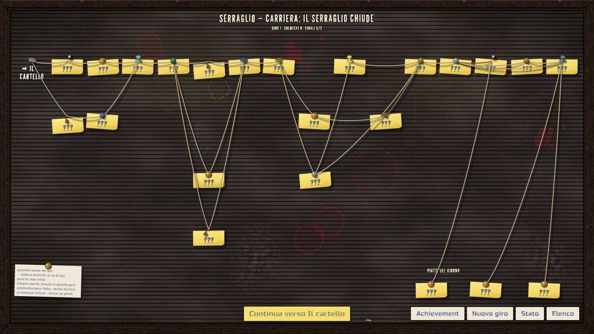

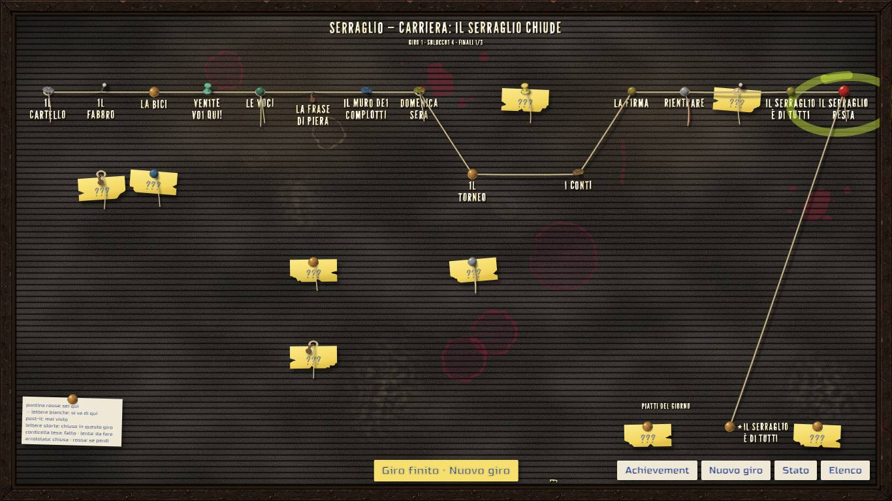

Sul telefono: [la bacheca nuova](../../../prototipi/carriere/catture/p37d-v-01-mappa-intera.jpg),
[la catena a metà](../../../prototipi/carriere/catture/p37d-v-02-catena-a-meta.jpg),
[la bacheca a giro finito](../../../prototipi/carriere/catture/p37d-v-03-fine-giro.jpg). Sei catture, 684 KB in tutto.

### Verifiche

| Comando | Esito |
|---|---|
| `run.ps1 -Task Test` | verdi: 133 prove (prima 130). Nuove: i ripieghi (espressioni, stacchi, sfondi, «Un signore»), la scena finale nel controllo, il PvP dopo le battute |
| `run.ps1 -Task Check` | verde: tutorial 6/6, prova 8/8, principale 27/27; 0 errori e 0 avvisi su tutte e tre |
| `run.ps1 -Task Build` | verde (`tsc` e `vite`). Lanciato con l'uscita rediretta (`*>`), un avviso di vite su stderr diventa un'eccezione di PowerShell 5.1; senza redirezione è verde |
| Convert | 0 errori; avvisi: 258 sulla principale (245 espressioni, 10 sfondi, 3 scelte di II1), 1 sul tutorial (domanda 3) |
| `strumenti/catture-principale.mjs` | verde, giocando dall'interfaccia: sconfitte e segreti nascosti all'inizio, F3 sulla bacheca nuova, la catena a metà, F1 dopo la catena vinta, il secondo giro perso al primo duello che finisce in «Disco pub» con F3 giocata |
| `git diff --check`, `python scripts/check-rules.py`, `python scripts/check-links.py` | verdi; nessun link rotto |
| Mutazioni | 7 sulla logica nuova, tutte prese (sotto) |

Non eseguiti, come chiesto: Misura, Banco e Registra (il Set Base può avere una misura lunga in corso su questa macchina).

| Mutazione | Prove che la prendono |
|---|---|
| Ripiego senza `*` | 19 |
| Ripiego verso un'espressione che il personaggio non ha | 1: i ripieghi |
| Ripiego dello sfondo senza la variante | 1: i ripieghi |
| Negli stacchi il ripiego si scarta | 1: i ripieghi |
| Nessuna esenzione per la scena finale | 2: il controllo della principale, la scena finale |
| Ogni nodo raggiunto perdendo conta come scena finale | 2: l'avviso del nodo non segreto, la scena finale |
| Il PvP dopo le battute non si conta | 2: i numeri per giro, il PvP dopo le battute |

Una prima versione dell'esenzione chiedeva anche «nessuna scelta nel nodo»: la mutazione che lo toglieva non rompeva niente, perché un
nodo che finisce con una scelta non ha uscite. La condizione era ridondante ed è stata tolta.

### Scelte prese

- **`storie/principale.md` resta come storia**, con una nota in testa, invece di cancellarla: tre sezioni qui sopra la linkano.
- **I ripieghi stanno nel cast**, non nel convertitore: quando arriva un ritratto o uno sfondo si toglie la voce e l'avviso sparisce.
- **Mara e Spazienzio hanno ripieghi uno per uno**, scelti fra i ritratti che ci sono; i cartoncini un `*` verso «neutra».
- **La notte e il buio di S2 sono il disordine**, come nel mockup della 0.3; «di giorno» e «dentro» l'immagine di base.
- **«Un signore» è un alias di Sergio** nel cast: niente nome, ritratto di Sergio.
- **F3 è visibile da subito**, come gli altri finali, con la sua cordicella rossa (domanda 1).
- **Le prove del segnaposto sono diventate prove del testo**, con gli stessi controlli dove il testo li regge; quelle sul segno `rientro`,
  che il testo non ha, leggono ora `chiave` e `via-atto-3`.

### Domande per il proprietario

1. **F3 visibile o segreta?** Nel testo F3 è una scena senza `[Nodo: …]`, quindi sulla bacheca nuova si vede con la cordicella rossa da
   III5, come il vecchio finale «Disco pub». Se deve comparire solo dopo averla persa, la modifica al testo è una riga sotto
   `## F3 — Disco pub`: `[Nodo: segreto]`. Il prototipo la tiene visibile (scelta presa).
2. **Le piste di II1:** per avere il personaggio sull'etichetta della bacheca, le tre opzioni diventerebbero
   `- con Piera, che si ricorda di dieci anni fa …`, `- con Beppe, che sa chi pagava in contanti …` e
   `- con Celestina, che fruga nel bidone …`. Senza la modifica funziona tutto, con tre avvisi.
3. **La citazione nell'epilogo del tutorial:** il blocco `> **Stesura della regia…**` sotto il titolo dell'epilogo è una nota di
   redazione dentro la scena; il convertitore la tiene come nota e avvisa. Spostarla nelle note in fondo a `tutorial-dialoghi.md` toglie
   l'avviso; in alternativa il convertitore può accettare le citazioni come note senza avviso.

### Risposte del proprietario e della regia

20 novembre 2026, revisione della regia: blocco approvato, verifiche rifatte (133 prove, Check verde, testi del proprietario intatti).

1. **F3 visibile:** già deciso dal proprietario nella 0.3.2 («F3 resta visibile»); la scelta del prototipo è giusta.
2. **Piste di II1:** il proprietario approva la forma «con Piera, …», «con Beppe, …», «con Celestina, …» («Sì, applica»), applicata nei
   dialoghi; i tre avvisi spariscono e la prova della principale non li conta più (255 avvisi, solo ripieghi).
3. **Nota nell'epilogo:** spostata dalla regia nelle note in fondo a `tutorial-dialoghi.md` (commit `3f799f6`); l'avviso sparisce.
