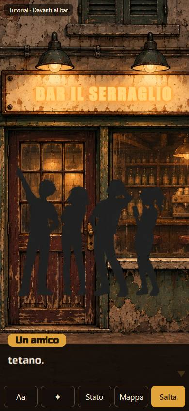
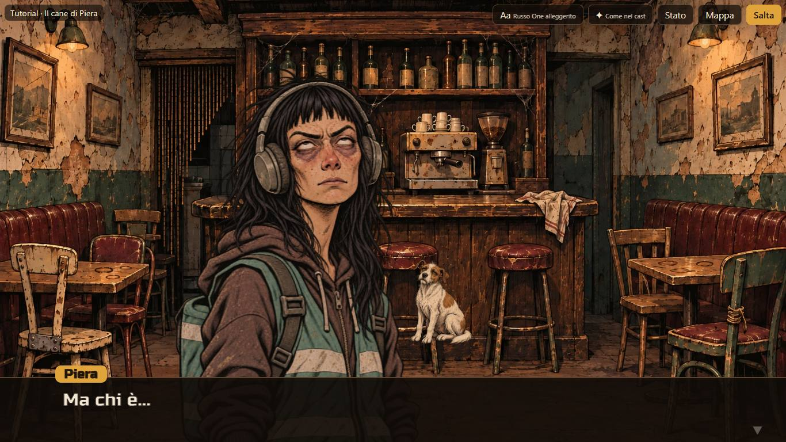
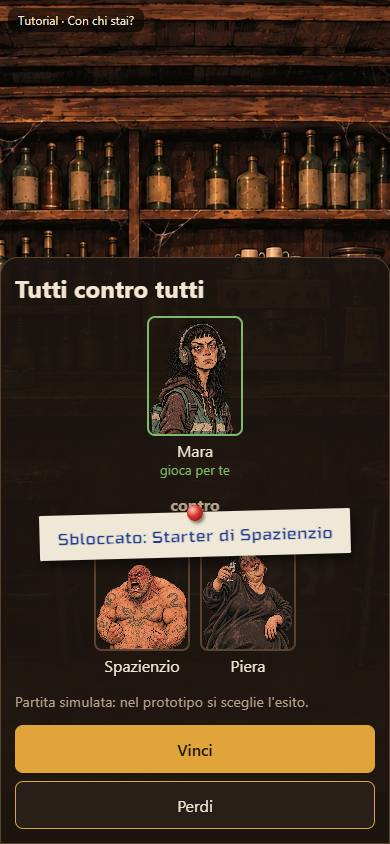
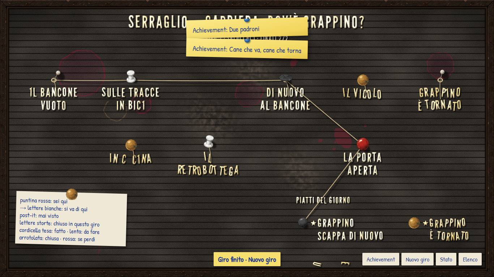
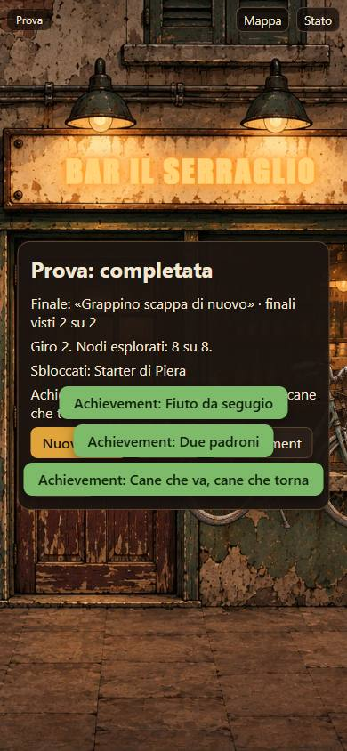

# Carriere — prototipo CA-0a, rapporto della Fase B

> Rapporto dell'esecutore, scritto l'11 novembre 2026 dopo la costruzione del prototipo descritto in [prototipo.md](prototipo.md),
> secondo la [proposta della Fase A](prototipo-fase-a.md) e le decisioni T1–T9 della
> [revisione della regia](prototipo-fase-a.md#revisione-della-regia); aggiornato lo stesso giorno con le risposte del proprietario
> a P1–P8 ([sotto](#risposte-del-proprietario-p1p8)). Lo stato sta nella riga di CA-0a dei
> [lavori anticipati](../../product-roadmap.md#lavori-anticipati). Senza valore normativo.

## In breve

Il prototipo funziona su PC, in orizzontale e in verticale. Si giocano il tutorial intero e la mini-carriera «Dov'è Grappino?», con
gli asset approvati, la mappa a rombi, le partite simulate, due finali e gli achievement. Il controllo del grafo è verde sulle due
carriere, le 30 prove unitarie sono verdi e le 11 mutazioni sono state prese tutte. Le catture Playwright giocano davvero i percorsi e
fanno anche da prova di bordo. Le risposte P1–P8 del proprietario sono applicate; [tutorial-dialoghi.md](tutorial-dialoghi.md) ora
contiene le 19 righe per il lettore (P1). **Non verificato sul telefono vero:** `Phone` si avvia sull'indirizzo privato, ma nessuno l'ha
aperto da un telefono.

## Come si avvia

Dalla radice del repository, con Node predisposto (`./client-c0/run.ps1 -Task Bootstrap`, se manca):

```powershell
./prototipi/carriere/run.ps1 -Task Install -Offline   # una volta: 25 pacchetti dalla cache di npm, senza rete
./prototipi/carriere/run.ps1 -Task Dev                # PC: http://127.0.0.1:4330/
```

**Sul telefono,** sulla stessa rete Wi-Fi del PC: `./prototipi/carriere/run.ps1 -Task Phone`, poi aprire dal telefono l'indirizzo che il
comando stampa («Dal telefono, sulla stessa rete: http://192.168.…:4330/»). Parte solo quando lo si chiede e non ha codice d'accesso (T5):
serve solo i file del prototipo e gli asset già nel repository. Se Windows chiede di consentire Node sulla rete privata, va consentito.

Gli altri comandi: `Test` (prove unitarie), `Convert` (markdown → `dati/generati/*.json`), `Check` (controllo del grafo), `Build`, `Shots`
(catture, `-Out <cartella>` per scegliere dove), `Lock` (rigenera il lock dal lock di client-web, T3).

## Cosa c'è

| Pezzo | Dove | Note |
|---|---|---|
| Formato dei dati | [`src/formato.ts`](../../../prototipi/carriere/src/formato.ts) | come nella proposta, con le piccole aggiunte di P7 e P8 (sotto); il cast ha in più la posizione degli sprite e l'insegna |
| Controllo di validità | [`src/valida.ts`](../../../prototipi/carriere/src/valida.ts) | scritto a mano (T1): forma, campi sconosciuti, riferimenti a nodi, finali, personaggi, espressioni, sfondi, varianti, sprite, pose e achievement; ogni errore dice il percorso del campo (`nodi[1].uscita.verso.nodo: nodo sconosciuto: nodo-z`). Gira anche nel browser, al caricamento |
| Convertitore | [`src/converti.ts`](../../../prototipi/carriere/src/converti.ts), [`strumenti/converti.ts`](../../../prototipi/carriere/strumenti/converti.ts) | quello della Fase A; `--tutti` scrive `dati/generati/` (ignorato da git, T2) |
| Controllo del grafo | [`src/grafo.ts`](../../../prototipi/carriere/src/grafo.ts), [`strumenti/controlla.ts`](../../../prototipi/carriere/strumenti/controlla.ts) | esplorazione degli stati (T6), sotto |
| Giro, account, condizioni | [`src/motore.ts`](../../../prototipi/carriere/src/motore.ts) | funzioni pure: le usano l'interfaccia e le prove |
| Mappa | [`src/mappa.ts`](../../../prototipi/carriere/src/mappa.ts) | archi, colonne e righe, stato di ogni casella, nodi e finali |
| Interfaccia | [`src/ui/`](../../../prototipi/carriere/src/ui/App.tsx) | React 19, senza librerie in più |
| Carriere | [tutorial-dialoghi.md](tutorial-dialoghi.md), [`storie/prova.md`](../../../prototipi/carriere/storie/prova.md) | elenco in [`strumenti/carriere.ts`](../../../prototipi/carriere/strumenti/carriere.ts) |
| Avvio | [`run.ps1`](../../../prototipi/carriere/run.ps1), [`package.json`](../../../prototipi/carriere/package.json), [`strumenti/deriva-lock.mjs`](../../../prototipi/carriere/strumenti/deriva-lock.mjs) | stesso Node, stessa cache e stesse versioni di client-web; porta 4330, anteprima 4331 |
| Catture | [`strumenti/catture.mjs`](../../../prototipi/carriere/strumenti/catture.mjs), [`catture/`](../../../prototipi/carriere/catture/o-04-scena0-mara.jpg) | 28 scelte su 44 |

### Il controllo del grafo

Esplora gli stati raggiungibili di un giro: nodo, segni, nodi visti, partite vinte e perse, sblocchi e achievement del giro. Le condizioni
si valutano davvero; gli atomi dell'account (`esplorato`, `achievement`, `finale`, `giri`) valgono «forse», con un tetto di 200 000
stati. Controlla: ogni nodo raggiungibile; nessun vicolo cieco (né cicli senza fine, né nodi con una condizione falsa all'arrivo); ogni
scelta con almeno un'opzione visibile; gli sblocchi obbligatori in ogni fine completata, qualunque sia il finale; ogni nodo segreto e
ogni achievement con almeno un percorso; le partite contro un segno non assegnato. Come avvisi: gli indizi che non possono comparire e le
battute con condizione che non si vedono mai. Una sconfitta che apre un ramo porta solo lì (P3); senza ramo, vincere dopo un ritento è un
altro stato, perché `perso` cambia.

```text
tutorial: 6/6 nodi raggiunti, 72 stati, fini completate 2 e fallite 0, finali: completata (2), segreti: nessuno, obbligatori: starter-mara, starter-spazienzio, carriera-principale; 0 errori, 0 avvisi
prova: 8/8 nodi raggiunti, 28 stati, fini completate 4 e fallite 0, finali: grappino-e-tornato (2), grappino-scappa-di-nuovo (2), segreti: nodo-f (da nodo-d), obbligatori: starter-piera; 0 errori, 0 avvisi
```

Vede ciò che l'abbozzo della Fase A non vedeva: per esempio, se l'opzione verso il vicolo chiede di aver visto sia B sia E, il vicolo non è
più raggiungibile in nessun giro, e il controllo lo dice insieme all'achievement che ne dipende; se lo sblocco obbligatorio sta solo su uno
dei due finali, dice che manca su un percorso.

### Le schermate

Come nella proposta ([schermate](prototipo-fase-a.md#le-schermate)): elenco, mappa, scena, notifica, scelta muta, risposta sul telefono,
partita simulata, sconfitta con ritento, fine del giro con il nome del finale, achievement, pannello dello stato. Alcune catture:

| Orizzontale 1366×768 | Verticale 390×844 |
|---|---|
|  |  |
|  |  |
|  |  |

Le altre in [`prototipi/carriere/catture/`](../../../prototipi/carriere/catture/o-02-mappa-inizio.jpg): mappa all'inizio (con le caselle
dei finali, «???»), scelta muta, telefono, fine del tutorial, mappa subito dopo la sconfitta che apre il retrobottega, scelta con l'opzione
condizionale, vicolo, mappa del nuovo giro, achievement, in tutti e due gli orientamenti. Gli avvisi verdi che si accumulano in alcune
catture vengono da passi di pochi secondi prima: lo script gioca molto più in fretta di una persona. Dopo le risposte del proprietario
sono state rifatte e sostituite solo le catture che cambiano (mappe, sconfitta, scelta in D, achievement) e aggiunte le due dei finali.

### Scelte fatte costruendo

- **Insegna sovrapposta:** la specifica vuole gli sfondi senza scritte, quindi «BAR IL SERRAGLIO» la scrive il lettore sull'insegna di S1,
  con posizione nel cast; si spegne nella variante «insegna-spenta», così lo sfarfallio si vede anche sulla scritta.
- **Sprite posati sulle coordinate dello sfondo,** non dello schermo, perché lo sfondo è ritagliato in modo diverso nei due orientamenti.
  Posizione e altezza stanno nel cast; i piedi al 74% dell'altezza dello sfondo, sopra la finestra di dialogo, invece che sul marciapiede in
  basso, che la finestra copre (specifica, «parte bassa tranquilla»).
- **Un luogo nuovo svuota la scena:** cambiando sfondo gli sprite spariscono (la bici di Mara resta fuori dal bar); una variante dello
  stesso sfondo li tiene (Grappino resta nel bar in disordine).
- **La mappa è il passaggio fra i nodi:** a fine nodo si torna alla mappa con il nodo seguente acceso e «Continua». Le righe seguono il ramo
  del predecessore (E sta sulla riga di C); un arco che salta una colonna si incurva per non passare sotto la casella di mezzo.
- **Stacchi:** la battuta si divide dopo i puntini; fra un pezzo e l'altro 0,9 s sul ritratto di chi ascolta, a turno. «Interrotta»: la
  battuta dopo entra a metà dell'ultimo pezzo. Velocità: 45 caratteri al secondo per 1, Piera 0,3, Mara 1,2.

## Risposte del proprietario (P1–P8)

Registrate dalla regia in [prototipo-fase-a.md](prototipo-fase-a.md#revisione-della-regia) e applicate qui.

| Domanda | Risposta | Cosa è cambiato |
|---|---|---|
| P1 | «sì» | Le 19 righe sono entrate in [tutorial-dialoghi.md](tutorial-dialoghi.md), senza toccare le battute; il file delle integrazioni è cancellato. Una prova controlla che le vecchie forme a parole restino errori chiari |
| P2 | «alternandole» | A ogni sconfitta una sola battuta di ritento, a turno fra quelle scritte (Mara, Spazienzio, Mara…); si salta come prima |
| P3 | «parte da sola» | La sconfitta che apre un ramo porta direttamente alla mappa con l'altra strada accesa, senza «Ritenta»; un avviso dice «Hai perso… e si apre un'altra strada». Anche il controllo del grafo non considera più il ritento in quel caso |
| P4 | «sulla scena» | Nessun cambiamento: la scelta muta resta nella scena, con i ritratti |
| P5 | «sì» | Nessun cambiamento |
| P6 | «vanno bene i tuoi» | Nessun cambiamento: testi segnaposto della regia |
| P7 | «sì, una seconda fine» | Nodo H, «La porta aperta», raggiunto da D scegliendo Mara: Grappino scappa di nuovo. Due finali con nome, caselle dei finali sulla mappa, nome del finale e «finali visti» nella schermata di fine, un terzo achievement visibile per averli visti tutti e due |
| P8 | «serviranno sicuramente espressioni esasperate» | Nel cast `espressioniFuture`: «esasperata» per Mara, «esasperato» per Spazienzio, senza file. Il convertitore le rifiuta con «espressione prevista ma ancora senza ritratto (P8)»; gli stacchi di Piera restano su «neutra» e «quasi calmo» |

**Estensioni del formato, le più piccole possibili:**

- **Fine con nome (P7):** la destinazione `{fine: 'completata'}` prende un campo facoltativo `finale` con il titolo
  (`{fine: 'completata', finale: 'Grappino scappa di nuovo'}`). Nel markdown: `→ Fine: completata, Grappino scappa di nuovo`. L'id del
  finale è il titolo in minuscolo con trattini (`grappino-scappa-di-nuovo`), o l'esito per una fine senza nome: il tutorial non cambia.
- **Condizione `finale` (P7):** `[Quando: finale Grappino è tornato e finale Grappino scappa di nuovo]`, un atomo dell'account come
  `esplorato`; il convertitore e il controllo di validità rifiutano un finale che non esiste.
- **Stato del giocatore:** l'account conserva i finali visti; il giro conta le sconfitte per nodo (per la battuta di ritento a turno) e il
  finale raggiunto. Un salvataggio di prima si completa da solo.
- **Cast:** `espressioniFuture` (P8).

**Mini-carriera, adesso:** otto nodi; da D si va da Piera a G («Grappino è tornato»), con Spazienzio al vicolo F se si è visto il
retrobottega, con Mara a H («Grappino scappa di nuovo»). Lo sblocco `starter-piera` resta in D, prima della scelta, quindi su tutti e due i
finali. Achievement: *Fiuto da segugio* (nascosto), *Due padroni* (B e C in giri diversi), *Cane che va, cane che torna* (visibile, tutti
e due i finali, con l'indizio chiaro dopo il primo).

## Verifiche

| Verifica | Esito |
|---|---|
| `run.ps1 -Task Install -Offline` | verde: 25 pacchetti dalla cache, lock derivato da client-web (51 voci) |
| `run.ps1 -Task Test` | verde: 30 prove (convertitore 9, motore 9, grafo, validità e mappa 12) |
| `run.ps1 -Task Check` | verde, uscita sopra |
| `run.ps1 -Task Build` | verde: `tsc --noEmit` stretto e `vite build`; asset presi dal loro posto |
| `run.ps1 -Task Shots` | verde: 44 catture, il tutorial e due giri della prova (il secondo fino al nuovo finale) giocati per intero in tutti e due gli orientamenti, senza errori nella pagina né richieste fallite |
| Mutazioni | 11 su 11 prese (sotto) |
| `python scripts/check-links.py`, `python scripts/check-rules.py`, `git diff --check` | verdi |
| Verifiche di client-web e del server | non pertinenti (T8): il blocco non tocca quei file |

**Mutazioni** (una alla volta, ognuna fa fallire almeno una prova): il nodo non si segna come visto nell'esplorazione; la sconfitta non
apre il ramo nell'esplorazione; gli obbligatori controllati sulle fini fallite; «tutti» vero se uno solo è vero; il segno che ignora il
valore; la fine che non conta il giro; la mappa senza nodi esclusi; la scena che non si svuota cambiando luogo; il ritento sempre con la
prima battuta (P2); la sconfitta che apre un ramo che chiede il ritento (P3); i finali senza id distinto (P7).

**Rossi:** nessuno. **Prova a mano** nel browser integrato a 1366×768, prima delle catture: elenco, mappa, scena 0 con insegna, sagome, bici
e ritratto di Mara.

## Non verificato e limiti

- **Telefono vero:** `Phone` sceglie l'indirizzo privato e si avvia (provato per pochi secondi); nessuno l'ha aperto da un telefono, né in
  orizzontale né in verticale. La verticale è provata solo a 390×844 nel browser del PC.
- **Il tocco** è provato con il mouse e con Playwright, non con un dito: la misura dei pulsanti sul telefono è da guardare.
- **L'epilogo del tutorial non si vede:** non ha battute («da scrivere»), quindi si attraversa in un istante, l'achievement compare come
  avviso sulla mappa e lo sfondo S3 non si vede mai. Si vedrà quando ci saranno le battute.
- **Suoni:** nei dati (`[Suono: frenata]`) ma non suonati, come previsto.
- **Due avvisi del convertitore** sul tutorial, attesi: i paragrafi dell'epilogo «da scrivere».
- **Un salvataggio** che punta a un nodo sparito (storia cambiata) riparte da un giro nuovo e conserva l'account; non c'è migrazione oltre al
  completamento dei campi nuovi.
- **Gli sprite sono posati a occhio** su S1 e S2; se una posa non piace si corregge nel cast, senza codice.

## Cosa giudica il proprietario

Dal vivo, su PC e sul telefono ([cosa giudica](prototipo.md#cosa-giudica-il-proprietario)): se la mappa fa capire dove si è e cosa manca,
finali compresi; se le scene «si leggono» come una visual novel (velocità del testo, regia di Piera, insegna, sagome, bici, Grappino); se
il ritmo del tutorial regge, con la prima partita dopo la scena 1; se la scelta muta, la risposta sul telefono, la sconfitta che porta da
sola al retrobottega e il secondo finale funzionano come se le immagina.

## Prova del proprietario

11 novembre 2026, su PC e su telefono. **«In generale comunque la direzione è giusta.»** Impressioni, con le sue parole:

1. **Finestra di dialogo troppo alta:** «su schermo verticale, la sezione dei dialoghi è troppo alta. Anche su schermo orizzontale, ma sul
   verticale è proprio esagerata».
2. **Carattere dei dialoghi:** «il font con cui si scrivono i dialoghi è troppo piccolo e poco coinvolgente, possiamo trovarne uno più bello».
3. **Ritratti in verticale:** «le figure a schermo verticale possono essere più grandi».
4. **Stacchi di Piera troppo brevi:** «quando Piera parla, le figure che compaiono stanno troppo poco, non si fa in tempo a vederle. Le farei
   andare avanti con un click o con un tap, o semplicemente ce le farei stare di più».
5. **Mappa e aspetto generale scarni:** «la mappa, ma anche il feel generale, è troppo scarno. Immagino che sia perché è un prototipo, ma
   manca di carattere e di profondità. È un videogioco, ma sembra un organigramma di una qualche app business».
6. **Pulsanti sul telefono:** «non sono facilissimi da premere, li farei più grandi e immediati».
7. **Intrecci nel grafo della mappa:** «ci sono un po' di intrecci».

Prossimo passo: una fase di ritocchi, con i concetti per dare carattere alla mappa scelti dal proprietario.
