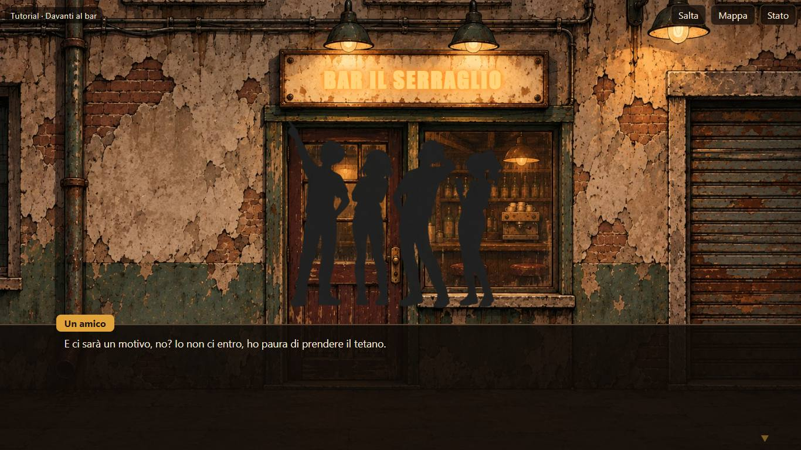
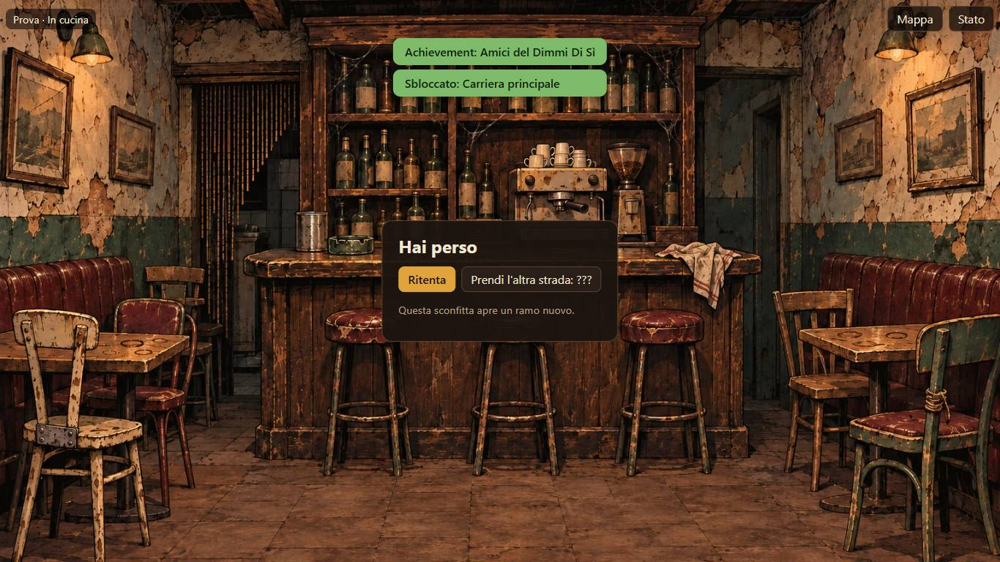
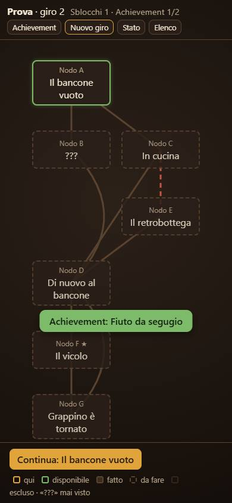

# Carriere — prototipo CA-0a, rapporto della Fase B

> Rapporto dell'esecutore, scritto l'11 novembre 2026 dopo la costruzione del prototipo descritto in [prototipo.md](prototipo.md),
> secondo la [proposta della Fase A](prototipo-fase-a.md) e le decisioni T1–T9 della
> [revisione della regia](prototipo-fase-a.md#revisione-della-regia). Lo stato sta nella riga di CA-0a dei
> [lavori anticipati](../../product-roadmap.md#lavori-anticipati). Senza valore normativo.

## In breve

Il prototipo funziona su PC, in orizzontale e in verticale: si gioca il tutorial intero e la mini-carriera «Dov'è Grappino?»
con gli asset approvati, la mappa a rombi, le partite simulate e gli achievement. Il controllo del grafo è verde sulle due carriere,
le 24 prove unitarie sono verdi e le 8 mutazioni sono state prese tutte. Le catture Playwright giocano davvero i due percorsi e servono anche
da prova di bordo. **Non verificato sul telefono vero:** `Phone` si avvia sull'indirizzo privato, ma nessuno l'ha aperto da un telefono.
Le domande P1–P8 sono ancora del proprietario: il prototipo usa le proposte della Fase A, e **tutorial-dialoghi.md non è stato toccato**.

## Come si avvia

Dalla radice del repository, con Node predisposto (`./client-c0/run.ps1 -Task Bootstrap`, se manca):

```powershell
./prototipi/carriere/run.ps1 -Task Install -Offline   # una volta: 25 pacchetti dalla cache di npm, senza rete
./prototipi/carriere/run.ps1 -Task Dev                # PC: http://127.0.0.1:4330/
```

**Sul telefono,** sulla stessa rete Wi-Fi del PC: `./prototipi/carriere/run.ps1 -Task Phone`, poi aprire dal telefono l'indirizzo che il
comando stampa («Dal telefono, sulla stessa rete: http://192.168.…:4330/»). Parte solo quando lo si chiede e non ha codice d'accesso (T5):
serve solo i file del prototipo e gli asset già nel repository. Se Windows chiede di consentire Node sulla rete privata, va consentito.

Gli altri comandi: `Test` (prove unitarie), `Convert` (markdown → `dati/generati/*.json`), `Check` (controllo del grafo), `Build`, `Shots`
(catture, `-Out <cartella>` per scegliere dove), `Lock` (rigenera il lock dal lock di client-web, T3).

## Cosa c'è

| Pezzo | Dove | Note |
|---|---|---|
| Formato dei dati | [`src/formato.ts`](../../../prototipi/carriere/src/formato.ts) | come nella proposta; il cast ha in più la posizione degli sprite e l'insegna (sotto) |
| Controllo di validità | [`src/valida.ts`](../../../prototipi/carriere/src/valida.ts) | scritto a mano (T1): forma, campi sconosciuti, riferimenti a nodi, personaggi, espressioni, sfondi, varianti, sprite, pose e achievement; ogni errore dice il percorso del campo (`nodi[1].uscita.verso.nodo: nodo sconosciuto: nodo-z`). Gira anche nel browser, al caricamento |
| Convertitore | [`src/converti.ts`](../../../prototipi/carriere/src/converti.ts), [`strumenti/converti.ts`](../../../prototipi/carriere/strumenti/converti.ts) | quello della Fase A; `--tutti` scrive `dati/generati/` (ignorato da git, T2) |
| Controllo del grafo | [`src/grafo.ts`](../../../prototipi/carriere/src/grafo.ts), [`strumenti/controlla.ts`](../../../prototipi/carriere/strumenti/controlla.ts) | esplorazione degli stati (T6), sotto |
| Giro, account, condizioni | [`src/motore.ts`](../../../prototipi/carriere/src/motore.ts) | funzioni pure: le usano l'interfaccia e le prove |
| Mappa | [`src/mappa.ts`](../../../prototipi/carriere/src/mappa.ts) | archi, colonne e righe, stato di ogni nodo |
| Interfaccia | [`src/ui/`](../../../prototipi/carriere/src/ui/App.tsx) | React 19, senza librerie in più |
| Carriere | [tutorial-dialoghi.md](tutorial-dialoghi.md) con le [integrazioni in memoria](../../../prototipi/carriere/tests/integrazioni-tutorial.ts) (P1), [`storie/prova.md`](../../../prototipi/carriere/storie/prova.md) | elenco in [`strumenti/carriere.ts`](../../../prototipi/carriere/strumenti/carriere.ts) |
| Avvio | [`run.ps1`](../../../prototipi/carriere/run.ps1), [`package.json`](../../../prototipi/carriere/package.json), [`strumenti/deriva-lock.mjs`](../../../prototipi/carriere/strumenti/deriva-lock.mjs) | stesso Node, stessa cache e stesse versioni di client-web; porta 4330, anteprima 4331 |
| Catture | [`strumenti/catture.mjs`](../../../prototipi/carriere/strumenti/catture.mjs), [`catture/`](../../../prototipi/carriere/catture/o-04-scena0-mara.jpg) | 24 scelte su 42, 2,2 MB |

### Il controllo del grafo

Esplora gli stati raggiungibili di un giro: nodo, segni, nodi visti, partite vinte e perse, sblocchi e achievement del giro. Le condizioni
si valutano davvero; gli atomi dell'account (`esplorato`, `achievement`, `giri`) valgono «forse», con un tetto di 200 000 stati. Controlla:
ogni nodo raggiungibile; nessun vicolo cieco (né cicli senza fine, né nodi con una condizione falsa all'arrivo); ogni scelta con almeno
un'opzione visibile; gli sblocchi obbligatori in ogni fine completata; ogni nodo segreto e ogni achievement con almeno un percorso; le
partite contro un segno non assegnato. Come avvisi: gli indizi che non possono comparire e le battute con condizione che non si vedono mai.
Una sconfitta che apre un ramo dà due strade, prenderlo o ritentare (P3); vincere dopo un ritento è un altro stato, perché `perso` cambia.

```text
tutorial: 6/6 nodi raggiunti, 72 stati, fini completate 2 e fallite 0, segreti: nessuno, obbligatori: starter-mara, starter-spazienzio, carriera-principale; 0 errori, 0 avvisi
prova: 7/7 nodi raggiunti, 23 stati, fini completate 2 e fallite 0, segreti: nodo-f (da nodo-d), obbligatori: starter-piera; 0 errori, 0 avvisi
```

Vede ciò che l'abbozzo della Fase A non vedeva: per esempio, se l'opzione verso il vicolo chiede di aver visto sia B sia E, il vicolo non è
più raggiungibile in nessun giro, e il controllo lo dice insieme all'achievement che ne dipende.

### Le schermate

Come nella proposta ([schermate](prototipo-fase-a.md#le-schermate)): elenco, mappa, scena, notifica, scelta muta, risposta sul telefono,
partita simulata, sconfitta, fine del giro, achievement, pannello dello stato. Alcune catture:

| Orizzontale 1366×768 | Verticale 390×844 |
|---|---|
|  |  |
|  |  |
|  |  |

Le altre in [`prototipi/carriere/catture/`](../../../prototipi/carriere/catture/o-02-mappa-inizio.jpg): mappa all'inizio, scelta muta, telefono,
fine del tutorial, scelta con l'opzione condizionale, vicolo, mappa del nuovo giro, achievement, in tutti e due gli orientamenti. Gli avvisi
verdi che compaiono in alcune catture vengono da passi di pochi secondi prima: lo script gioca molto più in fretta di una persona.

### Scelte fatte costruendo

- **Insegna sovrapposta:** la specifica vuole gli sfondi senza scritte, quindi «BAR IL SERRAGLIO» la scrive il lettore sull'insegna di S1,
  con posizione nel cast; si spegne nella variante «insegna-spenta», così lo sfarfallio si vede anche sulla scritta.
- **Sprite posati sulle coordinate dello sfondo,** non dello schermo, perché lo sfondo è ritagliato in modo diverso nei due orientamenti.
  Posizione e altezza stanno nel cast; i piedi al 74% dell'altezza dello sfondo, sopra la finestra di dialogo, invece che sul marciapiede in
  basso, che la finestra copre (specifica, «parte bassa tranquilla»).
- **Un luogo nuovo svuota la scena:** cambiando sfondo gli sprite spariscono (la bici di Mara resta fuori dal bar); una variante dello
  stesso sfondo li tiene (Grappino resta nel bar in disordine).
- **La mappa è il passaggio fra i nodi:** a fine nodo si torna alla mappa con il nodo seguente acceso e «Continua». Le righe seguono il ramo
  del predecessore (E sta sulla riga di C); un arco che salta una colonna si incurva per non passare sotto la casella di mezzo.
- **Stacchi:** la battuta si divide dopo i puntini; fra un pezzo e l'altro 0,9 s sul ritratto di chi ascolta, a turno. «Interrotta»: la
  battuta dopo entra a metà dell'ultimo pezzo. Velocità: 45 caratteri al secondo per 1, Piera 0,3, Mara 1,2.
- **Valori iniziali delle domande P1–P8:** quelli proposti. Battute di ritento tutte e due in ordine (P2), sconfitta con «Ritenta» e «Prendi
  l'altra strada» (P3), scelta muta nella scena con i ritratti (P4), «???» e segreti invisibili (P5), testi segnaposto (P6), stacchi con
  «neutra» e «quasi calmo» (P8).

## Verifiche

| Verifica | Esito |
|---|---|
| `run.ps1 -Task Install -Offline` | verde: 25 pacchetti dalla cache, lock derivato da client-web (51 voci) |
| `run.ps1 -Task Test` | verde: 24 prove (convertitore 7, motore 7, grafo, validità e mappa 10) |
| `run.ps1 -Task Check` | verde, uscita sopra |
| `run.ps1 -Task Build` | verde: `tsc --noEmit` stretto e `vite build`; JS 279 KB (87 KB compresso), asset presi dal loro posto |
| `run.ps1 -Task Shots` | verde: 42 catture, i due percorsi giocati per intero in tutti e due gli orientamenti, senza errori nella pagina né richieste fallite |
| Mutazioni | 8 su 8 prese (sotto) |
| `python scripts/check-links.py`, `python scripts/check-rules.py`, `git diff --check` | verdi |
| Verifiche di client-web e del server | non pertinenti (T8): il blocco non tocca quei file |

**Mutazioni** (una alla volta, ognuna fa fallire almeno una prova): il nodo non si segna come visto nell'esplorazione; la sconfitta non
apre il ramo; gli obbligatori controllati sulle fini fallite; «tutti» vero se uno solo è vero; il segno che ignora il valore; la fine che
non conta il giro; la mappa senza nodi esclusi; la scena che non si svuota cambiando luogo.

**Rossi:** nessuno. **Prova a mano** nel browser integrato a 1366×768, prima delle catture: elenco, mappa, scena 0 con insegna, sagome, bici
e ritratto di Mara.

## Non verificato e limiti

- **Telefono vero:** `Phone` sceglie l'indirizzo privato e si avvia (provato per pochi secondi); nessuno l'ha aperto da un telefono, né in
  orizzontale né in verticale. La verticale è provata solo a 390×844 nel browser del PC.
- **Il tocco** è provato con il mouse e con Playwright, non con un dito: la misura dei pulsanti sul telefono è da guardare.
- **L'epilogo del tutorial non si vede:** non ha battute («da scrivere»), quindi si attraversa in un istante, l'achievement compare come
  avviso sulla mappa e lo sfondo S3 non si vede mai. Si vedrà quando ci saranno le battute.
- **Suoni:** nei dati (`[Suono: frenata]`) ma non suonati, come previsto.
- **Due avvisi del convertitore** sul tutorial, attesi: i paragrafi dell'epilogo «da scrivere».
- **Un salvataggio** che punta a un nodo sparito (storia cambiata) riparte da un giro nuovo e conserva l'account; non c'è migrazione.
- **Gli sprite sono posati a occhio** su S1 e S2; se una posa non piace si corregge nel cast, senza codice.

## Cosa giudica il proprietario

Dal vivo, su PC e sul telefono ([cosa giudica](prototipo.md#cosa-giudica-il-proprietario)): se la mappa fa capire dove si è e cosa manca;
se le scene «si leggono» come una visual novel (velocità del testo, regia di Piera, insegna, sagome, bici, Grappino); se il ritmo del
tutorial regge, con la prima partita dopo la scena 1; se la scelta muta, la risposta sul telefono e la sconfitta che apre il retrobottega
funzionano come se le immagina. E le domande P1–P8 della proposta, che la regia gli ha portato: le risposte si applicano al prototipo se
costano poco.
