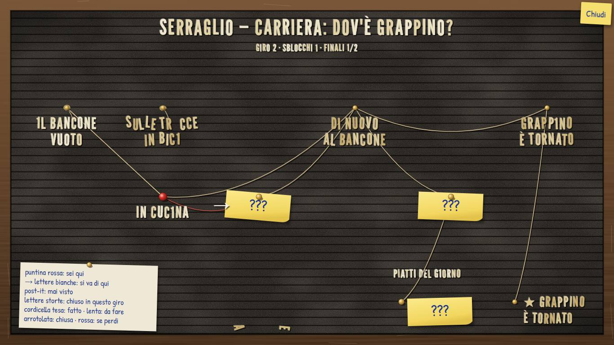
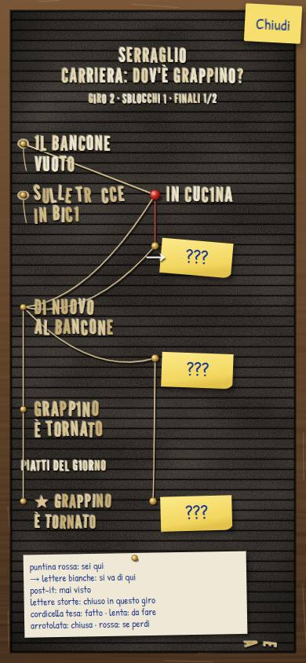

# Carriere — prototipo CA-0a, rapporto della Fase C

> Rapporto dell'esecutore, scritto l'11 novembre 2026 dopo i ritocchi chiesti dalla [prova del proprietario](prototipo-fase-b.md#prova-del-proprietario)
> («la direzione è giusta») e il bozzetto della [bacheca a lettere](bacheca.md), come da [prototipo.md](prototipo.md#fase-c-ritocchi-dopo-la-prova).
> Lo stato sta nella riga di CA-0a dei [lavori anticipati](../../product-roadmap.md#lavori-anticipati). Senza valore normativo.

## In breve

I sei ritocchi diretti sono fatti: finestra di dialogo più bassa, tre font da confrontare con un selettore, ritratti più grandi in
verticale, stacchi di Piera che restano fino al tocco, pulsanti da 48 px con le azioni in basso sul telefono, meno incroci nella mappa.
Il **bozzetto della bacheca** si apre dall'elenco con «Bozzetto bacheca»: la mini-carriera a metà del secondo giro, nei due orientamenti,
tutta disegnata dal codice. La mappa vera non è cambiata. Prove, controllo del grafo, build e catture sono verdi. **Non verificato su un
telefono vero.**

## Come si vede

Come nella [Fase B](prototipo-fase-b.md#come-si-avvia): `./prototipi/carriere/run.ps1 -Task Dev` sul PC, `-Task Phone` per il telefono
sulla stessa rete. Il carattere dei dialoghi si cambia dall'elenco o con il pulsante «Aa» nella scena e resta salvato nel browser. Il
bozzetto si apre dall'elenco.

## Parte 1, ritocchi diretti

| Impressione del proprietario | Cosa è cambiato |
|---|---|
| 1. Finestra di dialogo troppo alta | 20% dell'altezza in orizzontale, 22% in verticale, al più tre righe: il corpo del testo si adatta alla battuta (da 15 a 36 px in orizzontale, da 15 a 26 in verticale). La [specifica](specifica-asset.md#come-appare-la-scena) è aggiornata |
| 2. Carattere piccolo e poco coinvolgente | Tre font SIL OFL da confrontare (sotto), più grandi: una battuta breve in orizzontale arriva a circa 31 px. Anche il nome di chi parla usa il font scelto |
| 3. Ritratti piccoli in verticale | 75% dell'altezza, centrati, con la parte bassa dietro la finestra |
| 4. Stacchi di Piera troppo brevi | Lo stacco su chi ascolta resta finché non si tocca, e non prima di 0,7 s; il «▼» dice che si aspetta il tocco. Il tocco su un pezzo che scorre lo completa e passa allo stacco; «Salta» salta tutto come prima. Le frasi di Piera hanno un corpo minimo più grande (18 px in verticale, 24 in orizzontale) e la finestra mostra le ultime righe |
| 5. Mappa e aspetto scarni | La parte 2, il bozzetto della bacheca; la mappa vera aspetta il giudizio |
| 6. Pulsanti difficili sul telefono | Sul telefono (puntatore a dito o schermo verticale) tutti i pulsanti sono alti almeno 48 px. In verticale le azioni della scena stanno in una fila in basso, sotto la finestra («Aa», Stato, Mappa, Salta); scelte, partita, sconfitta e fine diventano fogli che salgono dal basso, con i pulsanti a tutta larghezza; «Continua» della mappa è a tutta larghezza |
| 7. Intrecci nella mappa | Archi a «S» con le tangenti nel verso di lettura al posto delle diagonali; i salti di colonna si incurvano verso l'esterno (in su o a sinistra dalla prima riga, in giù o a destra dalle altre). In verticale l'arco da B a D non attraversa più il ramo di C ed E |

### I font da scegliere

Scaricati solo dal repository ufficiale di Google Fonts su GitHub, fissato al commit `c30b221beb0c1da59d563feb91ec8656a1fa972a`
(URL: `https://raw.githubusercontent.com/google/fonts/c30b221beb0c1da59d563feb91ec8656a1fa972a/ofl/<cartella>/<file>`), ciascuno con il suo
`OFL.txt` accanto, in [`prototipi/carriere/font/`](../../../prototipi/carriere/font/shantellsans/OFL.txt). I file variabili sono rinominati
(il nome originale è nella tabella).

| Font | Uso | File (nome originale) | KB | SHA-256 |
|---|---|---|---|---|
| **Shantell Sans** (predefinito) | dialoghi | `shantellsans/ShantellSans-Variabile.ttf` (`ShantellSans[BNCE,INFM,SPAC,wght].ttf`) | 1 255 | `d98a7913853f78d71aa0b86daf66b5eddb5a3266c07bfd51ef70632b88c41084` |
| **Patrick Hand** | dialoghi; penna del bozzetto | `patrickhand/PatrickHand-Regular.ttf` | 210 | `0f173b3e6cb6d1af25babf7f0057c5ac4ee11f9992b0469bb817e967ef4ad0fc` |
| **Comic Neue** | dialoghi | `comicneue/ComicNeue-Regular.ttf`, `comicneue/ComicNeue-Bold.ttf` | 56 + 54 | `a0ee5a37c8b27c4db0700137d928598b1e23b0089e1546a8961909176b779360`, `3e7e5fccfd7e0788f317b43312151c1bd5cf058c9697a8d83eac3939050bd61e` |
| **League Gothic** | lettere della bacheca | `leaguegothic/LeagueGothic-Variabile.ttf` (`LeagueGothic[wdth].ttf`) | 64 | `3b0e998c9a0034222394ffecdd383e6948259ad037b95555b139a217629ce1d0` |

Licenze, tutte SIL Open Font License 1.1: `shantellsans/OFL.txt` `ebfce7d1…05caa`, `patrickhand/OFL.txt` `377f4f9c…02d1`,
`comicneue/OFL.txt` `7c38a22e…8320`, `leaguegothic/OFL.txt` `44778c33…cae5d` (SHA-256 completi con `sha256sum prototipi/carriere/font/*/*`).

**Come si confrontano:** Shantell Sans è il più «da fumetto» (con un po' di informalità e di rimbalzo attivati) ma il più largo e il più
pesante (1,25 MB, perché il file è variabile): sul telefono una battuta lunga, oltre i 120 caratteri circa, va su quattro righe al corpo
minimo, sempre dentro la finestra. Patrick Hand è una scrittura a mano stretta e leggibile: le stesse battute stanno in tre righe. Comic
Neue è il più pulito. Scelto il font, gli altri due si tolgono.

## Parte 2, il bozzetto della bacheca

Dall'elenco, «Bozzetto bacheca». È statico: lo stato è quello della mini-carriera giocata con il motore vero (un primo giro con Mara fino
a «Grappino è tornato», poi un secondo giro con Spazienzio, sconfitta in cucina), così ogni stato di [bacheca.md](bacheca.md#come-funziona-come-mappa)
compare almeno una volta. Codice in [`src/bacheca.ts`](../../../prototipi/carriere/src/bacheca.ts) (composizione, funzioni pure) e
[`src/ui/Bacheca.tsx`](../../../prototipi/carriere/src/ui/Bacheca.tsx) (disegno SVG).

| Pezzo | Come è fatto |
|---|---|
| **Feltro** | rettangolo scuro con due rumori SVG (`feTurbulence`): pelo fine e aloni larghi di polvere; bordo in ombra |
| **Scanalature** | un motivo SVG ripetuto a **passo esatto** (18 px in orizzontale, 13–16 in verticale): ombra, solco scuro, filo di luce. Ogni riga di lettere ha la base su una scanalatura |
| **Lettere di plastica** | League Gothic, una lettera per `tspan` con rotazione, scarto e colore propri, ombra netta in basso a destra e luce sul bordo alto. Le imperfezioni vengono da un generatore ripetibile con il seme dell'id del nodo: stessa «8» al posto della «B», stessa lettera caduta, a ogni apertura |
| **Stati dei nodi** | disponibile: lettere bianche e dritte con la freccia di plastica; fatto: ingiallite; visto in un giro passato: più gialle e più storte; escluso: storte, con una lettera mancante che sta in fondo alla cornice; mai visto: post-it con «???» a penna e puntina; segreto mai trovato: niente; «sei qui»: puntina rossa |
| **Cordicelle** (aggiunta del proprietario dell'11 novembre) | da spillo a spillo, anche in obliquo, così il rombo si vede: tesa per il percorso fatto (A→C), lenta e un po' pendente per quello da fare, arrotolata intorno allo spillo se il ramo è chiuso in questo giro (verso B), rossa per la sconfitta che apre il retrobottega; nessuna verso il vicolo segreto |
| **Disposizione** | in orizzontale le colonne di profondità da sinistra a destra, con lo spillo sopra il titolo; in verticale dall'alto in basso su due corsie, con lo spillo a sinistra. I titoli vanno a capo su due scanalature. I finali in fondo, come «piatti del giorno», ciascuno sotto il nodo da cui ci si arriva |
| **Intestazione** | «SERRAGLIO — CARRIERA: DOV'È GRAPPINO?», poi giro, sblocchi e finali; in verticale su due righe |
| **Cornice** | legno con venatura a rumore e graffi in posizioni fisse |
| **Legenda** | un cartoncino appeso con la puntina, scritto a penna: puntina rossa, frecce, post-it, lettere storte, cordicelle |

**Un'immagine generata servirebbe?** Per il bozzetto no: feltro, scanalature, lettere, cordicelle, spilli e post-it disegnati dal codice
reggono, e le scanalature devono restare a passo esatto. Se dopo il giudizio la bacheca va avanti, l'unico pezzo dove un'immagine farebbe
la differenza è la **cornice**: il legno a rumore si riconosce come «digitale» guardando da vicino, e una cornice vecchia, graffiata e
scrostata, generata come quattro listelli ripetibili (o nove pezzi, angoli compresi) nello stile degli sfondi, darebbe il malandato che il
proprietario chiede. In seconda battuta, una piccola **tessera di feltro** ripetibile, se il rumore sul telefono sembrasse piatto. Niente
lettere né scritte dentro le immagini. La regia prepara il prompt, se serve.

## Verifiche

| Verifica | Esito |
|---|---|
| `run.ps1 -Task Install -Offline` | verde, invariato (nessuna dipendenza nuova: i font sono file) |
| `run.ps1 -Task Test` | verde: 35 prove (5 nuove: composizione della bacheca, cordicelle, imperfezioni ripetibili, a capo, corpo del testo) |
| `run.ps1 -Task Check` | verde, uguale alla Fase B |
| `run.ps1 -Task Build` | verde |
| `run.ps1 -Task Shots` | verde: 50 catture; in più i tre font in tutti e due gli orientamenti, lo stacco di Piera ancora presente dopo due secondi (controllato dallo script) e il bozzetto |
| Mutazioni | 15 su 15 prese: le 11 delle fasi precedenti e 4 nuove (nessuna cordicella arrotolata, post-it anche sui nodi visti, corpo del testo che ignora la larghezza, nessuna lettera caduta) |
| `python scripts/check-links.py`, `python scripts/check-rules.py`, `git diff --check` | verdi |

**Catture in git:** 18 nuove o sostituite, 1,7 MB, in [`prototipi/carriere/catture/`](../../../prototipi/carriere/catture/o-04-scena0-mara.jpg):
scena 0 con i tre font (`04`, `04b`, `04c`), stacco di Piera (`07`), scelta muta (`09`, in verticale come foglio dal basso), partita a tre
(`10`), mappe (`20`, `23`) e bozzetto (`24`), in orizzontale (`o-`) e in verticale (`v-`). Le altre catture della Fase B restano e mostrano
ancora la finestra e i pulsanti di prima.

**Rossi:** nessuno.

## Non verificato e limiti

- **Telefono vero:** né i font, né i pulsanti da 48 px, né il bozzetto sono stati visti su un telefono; la verticale è provata a 390×844
  nel browser del PC.
- **La regola dello stacco** (resta fino al tocco, minimo 0,7 s) vive in un hook React: la provano le catture, che controllano che dopo due
  secondi lo stacco ci sia ancora, non una prova unitaria.
- **Il corpo del testo** si stima con una larghezza media per font, non misurando il testo: con Shantell Sans le battute lunghe sul
  telefono vanno su quattro righe.
- **Il bozzetto è uno solo stato fisso:** non si tocca e non si gioca; la mappa vera resta quella della Fase B, con gli archi a «S».
- Shantell Sans pesa 1,25 MB da solo: se resta il font scelto, in CA-0 andrà ridotto ai caratteri usati.

## Cosa giudica il proprietario

1. **Il font dei dialoghi,** sul telefono, con «Aa»: Shantell Sans, Patrick Hand o Comic Neue.
2. **La scena:** finestra più bassa, ritratti più grandi, stacchi di Piera fino al tocco, pulsanti in basso.
3. **Il bozzetto della bacheca,** nei due orientamenti:
   - il feltro e le lettere: abbastanza vecchi e malandati, o troppo puliti; il colore del feltro (oggi marrone quasi nero);
   - la leggibilità sul telefono, con lettere alte circa una scanalatura e mezza;
   - le cordicelle: si capisce il rombo, si capisce cosa è fatto e cosa è da fare;
   - i post-it per i «???» e la puntina rossa per «sei qui»;
   - la legenda sul cartoncino: utile o da togliere;
   - se va bene così per trasformare la mappa vera e il resto dell'aspetto, e se serve la cornice generata.
