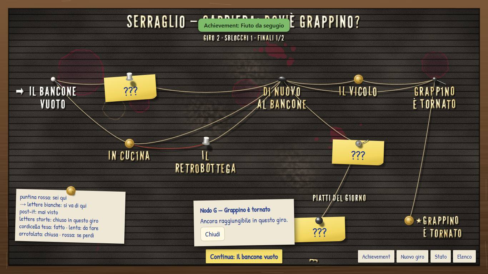
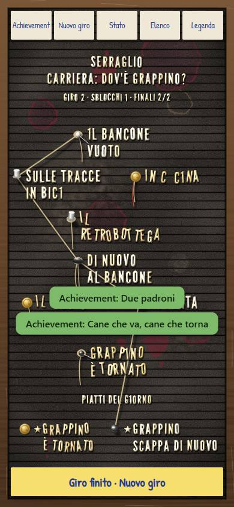

# Carriere — prototipo CA-0a, rapporto della Fase D

> Rapporto dell'esecutore, scritto l'11 novembre 2026, sulla [Fase D](prototipo.md#fase-d-la-mappa-vera-come-bacheca): la mappa vera come
> [bacheca a lettere](bacheca.md), dopo il [secondo giudizio](prototipo-fase-c.md#giudizio-del-proprietario-secondo-giro) del proprietario.
> Lo stato sta nella riga di CA-0a dei [lavori anticipati](../../product-roadmap.md#lavori-anticipati). Senza valore normativo.

## In breve

La mappa a caselle non c'è più: la mappa di tutte e due le carriere è la bacheca, nei due orientamenti, e si gioca toccandola. Il
bozzetto statico è tolto. Cordicelle che penzolano come catenarie e fanno ombra, puntine più tridimensionali con l'ombra calcolata,
macchie più grandi e feltro consunto. Cornice e puntine sono pronte per le [immagini generate](prompt-bacheca.md): finché la cartella
`docs/design/carriere/asset/bacheca/` è vuota resta tutto disegnato dal codice, e così sono tutte le catture. Prestazioni misurate a
390×844 con la CPU rallentata: le aperture dopo la prima stanno fra 100 e 230 ms. Il font dei dialoghi non è cambiato: si sceglie alla fine.
**Non verificato su un telefono vero, né con le immagini generate, che non ci sono ancora.**

## Come si vede

Come prima: `./prototipi/carriere/run.ps1 -Task Dev` sul PC, `-Task Phone` sul telefono. La mappa si apre da «Mappa» nella scena, da
«Continua» dell'elenco e alla fine di ogni nodo. Nuovo comando: `-Task Misura` (sotto).

## La mappa come bacheca

| Pezzo | Com'è |
|---|---|
| **Gioco** | Si tocca un punto disponibile (lettere bianche e freccia) per entrare; «Continua» in basso fa lo stesso. Un punto qualsiasi apre un **cartoncino** appeso con quello che si sa: titolo o «???», stato, partite e sblocchi se è già visto, «Entra» o «Riprendi». «Riprendi» torna alla scena se si è aperta la mappa a metà nodo; «Giro finito · Nuovo giro» a fine giro |
| **Stati** | gli stessi del bozzetto ([bacheca.md](bacheca.md#come-funziona-come-mappa)): corrente con la puntina rossa (dove si è, o l'ultimo nodo lasciato), disponibile, fatto, visto in un giro passato, escluso, «???» col post-it, segreto mai trovato assente; finali come «piatti del giorno», ciascuno sotto il nodo da cui ci si arriva |
| **Lettera caduta** | ora **una sola per bacheca**, dalla prima riga esclusa già vista, e sempre in mezzo a una parola. Prima ne cadeva una per riga, e a fine giro le righe escluse erano piene di buchi («N CUCINA») |
| **Intestazione** | «SERRAGLIO — CARRIERA: …» con il titolo della carriera, poi giro, sblocchi e finali. La mini-carriera ora si chiama «Dov'è Grappino?» (titolo del file di prova) |
| **Pulsanti** | cartellini scritti a penna: in orizzontale in basso a destra, «Continua» al centro; in verticale una fila in alto (con «Legenda», che apre il cartoncino) e «Continua» a tutta larghezza in basso, tutti alti almeno 48 px |
| **Legenda** | fissa in basso a sinistra in orizzontale; a richiesta in verticale, dove lo spazio serve alla mappa |
| **Tutorial** | lineare: sei punti in fila, il ritorno dall'epilogo alla scena 4 è una cordicella come le altre, un solo finale. L'epilogo appare con il suo titolo, «Da scrivere», finché il proprietario non lo scrive |

| Orizzontale, a metà del secondo giro | Verticale, a fine giro |
|---|---|
|  |  |

## Più tridimensione

- **Cordicelle che penzolano:** fra due spilli una catenaria, con una pendenza che cresce più che in proporzione alla lunghezza (circa 9 px
  per una corda di 150 px, 60 px per una di 600). L'ombra sul feltro si allontana dove la corda si stacca di più, cioè a metà. Tese per il
  percorso fatto (quasi dritte, ombra vicina), lente per quello da fare, arrotolate intorno allo spillo con una coda che penzola se il ramo è
  chiuso, rosse per la sconfitta che apre un ramo. Lo spago ha un filo più scuro sotto e una trama tratteggiata sopra.
- **Puntine:** sei forme con i nomi delle immagini che arriveranno — `tonda` (testa di plastica, «sei qui» in rosso), `cilindro`,
  `ottone`, `spillo`, `chiodino`, `ombrello` — scelte dai dati per ogni punto. Ognuna ha un'altezza diversa sul feltro, e l'ombra portata la
  calcola il client da quell'altezza e dalla direzione della luce (da sinistra, in alto): lunga per il cilindro, corta per l'ottone piatto.
- **Sporco:** tre zone di feltro consunto e schiarito (una chiazza più chiara bucherellata dal rumore, come il pelo che se n'è andato),
  aloni di vino più grandi e uno grandissimo, due schizzi, un alone di caffè, due ditate, una colatura; tutto in posizioni fisse decise
  dai dati, diverse per carriera e orientamento.

## Cornice e puntine generate

Il codice è pronto, nessuna immagine generata:

- **Cornice:** se c'è `asset/bacheca/cornice.webp`, il client la usa tagliata in **nove fette** con `border-image`: angoli fermi, lati
  ripetuti (`round`), fetta del 9,5% per lato (il prompt chiede una cornice di circa il 9%); altrimenti la cornice di legno disegnata.
- **Puntine:** se c'è `asset/bacheca/puntine/<nome>.webp`, il client la posa al posto del disegno, ruotata dai dati, con la sua ombra
  calcolata; quelle di plastica (`tonda`, `cilindro`, `ombrello`) le ricolora con un filtro di luminosità (la `tonda` rossa resta com'è per
  «sei qui»).
- Le immagini si cercano con un glob di Vite: finché la cartella non c'è non serve nient'altro, e il server di sviluppo può già leggerla.

## Prestazioni sul telefono

`run.ps1 -Task Misura` (`strumenti/misura.mjs`): build di produzione, Edge con il telefono simulato a 390×844 (densità 3, tocco), CPU
rallentata dal protocollo di DevTools; cinque aperture della mappa dalla scena, dal tocco su «Mappa» al secondo fotogramma dopo che la mappa
è nel documento. Risultati (millisecondi):

| CPU | Prima apertura | Aperture dopo (mediana) | Lavoro sul thread principale dopo la prima |
|---|---|---|---|
| 4× più lenta | 770–1 360 | 85–118 | 55–120 |
| 6× più lenta | 280–1 180 | 220–230 | 190–310 |

La prima apertura costa di più (caricamento di League Gothic, preparazione dei filtri) e varia molto fra un giro di misura e l'altro.
**Il fondo fisso disegnato una volta sola** è stato provato in due modi e tolto, perché non ha dato guadagni misurabili: come PNG in memoria
(4×: 1 050 la prima, mediana 122 dopo; 6×: mediana 292) e come tela già disegnata e riattaccata (4×: 2 080 la prima, mediana 131; 6×:
mediana 209). Il disegno dal vivo resta, più semplice. Da rivedere su un telefono vero: la CPU rallentata non rallenta il disegno dei filtri,
che Chrome fa su altri thread.

## Verifiche

| Verifica | Esito |
|---|---|
| `run.ps1 -Task Test` | verde: 43 prove (nuove: catenaria e pendenza, sporco ripetibile, nomi delle puntine, disposizione dentro il feltro e senza spilli sovrapposti per le due carriere, all'inizio, a metà e a fine giro, nei due orientamenti, una sola lettera caduta) |
| `run.ps1 -Task Check`, `Build` | verdi |
| `run.ps1 -Task Shots` | verde: 52 catture; i due giri della prova e il tutorial si giocano toccando la bacheca, e lo script controlla gli stati dei punti (`data-stato`) |
| `run.ps1 -Task Misura` | sopra |
| Mutazioni | 21 su 21 prese; nuove: pendenza solo proporzionale, distacco dell'ombra non normalizzato, una lettera caduta per riga, in verticale i nodi di una fila tutti al centro |
| `python scripts/check-links.py`, `python scripts/check-rules.py`, `git diff --check` | verdi |

**Catture in git:** 16 sostituite o nuove, 1,65 MB, in [`prototipi/carriere/catture/`](../../../prototipi/carriere/catture/o-02-mappa-inizio.jpg):
mappa del tutorial all'inizio (`02`), a metà (`06`) e dopo l'epilogo (`13`); prova dopo la sconfitta in cucina (`15`), a fine giro (`19`),
al giro dopo (`20`) con il cartoncino (`20b`) e a fine del secondo giro con i due finali (`23`); in orizzontale (`o-`) e in verticale (`v-`).
Le catture del bozzetto (`24`) restano perché il [prompt della cornice](prompt-bacheca.md#istruzioni) le usa come allegato, con la loro impronta.

**Rossi:** nessuno.

## Non verificato e limiti

- **Telefono vero:** né la mappa nuova né le misure; le misure sono di un telefono simulato.
- **Immagini generate:** la cornice a nove fette e le puntine da file non sono state viste, perché i file non ci sono ancora; il ripiego
  disegnato è quello delle catture.
- **Gli avvisi verdi** coprono a volte l'intestazione nelle catture: lo script gioca più in fretta di una persona.
- Il cartoncino dei dettagli si chiude solo con «Chiudi»; toccare fuori non lo chiude.

## Cosa giudica il proprietario

1. La mappa giocata come bacheca, sul telefono: si capisce dove si è, dove si può andare e cosa manca; il tocco sui punti e «Continua».
2. Cordicelle e puntine: abbastanza tridimensionali; la pendenza delle corde lunghe.
3. Sporco e feltro consunto: quantità e grandezza.
4. In verticale: la fila di pulsanti in alto e la legenda a richiesta.
5. Quando arriveranno cornice e puntine generate, come stanno sopra il feltro disegnato.
