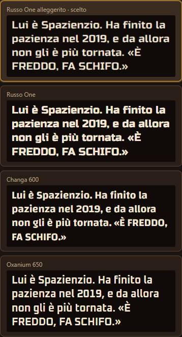
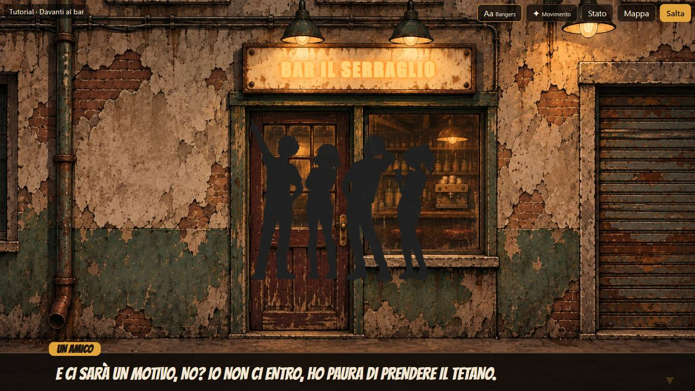
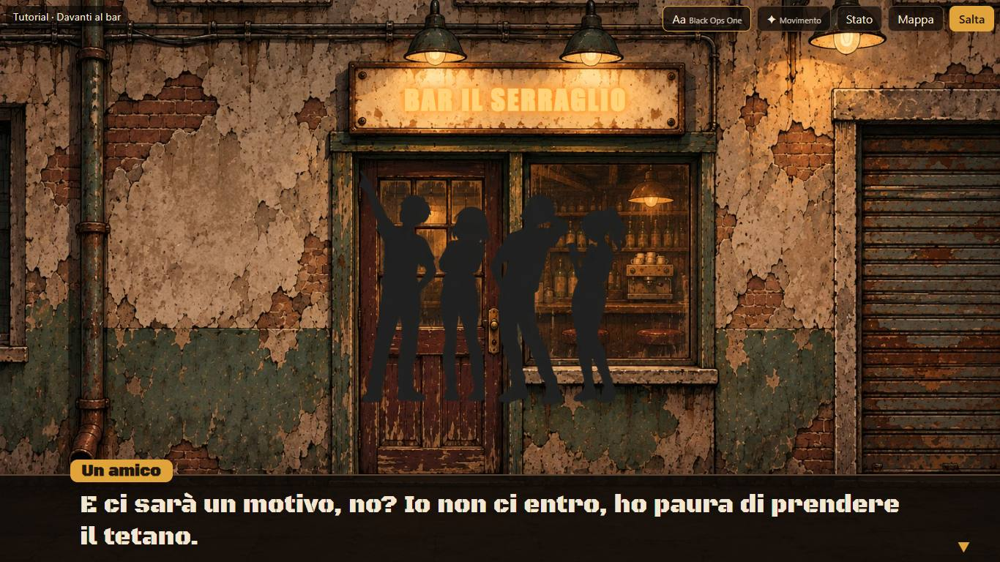
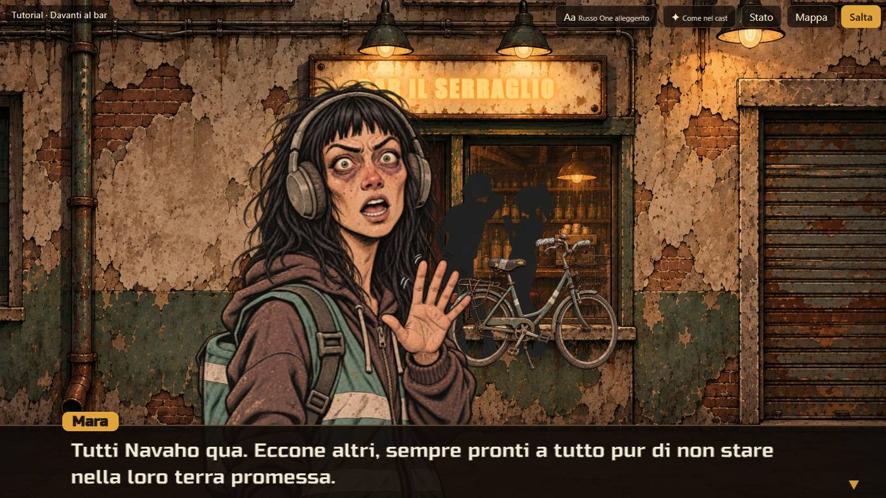
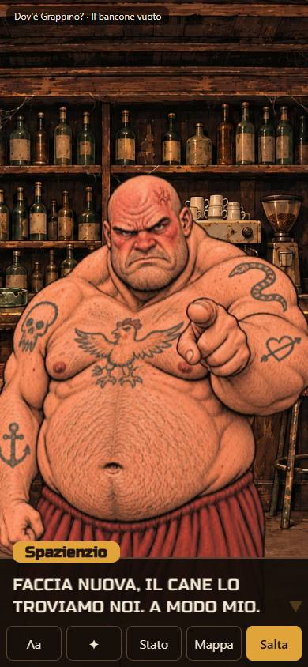
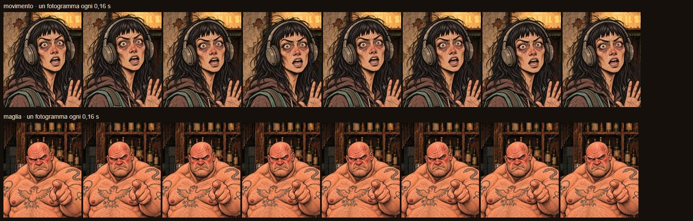

# Carriere — prototipo CA-0a, rapporto della Fase E

> Rapporto dell'esecutore, scritto il 12 novembre 2026, sulla [Fase E](prototipo.md#fase-e-font-finestra-e-ritratti-animati): font più
> squadrati, finestra di dialogo compatta e ritratti animati senza un asset per fotogramma, dopo il
> [giudizio del proprietario sui ritocchi della mappa](prototipo-fase-d.md#giudizio-del-proprietario-sui-ritocchi).
> Lo stato sta nella riga di CA-0a dei [lavori anticipati](../../product-roadmap.md#lavori-anticipati). Senza valore normativo.

## In breve

- **Sei font in più** nel campionario, squadrati, pesanti o da fumetto d'azione, dallo stesso repository e commit fissato di Google Fonts,
  con la stessa prova sulle accentate: Bangers e Bungee (tutti maiuscoli, il lettore li mostra in maiuscolo), Black Ops One, Russo One,
  Saira Stencil One, Anton. Ora sono quattordici.
- **Finestra di dialogo compatta:** alta quanto la battuta (una, due o tre righe) più un margine; in verticale i pulsanti della scena sono
  l'ultima fila della finestra, senza una fascia loro. La [specifica](specifica-asset.md#come-appare-la-scena) è aggiornata.
- **Ritratti animati, due livelli da confrontare** con un interruttore: **movimento** procedurale per tutti (respiro, sobbalzo a ogni
  parola, un movimento per espressione, ingresso con rimbalzo, schiacciamento e allungamento) e **maglia** su Spazienzio (testa che annuisce
  e si inclina, busto che respira, piegando l'unica immagine). Nessun asset nuovo. Con il movimento ridotto del sistema tutto resta fermo.
- **La maglia regge lo stile inchiostrato** alle ampiezze scelte (testa entro circa 5°): le linee non si stirano, perché la testa gira
  rigida e la piega sta nel collo. Due brevi video e un foglio di fotogrammi lo fanno vedere senza aprire il prototipo.

## Come si vede

`./prototipi/carriere/run.ps1 -Task Dev`, poi `http://127.0.0.1:4330/`. Nell'elenco, sopra il campionario dei font, c'è **«Ritratti di chi
parla»** con tre scelte: **Fermi**, **Movimento** (predefinito), **Maglia (Spazienzio)**. Nella scena lo stesso interruttore è **«✦»**, accanto
ad «Aa», e fa il giro dei tre; la scelta resta salvata nel browser. Con «Maglia» Spazienzio si piega e gli altri restano al movimento.

## Font più squadrati

Scaricati solo dal repository ufficiale di Google Fonts su GitHub, allo stesso commit fissato delle fasi precedenti,
`c30b221beb0c1da59d563feb91ec8656a1fa972a` (URL: `https://raw.githubusercontent.com/google/fonts/c30b221beb0c1da59d563feb91ec8656a1fa972a/ofl/<cartella>/<file>`),
ciascuno con il suo `OFL.txt` (SIL Open Font License 1.1) accanto, in [`prototipi/carriere/font/`](../../../prototipi/carriere/font/bangers/OFL.txt).

| Font | Carattere | File | KB | SHA-256 del font | SHA-256 di `OFL.txt` |
|---|---|---|---|---|---|
| **Bangers** | lettering da fumetto d'azione, tutto maiuscolo, stretto e inclinato | `bangers/Bangers-Regular.ttf` | 91 | `4160a7311de9342674cce9160cde9fcbb30f48190397d86ff1b70b455af65824` | `630dd5a307c0657b094d324e069b390edf90182fe5003639e06c02a0e5769af7` |
| **Bungee** | da insegna, squadrato e largo, tutto maiuscolo | `bungee/Bungee-Regular.ttf` | 116 | `c4f5361ce120af3e6b9156d0bf379fa19cda2ea0cd18ac01fd99596c6bf66e3f` | `d5787a50dde5be6c6daecab9ed459939b1bc37cff0d0e00257eaf1ec2cf4c16c` |
| **Black Ops One** | stencil militare, squadrato e consumato | `blackopsone/BlackOpsOne-Regular.ttf` | 163 | `282a825b5f294377387e3969f765408157dbea8da0f5d0aae68c6bc704b145b3` | `f67ca4a200424868ee8fcd5464d7b35ac1cbf7723f6bfdbd19a8524689fab9a8` |
| **Russo One** | squadrato a spigoli tondi, pesante, da maglia sportiva | `russoone/RussoOne-Regular.ttf` | 38 | `bc0abcc660bd8b7ad3000ecb2898a27c58a29a50f7ec81652fa12e75148d09df` | `3ac1301549523d9861fedca12871f24e575fbd26d520632fc00ba849b471d275` |
| **Saira Stencil One** | stencil squadrato, più leggero di Black Ops One | `sairastencilone/SairaStencilOne-Regular.ttf` | 107 | `781496fdaf8e04cf6741b31025f6b4ba84f66021b097a8e0d85cbea2180cf223` | `fc7c16a0d286a351a7de245a0bd661275e9d393de8955c7fa37ef3c8b85b7e3e` |
| **Anton** | condensato pesantissimo, da manifesto | `anton/Anton-Regular.ttf` | 167 | `a4ba3a92350ebb031da0cb47630ac49eb265082ca1bc0450442f4a83ab947cab` | `ee67e6ee22790b7929f1a3769ca2801d565c64b5a9096942c1adf5596de9c9e4` |

**Accentate verificate, non supposte:** la stessa prova delle fasi precedenti legge la tabella dei caratteri (`cmap`) di ogni file e
controlla tutti i caratteri che il lettore mostra nelle due storie, più `àèéìòùÀÈÉÌÒÙ«»’…`: tutti e quattordici passano.

**Scartati:** Squada One, il più squadrato di tutti, non ha l'apostrofo tipografico `’` né i puntini `…` (la prova lo ha fermato);
Luckiest Guy, il lettering da fumetto più noto, è sotto licenza Apache e non sta nella cartella `ofl/`; Rubik Dirt, consumato, pesa
1,5 MB, troppo per un font fra quattordici.

**Solo maiuscolo:** Bangers e Bungee non hanno minuscole vere (le minuscole sono maiuscole più piccole o uguali). Il catalogo dei font li
segna come tali e il lettore mostra in maiuscolo battute e nome di chi parla, nella scena e nel campionario; la stima del corpo del testo
li tratta già come larghi. È la convenzione dei fumetti, e Spazienzio urla già in maiuscolo.

| Bangers | Black Ops One |
|---|---|
|  |  |

## Finestra di dialogo compatta

Prima era una fascia fissa, il 20% dell'altezza in orizzontale e il 22% in verticale, più la fila dei pulsanti sotto in verticale. Ora:

- **alta quanto la battuta,** al più tre righe, più un margine (18 px sopra, 12 sotto in orizzontale). Non cresce mentre il testo
  scorre: una copia invisibile della battuta intera fissa l'altezza fin dalla prima lettera. Una battuta di una riga occupa circa la metà
  di prima;
- **corpo del testo** fino a 34 px in orizzontale e 24 px in verticale, come prima adattato perché la battuta stia in tre righe. La stima
  ora conta le maiuscole, più larghe di circa un terzo: con Shantell Sans la battuta urlata di Spazienzio in verticale andava su quattro
  righe e la prima restava tagliata. E dopo il disegno il lettore misura la copia invisibile: se passa le tre righe scende di un punto alla
  volta; al minimo mostra le ultime righe, come per le frasi di Piera;
- **in verticale i pulsanti stanno dentro la finestra,** come sua ultima fila: stessa tinta, nessuna fascia propria, alti circa 46 px
  (almeno 44, poco sotto i 48 di prima, per stringere). Fuori dal dialogo (scelte, partita, fine) la fila resta con il suo fondo. In
  orizzontale i pulsanti restano in alto a destra.

| Orizzontale, una riga | Verticale, tre righe e pulsanti nella finestra |
|---|---|
|  |  |

## Ritratti animati

Tutto il movimento è una funzione pura del tempo (in [`src/animazione.ts`](../../../prototipi/carriere/src/animazione.ts), con le sue
prove), applicata a ogni fotogramma del browser; nessun asset nuovo, nessuna immagine per fotogramma.

### Livello a: movimento procedurale

Si muove l'immagine intera, con l'origine in basso al centro (i piedi del busto restano dietro la finestra):

| Movimento | Quando | Come |
|---|---|---|
| Respiro | sempre | allungamento verticale di circa lo 0,8% ogni 3,4 s, con un lieve restringimento: il volume resta |
| Sobbalzo | a ogni parola mentre il testo scorre | su dello 0,6% dell'altezza, allungato del 2% e stretto dell'1%, spento in un decimo di secondo |
| Ingresso | al cambio di chi si vede o di espressione, e nello stacco su chi ascolta | arriva schiacciato del 13%, rimbalza allungandosi e si assesta in mezzo secondo |
| Furioso | Spazienzio | tremito veloce e piccolo, di lato e in rotazione |
| Fumante | Spazienzio | si gonfia a scatti brevi |
| Brilla | Piera | ondeggia lento, 2° per parte in tre secondi, dondolando di lato |
| Assonnata | Piera | la testa cala piano |
| Agitata | Mara | scatti nervosi ogni 0,8 s, ciascuno in una direzione sua ma sempre la stessa (non casuale) |
| Sospettosa | Mara | si sporge piano di traverso |
| Illuminata | Mara | un saltello ogni due secondi |

Chi ascolta durante uno stacco respira ma non fa il movimento della sua espressione, per non rubare la scena a chi parla.

### Livello b: maglia su Spazienzio

L'immagine di Spazienzio diventa una tela WebGL: una griglia di 14×21 vertici con l'immagine stesa sopra; a ogni fotogramma si spostano
i vertici e la scheda grafica piega l'immagine senza cuciture. **Tre punti di controllo** in coordinate dell'immagine, misurati una volta
sola e validi per tutte le sue espressioni, che hanno la stessa inquadratura per [specifica](specifica-asset.md#ritratti):

- il **perno del collo** (sotto il mento, fra le spalle), intorno a cui gira la testa;
- la **zona della testa**: piena sopra il 40% dell'altezza, sfumata fino al 50%, larga il 17% per lato intorno all'asse; le spalle, fuori,
  non girano;
- la **zona del busto**, fra il 48% e l'88%: si allarga ai lati e si alza un poco col respiro; il bordo basso resta fermo.

In silenzio la testa si inclina piano (circa 1° più una lenta deriva di 1,8°); **parlando annuisce** (2,6° ogni 1,3 s) e **a ogni parola dà
un cenno** di 3° che si spegne in un decimo di secondo. L'ingresso con rimbalzo resta quello del livello a, sull'immagine intera. Senza
WebGL il lettore torna al movimento.

**Regge lo stile inchiostrato?** Sì, a queste ampiezze. La testa gira rigida (le distanze fra i suoi punti restano, lo controlla una prova),
quindi le linee del volto non si stirano; la piega sta nella fascia del collo, dove il disegno ha ombra e pieghe di pelle che la nascondono.
A ingrandimento doppio non si vedono linee spezzate né sfocature diverse dal ritratto fermo. Oltre i 6° circa le linee del trapezio
cominciano a curvarsi come gomma: per questo le ampiezze sono basse, e l'effetto è più sottile del movimento procedurale. Un limite vero:
la maglia vuole i punti di controllo personaggio per personaggio (pochi minuti ciascuno, ma a mano) e per Piera, con i capelli lunghi
sulle spalle, la piega del collo si vedrebbe nei capelli.

### Ritagli: non servono per giudicare

Né il movimento né la maglia ne hanno bisogno. Se dopo la prova il proprietario vuole **bocche che parlano e occhi che sbattono**, servono
ritagli trasparenti sulla stessa tela 1024×1536 del ritratto, allineati al pixel, da sovrapporre: **bocca aperta** per ogni espressione
che parla (per il tutorial e la prova: Spazienzio furioso, fumante, serio, soddisfatto, quasi calmo; Mara agitata, illuminata, neutra,
sospettosa; Piera brilla, offesa, assonnata) e **occhi chiusi** uno per personaggio ed espressione con gli occhi aperti. Sono una ventina di
ritagli: da chiedere con un giro di prompt solo se il proprietario li vuole.

### Registrazioni

Fatte con `./prototipi/carriere/run.ps1 -Task Registra -Out prototipi/carriere/catture` (nuovo compito): il video lo registra Edge stesso,
perché il registratore di Playwright vuole un suo ffmpeg che qui non c'è e non si scarica.

- [`e-movimento.webm`](../../../prototipi/carriere/catture/e-movimento.webm) (9 s): la scena 0 del tutorial, la combriccola, poi Mara
  «agitata» che parla, con gli scatti, il sobbalzo a ogni parola e l'ingresso a ogni cambio;
- [`e-maglia.webm`](../../../prototipi/carriere/catture/e-maglia.webm) (9 s): la prima scena della prova; Spazienzio ascolta Piera
  (respiro e inclinazione), poi parla e annuisce;
- il foglio di fotogrammi qui sotto: otto istanti, uno ogni 0,16 s, di Mara agitata (movimento) e di Spazienzio che parla (maglia).

## Verifiche

| Comando | Esito |
|---|---|
| `run.ps1 -Task Test` | verde: 55 prove (8 nuove in `tests/animazione.test.ts`: livelli, respiro, sobbalzo, ingresso, espressioni, trasformazione CSS, maglia, larghezza delle maiuscole; la prova dei font ora conta quattordici font e ne controlla le accentate) |
| `tsc --noEmit` | verde |
| `run.ps1 -Task Check` | verde, invariato: le due storie senza errori né avvisi |
| `run.ps1 -Task Build` | verde (dentro Shots e Registra) |
| `run.ps1 -Task Shots` | verde: 58 catture, 50 nel repository (come prima senza elenco, partita, ritento e notifica); in più Bangers e Black Ops One nella scena (`04d`, `04e`) e Spazienzio con la maglia (`16a`) in tutti e due gli orientamenti. Lo script controlla anche che il ritratto parta in movimento, che con «✦» Spazienzio diventi una tela, che con il movimento ridotto torni un'immagine ferma e che «Aa» torni a Shantell Sans dopo il giro dei quattordici |
| `run.ps1 -Task Registra` | verde: `e-movimento.webm` 818 KB, `e-maglia.webm` 877 KB, `e-fotogrammi.jpg` 207 KB, 1,9 MB in tutto (entro i 3 MB) |
| Mutazioni | 22 mutazioni a mano sulla logica nuova (respiro, sobbalzo, ingresso, tremito, ondeggiare, scatti, maglia, larghezza delle maiuscole): tutte prese. Una (la punteggiatura contata come lettera) all'inizio sfuggiva: aggiunta la prova |
| `python scripts/check-links.py`, `python scripts/check-rules.py` | verdi |
| `git diff --check` | pulito |
| A vista | Edge a 1366×768 e 390×844: la battuta maiuscola di Spazienzio in verticale ora sta in tre righe (prima la prima riga era tagliata); la maglia a ingrandimento doppio contro il ritratto fermo |

`run.ps1 -Task Install -Offline` non è stato rifatto: nessuna dipendenza nuova (i font sono file).

## Non verificato e limiti

- **Telefono vero:** né i nuovi font, né la finestra compatta, né l'animazione sono stati visti su un telefono; la verticale è provata a
  390×844 in Edge. La maglia usa WebGL, che i telefoni hanno, ma il costo su un telefono lento non è misurato (sul portatile è trascurabile:
  294 vertici per fotogramma).
- **Il movimento a vista:** le prove controllano le ampiezze e i tempi, non se il movimento è gradevole: lo giudica il proprietario, dai video
  o nel prototipo.
- **Lo stacco con la maglia:** quando la scena passa da Spazienzio a un altro e indietro, la tela si ricrea; un istante senza ritratto è
  possibile su macchine lente, non visto sul portatile.
- **La misura dopo il disegno** dipende dal font già caricato; se arriva dopo, il lettore rimisura, ma il corpo può restare di un punto più
  piccolo del necessario fino alla battuta successiva.

## Cosa giudica il proprietario

1. **Il font:** fra i quattordici del campionario, o fra i sei nuovi; scelto il font, gli altri si tolgono.
2. **La finestra compatta,** in orizzontale e in verticale, e i pulsanti dentro la finestra in verticale (alti 46 px invece di 48).
3. **Il livello di animazione:** fermi, movimento o maglia. Se la maglia piace, va estesa agli altri con i loro punti di controllo; se il
   movimento basta, la maglia si toglie.
4. **I ritagli** di bocca aperta e occhi chiusi: se servono, si chiedono con un giro di prompt.

## Giudizio del proprietario

12 novembre 2026, con le sue parole:

- **Font:** «Russo One, ma un po' meno grassetto se possibile».
- **Animazioni:** «le animazioni maglia con Spazienzio sono molto belle, le altre mi piacciono ma sono un po' troppo rimbalzanti e scattose.
  Possiamo tenerle entrambe, a seconda dei casi»; «Piera che tentenna perché è ubriaca è bellissima».
- **Bocche:** «la bocca che si apre e chiude quando parlano mi piacerebbe» ([prompt](prompt-bocche.md)).
- **Spazienzio in verticale:** «è sempre troppo basso rispetto allo sfondo».
- **Finestra di dialogo:** «la sezione del testo dinamica sotto non mi piace: possiamo forzare sempre due righe, così resta della stessa
  altezza?».

Si apre la [Fase F](prototipo.md#fase-f-rifinitura-finale).
