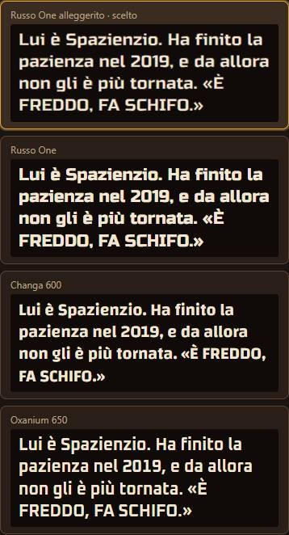
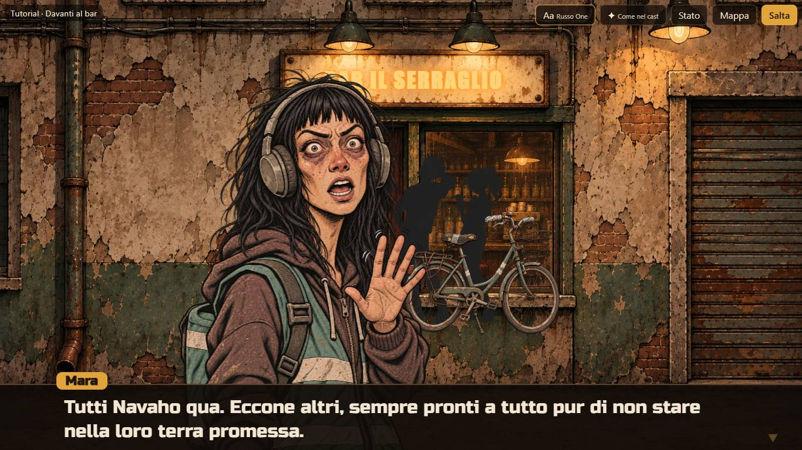
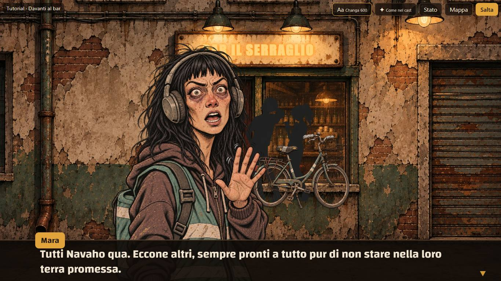
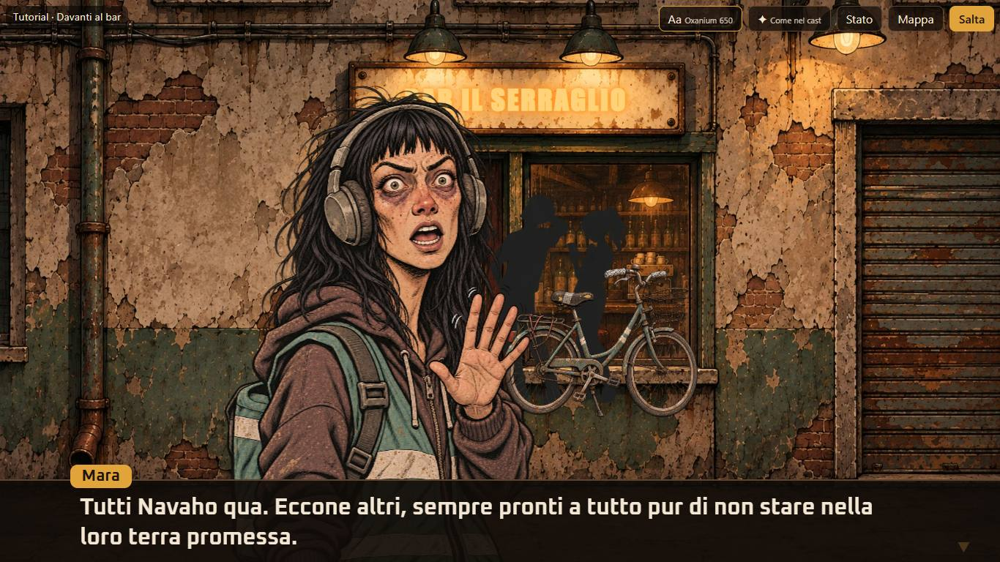
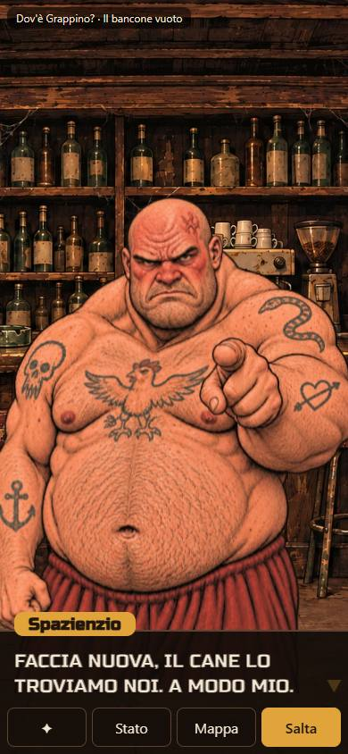
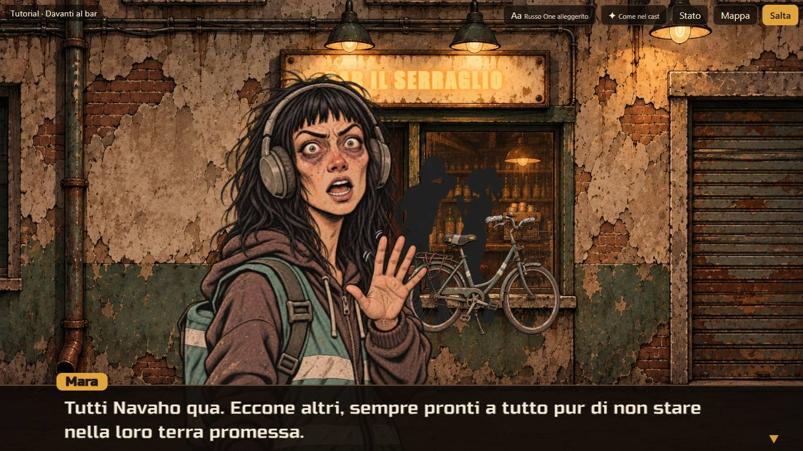
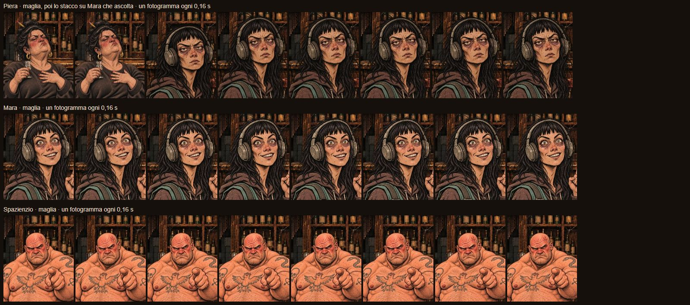
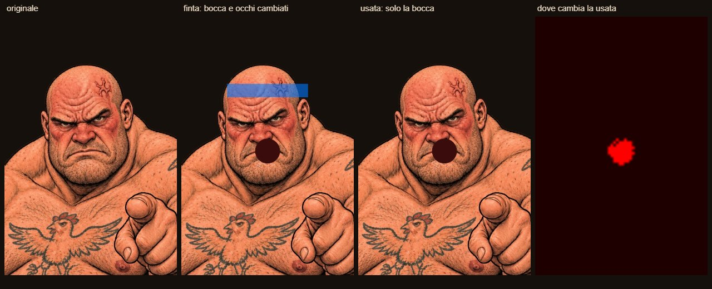
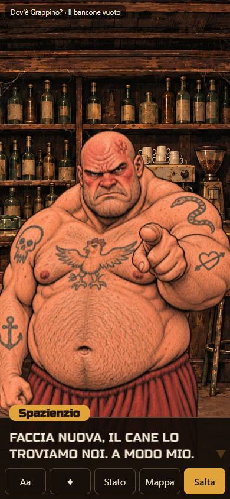

# Carriere — prototipo CA-0a, rapporto della Fase F

> Rapporto dell'esecutore, scritto il 12 novembre 2026, sulla [Fase F](prototipo.md#fase-f-rifinitura-finale): rifinitura finale dopo il
> [giudizio del proprietario sulla Fase E](prototipo-fase-e.md#giudizio-del-proprietario). Lo stato sta nella riga di CA-0a dei
> [lavori anticipati](../../product-roadmap.md#lavori-anticipati). Senza valore normativo.

## In breve

- **Font:** restano Russo One, in due versioni (alleggerito, il predefinito, e pieno), e due alternative squadrate con l'asse del peso,
  Changa e Oxanium, per la scelta finale. Gli altri dodici font dei dialoghi sono tolti, con file e licenze. Patrick Hand resta, ma solo per
  la penna della bacheca; League Gothic resta per le sue lettere.
- **Animazioni come dice il cast:** la maglia per tutti e tre (Mara, Spazienzio, Piera), ciascuno con i suoi punti di controllo; Piera
  «brilla» ondeggia come prima con il movimento procedurale, che ora è più morbido per tutti (meno rimbalzi, scatti arrotondati).
- **Bocca che si apre e si chiude:** pronta e provata con un'immagine finta; le versioni «-bocca» dei ritratti non sono ancora arrivate, e
  finché non ci sono il lettore funziona come prima. Lo stesso per gli stacchi esasperati su chi ascolta Piera.
- **Spazienzio in verticale più in alto,** dell'8% dello schermo, con la misura nel cast.
- **Finestra sempre alta due righe;** le battute più lunghe vanno a pagine da due righe, avanzate con un tocco.

## Come si vede

`./prototipi/carriere/run.ps1 -Task Dev`, poi `http://127.0.0.1:4330/`. Nell'elenco, «Ritratti di chi parla» ha ora **Come nel cast**
(predefinito), Fermi, Tutti movimento, Tutti maglia; nella scena «✦» fa lo stesso giro. Il campionario dei font mostra le quattro scelte su
fondo scuro, come nella finestra. Le scelte della Fase E salvate nel browser non contano più: si riparte da Russo One alleggerito e dal cast.

## Font dei dialoghi

**Russo One alleggerito:** Russo One ha un solo peso. Il lettore gli disegna attorno un contorno di 0,03 em del colore di fondo della
finestra, che mangia il bordo del tratto: le lettere restano le stesse ma più sottili. Con 0,05 em diventavano troppo esili e sporche agli
incroci; 0,03 em è il punto in cui si vede la differenza senza perdere pulizia. Il nome di chi parla resta pieno.

**Due alternative con l'asse del peso,** dallo stesso repository e commit fissato delle fasi precedenti
(`c30b221beb0c1da59d563feb91ec8656a1fa972a`, URL `https://raw.githubusercontent.com/google/fonts/c30b221beb0c1da59d563feb91ec8656a1fa972a/ofl/<cartella>/<file>`),
ciascuna con il suo `OFL.txt` (SIL Open Font License 1.1). I file variabili sono rinominati (il nome originale è nella tabella).

| Font | Carattere | File (nome originale) | KB | SHA-256 del font | SHA-256 di `OFL.txt` |
|---|---|---|---|---|---|
| **Changa** (peso 600 nel prototipo, asse 200–800) | squadrato a spigoli tondi, il più vicino a Russo One | `changa/Changa-Variabile.ttf` (`Changa[wght].ttf`) | 129 | `7c4f7a14d4b70ac8816ea8df3a0b127aee4c5f5af7239aca2afecc84ddc7f4d3` | `6b12c8d417bb766fa017d1161c7ca050392817a7eecbf3110fc2a8616564b956` |
| **Oxanium** (peso 650, asse 200–800) | squadrato, più tecnico, angoli tagliati | `oxanium/Oxanium-Variabile.ttf` (`Oxanium[wght].ttf`) | 43 | `2ce01d946e1e1ffc8d7eecfffbda8623bedd63eaf811a20488c4b69af45babb0` | `fe17c0f2581d71b4e1ea7e636e7f4877c29223e11bb1dd1a871e8c3f2a86336b` |

Il peso nel prototipo è un poco sotto quello di Russo One; con l'asse si può scegliere qualunque peso, basta dirlo. La prova sulle
accentate (la tabella `cmap` di ogni file contro tutti i caratteri delle due storie, più `àèéìòùÀÈÉÌÒÙ«»’…`) passa per tutti e quattro.
**Scartato:** Tektur, squadrato e con gli assi del peso e della larghezza, ha gli accenti piatti (la «è» sembra una «ē»).

**Tolti** dal prototipo, file e licenze: Shantell Sans, Comic Neue, Grandstander, Short Stack, Gochi Hand, Kalam, Mali (fasi C), Bangers,
Bungee, Black Ops One, Saira Stencil One, Anton (Fase E). **Patrick Hand resta:** non è più fra i font dei dialoghi, ma è la penna della
bacheca (il «???» dei post-it, i cartoncini, gli avvisi). Una prova controlla che nella cartella dei font restino solo i cinque usati.

| Russo One pieno | Changa 600 | Oxanium 650 |
|---|---|---|
|  |  |  |

## Finestra a due righe e pagine

La finestra è sempre alta due righe più un margine, in orizzontale e in verticale, e non cambia con la battuta. Il corpo è fisso per
orientamento: circa 31 px in orizzontale a 1366×768 (il 4% dell'altezza, fra 20 e 32), circa 21 px in verticale a 390×844 (fra 18 e 22).

**Pagine:** una copia invisibile della battuta, parola per parola, sta nella finestra con lo stesso font e la stessa larghezza; da lì il
lettore sa in che riga va ogni parola e taglia una pagina ogni due righe, sempre a inizio parola. Il testo scorre fino alla fine della
pagina e si ferma con ▼; un tocco apre la pagina dopo, che comincia vuota e si riempie. Un tocco mentre scrive completa la pagina, non tutta
la battuta. Mentre una pagina si scrive, il seguito della stessa pagina è già al suo posto ma invisibile, così le parole non saltano a capo
mentre compaiono. Se il font arriva tardi o la finestra cambia misura, le pagine si rifanno.

**Con gli stacchi di Piera:** lo stacco su chi ascolta resta dopo i puntini, con la sua durata minima; se lì comincia anche una pagina,
finito lo stacco la pagina si volta da sola, senza un tocco in più. Le battute interrotte si interrompono a metà dell'ultimo pezzo, come prima.

Il testo che scorre è ora un modello puro (fermate, scorrimento, tocco, pezzo in vista) con le sue prove; prima il corpo si adattava alla
battuta e Piera mostrava le ultime righe: quella logica è tolta.

| Verticale: fine della prima pagina di Spazienzio | Orizzontale: una battuta in una pagina |
|---|---|
|  |  |

## Animazioni come dice il cast

Il cast (`dati/cast.json`) dice per ogni personaggio il modo normale, le eccezioni per espressione e i punti di controllo della maglia:

| Personaggio | Modo | Eccezioni | Perno del collo | Testa (asse, raggio, piena sopra, sfuma fino a) | Busto |
|---|---|---|---|---|---|
| Mara | maglia | — | 0,55; 0,50 | 0,55; 0,20; 0,40; 0,50 | 0,52–0,90 |
| Spazienzio | maglia | — | 0,47; 0,47 | 0,47; 0,17; 0,40; 0,50 (quelli della Fase E, piaciuti) | 0,48–0,88 |
| Piera | maglia | brilla: movimento | 0,50; 0,42 | 0,50; 0,17; 0,32; 0,42 | 0,45–0,90 |

Misurati su tutti e quindici i ritratti con una griglia: ogni personaggio ha la stessa inquadratura in tutte le espressioni, quindi un solo
gruppo di punti per personaggio basta. Per Mara la testa è centrata sul volto, di tre quarti verso destra, non sui capelli. A ingrandimento
doppio la maglia regge su tutti e tre: la testa gira rigida, le linee non si stirano, la mano di Mara con il dito alzato e il bicchierino di
Piera non si piegano (stanno fuori dalla zona della testa); i capelli lunghi di Mara si piegano un poco all'altezza del collo, come
seguirebbero la testa.

**Movimento più morbido** (per Piera brilla, e per tutti con «Tutti movimento» o senza WebGL): il sobbalzo a ogni parola è un terzo di
prima; l'ingresso arriva schiacciato del 5% invece del 13% e torna con un solo rimbalzo, senza oscillare; gli scatti di Mara agitata sono
più piccoli e salgono in 40 ms invece che di colpo; il tremito di Spazienzio furioso è la metà; il saltello di Mara illuminata è più basso.
L'ondeggiare di Piera brilla è rimasto com'era.

**Come si disegna:** il ritratto è un contenitore che si muove (ingresso, movimento), con dentro l'immagine e, sopra, la tela WebGL quando
è pronta; finché la tela non è pronta si vede l'immagine, così al cambio di espressione non c'è un istante vuoto. Con «Fermi» o con il
movimento ridotto del sistema resta solo l'immagine.

## Bocca che si apre e si chiude

**Come funziona:** se accanto al ritratto c'è la sua versione `<ritratto>-bocca.webp` ([prompt](prompt-bocche.md)), il lettore la carica,
calcola dove le due immagini differiscono su una griglia piccola, ma **solo dentro una zona attorno alla bocca** scritta nel cast per
personaggio (allargata di metà), e ne fa un'ellisse sfumata: la versione usata è il ritratto approvato con, dentro l'ellisse, i pixel della
versione «bocca». Così, se lo strumento che genera le bocche cambia anche altro (occhi, capelli), quei cambiamenti non arrivano mai a
schermo. Le due versioni sono due tessiture della stessa maglia: si scambiano sotto la maglia e il movimento.

**Il ritmo:** mentre il personaggio in quadro parla e il testo scrive, la bocca si apre e si chiude sei volte al secondo; si ferma sulla
versione approvata dopo una virgola, un punto o dei puntini, a fine pagina, durante gli stacchi e a battuta finita. Chi ascolta non muove la
bocca.

**Provato senza le immagini vere:** le versioni «-bocca» non ci sono ancora. Lo strumento `strumenti/prova-bocca.mjs` (con il server di
sviluppo acceso) prende un ritratto vero, ne fa una versione finta con la bocca scurita **e una macchia sugli occhi**, e fa girare la stessa
catena del lettore: su Spazienzio serio e furioso, Mara neutra, Piera offesa e brilla la versione usata cambia solo attorno alla bocca
(0 celle cambiate fuori dall'ellisse), e la macchia sugli occhi sparisce. La prova ha anche corretto le zone della bocca nel cast, che per
Mara e Piera avevo messo troppo a sinistra.

**Esasperati negli stacchi:** il cast dice che chi ascolta Piera è `esasperata` (Mara) ed `esasperato` (Spazienzio); se il ritratto c'è, lo
stacco usa quello, altrimenti l'espressione scritta nella storia (neutra, quasi calmo). Le immagini, quando arrivano nella cartella dei
ritratti, il lettore le prende da sé, senza toccare codice né storie.

## Spazienzio in verticale

Inquadrato più da lontano degli altri (spalle e braccia per intero, per [specifica](specifica-asset.md#ritratti)), in verticale aveva la
testa sotto il bancone dello sfondo. Il cast ora ha, per personaggio, quanto alzare il ritratto in verticale, in frazioni dell'altezza dello
schermo: Spazienzio 0,08 (circa 68 px a 390×844). La testa sta ora sopra il bancone, all'altezza di quella di Mara; il bordo basso del
ritratto resta dietro la finestra. Mara e Piera non si muovono.

## Verifiche

| Comando | Esito |
|---|---|
| `run.ps1 -Task Test` | verde: 67 prove. Nuove: `tests/testo.test.ts` (pagine, fermate, tocchi, stacchi con le pagine, interruzione), e in `tests/animazione.test.ts` il modo dal cast, la maglia di ciascuno dei tre, la bocca (ritmo e zona), lo stacco esasperato e Spazienzio alzato nel cast. Cambiate, perché il comportamento è cambiato apposta: gli attesi del movimento più morbido, i font (quattro, e una prova sulla cartella), la prova dei pezzi di Piera (ora sulle fermate); tolta quella del corpo adattivo, che non c'è più |
| `tsc --noEmit` | verde |
| `run.ps1 -Task Check` | verde, invariato: le due storie senza errori né avvisi |
| `run.ps1 -Task Build` | verde (dentro Shots e Registra) |
| `run.ps1 -Task Shots` | verde: 58 catture, 50 nel repository come prima; nuove i tre font (`04b`, `04c`, `04d`) e la fine della prima pagina in verticale (`v-16b`). Lo script controlla anche Russo One alleggerito predefinito e il giro di «Aa», il modo maglia dal cast, la tela WebGL, la pagina che si volta con un tocco senza cambiare l'altezza della finestra, il movimento ridotto e il giro di «✦» |
| `run.ps1 -Task Registra` | verde: `f-scena.webm` 678 KB (12 s, i tre a maglia nella prima scena della prova; senza bocche, che non ci sono), `f-fotogrammi.jpg` 258 KB |
| `node strumenti/prova-bocca.mjs` | verde su cinque ritratti: la versione usata cambia solo attorno alla bocca; `f-prova-bocca.jpg` 119 KB |
| Mutazioni | 24 mutazioni a mano sulla logica nuova (fermate, pagine, tocchi, stacchi, interruzione, modo dal cast, bocca, ingresso, sobbalzo, scatti, tremito, cast): tutte prese |
| `python scripts/check-links.py`, `python scripts/check-rules.py` | verdi. Per i link: i rapporti delle Fasi C ed E puntavano alle licenze di due font tolti; il percorso è ora testo con il rimando a questo rapporto |
| `git diff --check` | pulito |
| A vista | Edge a 1366×768 e 390×844: le pagine, i quattro font, la maglia dei tre a ingrandimento doppio contro il ritratto fermo, Spazienzio alzato |

## Non verificato e limiti

- **Le bocche vere:** il lettore è pronto e provato su una versione finta, ma non sulle immagini dell'altro esecutore, che non c'erano
  durante il lavoro. Se arrivano, basta riaprire il prototipo; `run.ps1 -Task Registra` fa allora `f-bocche.webm` invece di `f-scena.webm`.
  Da guardare: se la zona trovata copre tutta la bocca aperta (il cast la cerca entro circa 0,13 × 0,09 del ritratto attorno al centro).
- **Gli esasperati:** stesso discorso; finché mancano, gli stacchi restano su neutra e quasi calmo.
- **Telefono vero:** come prima, provato a 390×844 in Edge, non su un telefono.
- **Pagine e font tardi:** se il font arriva dopo che la battuta ha cominciato a scorrere, le pagine si rifanno a metà; non l'ho visto
  succedere (i font sono locali), ma può spostare un a capo una volta.
- **Una parola sola in una pagina:** le pagine seguono gli a capo, quindi una battuta può finire con una pagina di una sola parola
  (succede in verticale con «tetano.»). Si può evitare, se dà fastidio, accorciando la penultima pagina.

## Cosa giudica il proprietario

1. **Il font:** Russo One alleggerito, Russo One pieno, Changa o Oxanium (e, per questi due, il peso).
2. **La finestra a due righe con le pagine,** in orizzontale e in verticale.
3. **La maglia per tutti** e il movimento più morbido per Piera brilla.
4. **Spazienzio in verticale,** se ora è all'altezza giusta.
5. **Le bocche e gli esasperati,** quando arrivano le immagini.

## Giudizio del proprietario

12 novembre 2026, con le sue parole:

- **Font dei dialoghi:** «Russo One alleggerito». Le alternative (Russo One pieno, Changa, Oxanium) si tolgono alla chiusura del prototipo.
- **Il resto della Fase F:** «mi sembra a posto».
- **Bocche ed espressioni esasperate:** arrivate lo stesso giorno ([prompt](prompt-bocche.md)). Tutte le versioni «bocca» cambiano un po'
  anche fuori dalla bocca, quindi il lettore usa la maschera della bocca; da giudicare dal vivo.
- **Mappa:** «sembra un po' statica (perché lo è). Possiamo metterci un po' di movimento? Non troppo se no disturba, ma tipo i fili che si
  agitano mentre penzolano, qualche lettera che sta per cadere e tremola, poi cade e l'utente può ritrascinarla al suo posto... cose così».

**Prova delle bocche** (proprietario, 12 novembre 2026): «si muovono troppo velocemente in generale, più altri bug strani: Mara ha una
cornice nera intorno, come se non fosse stata ritagliata bene; Piera ha artefatti strani quando muove la bocca; Spazienzio invece va bene».
La regia ha visto che almeno  ha un fondo grigio a quadretti, semitrasparente, invece della trasparenza pulita:
lo scontorno di quella consegna non è riuscito. Diagnosi e correzione nella sessione dell'esecutore, con la Fase G.
