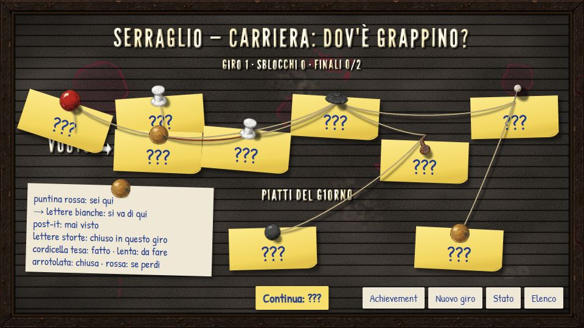
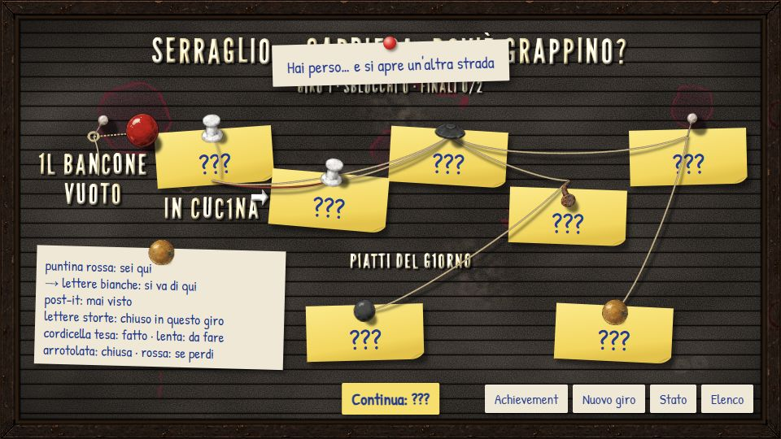
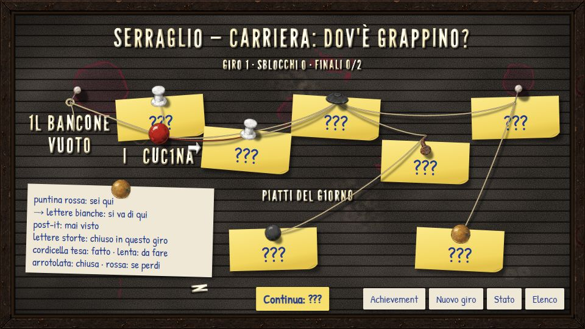
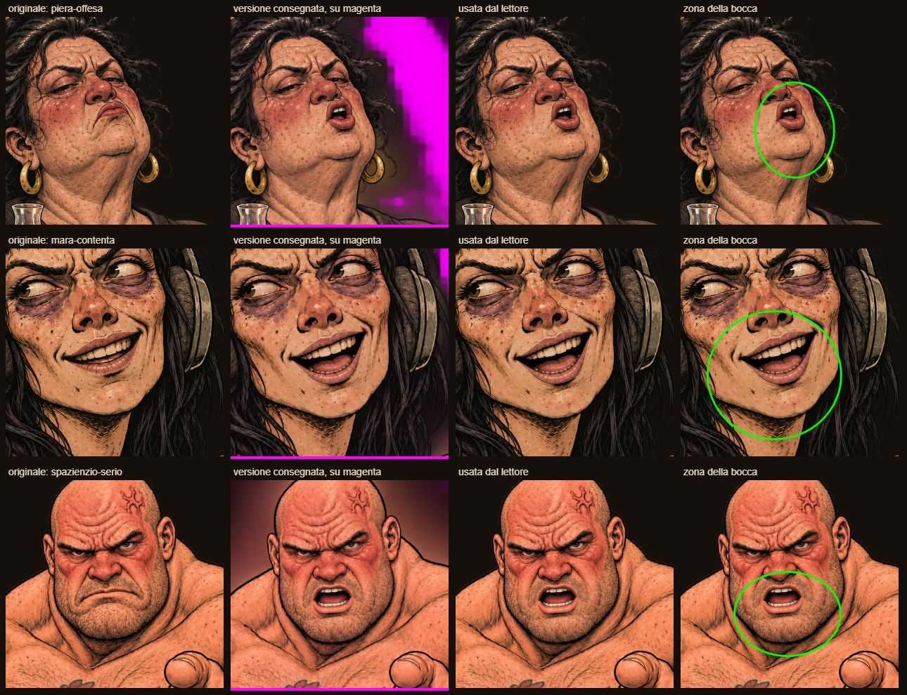

# Carriere — prototipo CA-0a, rapporto della Fase G

> Rapporto dell'esecutore, scritto il 12 novembre 2026, sulla [Fase G](prototipo.md#fase-g-la-bacheca-si-muove): la bacheca si muove, dopo
> il [giudizio del proprietario sulla Fase F](prototipo-fase-f.md#giudizio-del-proprietario). Lo stato sta nella riga di CA-0a dei
> [lavori anticipati](../../product-roadmap.md#lavori-anticipati). Senza valore normativo.

## In breve

- **Quattro movimenti, piccoli:**
  - le cordicelle che penzolano oscillano piano e si agitano di più dopo un tocco sul feltro o quando la puntina si sposta;
  - una lettera allentata tremola, cade in fondo alla cornice e il giocatore la rimette al suo posto trascinandola;
  - la puntina «sei qui» viaggia al nodo nuovo, con la cordicella che si tende dietro di lei;
  - il post-it di un nodo appena scoperto si stacca e cade, e sotto restano le lettere del titolo.
- **Quando si muovono:** niente si muove mentre è aperto un cartoncino o la legenda; con il movimento ridotto del sistema niente si muove.
- **L'apertura della mappa non peggiora:** rimisurata come nella Fase D, resta dentro il rumore delle misure di prima.
- **L'achievement per chi rimette a posto le lettere** è pronto ma spento, come chiesto.
- **I font alternativi restano:** si tolgono alla chiusura.
- **Bocche corrette nel lettore** (capitolo «Bocche»): più lente, la zona della bocca presa sempre con la trasparenza del ritratto approvato,
  la «cornice nera» di Mara e gli artefatti di Piera spariti. Da rifare: spazienzio-furioso-bocca (non combacia) e lo scontorno di
  mara-esasperata.

## Come si vede

`./prototipi/carriere/run.ps1 -Task Dev`, poi `http://127.0.0.1:4330/`; per far cadere subito una lettera (ogni volta, invece di una su due),
`http://127.0.0.1:4330/?allenta`. I movimenti si vedono giocando: la bacheca ricorda, per carriera, com'era l'ultima volta che si è vista
(dov'era la puntina rossa, quali nodi avevano il post-it, la lettera caduta e quante ne sono state rimesse); quando si torna alla mappa e
qualcosa è cambiato, si muove. «Azzera tutto» cancella anche questo.

## I quattro movimenti

| Movimento | Quando | Come | Quanto |
|---|---|---|---|
| **Cordicelle** | sempre, con la bacheca aperta e ferma | le lente e la coda delle arrotolate oscillano lente, ognuna con il suo periodo (3,2–5 s) e la sua fase, decisi dai dati; le tese no | al centro al più 9 px (di più se la corda pende di più); dopo un tocco sul feltro o il viaggio della puntina il triplo, che si spegne in un paio di secondi |
| **Puntina «sei qui»** | all'apertura, se la puntina era altrove l'ultima volta | si stacca, sale (più grande, ombra più lontana), passa sopra il feltro su un arco e si ripianta con un piccolo colpo; la cordicella nuova si tende dietro di lei | 1,1 s, dopo il post-it se c'è |
| **Post-it** | all'apertura, per i nodi che avevano il post-it e ora mostrano le lettere | si piega attorno alla puntina, poi cade per gravità verso il fondo della cornice e sparisce; sotto restano le lettere | 1,5 s, mezzo secondo dopo l'apertura |
| **Lettera allentata** | all'apertura, una volta su due (decisa dai dati), se non ce n'è già una caduta; dopo 4 s di bacheca ferma | tremola sempre di più (2,4 s), poi cade in fondo alla cornice girando, con un piccolo rimbalzo; resta lì finché il giocatore non la trascina al suo posto (lasciata vicino ci torna e resta; lasciata altrove ricade) | una lettera alla volta, scelta dai dati fra i titoli dei nodi già scoperti e non chiusi |

**Mai mentre si legge o si sceglie:** un orologio solo muove tutto, e si ferma mentre è aperto un cartoncino o la legenda (in verticale) o
mentre si trascina la lettera; il movimento riprende da dove era. Nella scena i movimenti della bacheca non ci sono (la mappa non è aperta).
**Movimento ridotto:** con la preferenza del sistema niente si muove e niente cade; una lettera già caduta resta in fondo e si può ancora
rimettere a posto, senza animazione.

**La lettera in verticale:** il fondo della cornice sta sotto «Continua», quindi lì la lettera cade appena sopra il pulsante, fra i due
finali, dove la si può riprendere con il dito (l'area da toccare è un cerchio di almeno 22 px di raggio).

**Variante dell'achievement (spenta):** quando il giocatore ha rimesso a posto cinque lettere, un cartellino «Achievement: Tutte al loro
posto» sulla bacheca. Per accenderlo basta `PREMIO_LETTERE.attivo` in `src/movimentiBacheca.ts`; non entra nell'elenco degli achievement delle
carriere, che sono scritti nelle storie: se il proprietario lo vuole davvero, va scritto lì.

| Il post-it del bancone si stacca | La puntina viaggia verso la cucina | La «N» di «IN CUCINA» caduta in fondo |
|---|---|---|
|  |  |  |

Registrazione: [`g-bacheca.webm`](../../../prototipi/carriere/catture/g-bacheca.webm) (13 s, 960×540, 1,1 MB): il post-it del bancone che si stacca,
poi dopo la cucina il post-it della cucina e la puntina che viaggia, un tocco sul feltro che scuote le cordicelle, la «N» che tremola e cade,
e il giocatore che la rimette a posto.

## Come è fatto

- **Due strati.** Sotto, il feltro con i suoi filtri (pelo, aloni, sporco), le lettere e i post-it: fermo, non si ridisegna. Sopra, in uno
  strato a parte (un livello suo per il browser), le cordicelle, le puntine, le aree da toccare e i pezzi che si muovono. Prima stava tutto
  in un disegno solo.
- **Un ciclo di fotogrammi** che tocca solo lo strato di sopra: ricalcola i percorsi delle cordicelle (a 30 fotogrammi al secondo: un
  dondolio lento non ne chiede di più) e sposta puntina, post-it e lettera. React ridisegna la bacheca solo ai passaggi (viaggio finito,
  post-it caduto, lettera che cade o torna): una volta ogni qualche secondo, non a ogni fotogramma.
- **Funzioni pure** in `src/movimentiBacheca.ts` (oscillazione, agitazione, viaggio, stacco del post-it, scelta della lettera, tremolio,
  caduta, rimessa a posto), con le loro prove. La posizione della lettera allentata non è stimata: la legge il lettore dal disegno.

## Bocche

Dopo la prova del proprietario con Phone, registrata nel [rapporto della Fase F](prototipo-fase-f.md#giudizio-del-proprietario): «si
muovono troppo velocemente in generale, più altri bug strani: Mara ha una cornice nera intorno, come se non fosse stata ritagliata bene;
Piera ha artefatti strani quando muove la bocca; Spazienzio invece va bene».

**Più lente.** La bocca cambia circa 3,5 volte al secondo (prima 12): il ritmo delle parole più che delle sillabe. Si apre e si chiude solo
mentre il testo scrive; resta chiusa (il ritratto approvato) dopo una virgola, un punto o dei puntini, a fine pagina, durante gli stacchi e a
battuta finita, come prima.

**La diagnosi.** Ho misurato la trasparenza di tutte le versioni «-bocca» e delle due esasperate rispetto ai ritratti approvati:

| File | Fondo | Nel prototipo |
|---|---|---|
| mara-agitata-bocca, mara-neutra-bocca, mara-pensierosa-bocca | trasparente, come il ritratto approvato | buone |
| mara-contenta-bocca, mara-illuminata-bocca, mara-sospettosa-bocca; piera-assonnata, brilla, contenta, offesa-bocca; spazienzio-fumante, quasi-calmo, serio, soddisfatto-bocca | **un velo scuro semitrasparente** al posto del fondo (dal 23% al 48% dell'immagine semitrasparente, angoli con alfa fino a 230; nel ritratto approvato il fondo è trasparente al 25–40%) | corrette dal lettore (sotto) |
| spazienzio-furioso-bocca | velo scuro, e in più **la testa è più in alto e più piccola** che nel ritratto approvato: le due immagini non combaciano | il lettore non la usa: Spazienzio furioso parla a bocca ferma |
| mara-esasperata | velo scuro al posto del fondo | corretta dal lettore con la sagoma di «neutra» |
| spazienzio-esasperato | trasparente | buona |

Fuori dalla bocca le altre versioni cambiano poco (al più lo 0,3% dei punti della sagoma, su una griglia di 128×192), quindi il resto
dell'immagine era tenuto bene; il problema è lo scontorno.

**Perché si vedeva.** La «cornice nera» di Mara è mara-esasperata: compare negli stacchi su chi ascolta Piera, e il suo velo scuro faceva
un alone attorno a tutta la figura. Gli artefatti di Piera: la sua bocca sta vicino al bordo del volto, e la zona della bocca, trovata
confrontando le due immagini, comprendeva anche il velo attorno (il confronto contava la trasparenza); così, a ogni apertura, attorno al
mento compariva e spariva un pezzo di velo. Spazienzio andava bene perché la sua bocca sta in mezzo a un volto grande, lontano dal fondo.

**Le correzioni nel prototipo**, tutte nel lettore, senza toccare le immagini:

1. **La zona della bocca si cerca solo dentro la sagoma del ritratto approvato** e confrontando solo il colore: un fondo sporco non la
   allarga più. Resta una maschera per espressione (ogni coppia di immagini ha la sua zona, trovata sui pixel), cercata attorno alla
   bocca che il cast indica per personaggio.
2. **Della versione «-bocca» si prende solo il colore**, solo dentro la zona della bocca, e sempre con la **trasparenza del ritratto
   approvato**: lo strumento `strumenti/prova-bocca.mjs` controlla, sulle quindici coppie vere, che la versione usata non cambi nessun
   pixel fuori dalla zona e che la sua trasparenza sia identica a quella del ritratto approvato (scarto 0 su tutte).
3. **Una versione «-bocca» non allineata non si usa:** se fuori dalla bocca cambia più dell'1% della sagoma, la bocca resta ferma
   (spazienzio-furioso: 1,5%; tutte le altre al più 0,3%).
4. **mara-esasperata prende la trasparenza da mara-neutra**, che ha la stessa sagoma (il cast lo dice: `"alfa": {"esasperata": "neutra"}`).
   I capelli differiscono di poco: qualche ciocca sottile può risultare tagliata.

**Immagini da rifare** (le lascio come sono, per la regia e l'altro esecutore):

- **spazienzio-furioso-bocca:** da rigenerare, perché la testa è spostata e rimpicciolita rispetto al ritratto approvato e quindi le due
  immagini non combaciano. Oggi Spazienzio furioso parla a bocca ferma.
- **mara-esasperata:** da rifare lo scontorno (fondo trasparente). Il lettore se la cava con la sagoma di neutra, ma un ritratto con il fondo
  sporco non deve arrivare al client vero.
- **Le undici «-bocca» con il velo** (mara-contenta, illuminata, sospettosa; le quattro di Piera; spazienzio-fumante, quasi-calmo, serio,
  soddisfatto): nel prototipo vanno bene così, perché se ne prende solo il colore della bocca. Da rifare lo scontorno solo se le immagini
  devono servire anche altrove.

## Verifiche

| Comando | Esito |
|---|---|
| `run.ps1 -Task Test` | verde: 78 prove. Nuove: `tests/movimenti-bacheca.test.ts` (cordicelle, agitazione, viaggio, post-it, scelta e caduta della lettera, rimessa a posto, achievement spento) e, in `tests/animazione.test.ts`, l'allineamento della versione «-bocca» e la sagoma presa da un'altra espressione. Cambiato apposta l'atteso del ritmo della bocca (da dodici a tre o quattro cambi al secondo) |
| `tsc --noEmit` | verde |
| `run.ps1 -Task Check` | verde, invariato |
| `run.ps1 -Task Build` | verde (dentro Shots e Registra) |
| `run.ps1 -Task Shots` | verde. Le foto della bacheca si fanno a movimenti d'apertura finiti; alla sconfitta della prova lo script controlla che la puntina «sei qui» viaggi, che il post-it della cucina si stacchi e che la bacheca si muova. Un primo giro si è fermato per un errore del disco nello scrivere una foto (`UNKNOWN: open`); rifatto, verde |
| `run.ps1 -Task Registra` con `BM_REGISTRA=bacheca` | verde: `g-bacheca.webm` 1,1 MB (13 s) e le tre foto del rapporto (`g-postit`, `g-viaggio`, `g-lettera`, circa 105 KB l'una) |
| `node strumenti/prova-bocca.mjs` | verde sulle quindici coppie vere: fuori dalla zona della bocca nessun pixel cambia, trasparenza identica a quella del ritratto approvato; spazienzio-furioso scartata perché non allineata. Foglio `g-bocche.jpg` 285 KB. In tutto, le catture nuove di questa fase pesano 1,7 MB |
| `strumenti/misura.mjs` (apertura della mappa a 390×844) | prima della Fase G: CPU 4× prima apertura 820 ms, mediana 150; CPU 6× prima 1 577, mediana 218. Dopo, due giri: CPU 4× prime 750 e 1 221 ms, mediane 121 e 138; CPU 6× prime 1 226 e 1 090, mediane 213 e 228. Nel rumore di prima: l'apertura non peggiora |
| Costo continuo, bacheca aperta e ferma (390×844, CPU 4×, build di produzione, 3 s) | con il movimento 1 094–1 264 ms di lavoro sul thread principale, senza (movimento ridotto) 486–594 ms; 180 fotogrammi in 3 s in tutti e due i casi. Ridisegnare le cordicelle a 15 invece che a 30 fotogrammi al secondo non cambia il conto; prima di togliere le ridisegnate inutili di React (una a ogni fotogramma) era 1 555 ms |
| Mutazioni | 26 sulla logica della bacheca (cordicelle, agitazione, viaggio, post-it, lettera, rimessa a posto, achievement) e 6 sulle bocche (ritmo, allineamento, sagoma nel cast): tutte prese. Due delle prime all'inizio sfuggivano (il limite dell'ampiezza delle cordicelle, il rimbalzo della lettera): aggiunte le prove |
| `python scripts/check-links.py`, `python scripts/check-rules.py`, `git diff --check` | verdi, pulito |
| A vista | Edge a 1366×768 e 390×844: i quattro movimenti, la lettera trascinata al suo posto (lasciata lontano ricade; rimessa, resta anche ricaricando), il movimento ridotto (niente si muove, niente cade), lo stacco su Mara esasperata senza velo, la bocca di Piera |

Per non disturbare il Phone del proprietario sulla 4330, le prove a mano sono state fatte con un server di sviluppo sulla 4332, poi chiuso.

## Non verificato e limiti

- **Telefono vero:** come prima, provato con la CPU rallentata in Edge, non su un telefono. Il proprietario sta provando le bocche con
  Phone: le modifiche di questa fase gli arrivano con il ricaricamento del server di sviluppo.
- **Il costo continuo:** l'apertura non peggiora, ma con la bacheca aperta il movimento lavora sempre (circa il doppio del thread principale
  a riposo con la CPU 4× più lenta); i fotogrammi restano 60 al secondo. Se sul telefono scalda, le cordicelle possono fermarsi dopo
  qualche secondo di bacheca ferma.
- **Trascinare con il dito** è provato con il mouse simulato; su un telefono vero no.
- **«Una volta su due»** è una scelta mia per «ogni tanto»: si cambia in una riga (`siAllenta`).

## Cosa giudica il proprietario

1. Se i movimenti sono «poco» abbastanza, o troppo, uno per uno: cordicelle, lettera, puntina, post-it.
2. Quanto spesso si allenta una lettera (oggi una volta su due che si apre la mappa, dopo 4 s di bacheca ferma).
3. Se accendere l'achievement per chi rimette a posto le lettere.
