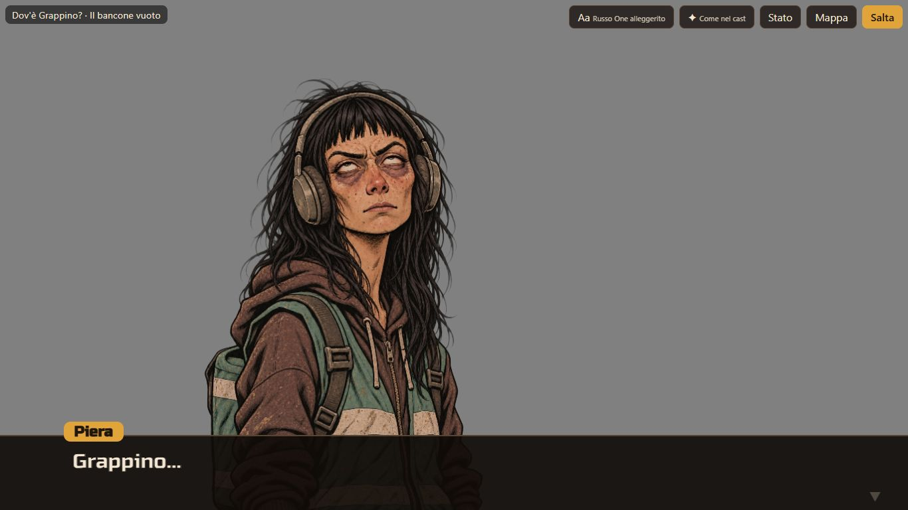

# Carriere — prototipo CA-0a, rapporto della Fase H

> Rapporto dell'esecutore, scritto il 12 novembre 2026, sulla [Fase H](prototipo.md#fase-h-fluidità-entrate-e-bacheca-viva): fluidità,
> entrate e bacheca viva, dopo il [giudizio del proprietario sulla Fase G](prototipo-fase-g.md#giudizio-del-proprietario). Lo stato sta nella
> riga di CA-0a dei [lavori anticipati](../../product-roadmap.md#lavori-anticipati). Senza valore normativo.

## In breve

- **Il banco della fluidità** (`run.ps1 -Task Banco`, `strumenti/banco.mjs`) registra scene e bacheca a frequenza piena, nei due
  orientamenti e con la CPU normale e quattro volte più lenta, e conta da solo i difetti: ritratto vuoto, lampeggio, salto, velo attorno alla
  figura, bocca che non combacia, fotogrammi lunghi. Lanciato prima e dopo: i difetti visibili (vuoti, lampeggi, salti, veli) sono passati
  da 540 a 0, e le immagini composte difettose da due a nessuna.
- **Bocche:** gli sfarfallii e il pezzo di contorno nero di Mara venivano da quattro cause diverse (sotto), tutte corrette nel lettore. Il
  prototipo regge con e senza le due immagini del secondo giro.
- **Entrate e uscite:** nessuno compare più di colpo. Di lato, da lontano (piccolo e sfocato che cresce) o con uno stacco dissolto; il modo si
  sceglie per scena con `[Entrate: …]` nella storia, con un valore normale nel cast. Il cambio di espressione si dissolve.
- **Bacheca viva:** l'achievement «Al suo posto» è acceso; in più un angolo di post-it che ogni tanto si solleva, una mosca che passeggia (e,
  toccata, vola via o si schiaccia), la luce e l'ombra delle lampade che dondolano piano. L'apertura della mappa, rimisurata, è nel rumore
  con la CPU 4× più lenta e forse un poco più lenta con la CPU 6×.
- **Font:** via Patrick Hand («tipo Comic Sans»): pulsanti, legenda e notifiche in Russo One alleggerito, cartoncini e «???» dei post-it in
  Caveat Brush, un pennarello meno tondo, da giudicare.

## Come si vede

`./prototipi/carriere/run.ps1 -Task Dev`, poi `http://127.0.0.1:4330/`. Le entrate si vedono a ogni cambio di personaggio: di lato nel
tutorial, da lontano nella scena del cane di Piera e al bancone vuoto della prova. Sulla bacheca, per vedere subito le cose rare:
`?mosca` (la mosca arriva dopo un secondo e mezzo), `?angolo` (il primo angolo di post-it dopo due), `?allenta` (la lettera), anche insieme
(`?mosca&angolo&allenta`). `?cartoncini=russo` scrive i cartoncini in Russo One invece che a pennarello, per confrontare.

## Il banco della fluidità

`./prototipi/carriere/run.ps1 -Task Banco -Out <cartella>` (in `strumenti/banco.mjs`; una parte sola con `BM_BANCO`, per esempio
`BM_BANCO=scena-prova-o-1x`). Tre percorsi (la prima scena della prova con Piera e gli stacchi, la scena 0 del tutorial, la bacheca dopo la
cucina), ciascuno nei due orientamenti (1366×768 e 390×844) e con la CPU normale e quattro volte più lenta: dodici giri, circa otto minuti.
Scrive `banco.md` con i numeri, `banco.json` e i fotogrammi incriminati (al più sei per giro).

**Come guarda.** Nella pagina, a ogni fotogramma del browser, annota quanto è durato e com'è ogni ritratto (immagine o tela visibili,
rettangolo, opacità, quale immagine, se sta entrando o uscendo). Dallo screencast di Edge prende i fotogrammi veri dello schermo, a frequenza
piena, e li analizza dopo in una pagina a parte. Con `?banco` la scena ha un fondo grigio uniforme (senza sfondo, sprite né insegna) e il
lettore controlla le immagini che compone.

**Cosa conta:**

| Difetto | Come lo trova |
|---|---|
| Fotogramma lungo | più di 50 ms fra un fotogramma del browser e il successivo |
| Ritratto vuoto | un ritratto in scena, non trasparente, senza né l'immagine né la tela visibili |
| Lampeggio | nel riquadro del ritratto, un fotogramma molto diverso dal precedente e dal successivo, che invece si somigliano (A-B-A) |
| Salto | lo stesso ritratto, pieno e non in entrata o uscita, che da un fotogramma all'altro si sposta o cambia misura di più del 3% della sua altezza |
| Velo | più di 200 punti (su una griglia di 64×96 sul ritratto) non grigi fuori dalla sagoma della figura allargata di tre punti: un fondo sporco attorno alla figura |
| Bocca che non combacia | nelle immagini composte dal lettore, pixel della bocca cambiati sul bordo sfumato della sagoma o fuori dalla zona della bocca; per una sagoma presa da un'altra espressione, pixel quasi neri sul bordo della figura dove il riferimento è chiaro |

Velo e lampeggio non si guardano mentre qualcuno entra, esce o si dissolve: lì la figura è sfocata o trasparente apposta.

**Il banco è stato provato contro un difetto vero:** togliendo per prova la sagoma a mara-esasperata (il suo velo scuro torna), il banco
conta 81 fotogrammi con il velo, a circa 640 punti l'uno; le ciocche mosse dalla maglia e i segni sottili del gesto di Mara agitata, che
sono semitrasparenti, ne danno fra 80 e 115: da qui la soglia di 200.

## Prima e dopo

Il banco lanciato prima di ogni correzione (sul codice della Fase G) e alla fine. Numeri per giro: fotogrammi lunghi, ritratti vuoti,
lampeggi, salti, veli; «bocche» sono le immagini composte con difetti.

| Giro | Lunghi prima → dopo | Vuoti | Lampeggi | Salti | Veli |
|---|---|---|---|---|---|
| scena-prova-o-1x | 26 → 16 | 12 → 0 | 16 → 0 | 21 → 0 | 93 → 0 |
| scena-prova-o-4x | 32 → 24 | 15 → 0 | 11 → 0 | 11 → 0 | 63 → 0 |
| scena-prova-v-1x | 23 → 10 | 12 → 0 | 12 → 0 | 16 → 0 | 67 → 0 |
| scena-prova-v-4x | 31 → 20 | 20 → 0 | 12 → 0 | 13 → 0 | 104 → 0 |
| scena-tutorial-o-1x | 5 → 6 | 3 → 0 | 1 → 0 | 2 → 0 | 3 → 0 |
| scena-tutorial-o-4x | 8 → 13 | 5 → 0 | 1 → 0 | 2 → 0 | 5 → 0 |
| scena-tutorial-v-1x | 3 → 4 | 0 → 0 | 0 → 0 | 0 → 0 | 0 → 0 |
| scena-tutorial-v-4x | 6 → 8 | 0 → 0 | 0 → 0 | 0 → 0 | 0 → 0 |
| bacheca-o-1x | 13 → 20 | 0 → 0 | 1 → 0 | 1 → 0 | 4 → 0 |
| bacheca-o-4x | 30 → 41 | 1 → 0 | 1 → 0 | 0 → 0 | 2 → 0 |
| bacheca-v-1x | 7 → 12 | 0 → 0 | 0 → 0 | 3 → 0 | 4 → 0 |
| bacheca-v-4x | 22 → 25 | 1 → 0 | 0 → 0 | 1 → 0 | 2 → 0 |
| **In tutto** | **206 → 199** | **69 → 0** | **54 → 0** | **70 → 0** | **347 → 0** |

**Immagini composte con difetti:** prima piera-offesa (bocca: 417 pixel cambiati sul bordo della sagoma) e mara-esasperata (sagoma: il velo
sul bordo della figura); dopo nessuna.

Due avvertenze sui numeri. Le soglie di velo e salto sono state ritoccate dopo la prima misura, per non contare i falsi allarmi visti nei
fotogrammi incriminati (ciocche semitrasparenti; il ritratto ancora invisibile prima dell'entrata): i veli e i salti di «prima» nella prova
sono quasi tutti veri (le figure con il velo di mara-esasperata, i ritratti che sparivano), quelli di tutorial e bacheca in gran parte falsi
allarmi. Vuoti e lampeggi hanno la stessa definizione prima e dopo. I fotogrammi lunghi dipendono molto dal carico del portatile: nelle scene
calano (le immagini composte si calcolano una volta e in anticipo), sulla bacheca in orizzontale crescono un poco (le lampade, la mosca).

**Apertura della mappa** (`run.ps1 -Task Misura`, come nella Fase D), con il portatile carico e misure molto variabili (prime aperture fino a
6 s per intoppi della macchina): CPU 4× mediane 132, 158, 174 ms (Fase G: 121 e 138; Fase D: 150), nel rumore; CPU 6× mediane 232, 254, 294,
319, 325 ms (Fase G: 213 e 228), forse un poco peggio. Spegnendo per prova le lampade la CPU 6× ha dato 372 e 382 ms: il rumore della macchina
è più grande della differenza.

Registrazione: [`h-scene-e-bacheca.webm`](../../../prototipi/carriere/catture/h-scene-e-bacheca.webm) (16 s, 960×540, 1,5 MB): la combriccola,
Mara che entra di lato e parla con la bocca; Piera che entra da lontano e gli stacchi dissolti su Mara e Spazienzio esasperati; poi la
bacheca con il post-it che si stacca, la mosca che arriva e passeggia, un angolo di post-it che si solleva.

## Bocche

Il proprietario vedeva «sfarfallii e un pezzo di contorno nero in qualche fotogramma di Mara». Con il banco le cause erano quattro:

1. **Il ritratto spariva per un fotogramma a ogni cambio** di espressione o stacco: la tela WebGL si nascondeva, ricompariva l'immagine con
   il file nuovo, ancora da decodificare (vuota), e poi di nuovo la tela. Prima: da 12 a 20 fotogrammi vuoti e da 11 a 16 lampeggi per giro
   nella prova. Ora la tela, una volta pronta, non si nasconde più: finché l'immagine nuova non è pronta si continua a disegnare quella di
   prima, poi le due si dissolvono in 180 ms. L'immagine di riserva (senza WebGL, ritratti fermi) cambia solo a decodifica fatta.
2. **La tela ricompariva con l'immagine vecchia** per un fotogramma, prima del primo disegno: ora il primo disegno si fa subito, appena le
   immagini sono pronte.
3. **Il contorno nero:** la bocca si prendeva anche sul bordo sfumato della sagoma, dove il colore della versione «-bocca» è il suo velo
   scuro: un pezzetto di contorno nero che compariva e spariva con la bocca. Ora il colore della bocca si prende solo dove tutte e due le
   immagini sono piene, a due pixel dal bordo. Per mara-esasperata (sagoma presa da mara-neutra), dove l'esasperata ha il velo nero ma la
   neutra ha la figura (una ciocca, il bordo della spalla), il colore viene ora dalla neutra.
4. **Le linee sottili tremolavano:** l'immagine da 1536 pixel veniva rimpicciolita dalla scheda grafica, senza mipmap, a circa 650; mentre la
   maglia si piega, le linee d'inchiostro sottili scintillavano. Ora le immagini si rimpiccioliscono prima alla misura della tela, con il
   filtro migliore del browser.

In più le immagini composte (bocca, sagoma) si calcolano una volta per espressione e restano in memoria, e all'inizio di ogni nodo si
preparano quelle di tutte le battute e degli stacchi del nodo: chi entra non aspetta i calcoli.

**Le due immagini del secondo giro** ([prompt](prompt-bocche.md#secondo-giro)) non sono arrivate durante il lavoro. Il prototipo regge senza
(spazienzio-furioso parla a bocca ferma, mara-esasperata con la sagoma di neutra) e con: una spazienzio-furioso-bocca allineata viene usata da
sola (il controllo dell'allineamento la accetta); per una mara-esasperata con il fondo trasparente basta togliere dal cast la riga
`"alfa": {"esasperata": "neutra"}`, che altrimenti continua a prendere la sagoma di neutra (innocuo, ma i capelli sono quelli di neutra).

## Entrate e uscite

Nessuno compare più di colpo. Ogni personaggio ha il suo ritratto: quando cambia chi si vede, chi c'era esce e chi arriva entra, nel modo
della scena.

| Modo | Entra | Esce | Durata |
|---|---|---|---|
| `lato` (il valore normale, nel cast) | da destra, rallentando, comparendo | verso sinistra, accelerando, sparendo | 0,45 s |
| `lontano` | piccolo (60%), un poco più in alto e sfocato, cresce mettendosi a fuoco | si allontana: rimpicciolisce, si sfoca, sparisce | 0,6 s |
| `stacco` | dissolvenza | dissolvenza | 0,14 s |

**Come si sceglie:** il comando `[Entrate: lato]`, `[Entrate: lontano]` o `[Entrate: stacco]` in una scena vale da lì in poi; un altro
luogo (`[Sfondo: …]` diverso) torna al valore normale. Il cast ha il valore normale (`"entrate": "lato"`) e può darne uno per personaggio
(`"entrata"`). Gli stacchi su chi ascolta Piera, e il ritorno da uno stacco, sono sempre dissolvenze brevi: sono tagli di regia. Il cambio di
espressione dello stesso personaggio si dissolve in 180 ms. Il personaggio entra quando il suo ritratto è pronto, mai a metà. Con il
movimento ridotto nessuno entra né esce: si cambia e basta.

**Nelle storie:** due righe di comando, `[Entrate: lontano]` al bancone vuoto della prova (`storie/prova.md`) e alla scena del cane di Piera
del tutorial (`tutorial-dialoghi.md`, solo quella riga). Il convertitore, la validazione e il motore conoscono il comando nuovo; un modo
sconosciuto è un errore con il suo messaggio.

## Bacheca viva

- **L'achievement «Al suo posto»,** acceso, alla prima lettera rimessa al suo posto. È un achievement come gli altri, nell'elenco di ogni
  carriera, nascosto con l'indizio «Ogni tanto sulla bacheca una lettera si allenta», e si annuncia con la stessa notifica.
- **L'angolo di post-it:** ogni tanto (fra 9 e 16 secondi di bacheca ferma, deciso dai dati) l'angolo in basso a destra di un post-it ancora
  coperto si solleva piano, come per uno spiffero, resta un attimo, ricade con un piccolo sobbalzo; sotto si vede il feltro, sopra il retro
  della carta.
- **La mosca:** una volta su due che si apre la bacheca, dopo 6–12 secondi, arriva in volo da un bordo, passeggia a piccoli tratti
  (fermandosi a pulirsi) e se ne va da un altro bordo. Toccata, vola via in fretta (due volte su tre) o si schiaccia e resta una macchiolina
  che svanisce; deciso dai dati. Le cordicelle si scuotono quando vola via.
- **Le lampade:** la luce calda e l'ombra di due lampade del bar dondolano piano sulla bacheca. Un'animazione CSS di un solo livello, a
  piccoli scatti (venti in otto secondi): con il dondolio continuo, e prima ancora con la fusione «soft-light», la bacheca in orizzontale
  perdeva fotogrammi sul banco (p95 da 33 a 50 ms); così torna vicina a prima.

Tutto si ferma mentre è aperto un cartoncino o la legenda; con il movimento ridotto niente di questo c'è.

## Font di pulsanti e cartoncini

Via Patrick Hand, la scrittura «tipo Comic Sans»: tolto dal prototipo, file e licenza.

- **Pulsanti** della bacheca e dei cartoncini, **legenda**, **notifiche**: Russo One alleggerito, il font scelto per i dialoghi.
- **Cartoncini** e «???» dei post-it: **Caveat Brush**, un pennarello meno tondo, da giudicare; `?cartoncini=russo` li fa in Russo One.

| Font | File | KB | SHA-256 del font | SHA-256 di `OFL.txt` |
|---|---|---|---|---|
| **Caveat Brush** | `caveatbrush/CaveatBrush-Regular.ttf` | 289 | `e565bd7bffd895ca64f8d1cb77c816b9b38d9c010246386a07c9648592f6f282` | `21b54eb0d7513524798a00dfbaf99a02c003a0012a728cc5f0e02d24c50482fb` |

Dallo stesso repository e commit fissato (`https://raw.githubusercontent.com/google/fonts/c30b221beb0c1da59d563feb91ec8656a1fa972a/ofl/caveatbrush/<file>`),
SIL Open Font License 1.1; ha tutti i caratteri delle storie, accentate comprese (lo controlla una prova). Guardati anche Sedgwick Ave (più
largo, da graffito) e Covered By Your Grace (sottile, poco leggibile piccolo). I font alternativi dei dialoghi (Russo One pieno, Changa,
Oxanium) restano, come chiesto, fino alla chiusura.

## Verifiche

| Comando | Esito |
|---|---|
| `run.ps1 -Task Test` | verde: 86 prove. Nuove: le entrate e le uscite, la maschera della bocca (peso dell'ellisse, erosione, composizione sui pixel), l'angolo di post-it, la mosca, il comando `[Entrate: …]` (convertitore e motore), l'achievement della bacheca nel motore, Caveat Brush (accentate). Cambiate apposta: i font (Patrick Hand tolto, Caveat Brush aggiunto) e l'achievement delle lettere (acceso, alla prima) |
| `tsc --noEmit` | verde |
| `run.ps1 -Task Check` | verde: le due storie senza errori; i due avvisi del tutorial sono quelli di sempre (l'epilogo da scrivere), spostati di due righe |
| `run.ps1 -Task Banco` | prima e dopo, sopra; il banco finale senza difetti visibili in nessuno dei dodici giri |
| `run.ps1 -Task Misura` | sopra |
| `run.ps1 -Task Shots` | verde: catture rifatte, 50 nel repository come prima |
| `run.ps1 -Task Registra` con `BM_REGISTRA=fase-h` | verde: `h-scene-e-bacheca.webm`, 1,5 MB; con il fotogramma del banco, 1,6 MB nuovi in tutto |
| Mutazioni | 24 sulla logica nuova (entrate, angolo, mosca, achievement, maschera ed erosione della bocca, comando `[Entrate]` nel convertitore e nel motore, valore normale nel cast): tutte prese. Una all'inizio sfuggiva (la maschera senza erosione: la composizione usava la tela del browser e le prove non la vedevano): separato il calcolo sui pixel, aggiunta la prova |
| `python scripts/check-links.py`, `python scripts/check-rules.py`, `git diff --check` | verdi, pulito |
| A vista | Edge a 1366×768 e 390×844: le entrate di lato e da lontano, gli stacchi, la bacheca con la mosca (ingrandita del 40% dopo averla vista minuscola), i cartoncini a pennarello |

Le prove a mano con il server di sviluppo sono state fatte sulla porta 4332: sulla 4330 c'era il Phone del proprietario, lasciato acceso.

## Non verificato e limiti

- **Telefono vero:** il banco simula la CPU lenta in Edge sul portatile; su un telefono vero no. Il browser del banco compone lo schermo
  senza scheda grafica: i livelli animati a tutto schermo (le lampade) lì costano più che su un telefono.
- **Le due immagini del secondo giro** non c'erano: il prototipo è provato senza.
- **Il velo sotto la finestra di dialogo** non si guarda (la finestra copre la figura).
- **Il banco non vede tutto:** misura salti, vuoti e lampeggi del ritratto, non della bacheca (lì guarda solo i fotogrammi lunghi); e non
  giudica se un movimento è bello.

## Cosa giudica il proprietario

1. Le entrate: di lato, da lontano, e quale per quale scena; le dissolvenze degli stacchi.
2. Le bocche, dal vivo, ora che non dovrebbero più sfarfallare.
3. La bacheca viva: angolo di post-it, mosca, lampade, achievement.
4. Il pennarello dei cartoncini (Caveat Brush) o Russo One anche lì; i pulsanti in Russo One alleggerito.

## Giudizio del proprietario

12 novembre 2026, dopo la prova dal vivo, con le sue parole:

- **In generale:** «ho testato, non noto altri errori strani». Entrate, bocche, bacheca viva e font restano come sono; nessuna obiezione al
  pennarello dei cartoncini.
- **Piera:** «siccome Piera parla lentamente, anche le animazioni di Piera dovrebbero essere estremamente lente».
- **Testa:** «le animazioni sulla testa che oscilla distorcono un po' troppo, le limiterei un po'».
- **Nodi chiusi:** «i nodi della carriera non più raggiungibili potrebbero strapparsi un po' o accartocciarsi».

La regia aggiunge un difetto visto nelle catture: in verticale le etichette dei pulsanti in alto sulla bacheca si tagliano («Achieve…»,
«Nuovo g…»), perché Russo One è più largo del font di prima.

Si apre la [Fase I](prototipo.md#fase-i-piera-lenta-teste-più-ferme-nodi-strappati).
