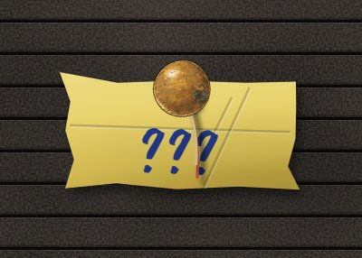
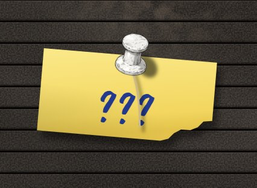
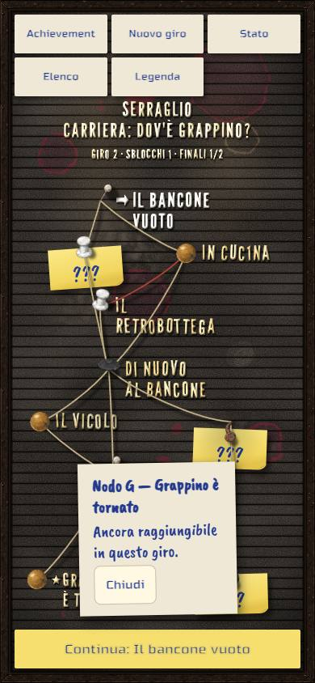

# Carriere — prototipo CA-0a, rapporto della Fase I

> Rapporto dell'esecutore, scritto il 12 novembre 2026, sulla [Fase I](prototipo.md#fase-i-piera-lenta-teste-più-ferme-nodi-strappati):
> Piera lenta, teste più ferme, nodi strappati, dopo il [giudizio del proprietario sulla Fase H](prototipo-fase-h.md#giudizio-del-proprietario).
> Lo stato sta nella riga di CA-0a dei [lavori anticipati](../../product-roadmap.md#lavori-anticipati). Senza valore normativo.

## In breve

- **Piera lentissima:** tutto ciò che si muove di lei va a un terzo della velocità (il fattore `tempoAnimazioni` nel cast, 0,3, come la
  `velocita` del suo testo); per gli altri resta 1. Le dissolvenze degli stacchi restano brevi.
- **Testa più ferma:** la piega della testa nella maglia ha ampiezze circa dimezzate e un tetto morbido di 3°, per tutti; prima arrivava
  oltre i 7°. `?testa=larga` rimette quella di prima, per confrontare.
- **Nodi chiusi strappati o accartocciati:** il post-it di un nodo non più raggiungibile in questo giro ha un angolo strappato (con il pezzo
  che manca) o è accartocciato; il tipo è deciso per nodo dai dati. Quando il nodo si chiude lo si vede succedere; poi resta; un nuovo giro
  rimette la carta intera.
- **Pulsanti della bacheca in verticale:** due righe da tre colonne invece di una riga da cinque; niente più etichette tagliate, a 390 e a
  360 px di larghezza.
- **Banco della fluidità:** zero difetti visibili prima e dopo sui giri che toccano Piera e la bacheca.

## Come si vede

`./prototipi/carriere/run.ps1 -Task Dev` (porta 4330; per le prove a mano qui la 4332, perché sulla 4330 c'era il Phone del proprietario).
Piera all'inizio della prova e del tutorial. La testa: `?testa=larga` per vederla come prima. I nodi chiusi: nella prova, dopo il bancone,
scegliendo Mara si chiude la cucina (si accartoccia), scegliendo Spazienzio si chiudono le tracce in bici (si strappano).

## Piera lentissima

Il proprietario: «siccome Piera parla lentamente, anche le animazioni di Piera dovrebbero essere estremamente lente». Il cast ha ora, per
personaggio, `tempoAnimazioni`, accanto alla `velocita` del testo: 1 il normale, meno di 1 più lento. Piera 0,3; Mara e Spazienzio non lo
hanno, quindi 1. Con 0,3 il tempo delle sue animazioni scorre a un terzo:

| Cosa | Prima | Piera ora |
|---|---|---|
| Ondeggiare di Piera brilla | un'andata e ritorno ogni 3 s | ogni 10 s |
| Maglia (testa che si inclina, busto che respira) | periodi da 1,3 a 4,1 s | da 4,3 a 14 s |
| Bocca | circa 3,5 cambi al secondo | circa uno |
| Cenno a ogni parola, rimbalzo al cambio d'espressione | si spengono in un decimo di secondo | in un terzo di secondo |
| Entrata e uscita di lato | 0,45 s | 1,5 s |
| Entrata e uscita da lontano | 0,6 s | 2 s |
| Stacchi su chi ascolta, dissolvenza fra espressioni | 0,14 s e 0,18 s | uguali: sono tagli di regia |

## Testa più ferma

Il proprietario: «le animazioni sulla testa che oscilla distorcono un po' troppo, le limiterei un po'». La piega della testa è la somma di
tre moti più un cenno a ogni parola; le loro ampiezze, in gradi:

| Moto | Prima | Ora |
|---|---|---|
| Annuire parlando | 2,6 | 1,4 |
| Inclinarsi in silenzio | 1,1 | 0,7 |
| Deriva lenta | 1,8 | 1,0 |
| Cenno a ogni parola | 3 | 1,6 |
| Somma massima | oltre 7 | sotto 3 (tetto morbido) |

Il tetto è morbido (la somma si avvicina a 3° senza superarli, senza scatti). Vale per tutti e tre i personaggi. Le prove controllano che la
testa resti sotto i 3°, che in media si pieghi meno di 0,6 volte di prima e che si muova ancora. La registrazione mostra Spazienzio prima e
dopo, uno dopo l'altro.

## Nodi chiusi strappati o accartocciati

Il proprietario: «i nodi della carriera non più raggiungibili potrebbero strapparsi un po' o accartocciarsi». Sulla bacheca i nodi chiusi
che non si conoscono ancora hanno il post-it; quelli già visti hanno le lettere storte e una lettera caduta (dalla Fase D), e restano così.

- **Strappo:** un angolo in basso del post-it lacerato con un orlo frastagliato, e il pezzo che manca (fra un quinto e un terzo della
  larghezza); mai in alto, dove c'è la puntina.
- **Accartocciato:** i bordi rientrati e storti, tre pieghe con la loro luce e la loro ombra, un poco più piccolo (dal 90 al 94%).
- **Quale:** deciso per nodo dai dati, sempre lo stesso. Nella prova si accartocciano la cucina, il vicolo e «Grappino è tornato», gli altri si
  strappano; nel tutorial si accartoccia la scena 3.
- **Quando:** la bacheca ricorda, per carriera, quali nodi erano chiusi e in che giro. Se dall'ultima volta se ne è chiuso uno, lo si vede
  succedere: il pezzo si stacca e cade, oppure la carta intera si stringe e sparisce lasciando quella accartocciata. Poi resta. Un nuovo giro
  rimette la carta intera (i nodi si riaprono) e non strappa niente davanti a noi.
- **Movimento ridotto:** niente animazione; il post-it danneggiato resta, perché dice che il nodo è chiuso.

## Pulsanti della bacheca in verticale

In Russo One le cinque etichette in una riga si tagliavano («Achieve…», «Nuovo g…»). Ora in verticale i pulsanti stanno in una griglia di
tre colonne, su due righe (Achievement, Nuovo giro, Stato; Elenco, Legenda), e la bacheca lascia più spazio sopra (92 px invece di 56). A 390
e a 360 px di larghezza nessuna etichetta è tagliata (controllato sul disegno: nessun pulsante ha il testo più largo dello spazio).

## Prima e dopo

Il banco della fluidità sui giri che toccano Piera (la prima scena della prova) e sulla bacheca, nei due orientamenti e con la CPU normale e
quattro volte più lenta, prima delle modifiche (sul codice della Fase H) e alla fine:

| Giro | Fotogrammi lunghi prima → dopo | p95 (ms) prima → dopo | Vuoti, lampeggi, salti, veli, bocche |
|---|---|---|---|
| scena-prova-o-1x | 10 → 11 | 17 → 17 | 0 → 0 |
| scena-prova-o-4x | 15 → 15 | 18 → 17 | 0 → 0 |
| scena-prova-v-1x | 7 → 8 | 17 → 17 | 0 → 0 |
| scena-prova-v-4x | 20 → 13 | 17 → 17 | 0 → 0 |
| bacheca-o-1x | 32 → 14 | 50 → 33 | 0 → 0 |
| bacheca-o-4x | 20 → 19 | 34 → 34 | 0 → 0 |
| bacheca-v-1x | 7 → 8 | 17 → 33 | 0 → 0 |
| bacheca-v-4x | 22 → 17 | 33 → 17 | 0 → 0 |

Zero difetti visibili prima e dopo; i fotogrammi lunghi restano nel rumore della macchina (i giri della bacheca ora comprendono anche lo
strappo del post-it chiuso). La testa più ferma non ha cambiato niente sul banco, che non giudica l'ampiezza: lo fanno le prove.

**Apertura della mappa** (`strumenti/misura.mjs`, 390×844): CPU 4× mediana 173 ms (Fase H: 132–174), CPU 6× mediana 303 ms (Fase H:
232–325), con un intoppo della macchina da 9 s nella prima apertura; nel rumore della Fase H.

Registrazione: [`i-testa-piera-nodi.webm`](../../../prototipi/carriere/catture/i-testa-piera-nodi.webm) (14 s, 960×540, 1,2 MB), con una
didascalia in alto: Spazienzio con la testa di prima (`?testa=larga`) e di ora; Piera che entra da lontano e parla, lentissima; la bacheca
dopo il bancone con Mara, dove la cucina si accartoccia e un altro nodo chiuso si strappa.

## Verifiche

| Comando | Esito |
|---|---|
| Prove (`node --test`) | verdi: 91. Nuove: la testa (sotto i 3°, meno di prima, ancora mobile), Piera nel cast, il danno per nodo, i nodi appena chiusi, lo strappo (in basso, orlo frastagliato, pezzo che combacia) e l'accartocciato |
| `tsc --noEmit` | verde |
| `run.ps1 -Task Check` | verde, invariato |
| Banco della fluidità | sopra: zero difetti visibili prima e dopo |
| `strumenti/misura.mjs` | sopra |
| Catture (`strumenti/catture.mjs`) | verdi, rifatte (50 nel repository come prima); in più i due ritagli `i-accartocciato.jpg` e `i-strappo.jpg` |
| Registrazione (`BM_REGISTRA=fase-i`) | verde: `i-testa-piera-nodi.webm`, 1,2 MB; con i ritagli, 1,3 MB nuovi |
| Mutazioni | 13 sulla logica nuova (tetto e ampiezze della testa, Piera nel cast, tipo di danno, nodi chiusi ora e nuovo giro, strappo e accartocciato, avanzamento): tutte prese; due all'inizio sfuggivano (il tetto alzato, l'orlo dritto): rafforzate le prove |
| Pulsanti in verticale | a 390 e a 360 px, nessun pulsante con il testo più largo del suo spazio |
| `python scripts/check-links.py`, `python scripts/check-rules.py`, `git diff --check` | verdi, pulito |

Le prove a mano con il server di sviluppo sono state fatte sulla porta 4332: sulla 4330 c'era il Phone del proprietario, lasciato acceso.

## Non verificato e limiti

- **Telefono vero:** come prima, Edge sul portatile con la CPU rallentata.
- **Accartocciato:** è un disegno (contorno storto e pieghe), non una carta piegata davvero; da vicino si vede che è piatto.
- **Nodi chiusi già visti** (con le lettere): restano come nella Fase D, senza strappi; la richiesta parlava di cartoncino o post-it.

## Cosa giudica il proprietario

1. Se Piera è lenta abbastanza (0,3) o troppo.
2. Se la testa ora ondeggia giusta.
3. Strappi e accartocciati: quanto, quali, e se la scelta per nodo va bene.
