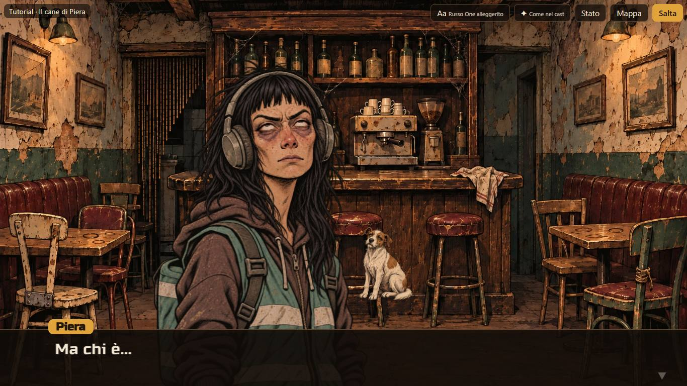
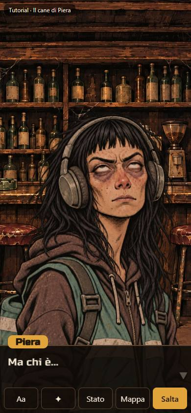
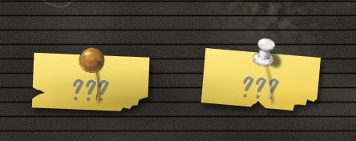

# Carriere — prototipo CA-0a, rapporto della Fase J

> Rapporto dell'esecutore, scritto il 12 novembre 2026, sulla [Fase J](prototipo.md#fase-j-due-in-scena-solo-di-lato-strappi-più-netti):
> due in scena, solo di lato, strappi più netti, dopo il [giudizio del proprietario sulla Fase I](prototipo-fase-i.md#giudizio-del-proprietario).
> Lo stato sta nella riga di CA-0a dei [lavori anticipati](../../product-roadmap.md#lavori-anticipati). Senza valore normativo.

## In breve

- **Due in scena:** quando arriva uno stacco di regia su chi ascolta, chi parla non esce più. Scivola a sinistra, e chi reagisce entra da
  destra e le resta a fianco finché dura la battuta; poi esce dal suo lato. Vale per ogni stacco su chi ascolta, non solo per Piera.
- **Chi è a fuoco** è in piena luce e davanti; l'altro è più scuro e un poco più piccolo, dietro. Si muove solo la bocca di chi parla.
- **Solo di lato:** via l'entrata «da lontano» e via il comando `[Entrate: …]` (dal convertitore, dalla validazione, dal motore, dal cast e
  dalle due storie); via anche le dissolvenze degli stacchi, sostituite dall'entrata di lato di chi reagisce.
- **Strappi:** il post-it di un nodo chiuso ha due o tre strappi e il «???» grigio. Via l'accartocciato.
- **Banco della fluidità:** zero difetti visibili prima e dopo, anche con due tele WebGL insieme, in verticale e con la CPU quattro volte
  più lenta.

## Come si vede

`./prototipi/carriere/run.ps1 -Task Dev` (porta 4330; per le prove a mano qui la 4332, perché sulla 4330 c'era il Phone del proprietario,
lasciato acceso). Due in scena: all'inizio della prova, Piera al bancone; ogni tocco riprende la frase e al «...» successivo reagisce un altro.
`?fuoco=parla` tiene sempre a fuoco chi parla, per confrontare (sotto). Gli strappi: nella prova, dopo il bancone, scegliendo Mara si
chiudono la cucina e il retrobottega.

## Due in scena

Il proprietario: «quando si intramezzano le altre persone mentre Piera parla lentamente, perché dobbiamo far sparire Piera? Mostriamo le
altre persone contemporaneamente a lei, magari a fianco». Il modello «un ritratto per volta» diventa al più due posti in scena:

| Momento | Chi parla | Chi reagisce |
|---|---|---|
| Da solo | al suo posto di sempre | — |
| Primo stacco su chi ascolta | scivola a sinistra (Piera lentissima, come si muove), passa in ombra | entra da destra e si ferma a fianco, a fuoco |
| Il testo riprende (tocco) | torna a fuoco, davanti; la bocca si muove | resta a fianco, in ombra, dietro |
| Stacco su un altro che ascolta | resta | il primo esce a destra, l'altro entra da destra al suo posto |
| Fine della battuta | se la battuta dopo è di un altro, esce a sinistra | esce a destra; se la battuta dopo è sua, resta e scivola al centro |

- **Posti:** in orizzontale i due stanno a fianco (chi parla un quarto di ritratto a sinistra, chi reagisce tre quarti a destra); in
  verticale si sovrappongono un poco, chi reagisce spostato di un quinto di ritratto, con chi è a fuoco davanti. In verticale lo spostamento
  di chi reagisce era all'inizio un terzo di ritratto, e il volto di Mara finiva tagliato sul bordo: ridotto.
- **Luce e profondità:** chi è a fuoco a luce piena e grandezza piena; l'altro al 70% della luce e al 95% della grandezza. Ci si arriva
  scivolando (un avvicinamento morbido, due terzi della strada in 0,16 s, per Piera in 0,5 s), senza scatti né rimbalzi.
- **Bocca:** si muove solo quella di chi parla e solo mentre il testo scorre; chi reagisce ha la sua espressione di stacco (le esasperate
  del cast), ferma, con la maglia che respira.
- **Niente specchiature:** chi reagisce sta a destra con il suo ritratto così com'è.
- **Movimento ridotto:** nessuno scivola né entra: i due compaiono al loro posto.
- **La [specifica](specifica-asset.md#come-appare-la-scena)** dice ora «al più due personaggi in scena», con una sezione «Due in scena» e le
  conseguenze per gli asset.

**Una scelta da giudicare: chi è a fuoco.** La proposta dice «chi parla è in piena luce, l'altro un poco più scuro e indietro» e «in verticale
[…] con chi parla davanti». Durante lo stacco il testo di Piera è fermo e la scena è la reazione di chi ascolta: l'ho messo a fuoco lui
(davanti e in piena luce), e Piera torna a fuoco quando il testo riprende. Con `?fuoco=parla` resta sempre a fuoco chi parla: chi reagisce è
sempre in ombra e dietro, anche durante il suo stacco.

## Solo di lato

Il proprietario: «quando i personaggi compaiono per parlare, dovrebbero arrivare di lato invece di comparire ingrandendosi come Pokémon».
Ora chi compare arriva sempre di lato, da destra, rallentando (0,45 s, Piera 1,5 s); chi se ne va esce dal suo lato accelerando: chi parla
da solo a sinistra, chi ha reagito a destra. Nessuno cresce, si sfoca o si dissolve sul posto.

Il comando `[Entrate: …]` non serve più, perché c'è un modo solo: tolto dal convertitore (ora è un comando sconosciuto), dalla validazione,
dal motore (la scena non ricorda più un modo), dal formato e dal cast, e le due righe `[Entrate: lontano]` tolte da `storie/prova.md` e da
`tutorial-dialoghi.md` (lì solo quella riga, aggiunta nella Fase H).

## Strappi

Il proprietario: «va bene lo strappo, ma strappiamolo in più punti e grigiamo la scritta, così si capisce meglio».

- **Due o tre strappi** per post-it (circa metà e metà), decisi per nodo dai dati: sempre un angolo in basso lacerato; poi un morso nel
  fianco dell'altro lato, sotto la metà, o un morso nel bordo basso; con tre, tutti e due. Mai in alto, dove c'è la puntina; mai sopra il
  «???». Orli frastagliati; i pezzi che mancano combaciano con gli strappi (le prove rimettono i pezzi al loro posto e ritrovano il post-it
  intero). Tolta in tutto fra il 2,5 e il 15% della carta.
- **Il «???» grigio** sui post-it dei nodi chiusi; blu, come prima, sugli altri.
- **Quando:** come nella Fase I. Se dall'ultima volta si è chiuso un nodo, lo si vede succedere: i pezzi si staccano uno dopo l'altro
  (0,18 s di scarto) e cadono girando; poi resta. Un nuovo giro rimette la carta intera.
- **Via l'accartocciato** (disegno, animazione, prove).

## Prima e dopo

Il banco della fluidità (`strumenti/banco.mjs`) sui giri della scena di prova (Piera al bancone con gli stacchi: ora due tele WebGL insieme)
e della bacheca (ora con gli strappi), nei due orientamenti e con la CPU normale e quattro volte più lenta, prima delle modifiche (sul
codice della Fase I) e alla fine. Il banco ora guarda anche il secondo ritratto: il campionatore li segue tutti e due, il riquadro di
lampeggi e veli è quello di ognuno, e il velo di uno si conta fuori dalle sagome di tutti e due (dove si sovrappongono, quello dietro non è
un velo di quello davanti).

| Giro | Fotogrammi lunghi prima → dopo | p95 (ms) prima → dopo | Vuoti, lampeggi, salti, veli, bocche |
|---|---|---|---|
| scena-prova-o-1x | 8 → 9 | 17 → 17 | 0 → 0 |
| scena-prova-o-4x | 14 → 14 | 17 → 33 | 0 → 0 |
| scena-prova-v-1x | 8 → 6 | 17 → 17 | 0 → 0 |
| scena-prova-v-4x | 16 → 14 | 17 → 17 | 0 → 0 |
| bacheca-o-1x | 26 → 14 | 50 → 33 | 0 → 0 |
| bacheca-o-4x | 22 → 35 (ripetuto: 20 e 17) | 34 → 50 (ripetuto: 34 e 34) | 0 → 0 |
| bacheca-v-1x | 8 → 10 | 17 → 17 | 0 → 0 |
| bacheca-v-4x | 20 → 16 | 17 → 17 | 0 → 0 |

Zero difetti visibili prima e dopo. Due tele insieme non hanno cambiato i fotogrammi lunghi della scena, nemmeno in verticale con la CPU
4×; il p95 a 33 ms in orizzontale 4× è un gradino a metà fra 17 e 33, con gli stessi fotogrammi lunghi. Il giro della bacheca in
orizzontale 4× con 35 fotogrammi lunghi, ripetuto due volte, ne ha dati 20 e 17: rumore della macchina, non gli strappi.

Registrazione: [`j-due-in-scena-strappi.webm`](../../../prototipi/carriere/catture/j-due-in-scena-strappi.webm) (12 s, 960×540,
0,7 MB), con una didascalia in alto: Piera che entra di lato e parla, chi reagisce che le entra a fianco a ogni stacco (Mara, poi Spazienzio
al suo posto); poi la bacheca dopo il bancone con Mara, dove due nodi si chiudono e i loro pezzi cadono.

## Verifiche

| Comando | Esito |
|---|---|
| Prove (`node --test`) | verdi: 92. Nuove o rifatte: le entrate solo di lato dal lato voluto, i posti dei due in scena e i loro lati, luce e profondità, lo scivolare senza scatti né rimbalzi (e uguale a ogni passo di fotogramma), `[Entrate: …]` ora sconosciuto, la scena senza modo di entrare, gli strappi (due o tre, mai in alto né sul «???», pezzi che combaciano, carta tolta), i pezzi che cadono uno dopo l'altro. Tolte quelle dell'accartocciato e delle entrate da lontano |
| `tsc --noEmit` | verde |
| `run.ps1 -Task Test -Offline`, `run.ps1 -Task Check` | verdi; il controllo delle due storie invariato (tutti i nodi raggiunti, 0 errori, 0 avvisi) |
| Banco della fluidità | sopra: zero difetti visibili prima e dopo |
| Catture (`strumenti/catture.mjs`) | verdi, con un controllo in più (durante lo stacco della scena del cane Piera ha il posto di chi parla e chi reagisce le sta a fianco); nel repository solo le 15 che cambiano davvero (le altre differivano per meno dello 0,2% dei pixel), più il ritaglio `j-strappi.jpg` |
| Registrazione (`BM_REGISTRA=fase-j`) | verde: `j-due-in-scena-strappi.webm`, 0,7 MB; con le catture cambiate e il ritaglio, 2,5 MB |
| Mutazioni | 25 sulla logica nuova (lato di entrata e di uscita, il ritorno del «lontano», i posti in orizzontale e in verticale, luce e profondità, lo scivolare, il numero, il lato, l'orlo, il fondo e la posizione degli strappi, i pezzi, lo scarto della caduta, i nodi chiusi a giro nuovo, `[Entrate: …]` riaccettato): tutte prese |
| A occhio, porta 4332 | la scena di prova a 1366×768 e 390×844, stacco per stacco; in verticale lo spostamento di chi reagisce ridotto da un terzo a un quinto di ritratto, perché il volto di Mara finiva sul bordo |
| `python scripts/check-links.py`, `python scripts/check-rules.py`, `git diff --check` | verdi, pulito |

Le prove a mano con il server di sviluppo sono state fatte sulla porta 4332: sulla 4330 c'era il Phone del proprietario, lasciato acceso.

## Non verificato e limiti

- **Telefono vero:** come prima, Edge sul portatile con la CPU rallentata.
- **Il cambio di fuoco** in verticale scambia chi sta davanti in un fotogramma (la luce invece scivola): dove i due si sovrappongono si
  vede un taglio. Breve e voluto, ma da guardare.
- **Chi reagisce resta finché dura la battuta:** in una battuta con molti stacchi (Piera al bancone) si alternano Mara e Spazienzio nello
  stesso posto, uscendo ed entrando; tre in scena non ci sono mai.
- **Uno stacco di chi parla su sé stesso** (chi ascolta è chi parla) non apre il secondo posto.

## Cosa giudica il proprietario

1. Due in scena: posti, ombra di chi non è a fuoco, quanto si sovrappongono in verticale.
2. Chi è a fuoco durante lo stacco: chi reagisce (ora) o sempre chi parla (`?fuoco=parla`).
3. Strappi: quanti, quanto grandi, il grigio del «???».

## Giudizio del proprietario

12 novembre 2026, con le sue parole:

- **Fuoco:** «meglio con sempre a fuoco chi parla».
- **Chi reagisce:** «chi è non a fuoco perché reagisce è meglio che sia un po' più piccolo e defilato, ad esempio Mara è troppo grande
  rispetto a Piera».
- **Il filo:** «sulla mappa, quando la puntina viene tolta, il filo resta lì sospeso nel nulla. O lo facciamo cadere e riprendere dalla
  puntina rossa, o troviamo un'altra soluzione».
- **I nodi successivi:** «vorrei che i nomi dei prossimi nodi affrontabili siano rivelati, non che ci sia "continua verso ???"».
- **In generale:** «sistemiamo queste cose e poi direi che è perfetto, e siamo pronti per scrivere e realizzare la carriera principale del
  set base».

Si apre la [Fase K](prototipo.md#fase-k-ultimi-ritocchi-e-chiusura), l'ultima del prototipo.
