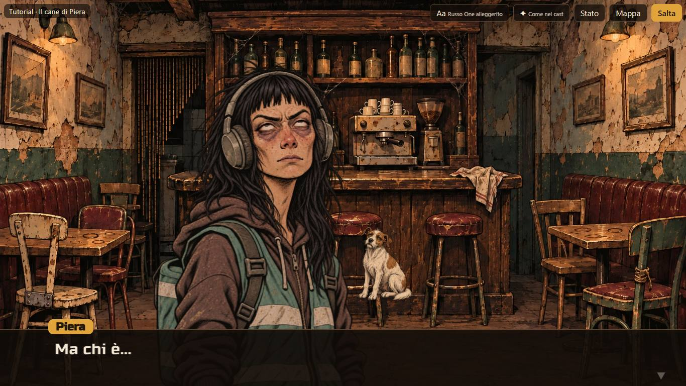
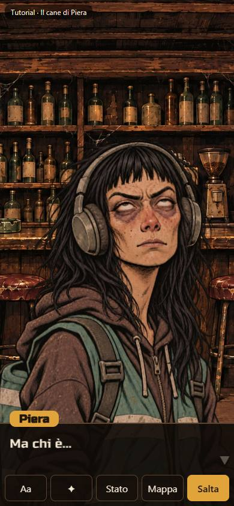
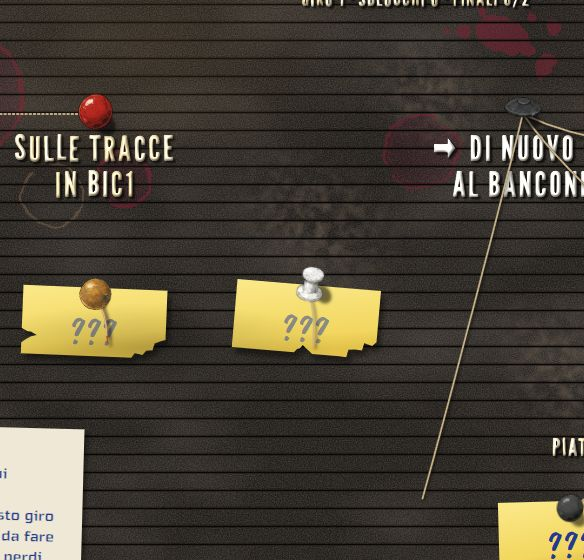

# Carriere — prototipo CA-0a, rapporto della Fase K

> Rapporto dell'esecutore, scritto il 12 novembre 2026, sulla [Fase K](prototipo.md#fase-k-ultimi-ritocchi-e-chiusura): ultimi ritocchi e
> chiusura, dopo il [giudizio del proprietario sulla Fase J](prototipo-fase-j.md#giudizio-del-proprietario). È l'ultima fase del prototipo;
> la [chiusura](prototipo.md#chiusura) dice cosa passa a CA-0, cosa si butta e cosa resta aperto. Lo stato sta nella riga di CA-0a dei
> [lavori anticipati](../../product-roadmap.md#lavori-anticipati). Senza valore normativo.

## In breve

- **Sempre a fuoco chi parla:** il comportamento di `?fuoco=parla` è ora quello normale, e la scelta è tolta.
- **Chi reagisce più piccolo e defilato:** sta più verso il bordo, più scuro, dietro, e la sua testa è l'80% di quella di chi parla,
  misurata sulla testa del cast. Mara accanto a Piera scende al 68% della sua immagine.
- **Il filo non resta sospeso:** quando la puntina del nodo d'arrivo si toglie per far posto alla «sei qui», il capo libero delle sue
  cordicelle cade, penzola dall'altro capo e, quando la puntina rossa si pianta, torna su e lei lo riprende.
- **I nodi affrontabili si leggono:** mostrano il nome sulla bacheca anche se non li si è mai visti, e il pulsante dice «Continua verso» con
  il nome vero. Il «???» resta sui nodi più lontani; il post-it si stacca quando il nodo diventa affrontabile.
- **Chiusura:** via Russo One pieno, Changa e Oxanium (file, licenze, «Aa» nella scena, campionario nell'elenco, prove), via `?fuoco`,
  `?testa=larga` e `?cartoncini=russo`. La sezione [Chiusura](prototipo.md#chiusura) è scritta.
- **Banco della fluidità:** zero difetti visibili prima e dopo, sulla scena di prova e sulla bacheca (che ora comprende il filo che cade),
  nei due orientamenti e con la CPU quattro volte più lenta.

## Come si vede

`./prototipi/carriere/run.ps1 -Task Dev` (porta 4330; per le prove a mano qui la 4332, perché sulla 4330 c'era il Phone del proprietario,
lasciato acceso). Chi reagisce: all'inizio della prova, Piera al bancone. I nomi: la bacheca della prova all'inizio («Continua verso Il
bancone vuoto») e dopo il bancone. Il filo: dopo il bancone con Mara, entrare nelle tracce in bici e tornare alla bacheca; la puntina del
nodo d'arrivo si toglie e la cordicella verso «Di nuovo al bancone» cade e penzola.

## Chi reagisce

Il proprietario: «chi è non a fuoco perché reagisce è meglio che sia un po' più piccolo e defilato, ad esempio Mara è troppo grande rispetto
a Piera». E: «meglio con sempre a fuoco chi parla».

| | Fase J | Fase K |
|---|---|---|
| A fuoco | chi reagisce durante lo stacco, chi parla quando il testo riprende | sempre chi parla |
| Luce di chi reagisce | 70% (quando non era a fuoco) | 70% |
| Grandezza di chi reagisce | 95% dell'immagine | la testa all'80% di quella di chi parla |
| Posto di chi reagisce, in larghezze del ritratto | 0,72 a destra in orizzontale, 0,22 in verticale | 0,95 e 0,26 |
| Davanti | chi era a fuoco | sempre chi parla |

**La misura della testa** viene dal cast, come per la maglia: il raggio della testa, in frazioni della larghezza del ritratto, che è la
stessa tela per tutti. Mara ha 0,20, Piera e Spazienzio 0,17: Mara è inquadrata più da vicino, e a parità di immagine sembrava più grande.
Ora la scala di chi reagisce è 0,8 × testa di chi parla ÷ testa sua:

| Chi parla | Chi reagisce | Scala dell'immagine |
|---|---|---|
| Piera | Mara | 0,68 |
| Piera | Spazienzio | 0,80 |
| Mara | Piera o Spazienzio | 0,94 |
| Spazienzio | Mara | 0,68 |

La scala parte dal bordo basso, che resta dietro la finestra di dialogo: chi reagisce ha la testa più in basso di chi parla, come chi sta
un passo indietro. Ci si arriva scivolando, come per i posti; chi reagisce esce piccolo com'era. Se un personaggio non ha la misura della
testa, si usa l'80% dell'immagine. La [specifica](specifica-asset.md#come-appare-la-scena) è aggiornata: per ogni personaggio nuovo va
presa la misura della testa nel cast.

## Il filo che cade

Il proprietario: «sulla mappa, quando la puntina viene tolta, il filo resta lì sospeso nel nulla. O lo facciamo cadere e riprendere dalla
puntina rossa, o troviamo un'altra soluzione».

**Tutti i casi in cui un capo perde la sua puntina.** Ho cercato ogni punto in cui la bacheca disegna una cordicella senza la puntina a un
capo:

- **Il nodo d'arrivo, durante il viaggio della «sei qui»:** l'unico caso. Quando si torna alla bacheca dopo un nodo nuovo, la puntina di quel
  nodo spariva subito, per far posto alla «sei qui» che arriva in volo dal nodo di prima; le cordicelle legate lì (verso i nodi dopo, o da
  altri nodi che ci portano) restavano tese a mezz'aria per più di due secondi, fino all'arrivo. Era il filo sospeso.
- **La cordicella nuova**, dal nodo di prima a quello d'arrivo, non ha il problema: la tira la «sei qui» in volo, legata a lei.
- **Il nodo di partenza** riprende subito il suo spillo quando la «sei qui» se ne va: le sue cordicelle restano legate.
- **I segreti non trovati** non si disegnano, e nemmeno le cordicelle verso di loro; **le arrotolate** stanno attorno a una puntina sola;
  **la legenda** ha la sua puntina. Una prova lo controlla su ottanta partite di tre giri giocate a caso (sotto).

**La soluzione** è quella del proprietario, con un dettaglio: la puntina d'arrivo non sparisce più di colpo. Resta finché la «sei qui» non
sta per partire, poi si sfila (sale un poco e svanisce in un quarto di secondo). In quel momento il capo libero di ogni cordicella legata a
lei cade: penzola dall'altro capo come un pendolo che si smorza, con la corda che si raddrizza e non si allunga, e con una piccola spinta di
lato, così anche un capo che era già sotto il capo fisso dondola e si vede che è libero. Quando la «sei qui» si pianta, i capi tornano su in
0,4 s e la puntina rossa li riprende; la cordicella riprende la sua forma e torna a oscillare con le altre. Le arrotolate attorno alla
puntina tolta cadono con lei e ricompaiono con la rossa. Con il movimento ridotto non c'è viaggio, quindi niente cade.

Ho tenuto la proposta del proprietario perché racconta quello che succede (il barista toglie una puntina e ne pianta un'altra) e si legge in
due secondi; l'alternativa più semplice, lasciare la vecchia puntina finché arriva la rossa e scambiarle, non avrebbe mostrato niente.

| Tempo dall'apertura (senza post-it che cade; con, tutto un secondo dopo) | Cosa succede |
|---|---|
| 0,55 s | la vecchia puntina si sfila; i capi cadono |
| 1,0 s | parte la «sei qui» |
| 2,1 s | la «sei qui» si pianta |
| 2,5 s | i capi sono di nuovo legati alla rossa |

## I nodi affrontabili

Il proprietario: «vorrei che i nomi dei prossimi nodi affrontabili siano rivelati, non che ci sia "continua verso ???"».

- **Affrontabile** vuol dire disponibile: un nodo dove si può entrare subito toccandolo. Mostra il nome con le lettere dritte e bianche e la
  freccia, anche se non lo si è mai visto.
- **Il pulsante** dice «Continua verso» con il nome vero del primo nodo affrontabile (prima: «Continua: ???» o «Continua: nome»).
- **Il «???» resta** sui nodi più lontani mai visti e su quelli raggiunti ma bloccati dalla loro condizione, che non si possono affrontare.
- **Il post-it si stacca** quando il nodo diventa affrontabile, cioè alla prima apertura della bacheca in cui lo è: è il movimento della Fase
  G, che ora parte prima. Quando poi ci si arriva, il nome c'è già.
- **I segreti:** un segreto non trovato non si vede, nemmeno il post-it, come prima. Oggi però diventa visibile quando il giro ci porta
  proprio lì, cioè quando è affrontabile (nella prova, il vicolo dopo il retrobottega). Ho deciso che in quel momento mostra il nome come gli
  altri: la scelta che porta lì lo nomina già («con Spazienzio, che fiuta qualcosa»), e un post-it su un solo nodo affrontabile avrebbe
  rimesso il «Continua verso ???» che il proprietario non vuole. La scoperta resta: fino a quel momento il segreto non c'è.
- Il [concetto della bacheca](bacheca.md) è aggiornato.

## Chiusura del prototipo

- **Font:** resta Russo One alleggerito per i dialoghi, i pulsanti, la legenda e le notifiche; League Gothic per le lettere della bacheca;
  Caveat Brush per i cartoncini e il «???». Tolti Russo One pieno (era la stessa famiglia, senza il contorno), Changa e Oxanium, con le
  cartelle `font/changa` e `font/oxanium` e le loro licenze; tolti «Aa» nella scena e il campionario nell'elenco, con le catture che li
  fotografavano. Le prove dei font controllano ora un font solo per i dialoghi e tre cartelle.
- **Scelte di confronto tolte:** `?fuoco` (ora il normale), `?testa=larga` (la testa di prima: le prove confrontano le ampiezze di adesso
  con quelle di prima scritte nella prova), `?cartoncini=russo`. Tolte anche le parti della registrazione che mostravano modi che non ci sono
  più (entrate da lontano, testa larga); le registrazioni già fatte restano nel repository.
- **Restano** gli interruttori delle cose rare (`?mosca`, `?angolo`, `?allenta`), il banco (`?banco`) e il livello dei ritratti «✦».
- **La [Chiusura](prototipo.md#chiusura)** è scritta in `prototipo.md`.

## Prima e dopo

Il banco della fluidità sui giri della scena di prova (Piera con chi reagisce a fianco) e della bacheca (dopo la cucina: la «sei qui» che
viaggia, e ora la puntina della cucina che si toglie con la sua cordicella verso il retrobottega che cade), nei due orientamenti e con la CPU
normale e quattro volte più lenta, prima delle modifiche (sul codice della Fase J) e alla fine:

| Giro | Fotogrammi lunghi prima → dopo | p95 (ms) prima → dopo | Vuoti, lampeggi, salti, veli, bocche |
|---|---|---|---|
| scena-prova-o-1x | 10 → 7 | 17 → 17 | 0 → 0 |
| scena-prova-o-4x | 18 → 12 | 33 → 17 | 0 → 0 |
| scena-prova-v-1x | 8 → 9 | 17 → 17 | 0 → 0 |
| scena-prova-v-4x | 14 → 13 | 17 → 17 | 0 → 0 |
| bacheca-o-1x | 9 → 14 | 34 → 34 | 0 → 0 |
| bacheca-o-4x | 24 → 20 | 34 → 34 | 0 → 0 |
| bacheca-v-1x | 7 → 10 | 17 → 17 | 0 → 0 |
| bacheca-v-4x | 16 → 16 | 17 → 17 | 0 → 0 |

Zero difetti visibili prima e dopo. Chi reagisce, più piccolo, non ha cambiato niente; il filo che cade ridisegna ogni fotogramma una o due
cordicelle per due secondi e mezzo, senza peso misurabile: i fotogrammi lunghi restano nel rumore della macchina delle fasi prima (nella
Fase J lo stesso giro della bacheca ne dava fra 17 e 35).

Registrazione: [`k-reagisce-filo-nomi.webm`](../../../prototipi/carriere/catture/k-reagisce-filo-nomi.webm) (14 s, 960×540, 1,2 MB),
con una didascalia in alto: Piera al bancone con Mara e poi Spazienzio a fianco, più piccoli e defilati; la bacheca dopo il bancone con i
nomi dei nodi affrontabili e «Continua verso …»; poi il ritorno dalle tracce in bici, con la puntina che si toglie, il filo che cade e
penzola e la «sei qui» che lo riprende.

## Verifiche

| Comando | Esito |
|---|---|
| Prove (`node --test`) | verdi: 101. Nuove: chi reagisce (scala dalla testa del cast, più piccolo con ogni coppia, Mara accanto a Piera, defilato); il filo (`tests/filo.test.ts`): ottanta partite di tre giri giocate a caso sulle due carriere, in cui ogni cordicella ha una puntina a ogni capo, ogni cordicella della puntina tolta si riprende (e la nuova no), i nodi affrontabili hanno il nome e il «???» resta sugli altri, il post-it si stacca quando il nodo diventa affrontabile, i segreti; il capo libero che cade, penzola sotto il capo fisso, non si allunga, non salta, dondola e torna; i tempi; un nodo bloccato che tiene il post-it. Rifatte: la testa senza `?testa=larga`, i font con uno solo per i dialoghi, il bozzetto della bacheca (il retrobottega affrontabile ora senza post-it, voluto) |
| `tsc --noEmit` | verde |
| `run.ps1 -Task Test -Offline`, `run.ps1 -Task Check` | verdi; il controllo delle due storie invariato |
| Banco della fluidità | sopra: zero difetti visibili prima e dopo |
| Catture (`strumenti/catture.mjs`) | verdi, con controlli nuovi: niente scelta del carattere, «Continua verso» con il nome, dopo la cucina il post-it del retrobottega che si stacca (non più quello della cucina) e la puntina tolta con il filo che cade. Nel repository le 17 che mostrano la fase (scene con chi reagisce, bacheche con i nomi, la barra senza «Aa» in verticale), più il ritaglio `k-filo.jpg`; le altre restano della Fase J e in orizzontale mostrano ancora il pulsante «Aa» |
| Registrazione (`BM_REGISTRA=fase-k`) | verde: `k-reagisce-filo-nomi.webm`, 1,2 MB; con le catture cambiate e il ritaglio, 2,7 MB |
| Mutazioni | 21 sulla logica nuova (grandezza, rapporto e posto di chi reagisce, luce, nodi affrontabili, bloccati, cordicelle da riprendere e capo fisso, caduta, lunghezza, ritorno, spinta, tempi, font): tutte prese; tre all'inizio sfuggivano (i bloccati col nome, la cordicella nuova fra quelle che cadono, la spinta tolta): rafforzate le prove |
| A occhio, porta 4332 | la scena di prova a 1366×768 e 390×844; il filo che cade fotogramma per fotogramma; i nomi e il pulsante |
| `python scripts/check-links.py`, `python scripts/check-rules.py`, `git diff --check` | verdi, pulito |

Le prove a mano con il server di sviluppo sono state fatte sulla porta 4332: sulla 4330 c'era il Phone del proprietario, lasciato acceso.

## Non verificato e limiti

- **Telefono vero:** come prima, Edge sul portatile con la CPU rallentata.
- **Il filo è disegnato come una corda senza peso proprio:** penzola come un pendolo smorzato e si raddrizza, ma non si attorciglia né
  tocca le lettere sotto.
- **Chi reagisce in verticale** sta dietro chi parla e se ne vede di più la testa che il corpo; con personaggi larghi come Spazienzio la
  sovrapposizione è maggiore.

## Cosa giudica il proprietario

1. Chi reagisce: quanto piccolo (testa all'80% di chi parla) e quanto defilato.
2. Il filo che cade e la «sei qui» che lo riprende.
3. I nomi dei nodi affrontabili, e la scelta sui segreti.
4. La [chiusura](prototipo.md#chiusura): se il prototipo è riuscito e si passa a CA-0.

## Giudizio del proprietario

12 novembre 2026: «Sì, chiudiamo». Prima, sui ritocchi di questa fase: «sistemiamo queste cose e poi direi che è perfetto, e siamo pronti
per scrivere e realizzare la carriera principale del set base»; sulla chiusura: «teniamoci questo prototipo anche in repo!». Il prototipo è
chiuso e resta nel repository ([chiusura](prototipo.md#chiusura)).
