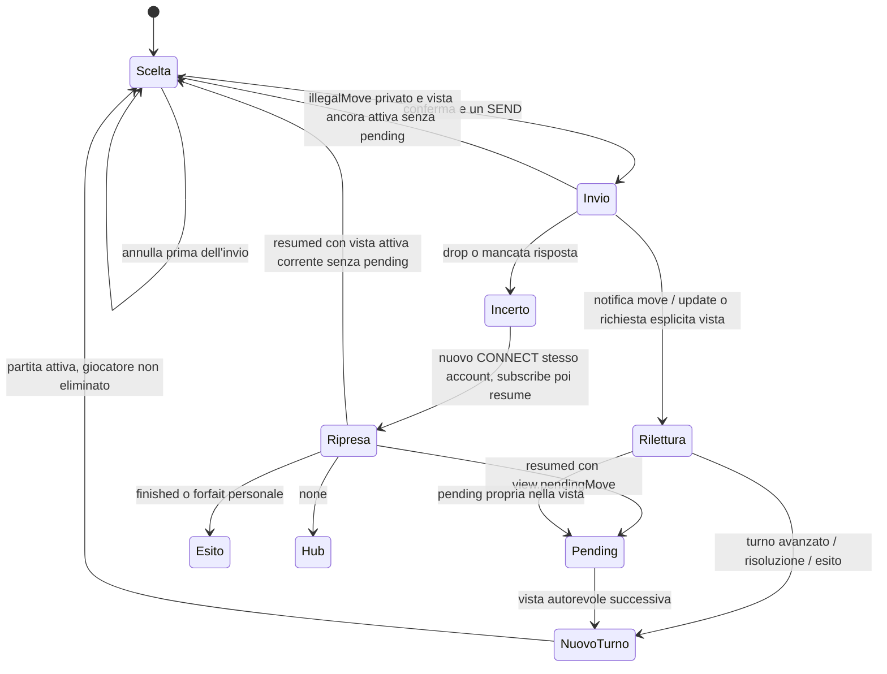
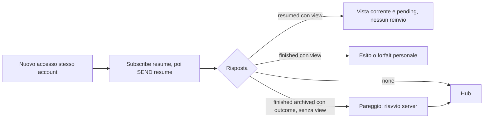

# C0 — Selezione, conferma e riconciliazione

**Revisione corrente dei gesti:** [partita a carte nel bar](bar-table-revision.md).
Le sequenze sotto descrivono la composizione dei comandi e restano valide come
contratto wire, ma non impongono i pannelli/menu del primo prototipo. Nuova UX:
riordino della mano, calata diretta sul personaggio o sulla carta oggetto,
scarto bound dalla mano e check discreto; mani avversarie mostrate coperte.

26 ottobre 2026, regolamento 1.6. Proposta di UX sul protocollo corrente.
Il prototipo verifica composizione locale e ricezione manuale di fixture;
non implementa un trasporto, non certifica partite o tempi di rete.

## Tre mosse esprimibili oggi

Esempi con `gameId=c0-synthetic-ffa`, giocatore Ada e bersaglio Bice. I nomi
sono quelli GUI di `cards.sqlite`, **non** gli identificatori delle classi.

1. **Ordinaria:** scegliere «COSA FAI NON È UNA DOMANDA», leggere costo
   V 10 + A 10 e priorità 2, scegliere esplicitamente Bice. Il riepilogo
   contiene carta, autore e bersaglio; Annulla/Escape cancella soltanto la
   scelta non inviata. Conferma compone:

   ```json
   {"playedCardName":"COSA FAI NON È UNA DOMANDA","playerId":"Ada","targetId":"Bice","gameId":"c0-synthetic-ffa","choices":null}
   ```

2. **Bound con scarto:** scegliere «SVEGLIAMOCI MA TU NO», poi Bice, poi
   «Steal» come altra carta da scartare. Mostrare persistenza della bound e
   scarto distinto dal costo. Nel selettore solo regolari, nessuna basic,
   bound o last resort; non aggiungere compatibilità di personaggio R02.
   Senza scarto Conferma resta inattiva con istruzione visibile.

   ```json
   {"playedCardName":"SVEGLIAMOCI MA TU NO","playerId":"Ada","targetId":"Bice","gameId":"c0-synthetic-ffa","choices":{"DISCARD_ONE":"Steal"}}
   ```

3. **Su oggetto:** scegliere «Steal» → oggetti di Bice → «Peroni da 66,
   calda». Il riepilogo mostra **proprietario e nome separati**. Non inviare
   il nome oggetto come targetId, non concatenare/parlare in punti come
   contratto. Per un oggetto proprio usare `targetId:"SELF"` e per esempio
   «ADOPERIAMOTI». Nessun SELF preselezionato invisibile.

   ```json
   {"playedCardName":"Steal","playerId":"Ada","targetId":"Bice","gameId":"c0-synthetic-ffa","choices":{"TARGET_ITEM":"Peroni da 66, calda"}}
   ```

`choices` null per l'ordinaria, mappa per le scelte richieste. Niente campi
`void`, `moveReport`, turno, ID d'istanza o idempotency key nel comando.
[MoveCommandValidator](../../../server/src/main/java/com/gsc/bm/api/ws/MoveCommandValidator.java)
accetta i soli cinque campi, controlla identità, gameId, categorie e scelte;
[Move](../../../server/src/main/java/com/gsc/bm/model/game/Move.java) controlla
mano, scarto, oggetto, costo e pending. L'assistenza locale non è una
seconda implementazione delle regole né garantisce legalità alla risoluzione.

## Stati della richiesta



Il vero invio futuro sarà SEND `/app/game/{gameId}/move` dopo aver sottoscritto
`/user/queue/illegalMove`, `/user/queue/game/{id}/view` e topic move/update.
SUBSCRIBE prima di richiedere la vista con SEND
`/app/game/{id}/{playerId}/view`. In C0 «Conferma scelta» salva un'anteprima
JSON e mostra invio in corso, **non chiama alcuna API**.

- **Invio in corso:** impedire doppio click; conservare il comando locale
  per confrontarlo con la risposta, senza togliere carte/risorse. Il SEND
  riuscito al trasporto non è prova di accettazione applicativa. Non c'è
  ACK strutturato con ID comando, né promessa exactly-once.
- **Notifica move:** testo «player submitted a Move» sul topic, non un
  ricevuto privato correlato al nostro comando. Sollecita una rilettura.
- **Accettazione/pending:** la vista privata con `pendingMove` propria
  descrive la scelta registrata. Mostrare «Mossa ricevuta, attesa degli
  altri» e bloccare sostituzioni; il solo clock mossa dell'autore si ferma.
  Ispezione di carte/risorse resta disponibile. Le pending altrui non esistono
  nella vista e non vanno indovinate.
- **Risoluzione rapida:** può arrivare un turno nuovo senza mai osservare
  pending. `resolvedMoves` può confermare la mossa propria registrata e
  risolta, anche se annullata. Il solo avanzamento turno significa che il
  vecchio turno è superato, non garantisce che la nostra carta abbia avuto
  effetto: considerare anche forfait, morte, esito e report. In ogni caso
  nessun reinvio della vecchia scelta al nuovo turno.
- **Rifiuto:** testo privato `illegalMove`; conservare le scelte correggibili,
  mostrare il motivo e rileggere la vista prima di riabilitare se lo stato
  è incerto. Quel canale non ha ID comando/turno: non attribuire un rifiuto
  tardivo a una nuova scelta con certezza. Errori di identità/policy possono
  chiudere il trasporto e non passare per `illegalMove`.
- **Mancata risposta/drop:** stato incerto, non «rifiutata» e non «accettata».
  Nessun timer locale decide l'esito o reinvia automaticamente. Rilettura
  se connessi, altrimenti nuovo accesso con lo stesso account e resume.
  I timeout tecnici sono UI proposti, non estendono i termini server.

## Ripresa e restart senza vista

Nel processo vivo SEND `/app/session/resume`, SUB
`/user/queue/session/resume`: `none` → hub; `resumed` con view → stessa partita
e pending conservata; `finished` con view → esito o proprio forfait (gli altri
possono continuare in FFA). Nessun join nuovo per «riprendere». La finestra
server è 30 s dal primo drop, confine escluso; il clock mossa continua e può
scadere prima. Login e tentativi di reconnect non spostano il termine.



Ricevuta restart reale:

```json
{"status":"finished","gameId":"ID","archived":true,"outcome":{"over":true,"result":"draw","winner":null,"reason":"riavvio server"}}
```

Non costruire una vista vuota di una partita giocabile. Mostrare motivo e
ritorno hub; niente subscribe/watch/view/leave o mossa sul vecchio ID.
La presa visione non è un nuovo stato persistente. Il prototipo non simula
account né resume; questo ramo è documentato e coperto dalla base separata.

## Duplicati, clock e animazioni

[Game.getCardFromHand](../../../server/src/main/java/com/gsc/bm/model/game/Game.java)
cerca per nome case-insensitive con `findAny`; `getItem` restituisce il primo
oggetto omonimo iterato. `AbstractCard.equals` usa il nome e la rimozione
agisce su un elemento uguale. Quindi non promettere l'identità della copia
di carta; per gli oggetti omonimi dello stesso proprietario il primo è
quello reperito dal server. Nel prototipo due SuperImpact hanno due pulsanti
e due Peroni presso Bice producono lo stesso TARGET_ITEM: prova browser,
non una nuova partita server. Raggruppare le copie omonime in futuro è una
proposta UX, senza alterare il comando.

Separare vista autorevole, scelta locale e sole decorazioni. Accettare viste
dello stesso turno: possono cambiare pending e deadline. `turn` non è una
revisione; il protocollo non consente di ordinare con certezza due snapshot
concorrenti dello stesso turno. Nella futura integrazione serializzare le
riletture dove possibile; ignorare callback di vecchie generazioni di
connessione. Non affermare che una coda locale risolva tutte le race del server.

Il prototipo aggiorna subito i valori finali, poi anima 300 ms trasferimento,
250 ms impatto, 250 ms delta aggregato. I valori non vengono modificati
dall'animazione e i report non vengono interpretati per calcolare effetti.
I tre accenti sono una traccia di laboratorio fissa associata a due snapshot
precostituiti, non eventi structured dedotti per il gioco. In C1 mostrare
solo trasferimenti/risultati dimostrabili; altrimenti transizione aggregata.
Le risorse negative e oltre 100 rimangono numeriche anche se la barra satura.

Nuova vista, resize, selezione, Escape, movimento ridotto e background
cancellano gli oggetti Web Animations e rimuovono le decorazioni. Stessa
vista non rilancia il round già mostrato (`gameId:turn`, chiave locale di
presentazione, non ID server). Nessuna ricostruzione dopo round saltati.
Focus sui nodi conservati, input del turno corrente subito disponibile,
clock mai sospeso. Movimento ridotto conserva valori e report senza voli.

Le deadline sono epoch del server; non c'è un campione ora-server nel DTO.
Il countdown futuro sarà **indicativo** finché non si misura lo scarto
orario; nessun forfait deciso dal client. Nel laboratorio il tempo di
riferimento è esplicitamente sintetico e separato dal protocollo.
