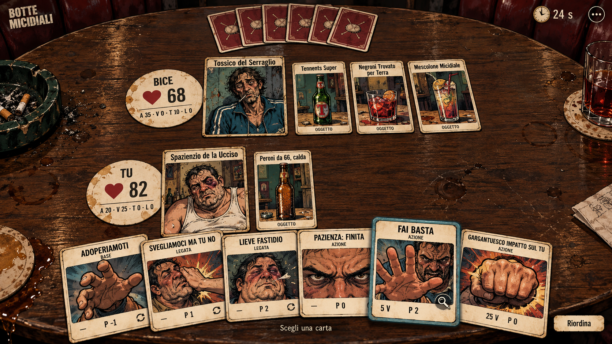
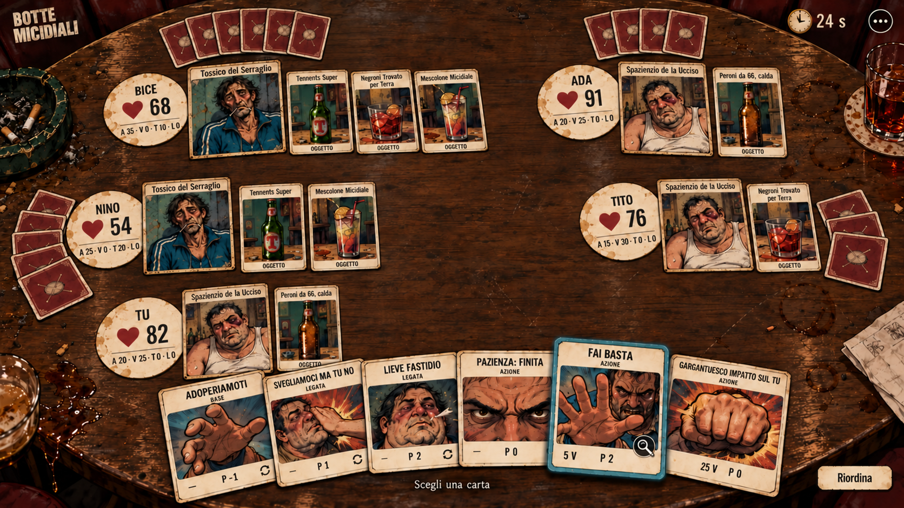
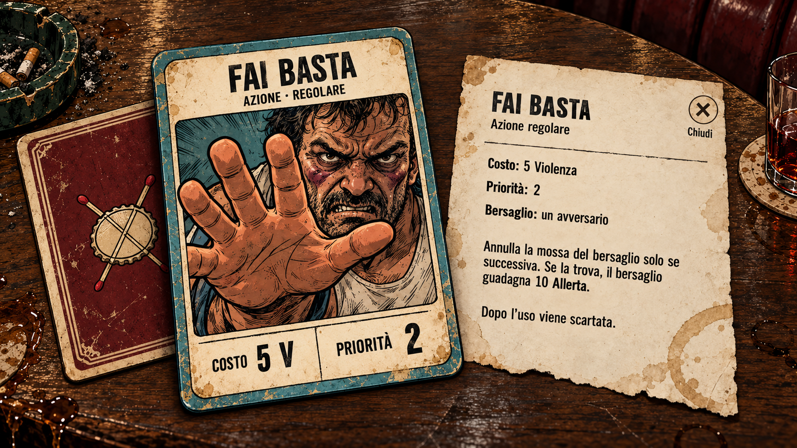

# C0-R1 — Carte sul tavolo del bar

**Riferimento visivo approvato dal proprietario:** [duello, FFA cinque e
carta/ispezione](approval.md), nei file identificati da assets.json.
Queste immagini rimangono mockup statici della consegna del 26 ottobre.
Dal 27 ottobre sono disponibili la [scena interattiva](../../../../client-c0/revision/README.md)
e il [rapporto R2–R5](../../../reports/client-c0-r2-report.md).
C0 resta aperta per prova fisica e giudizio umano interattivo; C1 non iniziata.
Le sezioni sotto descrivono la fase statica e i suoi limiti al momento della produzione.

## Duello

Due postazioni, una mano propria di sei azioni e sei dorsi avversari.
Il Tossico ha tre carte oggetto, il Bruiser una; gli oggetti mantengono
bordo, nome, illustrazione e ombra. «FAI BASTA» è sollevata per ispezione:
nessun danno, consumo o invio è rappresentato come già avvenuto.

## FFA a cinque

Cinque sedi e quattro mani avversarie distinte; il centro resta libero.
I personaggi ripetuti sono i due personaggi esistenti, non nuove classi.
Gli alias identificano i giocatori; non cambiano l'identità della carta.

| Postazione | Personaggio | Salute mostrata | Dorsi visibili | Carte oggetto |
|---|---|---:|---:|---:|
| Bice, alto sinistra | Tossico del Serraglio | 68 | 6 | 3 |
| Ada, alto destra | Spazienzio de la Ucciso | 91 | 4 | 1 |
| Nino, sinistra | Tossico del Serraglio | 54 | 5 | 2 |
| Tito, destra | Spazienzio de la Ucciso | 76 | 3 | 1 |
| Tu, basso | Spazienzio de la Ucciso | 82 | —; sei azioni scoperte | 1 |

I valori sono un tableau sintetico, non un replay o una partita certificata.
I 18 dorsi non contengono identità, fronte o scelta degli avversari. Nella
prova futura il numero deriverà da `cardsInHand`, compresi zero e uno;
quest'immagine non prova tale comportamento. I conteggi sotto sei non
introducono scarti volontari o limiti nuovi.

## Carta e ispezione richiesta

La faccia mette prima nome, tipo, illustrazione, costo e priorità. Il foglio
a destra rappresenta il dettaglio aperto su richiesta, richiudibile; non è
un pannello permanente del tavolo. Il dorso accostato mostra il disegno
nuovo, non un ulteriore oggetto o una mano di gioco.

«FAI BASTA» corrisponde a `bruiser.YouStop`: azione regolare, costo 5 VIOLENCE,
priorità 2, bersaglio avversario. Annulla la mossa del bersaglio solo se
successiva; se trovata, il bersaglio guadagna 10 ALERTNESS. Si scarta dopo
l'uso. Il testo del mockup espande i nomi delle risorse e omette il suffisso
bibliografico; nessuna modifica al catalogo. I riferimenti del regolamento
rimangono nella documentazione, fuori dalle tre immagini.

## Grammatica artistica proposta

- Tavolo di noce/tabacco, aloni, graffi, bruciature, posacenere verdastro e
  vinile bordeaux. Sporcizia ai bordi e nello spazio vuoto, leggibilità sulla carta.
- Fumetto a inchiostro, ombre corte e spessore del cartoncino; personaggi
  rappresentati sulle carte. Nessuna griglia di pannelli o palette giallo/nero.
- Avorio caldo per le carte, bordeaux per i dorsi, petrolio per la selezione,
  vetro verde e rosso mattone negli oggetti. Riferimenti indicativi:
  `#493025`, `#742e33`, `#e8d7b4`, `#38616a`, `#3f5146`; non token già implementati.
- Dorso unico con tappo e fiammiferi incrociati; cornice consumata comune a
  personaggi, azioni e oggetti. Le azioni base/legate hanno il segno di
  persistenza; le regolari no. La carta ingrandita esplicita il sottotipo.
- Salute numerica sui sottobicchieri, altre risorse compatte, clock e menu
  al margine. La futura UI deve conservare valori negativi e oltre l'iniziale.
- I bicchieri, il posacenere e i mozziconi scenici non sono selezionabili.
  Gli oggetti utilizzabili sono rettangoli di cartoncino presso il proprietario.
  Equipaggiamenti e stati non diventano per questo nuove carte oggetto.

## Tecnologia

[Decisione rivalutata e fonti](technology.md): **PixiJS 8 + TypeScript per
il tavolo, React/HTML per shell e dettagli, Vite per sviluppo/build.**
La precedente raccomandazione Angular non è stata assunta come vincolo.
Scelta per coordinate, sovrapposizioni e gesti della scena; prestazioni,
peso e accessibilità ancora da verificare. Nessun package, lock o sorgente
del laboratorio è stato migrato in R1.

## Inventario e provenienza

Tutti e tre i file sono PNG **1672×941**, senza trasparenza. Dimensioni,
byte e SHA-256 sono in [assets.json](assets.json). Il set completo occupa
8.629.356 byte: è materiale di revisione, non il download critico del gioco.

| File definitivo | Produzione | Input visivo |
|---|---|---|
| [duel.png](duel.png) | imagegen integrato, generazione nuova | Nessuno |
| [ffa-five.png](ffa-five.png) | imagegen integrato, generazione e correzione del fan di Bice | Solo il nuovo duello R1 e le bozze FFA prodotte in questa revisione |
| [card.png](card.png) | imagegen integrato, nuova vista di ispezione | Solo il nuovo duello R1 |

[Prompt completi e correzioni](prompts.json). Nessun asset del debug, vecchio
schizzo, screenshot precedente o immagine dei giochi citati è stato usato
come input. Le bozze FFA con sette dorsi a Bice sono state scartate; il file
consegnato ne contiene sei. Nessun download di font, pacchetti grafici o audio.

Nomi, tipi, costi ed effetto provengono dal catalogo e dal regolamento 1.6.
Le illustrazioni sono generate ex novo; il lettering delle PNG è raster,
non un font acquisito. Restano i diritti riservati del progetto: nessuna
nuova licenza open source implicita e nessuna dichiarazione di esclusività
dei risultati generati. La produzione futura separerà testo e illustrazioni.

## Controlli e limiti della consegna

Ispezione visiva dei tre file definitivi: due/cinque postazioni, sei azioni
proprie, dorsi 6 nel duello e 6/4/5/3 in FFA, oggetti entro capacità, nessun
fronte privato avversario, nessuna citazione normativa nella scena. Controllati
costo, priorità, destinatario del bonus e scarto di «FAI BASTA». La verifica
dei conteggi è visiva: non è un test di rendering dinamico.

Le immagini mostrano la composizione desktop. Non attestano ancora leggibilità
di tutte le etichette a 844×390, mira touch, target da 44 CSS px, movimento,
focus, contrasto misurato o adattamento portrait. Il testo completo e le
zone oggetto dovranno aprirsi senza zoom del browser nella prova successiva;
non basta ridurre queste PNG al viewport minimo. Immunità, stati e timer
restano da completare nel dettaglio consultabile, secondo la parità esistente.

Le verifiche del repository e il confronto dei file protetti sono registrati
in [verification.json](verification.json). Non certificano questa UI o una
partita nel nuovo client; il contesto Spring è verificato separatamente.

- `./scripts/build.ps1 -Task Test -Offline`: PASS, 251 test server e 36 debug.
- `python scripts/check-rules.py`: PASS, regolamento 1.6 e catalogo coerenti.
- `./scripts/build.ps1 -Task TestServerContext -Offline`: PASS, 358 test del
  profilo, incluso avvio Spring; comprende casi sovrapposti alla suite ordinaria.
- `python scripts/verify-match-manifests.py`: PASS; manifest non modificati.
- 71 collegamenti locali, metadati/hash delle PNG, JSON, codifica e spazi:
  PASS. Regole, catalogo e diff preesistente server/debug/CLI invariati.

Lavoro registrato separatamente dalla prima prova C0: tre nuove immagini,
due correzioni mirate FFA e documentazione. Finestra tracciata 22:18–22:32
Europe/Rome; ricognizione e prima richiesta di generazione precedenti non
cronometrate. Questi tempi non sono misure del futuro client.

**Stato aggiornato:** R1 approvata come riferimento artistico; R2–R4
implementate nella scena separata, R5 parziale. Le prove statiche di questa
pagina non sostituiscono quelle interattive. C0 aperta, C1 non iniziata.
