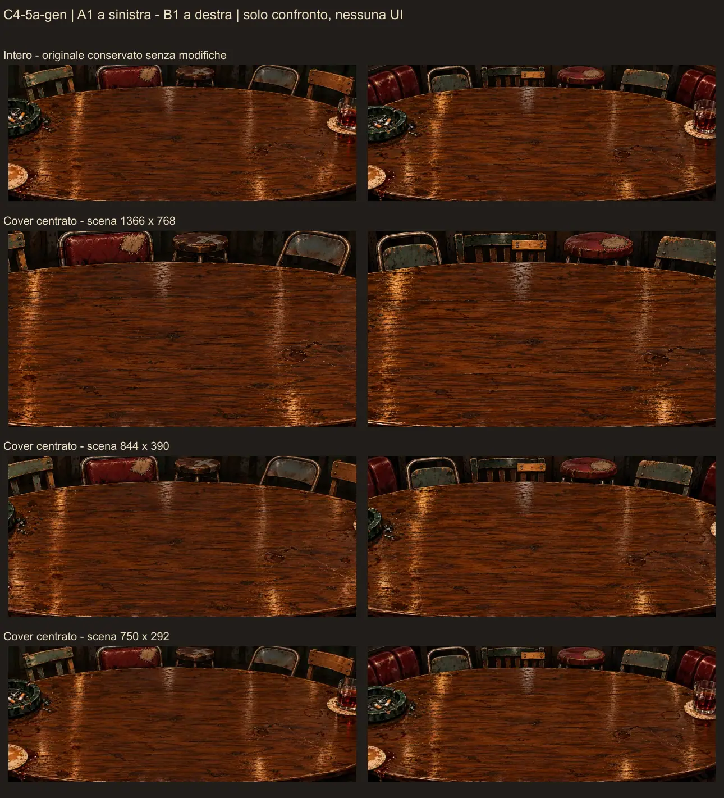

# C4-5a-gen — Candidati per il giudizio del proprietario

4 novembre 2026. **Due candidati, A1 e B1: nessuna scelta, approvazione o integrazione.** Operatore Codex su richiesta esplicita del proprietario. Generazione con image_gen.imagegen integrato; il C2PA degli originali dichiara softwareAgent.name **ChatGPT**, softwareAgent.version **gpt-image**. Versione numerica del modello e seed non esposti. Non è stato usato il fallback API/CLI.

## Capacità e processo effettivamente osservati

L'interfaccia accetta un prompt e immagini di riferimento tramite referenced_image_paths; sono stati allegati soltanto table.png C0-R2 e duel.png R1, nell'ordine previsto. Le impronte coincidevano con prompt-sfondo.md. Il confronto git diff db233d8 sul documento dei prompt era vuoto prima delle chiamate: A e B sono stati inviati integralmente, senza aggiunte né adattamenti. [Richieste e orari effettivi](richieste-generazione.json), incluse le stringhe dei prompt e gli output_hint restituiti.

Non sono esposti parametri per dimensioni, formato, seed, qualità numerica o forza dei riferimenti, né un elenco garantito dei formati supportati. La richiesta nel testo era 2560×1000 PNG; il servizio ha restituito i PNG sotto, vicini al rapporto 2,56:1 ma di risoluzione inferiore. Nessun ulteriore ridimensionamento dell'originale è stato effettuato per forzare la richiesta e nessuna dimensione alternativa è stata inventata come “supportata”. Un risultato per prompt: A2 e B2 non generati.

| Candidato | Originale nel repository | Dimensioni reali | Rapporto circa | Byte | Registro |
|---|---|---|---:|---:|---|
| A1 | [A1.png](candidati/A1.png) | 2006×784 | 2,55867:1 | 2.577.890 | [A1](registro-A1.md) |
| B1 | [B1.png](candidati/B1.png) | 2007×784 | 2,55995:1 | 2.687.516 | [B1](registro-B1.md) |

Entrambi sotto 6.000.000 byte; totale originali **5.265.406 byte**, sotto 20.000.000. Conservati byte per byte con sola rinomina in candidati/: nessun ritocco, crop o conversione degli originali. Le copie automatiche dello strumento restano nei percorsi indicati nei registri. Nessun originale è rimasto solo fuori dal repository.

SHA-256 degli originali:

- A1: 53ba5a5b363263b9d93cfe5ed2c6ac279c35f0cfcce6eadf1184e4dcabab18f3
- B1: 0f07fbab9678cbe5f0542f7932930245da8a560b90f13bfc0d71ad3c112a270a

Il chunk caBX contiene C2PA, compresi nome generico del generatore e azioni created/converted/watermarked.unbound. Queste azioni sono dichiarazioni del servizio prima della consegna; gli originali non sono stati convertiti dall'operatore. Il manifest resta nei PNG. **Firma, certificati e validità crittografica non verificati.** Non dedurre una licenza o una versione numerica del modello dai metadati. Termini d'uso e condizioni lasciati vuoti nei registri e marcati **da verificare dal proprietario**; nessun URL applicabile all'account è stato accertato.

## Confronto visivo

Osservazioni dell'operatore su originali e anteprime, non giudizio del proprietario né prova sul client.

| Aspetto | A1 | B1 |
|---|---|---|
| Sedute corrette | Sedie di legno scrostato, seduta metallica, schienale bordeaux con rattoppo evidente, sgabello con croce di nastro sulla seduta. Le forme sono spaiate. | Sedia metallica, sedia a stecche con pezza/traversa chiara fissata, sgabello bordeaux con rattoppo cucito e altra sedia consumata. Riparazioni più esplicite e differenziate. |
| Continuità con table.png | Conserva legno caldo, aloni, bruciature, posacenere verde, bicchiere e bordo arrotondato. Riduce molto la continuità delle imbottiture bordeaux ai lati. | Conserva gli stessi elementi del tavolo e porzioni delle imbottiture bordeaux ai due lati, quindi più memoria del contorno del riferimento. |
| Cosa cambia o si perde | Il bordo lontano scende e le sedie sono esposte come una fila più visibile. Il locale appare meno raccolto attorno al piano rispetto al riferimento. | Anche qui la fascia del locale sopra il tavolo è più ampia. Le riparazioni diventano punti d'attenzione, soprattutto il tassello di legno chiaro. |
| Sedute dopo il crop | Nei tre ritagli restano visibili lo schienale rattoppato, lo sgabello e parti delle altre sedie; a 1366×768 si perdono soprattutto le sedie estreme. | Nei tre ritagli rimangono traversa riparata e sgabello; a 1366×768 scompaiono quasi tutte le imbottiture bordeaux laterali. |
| Vincolo della piccola zona alta centrale | Il rattoppo dello schienale è vicino alla zona richiesta; lo sgabello è più a destra. Non tutti gli indizi essenziali sono confinati alla zona X 40–45%, Y 3–9%. | La riparazione chiara e soprattutto il rattoppo dello sgabello si estendono più a destra della zona richiesta. La loro visibilità sotto le sovrapposizioni del client resta incerta. |

Entrambi conservano un piano centrale ampio, ma venature e riflessi restano marcati. I riflessi mi appaiono molto luminosi e concentrati: è un'osservazione visiva, non una misura di palette o contrasto. Sul ritaglio 750×292 l'usura si legge come sagoma o macchia; le cuciture minute perdono dettaglio. La correttezza delle sedute isolate non prova che restino leggibili dietro carte, plance, mano, pile e scritta.

**Contenuti da evitare:** non noto testo leggibile, pseudo-lettering evidente, marchi commerciali visibili, persone, mani, carte o interfaccia negli originali. In A1 la croce sullo sgabello appare come due strisce di nastro fisico; in B1 il rettangolo chiaro appare come riparazione della sedia, senza scritte. Non riconosco elementi specifici che richiamino un gioco esistente; non è una ricerca esaustiva di somiglianze e non sono state consultate immagini esterne. La dichiarazione C2PA watermarked.unbound riguarda i metadati del servizio: non equivale a un marchio visibile osservato nell'illustrazione.

## Scheda di contatto e ritagli solo per visione

[Scheda di contatto](scheda-contatto.webp): **1290×1421, 194.854 byte**, A1 nella colonna sinistra, B1 nella destra. Quattro righe: vista intera, scena 1366×768, 844×390, 750×292. La scritta di confronto è fuori dai riquadri ed è un'annotazione dell'operatore, non parte degli originali.

| Candidato | Intero ridotto | 1366×768 | 844×390 | 750×292 |
|---|---|---|---|---|
| A1 | [Intero](anteprime/A1-intero.webp) | [Desktop](anteprime/A1-1366x768.webp) | [Compatto](anteprime/A1-844x390.webp) | [Minimo](anteprime/A1-750x292.webp) |
| B1 | [Intero](anteprime/B1-intero.webp) | [Desktop](anteprime/B1-1366x768.webp) | [Compatto](anteprime/B1-844x390.webp) | [Minimo](anteprime/B1-750x292.webp) |

Tutti i file WebP sono **anteprime di revisione, non derivati da distribuire**. Creati con sharp 0.35.5 / libvips 8.18.7 / libwebp 1.6.0 tramite script temporaneo fuori dal repository. Originali solo letti. Vista intera ridotta a larghezza 1000 senza ingrandimento; ritagli con resize cover centrato e filtro Lanczos3, alle dimensioni esatte delle tre scene, WebP qualità 76, effort 5. Scheda a due colonne da 620 px con proporzioni conservate, qualità 72, effort 5. Nessuna correzione artistica o colore.

Il cover applica la formula della specifica alle **dimensioni reali**, con il consueto arrotondamento raster ai pixel interi. Intervalli teorici della sorgente conservati, prima di tale arrotondamento:

| Candidato / scena | X visibile | Y visibile |
|---|---|---|
| A1 / 1366×768 | 15,2428–84,7572% | 0–100% |
| A1 / 844×390 | 7,7105–92,2895% | 0–100% |
| A1 / 750×292 | 0–100% | 0,1912–99,8088% |
| B1 / 1366×768 | 15,2601–84,7399% | 0–100% |
| B1 / 844×390 | 7,7315–92,2685% | 0–100% |
| B1 / 750×292 | 0–100% | 0,1663–99,8337% |

[dati-file-generati.json](dati-file-generati.json) contiene formato, larghezza/altezza, byte e SHA-256 di **ogni immagine** originale o di anteprima, oltre a scale e offset. Non è l'inventario di distribuzione degli asset, che resta intatto.

## Decisione richiesta al proprietario

Scegliere **A1**, **B1** oppure **rigenerare**, indicando quali sedute o caratteristiche conservare/correggere. Decidere in particolare se la fascia superiore più visibile e la conservazione/riduzione del bordeaux mantengono l'identità del bar approvata. Nessun candidato è stato scelto al posto del proprietario.

Restano da verificare dal proprietario i termini applicabili e le condizioni d'uso dell'output. Seed, versione numerica del modello, forza dei riferimenti e riscrittura interna del prompt non sono esposti. Le sezioni “Modifiche e derivati” e “Giudizio del proprietario” dei registri sono vuote. Eventuali prompt corretti dovranno essere salvati e committati prima di una nuova generazione.

Non sono stati toccati client, server, scripts, piano, indice, report o inventario. Nessun server, Playwright, suite di test o verifica applicativa eseguiti; nessun push. Letture di file, calcoli, hash e osservazioni sulle anteprime servono a questa consegna, non certificano l'integrazione nel gioco.
