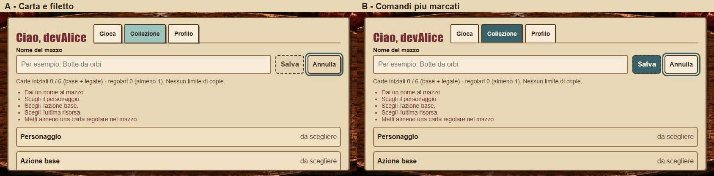
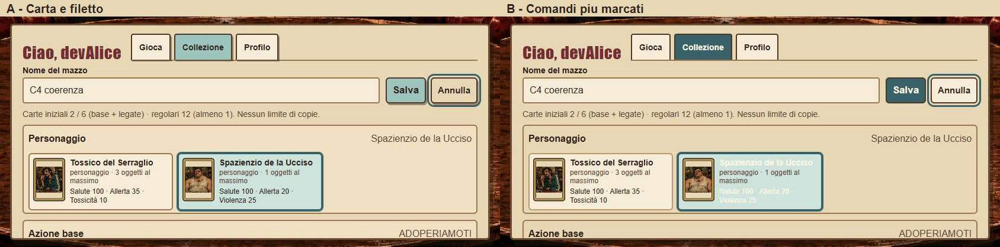
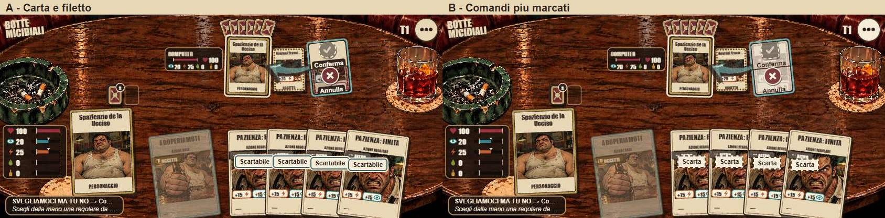
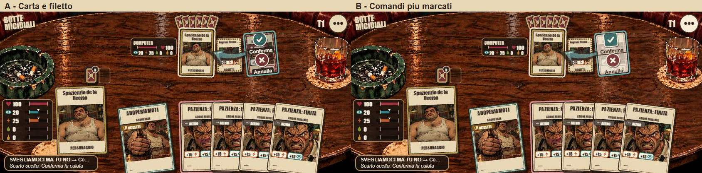
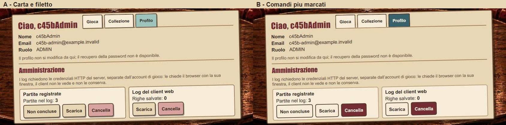

# C4-5b — Varianti della Fase A, scelte registrate

**Aggiornamento dopo la scelta:** A comune/editor/admin e B di calata, con invito unico senza targhette. [Scelte](../scelte.md), [implementazione e verifiche](../../../../reports/client-c4/c4-5b.md#fase-b--esiti-finali-e-cosa-giudicare). Questo documento conserva la base/proposta di Fase A.
5 novembre 2026. **Prototipi temporanei su schermate reali, nessuna finitura di produzione applicata.** [Proposta motivata e token da approvare](../proposta.md), [prima](../../../../reports/client-c4/c4-5b/prima/README.md).

**Raccomandazione: A generale e A per calata/scarto.** È possibile combinare il sistema generale A/B e quello di ✓/×/scarto A/B. Giudicare anche la lettura dei nomi, dei costi e della richiesta di scarto. Le targhette delle candidate sono solo del prototipo; non sono nuove azioni né nuovi bersagli. Le forme ✓ e × sono quelle SVG di symbols.ts già caricate dal client.

## Editor incompleto

| Misura | A — carta e filetto | B — comandi più marcati |
|---|---|---|
| 1366×768 | [apri](editor-incompleto-A-1366x768.jpg) | [apri](editor-incompleto-B-1366x768.jpg) |
| 844×390 | [apri](editor-incompleto-A-844x390.jpg) | [apri](editor-incompleto-B-844x390.jpg) |

## Editor completo

| Misura | A — carta e filetto | B — comandi più marcati |
|---|---|---|
| 1366×768 | [apri](editor-A-1366x768.jpg) | [apri](editor-B-1366x768.jpg) |
| 844×390 | [apri](editor-A-844x390.jpg) | [apri](editor-B-844x390.jpg) |

## Bound: scarto richiesto, conferma disabilitata

| Misura | A — carta e filetto | B — comandi più marcati |
|---|---|---|
| 1366×768 | [apri](scarto-bound-A-1366x768.jpg) | [apri](scarto-bound-B-1366x768.jpg) |
| 844×390 | [apri](scarto-bound-A-844x390.jpg) | [apri](scarto-bound-B-844x390.jpg) |

## Bound: scarto scelto, conferma pronta

| Misura | A — carta e filetto | B — comandi più marcati |
|---|---|---|
| 1366×768 | [apri](conferma-pronta-A-1366x768.jpg) | [apri](conferma-pronta-B-1366x768.jpg) |
| 844×390 | [apri](conferma-pronta-A-844x390.jpg) | [apri](conferma-pronta-B-844x390.jpg) |

## Amministrazione

| Misura | A — carta e filetto | B — comandi più marcati |
|---|---|---|
| 1366×768 | [apri](amministrazione-A-1366x768.jpg) | [apri](amministrazione-B-1366x768.jpg) |
| 844×390 | [apri](amministrazione-A-844x390.jpg) | [apri](amministrazione-B-844x390.jpg) |

Le stesse azioni sono presenti in entrambe le varianti. Per i comandi generali si vedono l’editor (incompleto/completo, con focus) e l’amministrazione; per conferma e scarto si vede la stessa partita open reale prima e dopo la scelta dello scarto. Non si misurano su questi prototipi prestazioni, contrasto formale o raggiungibilità della futura implementazione.
