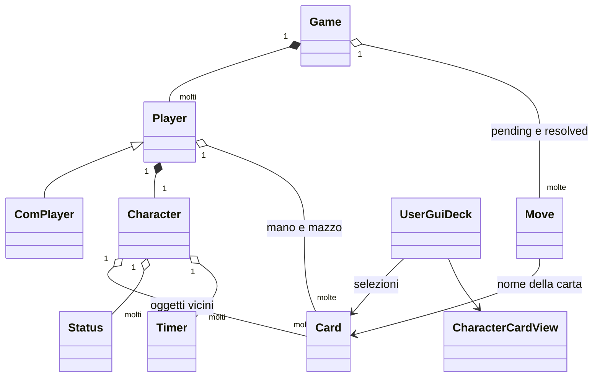

> **Stato documentale:** lo stato corrente del progetto (base I22 approvata,
> client animato con C0 chiusa e C1 non iniziata) è nell'[indice della
> documentazione](README.md#stato-corrente). Le indicazioni datate di incrementi
> prossimi/aperti e priorità della base restano storico, non attività correnti.

> La base I22 è completata e approvata. **I26/F39 è completato**: la CLI è disponibile per gli scenari applicativi automatici non UX; unit e integrazioni mirate restano diretti, browser/debug per UX. [Guida CLI](cli.md), [report I26](reports/i26-report.md), [roadmap archiviata](history/roadmap-base-i22.md).

> Aggiornamento normativo 23 ottobre 2026: il [Regolamento ufficiale](game-rules.md) (1.0 a quella data, ora 1.6) prevale su questo documento per le regole di gioco. Le indicazioni precedenti «codice come riferimento provvisorio», le questioni sulle regole già risolte da R01–R07 e i risultati di test qui riportati sono storici; le richieste non implementate restano roadmap. Verifiche attuali: [conformità](rules-conformance.md).

# Modello di dominio

**Requisiti acquisiti nella base I22:** sessione unica/account, reconnect sul processo vivo, timeout multiplayer e forfait, draw al restart, archivio completo e CLI I26. Elo ed economia restano differiti. Le entità sotto conservano il censimento storico; stato e limiti attuali nel [report I22](reports/i22-report.md).

**V** indica strutture e comportamento letti nel codice; **D** una deduzione; **M** un requisito non ricostruibile. Non tutte le classi rappresentano entità persistenti.

## Entità del motore

| Entità | Contenuto e responsabilità verificati | Fonte |
|---|---|---|
| `Game` | `gameId`, mappa player, mosse pendenti/risolte, report temporali, contatore `turn`, tipo e log; validazione/invocazione mosse, fine partita | [Game](../server/src/main/java/com/gsc/bm/model/game/Game.java) |
| `Player` | ID, personaggio, mano, pila mazzo, carta last resort; mescola/pesca/scarta; non è l'account persistito | [Player](../server/src/main/java/com/gsc/bm/model/game/Player.java) |
| `ComPlayer` | Sottoclasse che mescola carte candidate, sceglie bersagli casuali e restituisce la prima mossa valida, oppure una mossa vuota | [ComPlayer.chooseMove](../server/src/main/java/com/gsc/bm/model/game/ComPlayer.java) |
| `Character` | `bindingName`, risorse, coda circolare oggetti, stati, immunità e timer; calcolo danni/variazioni risorse | [Character](../server/src/main/java/com/gsc/bm/model/Character.java) |
| `Card` / `AbstractCard` | Nome GUI, identificatore classe, descrizione HTML, immagine/sprite, costo, priorità, bersagli e flag; esecuzione tramite tre hook | [AbstractCard.resolve](../server/src/main/java/com/gsc/bm/model/cards/AbstractCard.java) |
| `Move` | Nome carta, player/target/game ID, `choices`, flag void, report per bersaglio; controlli e applicazione costo/effetti | [Move](../server/src/main/java/com/gsc/bm/model/game/Move.java) |
| `Resource` | `HEALTH`, `ALERTNESS`, `VIOLENCE`, `TOXICITY`, `ALCOHOL`; valori interi in una mappa | [Resource](../server/src/main/java/com/gsc/bm/model/Resource.java) |
| `Damage` | Tipo `HIT`, `CUT`, `POISON` e quantità mutabile | [Damage](../server/src/main/java/com/gsc/bm/model/Damage.java) |
| `Status` | Nome, descrizione, GOOD/BAD, INPUT/OUTPUT, proprietà colpita, funzioni quantità/tipo, durata opzionale, equip e single-use | [Status](../server/src/main/java/com/gsc/bm/model/game/status/Status.java) |
| `Timer` | Nome, contatore di turni e callback sul personaggio; non è un timer di tempo reale | [Timer](../server/src/main/java/com/gsc/bm/model/game/Timer.java) |

**V:** il dominio non ha un'entità `Turn`, un'entità pila scarti o un'entità deck runtime autonoma: `turn` e liste sono in `Game`/`Player`. Gli scarti rimuovono carte dalla mano senza conservarle in una zona separata. `Move` individua la carta per nome, non per ID d'istanza. Carte duplicate sono quindi indistinguibili nel comando. `AbstractCard.equals` confronta il nome e non ridefinisce `hashCode`.

## Personaggi effettivi

| Classe | HEALTH | ALERTNESS | Risorsa aggiuntiva | Capacità oggetti | Immunità iniziale |
|---|---:|---:|---|---:|---|
| [BigBadBruiser](../server/src/main/java/com/gsc/bm/model/cards/bruiser/character/BigBadBruiser.java) | 100 | 20 | VIOLENCE 25 | 1 | Nessuna |
| [ToxicJunkie](../server/src/main/java/com/gsc/bm/model/cards/junkie/character/ToxicJunkie.java) | 100 | 35 | TOXICITY 10 | 3 | TOXICITY |

**V:** sono gli unici personaggi nel catalogo `CRD003_CHARACTERS`, e `PlayerFactoryServiceImpl.randomPlayer` sceglie soltanto fra questi due. I nomi visualizzati provengono da SQLite, non dai nomi Java.

## Tipi di carta e caricamento

**V:** `AbstractCharacterBoundCard` scarta la carta indicata da `DISCARD_ONE` e poi risolve gli effetti. `AbstractItemCard` imposta item, bersaglio SELF e costo vuoto; `Player.drawCard` sposta gli item sul campo. `BruiserGrab`/`ToxicGrab` sono basic action; `Struggle` è last resort. [Classi base](../server/src/main/java/com/gsc/bm/model/cards/AbstractCharacterBoundCard.java), [Struggle](../server/src/main/java/com/gsc/bm/model/cards/com/last/Struggle.java).

**V:** `bindingName` è il nome della classe relativo a `com.gsc.bm.model.cards.`; le factory usano `Class.forName` e un costruttore vuoto. Effetti, costi e priorità risiedono nel codice Java; nomi, descrizioni e immagini sono nel catalogo SQLite. Non esiste un interprete generico delle descrizioni delle carte. [CardFactoryServiceImpl](../server/src/main/java/com/gsc/bm/service/factories/CardFactoryServiceImpl.java).

**V:** `BrokenBeerBottle` è un token costruito direttamente da `AnotherRottenBeer`, senza riga nel catalogo. `SoberUp` ha un effetto scritto ma non una riga di catalogo e non configura `canTarget`; non basta la sua presenza per dichiararlo giocabile. [AnotherRottenBeer](../server/src/main/java/com/gsc/bm/model/cards/com/items/AnotherRottenBeer.java), [SoberUp](../server/src/main/java/com/gsc/bm/model/cards/bitch/SoberUp.java).

## Account, collezione, mazzi e viste

**V:** credenziali persistite e giocatore di partita sono distinti. `UserAccountInfo` trasporta username, email, ruolo, mazzi e collezione. `UserGuiDeck` contiene ID mazzo, personaggio, basic action, last resort, lista character-bound e lista regolare. `UserStoredDeck` persiste soltanto i riferimenti alle classi. [UserAccountInfo](../server/src/main/java/com/gsc/bm/service/account/model/UserAccountInfo.java), [UserGuiDeck](../server/src/main/java/com/gsc/bm/service/account/model/UserGuiDeck.java), [UserDecksRecord](../server/src/main/java/com/gsc/bm/repo/external/UserDecksRecord.java).

**V:** `UserCollection` è un DTO generato dall'intero catalogo, non una tabella di possesso. La relazione account→mazzo è implementata tramite username e query repository, senza associazione ORM `@ManyToOne`. [UserAccountServiceImpl](../server/src/main/java/com/gsc/bm/service/account/UserAccountServiceImpl.java).

**V:** `ClientSelfPlayerView.cardsInHand` contiene carte, `ClientOpponentView.cardsInHand` un numero. Entrambi espongono `deck` come conteggio. `ClientCharacterView` non espone `dead`, mentre il client lo usa; il tipo TypeScript Player dichiara `deckSize`. Sono differenze effettive, dettagliate in [API](api.md).

**M:** rarità, inventario posseduto, pacchetti, acquisti, scambi, progressione, ranking, matchmaking per abilità e identità stabile delle copie non sono rappresentati nei modelli e percorsi censiti. Non se ne deduce una specifica di prodotto.
