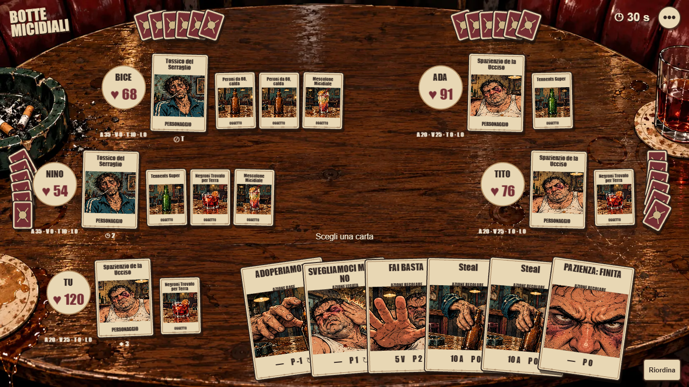

# C0-R2–R5 — Scena del tavolo del bar e audit del gate

27 ottobre 2026. **C0 chiusa su decisione del proprietario; C1 non è iniziata.**
La proposta R1 approvata è diventata una sola scena interattiva. Prove
automatiche, misure desktop/emulazione e peso passano. Su iPhone 16 Pro la
fluidità passa e la risposta al tocco (116 ms contro 100) è accettata con
deroga; revisione umana superata con riserve, landscape forzato.
[Esiti e chiusura](client-c0-r5-procedure.md#esiti). Le sezioni seguenti
descrivono la consegna R2–R5 come era prima delle prove fisiche.

## Approvazione e risultato

Il proprietario ha approvato come riferimento visivo i tre elaborati
[duello, FFA cinque e carta/ispezione](../design/client-c0/r1/approval.md),
identificati da SHA-256 nell'inventario R1. La prima grafica respinta è
conservata come storico; nessun suo asset entra nella nuova scena.

[Avvio e controlli della scena](../../client-c0/revision/README.md).
Duello e FFA sono configurazioni dello stesso tavolo. PixiJS 8.22.0 e
TypeScript 5.9.3 disegnano carte, personaggi, oggetti, ventagli, bersagli e
movimento; React/ReactDOM 19.3.1 gestiscono shell, dialoghi e dettagli HTML.
Vite 8.3.5, Node 24.13.0/npm 11.6.2 isolati e lock con integrità.
La scelta supera i criteri PC disponibili, ma la conferma del gate resta
subordinata al dispositivo fisico. Il debug Angular rimane operativo e separato.

La FFA rappresentativa ha sei azioni proprie, quattro mani coperte di sei
carte e nove carte oggetto alle capacità 1/3/1/3/1. Sono provati anche conteggi
0/1/6/4, copie omonime, salute 120 e −5, morte, forfait, stati, immunità e
timer. La mano propria si riordina con drag, scambio click/tap o tastiera.
Calata su personaggio/oggetto, eventuale scarto bound, check unico e annulla;
testo esteso su richiesta, senza riferimenti normativi o categorie wire.

## Audit C0-R1–R5

| Passo | Esito | Evidenza e confine |
|---|---|---|
| R1 Direzione artistica | Approvata | Tre file definitivi e dichiarazione del proprietario in approval.md. Non certifica i gesti della build. |
| R2 Mano fisica | Implementata, verificata automaticamente | Ventaglio sovrapposto, ispezione HTML, riordino drag/scambio/frecce, copie conservate; quattro ventagli coperti conformi ai conteggi. |
| R3 Calata e oggetti | Implementata, verificata automaticamente | Ordinaria, bound/scarto, SELF e oggetto/proprietario nei cinque campi correnti. Drop invalido, Escape, annulla e riordino producono zero comandi; check produce una sola anteprima. |
| R4 Vita della scena | Implementata, verificata automaticamente | Invio/pending/rifiuto/drop/ripresa sintetici; viste stesso turno, generazioni vecchie, resize, zoom/orientamento, background, pointercancel, movimento ridotto, focus e WebGL. |
| R5 Misure e giudizio | Chiusa con deroga | Catture PC/emulazione e peso PASS; iPhone 16 Pro frame PASS, input accettato dal proprietario; revisione umana sì con riserve. |

La checklist [P01–P44](../client-c0-parity.md), i tre esempi di comando e
il restart senza vista nel [contratto](../design/client-c0/interaction-contract.md)
restano documentati. Non sono percorsi già disponibili nella scena C0.
Il menu corrente espone dettagli, ultimo turno e laboratorio; account,
regole complete, abbandono reale e diagnostica a parità appartengono a C1–C2.

## Dati e comportamento

Le fixture riprendono i campi dei DTO correnti ClientGameView,
ClientSelfPlayerView, ClientOpponentView e ClientCharacterView. Il proprio
cardsInHand è una lista di Card; quello altrui è soltanto un intero.
Metadati e testo vengono da SQLite in sola lettura; le viste sono fissate,
non generate risolvendo regole. Il turno successivo non dipende dalla scelta
provata e non costituisce un replay completo o una partita valida certificata.

Il check conserva i cinque campi esistenti, nomi GUI, SELF esplicito,
DISCARD_ONE e TARGET_ITEM; nessun ID di istanza inventato. Le chiavi locali
servono a disegnare e riordinare le copie. Non c'è SEND reale.
Una notifica dello stesso turno non sblocca un invio in corso/incerto;
pending, nuovo turno, rifiuto o snapshot esplicito di ripresa chiariscono lo
stato. Nessun consumo/danno anticipato, retry automatico o fronte nemico
ricostruito dai conteggi.

Le animazioni usano identità delle mosse pubblicate e vista finale. Il
trasferimento illustrato deriva da diminuzione/aumento osservabile dello
stesso oggetto con proprietari non ambigui; i delta salute sono marcati
«totale turno». Non vengono attribuiti effetti intermedi attraverso parsing
dei report. Sequenza 1200 ms, saltabile/interrompibile; nuovo stato subito
disponibile, clock assoluto sintetico continuo, nessun esito deciso a zero.

Un solo controller Pointer Events possiede il gesto. Gli eventi Pixi sono
scollegati; l'overlay HTML semantico chiama gli stessi intenti da tastiera.
I dettagli usano focus dialog e ripristino sul controllo precedente o su
uno disponibile. Il rilascio di un tap dopo un drag catturato è gestito una
sola volta anche se il browser sopprime il click di compatibilità.

## Prove effettive ed emulazione

- **Eseguito sul PC:** Edge 156.0.4314.42, Windows 10.0.26200, Ryzen 9
  5950X, 32 GiB, RTX 2060/ANGLE D3D11, DPR 1. Browser automatico headless per
  Verify; browser visibile per le misure. Input mouse/tastiera iniettati.
- **Emulato sullo stesso PC:** viewport mobile, touch nativo browser via
  CDP, pinch/visualViewport e orientamento. La GPU e la CPU restano quelle
  del PC; non è una misura di telefono.
- **Segnali sintetici dichiarati:** iniezioni pending/reject/disconnect/resume,
  snapshot e scadenze; pointercancel e, dove headless non cambia visibilità,
  segnale hidden. Non attestano un trasporto STOMP o un reconnect reale.
- **Perdita grafica effettiva nel browser:** estensione WEBGL_lose_context
  con ripristino, non il solo dispatch dell'evento. Non simula un guasto
  completo del driver. React unmount rimuove canvas/listener senza errori
  al resize successivo.
- **Non eseguito:** dispositivo touch fisico, lettura con screen reader,
  contrasto strumentale completo, giudizio umano interattivo, partita server.

[verification.json](client-c0-r2/verification.json) registra tre viewport
PASS; [lifecycle.json](client-c0-r2/lifecycle.json) registra 10 controlli
ulteriori PASS. Otto test di stato e build TypeScript/produzione PASS.
I [sorgenti delle prove](../../client-c0/revision/tools/verify.mjs) sono ripetibili.

La geometria delle carte interattive è ≥44 CSS px e contenuta nel viewport
landscape, senza scroll della pagina. Il testo esteso è HTML da 16–18 px e
si apre senza zoom; nomi piccoli possono essere abbreviati. Questo dimostra
dimensioni e raggiungibilità, non comprensione o precisione umane.
In portrait compare una richiesta di rotazione: scelta motivata dalla
densità delle cinque sedi e ancora da confermare sul fisico.

## Fluidità e peso della build finale

[performance.json](client-c0-r2/performance.json) contiene hash di tutti i
file della build misurata, hardware, browser e metodo. Stessa FFA densa,
600 ms di riscaldamento dopo caricamento, selezione/mira, drag, riordino,
vista nuova e animazioni ripetuti. Raw frame/input disponibili nelle due
catture JSON della stessa cartella.

| Campione | Durata | Intervallo p95 | Entro soglia | Input software max | Esito |
|---|---:|---:|---:|---:|---|
| Desktop 1366×768 | 62,75 s | 8,7 ms | 99,99% ≤20 ms | 30,9 ms | PASS |
| Touch emulato 844×390 sul PC | 63,11 s | 9,7 ms | 99,71% ≤33 ms | 29,5 ms | PASS emulazione |
| iPhone 16 Pro, Safari 750×292, build precedente | 65,5 s | 22 ms | 96,3% ≤33 ms | 125 ms | **FAIL input** |
| iPhone 16 Pro, Safari 750×292, build corretta | 65,2 s | 19 ms | 98,7% ≤33 ms | 116 ms | **FAIL input** |

Il proprietario ha giudicato accettabile la fluidità sul telefono: criterio fisico
**accettato con deroga**, soglie invariate, valori registrati come misurati.

Le righe desktop ed emulazione qui sopra riportano la prima misura. Dopo la
correzione del testo sono state ripetute sulla nuova build: desktop 99,96%
≤20 ms con input massimo 28 ms, emulazione 100% ≤33 ms con input massimo 21 ms,
entrambe PASS ([performance.json](client-c0-r2/performance.json)). Peso nuovo:
255535 B JS e 941150 B totali gzip, PASS. Dettagli e diagnosi nella
[procedura C0-R5](client-c0-r5-procedure.md#esiti).

Soglie invariate: almeno 95% entro 20/33 ms e risposta software ≤100 ms.
Intervalli rilevati dal ticker del renderer; input fino al frame successivo,
non misura fotometrica della presentazione né latenza hardware del dito.
Il PC osservato lavora circa a 120 Hz: non generalizzare a GPU mobili o
assumere una garanzia di 60 fps su ogni dispositivo.

[size.json](client-c0-r2/size.json): **255386 byte JS gzip (249,4 KiB)** e
**941002 byte totali gzip (919,0 KiB)**, PASS sui budget 500 KiB / 1 MiB.
La somma gzip livello 9 include ogni file produzione, chunk facoltativi,
WebP e manifest; PNG di revisione non distribuite escluse. Non è il peso
raw né la misura del trasferimento HTTP del piccolo server locale.
Vite segnala un chunk raw minificato oltre 500 kB: avviso distinto dal
budget gzip, che passa. Rimisurare a parità C2, senza alzare implicitamente
le soglie. Nessuna dipendenza da CDN, font remoto o audio.

## Verifiche della base e integrità

Le suite della consegna sono state eseguite prima delle ultime correzioni
al solo nuovo client; nessun file del motore/debug è stato poi cambiato:

| Verifica | Risultato |
|---|---|
| ./scripts/build.ps1 -Task Test -Offline | PASS, 251 server e 36 debug |
| python scripts/check-rules.py | PASS, regolamento/copia/catalogo coerenti |
| ./scripts/build.ps1 -Task TestServerContext -Offline | PASS, 358 del profilo, include avvio Spring |
| python scripts/verify-match-manifests.py | PASS, manifest non modificati |

Il profilo context comprende casi sovrapposti agli unitari: non sommare i
totali come casi distinti. Unitari verdi e avvio applicativo sono evidenze
separate. [delivery.json](client-c0-r2/delivery.json) registra anche confronto
hash dei file protetti e diff preesistente server/debug/CLI, inventario
asset, corrispondenza build misurata/peso e controllo dei link locali.
Log operativi locali in .build-logs/client-c0-r2, esclusi dal repository.

## Asset e lavoro registrato

[Provenienza e inventario](../design/client-c0/r2-assets/README.md): tavolo
vuoto e atlante nuovi, derivati dal riferimento R1 approvato; compressione
WebP soltanto, cornici/dorsi/testi separati. La perdita dei prompt letterali
R2 durante l'interruzione è dichiarata: resta una ricostruzione descrittiva,
non spacciata per originale. I prompt R1 sono conservati. Nessun vecchio
asset riutilizzato, nessuna modifica ai diritti riservati del progetto.

Rifacimento svolto tra 26 e 27 ottobre, separato dalla prima prova e con
due sospensioni per limite d'uso. Non è disponibile un conteggio affidabile
delle ore attive. L'ultimo punto di ripresa è conservato come storico.

## Come chiudere C0 e proseguire

[Procedura operativa C0-R5](client-c0-r5-procedure.md): strumento di cattura
`-Task Physical` sulla stessa build, inoltro USB, attività da svolgere e scheda
di giudizio. Gli esiti si registrano lì e in questo rapporto.

1. Provare questa build su un telefono fisico campione, annotando modello,
   OS, browser, DPR e CSS px effettivi. Il Galaxy A54/Chrome è proposto;
   un equivalente va registrato, non assunto identico all'emulazione.
   Usare forwarding USB del browser verso il server locale sulla porta
   4310; così non occorre pubblicare la scena o aprire il server alla LAN.
2. Fare almeno 60 s della stessa FFA: sei proprie, quattro mani da sei e
   nove oggetti. Registrare intervalli e input tramite la strumentazione
   __c0.measureStart()/measureEnd() dall'ispezione remota; conservare raw,
   metodo e risultati con le stesse soglie. Raccogliere eventuali pause
   del browser separatamente dai ritardi della UI.
3. Breve revisione umana: riconoscere i cinque posti e i proprietari degli
   oggetti, leggere carta lunga, riordinare, calare su personaggio e oggetto,
   scegliere scarto bound, annullare, distinguere invio/pending, ruotare.
   Confermare minimo landscape e richiesta portrait, annotando blocchi e
   correzioni. Nessuna approvazione per il solo trascorrere del tempo.
4. Solo se i criteri passano, registrare la chiusura C0 e procedere in una
   consegna successiva a **C1: login → quick 1vCom → partita → esito → nuova
   partita**, usando già questa veste e questi gesti sul protocollo corrente.

Poi C2 porta lo stesso linguaggio ai 44 percorsi e alla FFA reale; C3 affina
la risoluzione osservabile, C4 rifinisce art/audio/layout e prestazioni,
C5 verifica i playtest finali. Il cambio grafico modifica la base del client,
non le regole o l'ordine delle dipendenze. Non rinviare a C4 il tavolo da
videogioco già approvato. La parità completa resta futura.
