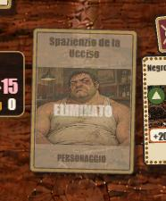
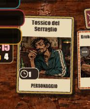
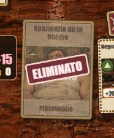
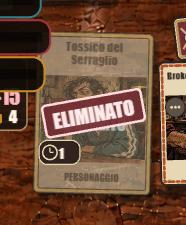
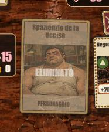
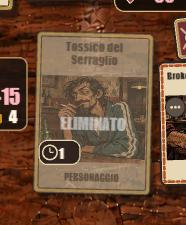

# C4-12 — Eliminazione ed esito dopo la sequenza

11 novembre 2026. **Fase unica fatta, approvata dal proprietario l'11 novembre 2026** dopo il controllo dal vivo («ho fatto il controllo dal vivo mi sembra che vada bene»; alla domanda della regia «Approvi C4-12 e chiudi C4?»: «Approvo, chiudi C4»); C4 chiusa in [C4-9 Fase B](c4-9.md#fase-b-11-novembre-2026). Origine: [prova del proprietario di
C4-9](c4-9.md#prova-del-proprietario-11-novembre-2026). Perimetro nel [piano](../../client-c4-plan.md#c4-12--eliminazione-ed-esito-dopo-la-sequenza).
Base `2ac6357` (commit di soli documenti su `12c586f`; ultimo codice prima del blocco `61ff59f`). Codice in **`7687802`**. Evidenze: [c4-12/](c4-12/).

## Da quando c'è l'anticipo

Ricostruito da codice e `git log -S`, senza giri sulla base:

| Cosa | Da dove legge | Da quando |
|---|---|---|
| Velo e scritta «ELIMINATO»/«FORFAIT» sul posto (`scene.ts`, `draw()`) | dalla **vista** (`character.dead`, `forfeits`) | C1, `82a4080` (27 ottobre 2026) |
| Pannello dell'esito (`table.tsx`, `finished`/`panel`), compresa la propria eliminazione in FFA | dalla **vista** (`over`, `eliminated`) | C1, `82a4080`; «Resta a guardare» (D11) da C2b-3, `ad782ff` |
| Sequenza fino a 20 s, barre che seguono `display` | dalla sequenza | C3-4, `f75d85a` (30 ottobre 2026) |
| Timbro «ELIMINATO» alla coda e striscione «VITTORIA/SCONFITTA/PAREGGIO» alla fine | dalla sequenza | C3-5, `703d96b` (2 novembre 2026) |
| Suono dell'esito legato al pannello (J2) | dal pannello | C4-7-ter, `8c54275` (7 novembre 2026) |

Il velo e il pannello leggevano la vista fin da C1, quando non c'era una sequenza lunga. L'anticipo si vede **da C3-4** (`f75d85a`):
da allora le barre aspettano la sequenza e il velo e il pannello no. Con C3-5 (`703d96b`) si vede doppio: velo subito, timbro alla
coda; pannello subito, striscione alla fine. Da C4-7-ter anche il suono dell'esito arriva in anticipo, insieme al pannello.

## Cosa cambia

- **Posto eliminato** (`scene.ts`): i posti che la sequenza in corso timbra alla coda (`emphasis`: morti e forfait del round) restano
  disegnati come prima finché la coda non comincia, come le barre con `display`; dalla coda (cartello) in poi velo e scritta della
  vista. «FORFAIT» aveva lo stesso difetto e segue la stessa regola. Senza sequenza, o quando la sequenza finisce o si interrompe,
  i segni sono subito quelli della vista. L'etichetta accessibile del posto e le decisioni restano sulla vista (regola 2).
- **Pannello dell'esito** (`table.tsx`): aspetta la fine della sequenza che mostra la fine della partita per chi guarda (striscione
  dell'esito, o il proprio timbro in una FFA che prosegue, D11). Si apre subito se quella sequenza manca (movimento ridotto, salto di
  turni, rientro), è saltata («Salta effetti», tocchi fino alla fine), interrotta (vista nascosta, ridimensionamento, nuova vista) o se
  si apre un dialogo (la sequenza prosegue dietro, come prima). Una volta aperto per una fase della partita (fuori, finita) resta aperto.
  **Limite dichiarato: 22 s** dall'inizio della sequenza (`OUTCOME_WAIT_MS`: il tetto di 20 s per round della regola 9 più 2 s): nessun
  esito resta senza pannello oltre.
- **Audio dell'esito (J2)**: segue il pannello, nello stesso commit del pannello; mentre il pannello aspetta il suono resta in attesa.
  Con la vista nascosta resta annullato come prima.
- **Riga di suggerimento**: mentre il pannello aspetta non mostra «Hai vinto/Hai perso» né «Sei fuori», che anticiperebbero l'esito.
- Funzioni pure in `lifecycle.ts` (`seatMark`, `heldBack`, `outcomeWait`); `model.ts` non cambia; `sound.ts` non cambia.

Movimento ridotto: nessuna sequenza (K3), quindi pannello e segni subito, come prima («alla fine di ciò che si mostra»: il riepilogo statico).

## Attesi cambiati e decisione

- **Nessun atteso di test unitario cambiato.** Test nuovi: [`outcome-after-sequence.test.ts`](../../../client-web/tests/outcome-after-sequence.test.ts)
  (5 test): niente «ELIMINATO» né «FORFAIT» prima della coda, coda dopo l'ultima carta su un round FFA registrato con una morte;
  sequenze di fine partita (duello e propria morte in FFA) che trattengono il pannello; attesa che copre ogni sequenza, striscione
  compreso; pannello garantito senza sequenza, con movimento ridotto, dialogo, già aperto e oltre il limite.
- **`verify-outcome-audio.mjs`**: prima pretendeva il pannello visibile **subito** all'arrivo della vista finale, cioè l'anticipo che
  il proprietario ha visto come difetto. Ora fallisce se il pannello è visibile mentre la sequenza finale gira e pretende il pannello
  alla fine di ogni modo (attesa, tocchi, ✓, salto, ridimensionamento, uscita); con movimento ridotto il controllo è lo stesso di prima
  (pannello subito, nessuna sequenza). Controlla la stessa cosa più l'ordine. Decisione: la prova e la scelta del proprietario
  dell'11 novembre 2026 ([C4-9](c4-9.md#prova-del-proprietario-11-novembre-2026)).
- Strumento nuovo, solo aggiunta: [`c4-12-captures.mjs`](../../../client-web/tools/c4-12-captures.mjs) (catture prima e dopo, non una verifica).

**Mutazioni** sulla logica nuova (7, tutte uccise): segno senza attesa, propria morte non trattenuta, dialogo ignorato, «già aperto»
ignorato, «finito» ignorato, orologio all'indietro che allunga l'attesa, nessun posto trattenuto. Non coperto da test unitari: il
collegamento in `scene.ts` (la pulizia dei posti alla coda) e in `table.tsx`; li coprono le catture e `VerifyOutcomeAudio`.

## Build

| Cosa | Valore |
|---|---|
| Commit | `7687802`, albero pulito (`dirtyPaths` vuoto) per matrice, rilancio e 750×292 |
| Client (`dist`) | 28 file, impronta **`6f8d108e927bd2bd`**, uguale in tutti i giri (anche nelle mirate, fatte prima del commit sullo stesso sorgente) |
| Jar | rifatto dalla matrice: `c193918291c263c0`, riusato (`-ReuseJar`) per il rilancio e per 750×292; server invariato dal C4-9 |
| `Size` | JS gzip 350 290 B (+426 B), totale 1 760 434 B, texture 27 729 048 B (82,6% del tetto di 32 MiB): limiti e tetto verdi |

## Esiti

| # | Verifica | Misure | Esito | Nota |
|---|---|---|---|---|
| 1 | Test del client | — | **333/333** | 328 + 5 nuovi |
| 2 | `Build`, `Size` (con `BM_OUT`), `git diff --check` | — | **verdi** | `size.json` tracciato non toccato |
| 3 | `./scripts/build.ps1 -Task Test -Offline` | — | **verde** | server 658 test, 0 falliti, 7 saltati |
| 4 | `python scripts/check-rules.py` | — | **PASS** | |
| 5 | Mirate: `VerifyFfa`, `VerifyLifecycle` (`VerifyAll -Parallel 2 -Only`) | 1366×768, 844×390 | **7/7** | [riepilogo](c4-12/mirate/run-summary.json) |
| 6 | `VerifyResolution` ridotta (`BM_SCENARIOS=quick,reduced,interrupt,ffa`, senza `-Split`) | 1366×768, 844×390 | **verde** | 0 errori; [1366](c4-12/mirate/resolution-ridotta-1366x768.json), [844](c4-12/mirate/resolution-ridotta-844x390.json) |
| 7 | `VerifyOutcomeAudio`, senza e con la sonda; `check-audio-probe.mjs --require=win,loss` | 1366×768 | **verde, verde, PASS** | pannello mai prima della fine; [sotto](#esito-e-audio) |
| 8 | **Matrice completa** `VerifyAll -Parallel 4 -Split 'resolution,ffa'` | 1366×768, 844×390; `Verify` e `VerifyLayout` anche 1920×1080 | **24/25**, poi **`VerifyAim` 1366×768 verde da solo** | `complete` e `equivalentToConsolidation` veri; parete 43 min 49 s; [riepilogo](c4-12/matrice/run-summary.json), [rilancio](c4-12/matrice/aim-1366x768-rilancio-run-summary.json); rosso nuovo [sotto](#rossi) |
| 9 | Regola 18: `-Measures 750x292 -Only 'test,build,size,verify,ffa,aim,layout'` | 750×292 | **5/7**, come in C4-9 | `Verify` e `VerifyAim` verdi; `VerifyLayout` **noto, voce R1**; `VerifyFfa` **noto, voce R4** ([riepilogo](c4-12/m750/run-summary.json)) |
| 10 | `python scripts/verify-match-manifests.py` | — | **PASS** | `allChecks: PASS` |
| 11 | Contesto Spring (`build.ps1 -Task TestServerContext -Offline`) | — | **verde** | esito separato |

`VerifyResolution` completa nella matrice: 22 controlli per misura come in C4-9, 0 errori. La coerenza del riepilogo
(`reportConsistency`, informativa, non un'asserzione) ha 2–3 round FFA per misura con la salute del resoconto diversa dalla vista,
come nei giri di C4-1b, C4-1c e C4-10: non è un rosso e non riguarda questo blocco.

### Esito e audio

Nei due giri di `VerifyOutcomeAudio` ([senza sonda](c4-12/esito-audio/esito-audio.json), [con sonda](c4-12/esito-audio/esito-audio-sonda.json)):
in tutti i 12 casi con sequenza finale il pannello era trattenuto (`held`) e **mai visibile prima** (`panelEarly` falso); in «uscita»
il pannello si è aperto a 10,27 s su una sequenza di 9,95 s (8,45 su 8,40 con la sonda), cioè alla fine; con «Salta effetti» e
ridimensionamento subito dopo l'interruzione; con movimento ridotto subito, senza sequenza. La sonda: 8 esiti suonati (3 vittorie,
5 sconfitte), 8 pannelli nel DOM, ogni esito avviato nello stesso turno sincrono del pannello ([registro](c4-12/esito-audio/check-audio-probe.txt)).

## Catture

Stesso momento della sequenza, misurato dal suo inizio; «prima» sulla build della base (`2ac6357`, costruita a parte), «dopo» su `7687802`.
Partite reali contro computer, diverse fra prima e dopo ([dati](c4-12/catture/catture.json)). 1366×768, Edge via Playwright.

**FFA, eliminazione di un computer** (prima: turno con «Spazienzio de la Ucciso» eliminato; dopo: «Tossico del Serraglio»):

| Momento | Prima | Dopo |
|---|---|---|
| 250 ms prima della coda |  velo e «ELIMINATO» già sul posto |  personaggio pieno |
| 350 ms dopo l'inizio della coda |  |  timbro e velo insieme |
| 400 ms dopo la fine |  |  |

Tavolo intero 250 ms prima della coda: [prima](c4-12/catture/c4-12-ffa-prima-1366x768-coda-250.jpg), [dopo](c4-12/catture/c4-12-ffa-dopo-1366x768-coda-250.jpg).

**Duello, esito** (prima: «Hai perso»; dopo: pareggio, entrambi eliminati nello stesso turno):

| Momento | Prima | Dopo |
|---|---|---|
| 250 ms prima della coda | [pannello «Hai perso» già aperto](c4-12/catture/c4-12-duel-prima-1366x768-coda-250.jpg), sequenza ancora in corso | [tavolo, sequenza in corso, nessun pannello né suggerimento](c4-12/catture/c4-12-duel-dopo-1366x768-coda-250.jpg) |
| 400 ms dopo la fine | [pannello](c4-12/catture/c4-12-duel-prima-1366x768-fine+400.jpg) | [pannello «Pareggio»](c4-12/catture/c4-12-duel-dopo-1366x768-fine+400.jpg) |

Nella prima partita FFA «dopo» il giocatore è stato eliminato con un salto di quattro turni (nessuna sequenza): pannello subito, come
deve. Le catture sono state ripetute fino a una FFA con un'eliminazione animata (una partita in più).

## Rossi

- **`VerifyAim` 1366×768 nella matrice: rosso nuovo, non del prodotto, non nel registro.** Scenario `keyboard-ffa` (movimento ridotto,
  quindi **nessuna** sequenza e nessuna attesa di C4-12): il giocatore è stato eliminato al terzo turno e la FFA è finita con un salto
  di 17 turni; il pannello si è aperto subito ([cattura](c4-12/matrice/aim-keyboard-ffa-end-1366x768.jpg)). Lo script (`kbdLeave`,
  C4-8a `fe7b0ed`) raggiunge «Nuova partita» col Tab, preme Invio e aspetta una mano entro 30 s; in FFA «Nuova partita» ripete la FFA
  (`session.leave('again')` → coda con la lista dei posti, D11 di C2b), quindi la mano non arriva e il Tab non trova più il menu:
  ««Nuova partita» from the keyboard did not start a game», «Tab never reaches the menu». Il ramo dello script fallisce ogni volta
  che `keyboard-ffa` arriva a un esito, con qualunque build; in C4-8a e C4-9 lo scenario era sempre finito senza esito (6 turni,
  uscita dal menu). **Rilanciato da solo: verde** (stessa build). **Non riprovato sulla base**: il ramo dipende da una partita che
  finisce entro sei turni, non si riproduce a comando; l'attribuzione è dal codice (`session.ts` e `verify-aim.mjs` non toccati,
  C4-12 inerte con movimento ridotto). Domanda 1.
- **`VerifyLayout` 750×292: noto, voce R1.** `layoutProblems` per turno duello 6/6/6, FFA 11/11/11, 47 problemi.
- **`VerifyFfa` 750×292: noto, voce R4.** `queueExit` verde, poi al turno 0 i **13 messaggi** della voce (4+4 sovrapposizioni fra il
  proprio posto e un computer, 1 ventaglio sopra il proprio posto, 4 «over the hand»).

R2 (cadenza) non si è presentata: aim e layout verdi nella fase da sole, salvo il rosso sopra, che non è di cadenza. R3 non si è presentata: contesto Spring **775 test, 0 falliti, 7 saltati**, come in C4-9.

## Non verificato e limiti dichiarati

- Il collegamento fra scena e pannello non ha test unitari (Pixi e React): lo provano `VerifyOutcomeAudio`, le catture e la prova dal vivo.
- Le catture sono una partita per caso e per build, a 1366×768; i momenti sono presi con un'attesa sull'orologio della pagina (±50 ms).
- iPhone e Safari non provati; la prova dal vivo è su desktop.
- La FFA con la propria eliminazione **animata** (D11, «Resta a guardare» dopo lo striscione) non è nelle catture: nella partita
  automatica la propria morte è arrivata con un salto di turni. È coperta dai test unitari (`heldBack` con la propria morte) e va
  guardata nella prova dal vivo.
- Il limite di 22 s non è mai scattato nei giri (le sequenze finali durano 8–19 s): è provato dai test unitari.

## Per il controllo dal vivo del proprietario

Server con DB dedicato e `./client-web/run.ps1 -Task Physical` (o `Serve`), 1366×768 o la tua misura, movimento non ridotto.

1. **FFA con un'eliminazione.** «Tutti contro tutti», quattro computer. Gioca finché un personaggio muore: durante il turno la sua
   carta resta normale; il timbro «ELIMINATO» e il velo compaiono insieme, dopo tutte le carte del turno. Se muori tu: niente
   «Sei fuori dalla partita» finché il turno non ha finito di scorrere, poi il pannello con «Resta a guardare»; restando a guardare,
   l'esito finale arriva dopo lo striscione dell'ultimo turno.
2. **Duello fino all'esito.** «Contro il computer», gioca fino alla fine e lascia scorrere l'ultimo turno: lo striscione
   «VITTORIA/SCONFITTA/PAREGGIO», poi il pannello e il suono dell'esito. Nessun pannello né scritta in basso prima.
3. **Sequenza saltata.** In un'altra partita, all'ultimo turno apri il menu e premi «Salta effetti» (oppure tocca il tavolo fino alla
   fine): il pannello compare subito dopo il salto. Con il menu aperto il pannello è già dietro il dialogo.

Da giudicare: se l'attesa del pannello è giusta o se il pannello va anticipato allo striscione (oggi si apre a fine sequenza, cioè dopo
lo striscione); se togliere la riga di suggerimento durante l'attesa va bene.

## Domande al proprietario

1. **Rosso di `VerifyAim` `keyboard-ffa`.** È un ramo dello script, non del client: (a) lo registro come voce R5 nel registro dei rossi
   noti e lo correggo nello script in un blocco a parte (in FFA, dopo «Nuova partita» uscire dalla coda invece di aspettare una mano);
   (b) lo correggo dentro C4-12 prima della tua prova, rifacendo `VerifyAim` alle due misure. Raccomandazione: **(a)**, perché non tocca
   il client e la matrice è già sulla build finale.
2. **La prova dal vivo** (sopra): il giudizio con le tue parole; «C4 chiusa» lo scrive C4-9 Fase B.

**Risposta del proprietario (11 novembre 2026)** alla domanda 1: «R5, fix it later». Il rosso è registrato come [R5](../rossi-noti.md) nel registro dei rossi noti; la correzione dello script (`kbdLeave` in `verify-aim.mjs`: in FFA, dopo «Nuova partita», uscire dalla coda invece di aspettare una mano) va in un blocco a parte, dopo. Nessun codice cambia: la matrice di C4-12 resta valida.
