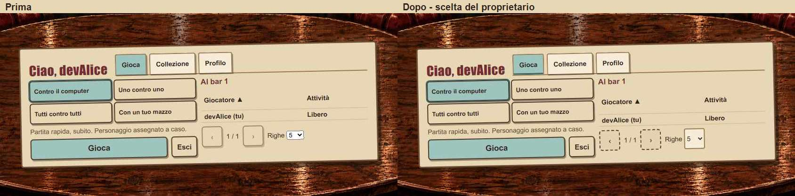
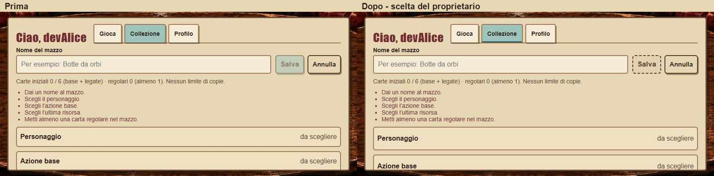
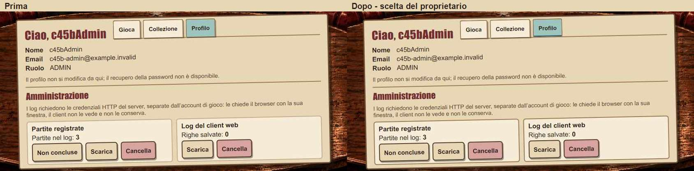
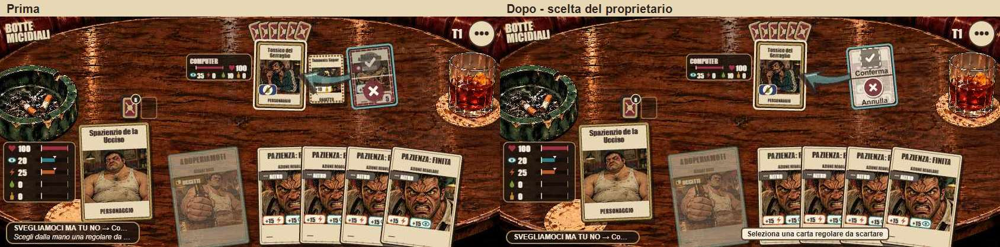
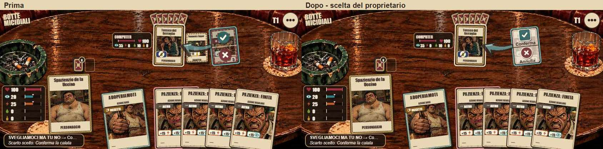

# C4-5b — Prima e dopo

Stessi percorsi e misure 844×390. A generale, B di calata, invito singolo allo scarto. Partite e avversari possono variare: non è un confronto pixel per pixel della stessa vista autorevole. [Tutte le schermate dopo](../dopo/README.md), [scelte](../../../../design/client-c4/screens/scelte.md).

## Hub e Al bar

## Editor incompleto

## Amministrazione

## Scarto richiesto

## Conferma pronta

